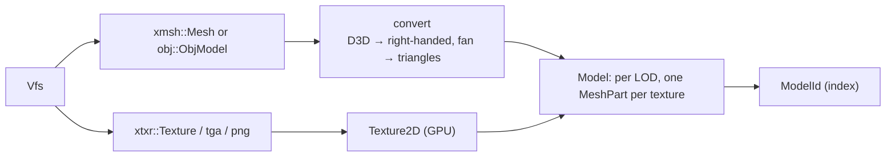

# Assets and GPU cache

`src/assets.rs`: converts parsed meshes and images into GPU resources once, and hands out cheap
handles. Plan: Stage 1, item 1.3.

## Architecture Overview

Logic flow when drawing: pick the LOD from the distance → for each `MeshPart`, transform its
vertices into camera-relative space on the CPU and apply sun lighting to vertex colours →
`draw_mesh`.

## Key Symbols

| Symbol | What it is |
|---|---|
| `ModelId`, `TextureId` | Newtypes around `u32`: an index into the cache. Cheap to copy and store in the sim. |
| `Model` | Bounding radius, box, `lods: Vec<LodMesh>`, attachment points. |
| `LodMesh` | Switch distance and `parts: Vec<MeshPart>`. |
| `MeshPart` | Vertices (`Vec<Vertex>`), triangle indices (`Vec<u16>`) and a `TextureId`, ready for `draw_mesh`. |
| `Assets` | Owns all models and textures; `model(name) -> Result<ModelId>` loads on first use. |

## API Reference

- `Assets::new(&Vfs)`; `Assets::model(&mut self, name) -> Result<ModelId>`;
  `Assets::get(ModelId) -> &Model`.
- Conversion lives in plain functions so it can be unit tested without a GPU.

## Debugging

The model viewer scenario shows any model with LOD and texture toggles. Missing textures render
in a magenta checker, so they stand out.
