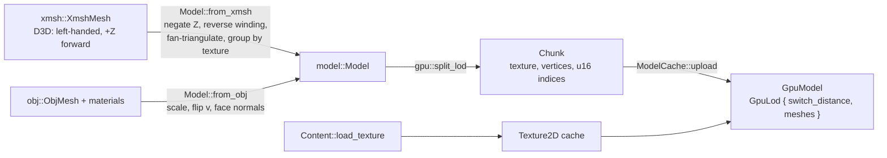

# Assets and GPU cache

Two steps turn a file into something drawable:

1. `src/model.rs` converts an `XmshMesh` or `ObjMesh` into the format-neutral **`Model`**, once,
   at load time (pure CPU data, unit-tested).
2. `src/render/gpu.rs` splits each LOD into **per-texture chunks** with `u16` indices
   (`split_lod`, pure, tested) and uploads them as macroquad `Mesh`es with their textures
   (`ModelCache`).

Plan: Stage 1.

## Architecture Overview

Engine coordinates everywhere above the formats layer: **right-handed, +Y up, −Z forward,
metres**. The original models use Direct3D's left-handed system with +Z forward, so
`from_xmsh` negates Z and swaps two indices of every triangle so faces still point outwards
(a unit test checks the winding).

Collision shapes come from the same data: `Model::collision_lod()` (the cheapest LOD) gives
triangles for station meshes in `app::flight::FlightSession::start`.

## Key Symbols

| Symbol | What it is |
|---|---|
| `model::Model` | `name`, `radius`, `bounds_min/max`, `lods: Vec<ModelLod>` (never empty), `attachments`. |
| `model::ModelLod` | `switch_distance`, `vertices: Vec<ModelVertex>`, `groups: Vec<MaterialGroup>`. |
| `model::MaterialGroup` | `texture: Option<String>` and triangle `indices: Vec<u32>`. |
| `model::Attachment` | A point and facing from an original *manipulator* (e.g. engine exhaust). |
| `render::gpu::Chunk` | CPU-side chunk ready to become a `Mesh` (≤ `MAX_CHUNK_VERTICES` = 16 000). |
| `render::gpu::GpuModel` | GPU LODs plus the CPU `Model` (kept for stats and collision). |
| `render::gpu::ModelCache` | `(reference, pack) → Option<Rc<GpuModel>>` and texture caches; failures recorded in `errors`. |

## API Reference

- `Model::from_xmsh(&XmshMesh)`, `Model::from_obj(name, &ObjMesh, scale, &[ObjMaterial])`.
- `model.lod_for_distance(d)`, `model.collision_lod()`, `lod.triangle_count()`,
  `lod.triangles() -> impl Iterator<Item = [Vec3; 3]>`.
- `gpu::split_lod(&ModelLod) -> Vec<Chunk>`.
- `ModelCache::get(&Content, reference, pack, scale) -> Option<Rc<GpuModel>>`;
  `GpuModel::lod(distance)`.

## Debugging

- The **model viewer** (launcher → Model viewer) shows each model's LOD triangle counts and
  switch distances, forces a LOD with `L`, and draws attachment points as RGB axes.
- A model drawn inside-out or mirrored points at the handedness conversion; a model that is
  missing shows "could not load" with the `ModelCache` error underneath.
- Textures that fail to load leave the group white (macroquad's default texture).
