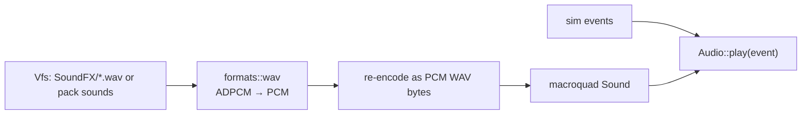

# Audio

`src/audio.rs`: plays sound effects through macroquad's audio. Plan: Stage 1 (weapons), grown in
Stage 2 (`soundfx.ini`) and Stage 5 (music).

## Architecture Overview

## Key Symbols

| Symbol | What it is |
|---|---|
| `Audio` | Loaded sounds by name; `play(name, volume)`. Missing sounds are silently skipped (logged once). |

## API Reference

- `Audio::load(&Vfs, &Rules)`; `Audio::on_event(&Event)`.

## Debugging

`--no-audio` disables sound for a run.
