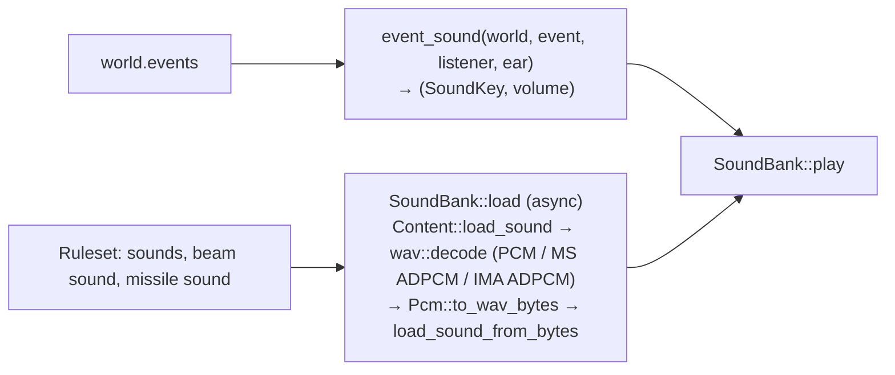

# Audio

`src/audio.rs`: sound effects driven by simulation events. Plan: Stage 1 (event sounds);
music loops and CD audio are Stage 5.

## Architecture Overview

`event_sound` is pure and tested: beam and missile sounds use the firing ship's weapon;
hits use `shield_hit` or `hull_hit`; destruction uses `big_explosion` for objects with radius
over 100 m, else `explosion` (always at least 15 % volume); `lock` and `denied` only for the
listener; since Stage 2, `system_damage` when one of the listener's systems is damaged
(`SystemChanged`, not repairs), `tractor` / `cloak` / `ecm` when a switchable system goes on or
off (`Switched`; quieter when switching off, attenuated for other ships) and `hyperspace` when a
ship jumps out (`Departed`), `point_defence` for each point-defence shot (`PointDefence`, at 40 %
of the distance volume); a destruction whose model set's `destroyed_effect`, or a missile blast
whose `explosion` effect, has a `sound` plays that sound instead of the usual event; everything else is attenuated by distance (`attenuate`: full within 50 m, half at
about 350 m).

**Cue table (Stage 2, item 2.12).** Sound references are resolved when the rules load
(`rules::build_at`): a reference written `cue:<Name>` is looked up in the table named by
`audio.cue_table` — `original:<file>/<section>` of an original INI file, the original game's
`soundfx.ini` — whose entry's file name becomes `original:<file>.wav`. By the time `SoundBank`
loads, every reference is an ordinary asset, so cues need no run-time code. Unknown cues and a
missing table are load errors.

Playback uses macroquad's `audio` feature (quad-snd: CoreAudio on macOS, ALSA on Linux).

## Key Symbols

| Symbol | What it is |
|---|---|
| `SoundKey` | `Named(&'static str)`, `Beam(u16)`, `Missile(u16)`. |
| `NAMED` | The sixteen event names: `explosion`, `big_explosion`, `shield_hit`, `hull_hit`, `lock`, `missile_launch`, `afterburner`, `target`, `denied`, `collision`, and since Stage 2 `system_damage`, `tractor`, `cloak`, `ecm`, `hyperspace`, `point_defence`. |
| `SoundKey::Effect(i)` | The sound of effect `i` (an event name from `sounds:` or an asset in the effect's pack), loaded with the bank. |
| `SoundBank` | Decoded sounds by key, and `errors` for sounds that failed. |

## API Reference

- `SoundBank::load(&Content).await`, `bank.play(&SoundKey, volume)`,
  `bank.play_events(&World, listener, ear)`.
- `event_sound(&World, &SimEvent, ShipId, Vec3) -> Option<(SoundKey, f32)>`, `attenuate(distance)`.

## Debugging

- Sounds that fail to load are printed at start-up as `sound: …` lines; `--check` loads every
  referenced sound too.
- No sound at all on Linux: the build needs the ALSA development package (`libasound2-dev`).
- A `cue:` sound that is silent: `--check` names unknown cues (`sounds.x: unknown sound cue 'Y'`);
  if the cue resolves, the asset browser shows whether the original file (or its override)
  loads.
