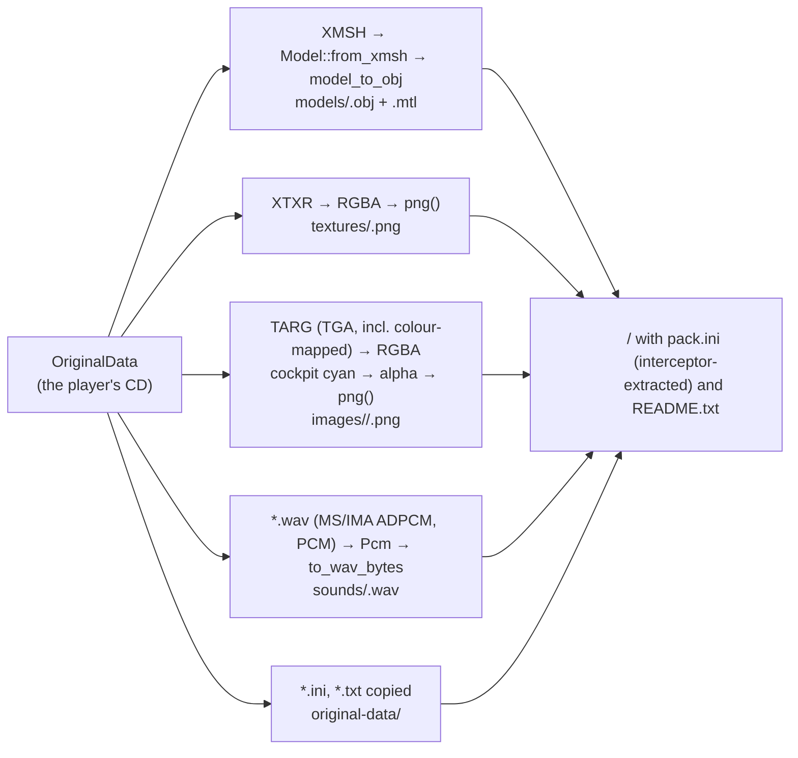

# Extractor (`--extract`)

`src/extract.rs`: converts the player's original data into formats every tool edits, writing
each file **at its override path** so an edited copy dropped into a mod replaces the original.
Plan: Stage 1 (first version); Stage 6 polishes the modding toolkit.

## Architecture Overview

- **Models**: the most detailed LOD, in the engine's convention (metres, +Y up, nose along
  −Z), so positions are written unchanged; texture `v` is flipped back (`1 − v`) because
  `Model::from_obj` flips it on load — a round trip is exact (unit-tested). Textured groups
  get `map_Kd ../textures/<tex>.png`; untextured faces become `flat_rrggbb` materials with a
  `Kd` colour. Materials are kept in a `BTreeMap` so the output is identical run to run.
- **Images**: the original cockpits mark see-through areas with cyan (`0x03DF`); for cockpit
  DLLs that becomes alpha 0. Sprites and menu art use colour-mapped TGA, also decoded.
- On the full CD: 297 models, 799 textures, 3244 images, 792 sounds, 27 reference files,
  0 errors, about 2.4 s and 195 MB.

The output is the player's own copy of copyrighted content: personal modding only, never to be
shared or committed. The README written into the folder says so.

## Key Symbols

| Symbol | What it is |
|---|---|
| `ExtractReport` | Counts per kind plus error messages; `summary()`. |
| `model_to_obj(&Model, name) -> (obj, mtl)` | OBJ + MTL text for LOD 0. |
| `png(&Image) -> Result<Vec<u8>, String>` | PNG encoding via the `image` crate. |
| `pack_files() -> (pack.ini, README)` | The texts written at the top of the folder. |

## API Reference

- `extract::run(&Content, out: &Path) -> Result<ExtractReport, String>` — errors if no
  original data is loaded; individual asset failures go into the report.
- CLI: `openinterceptor --extract <DIR>` (exits 1 if any asset failed).

## Debugging

- Each failure names the asset (`image spritesdll.dll#28771: …`). The extractor shares every
  reader with the game, so a failure here is also a failure in play — fix the reader, add a
  unit test with a synthetic file.
- To check an override end to end, copy one extracted file into a mod at the same relative
  path and open the launcher's Asset browser: it shows `[overridden by <mod>]`.
