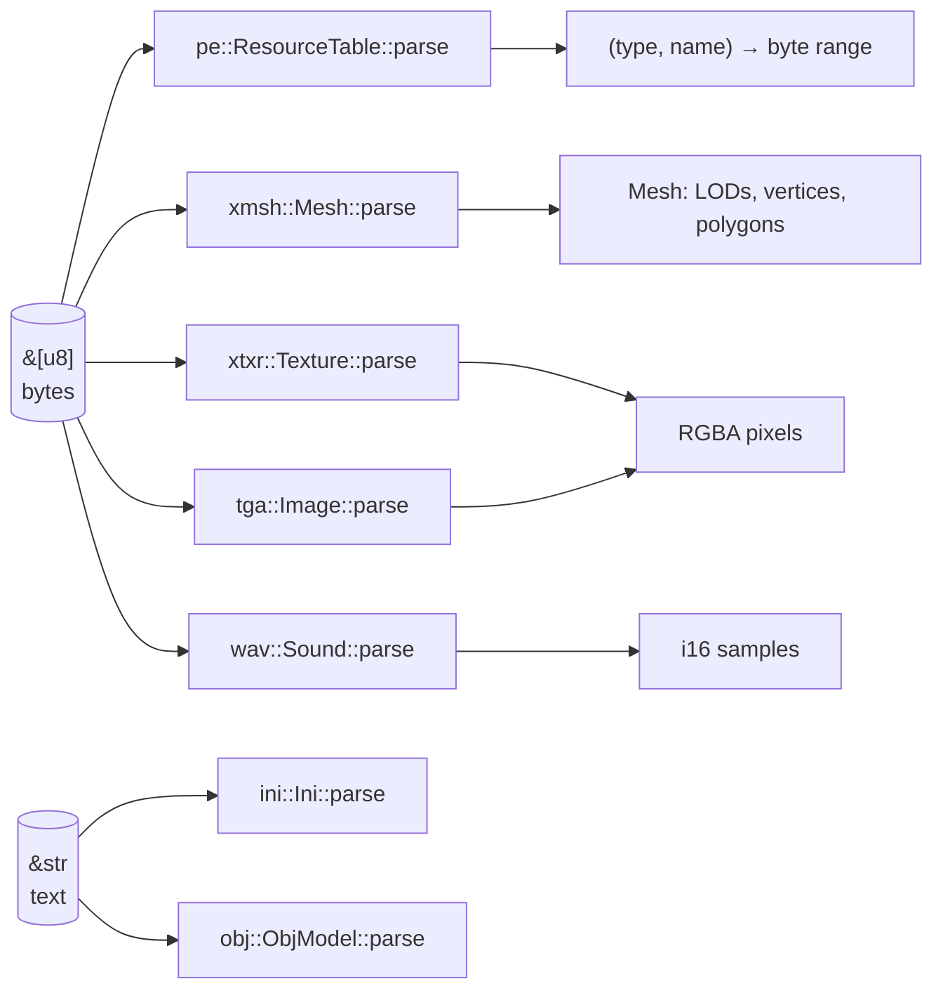

# Formats layer

`src/formats/`: readers for every file format, each a pure function from bytes to a plain Rust
value. No file system, no GPU, no global state — which is why every reader has unit tests that
run on small byte arrays built in the test itself. Plan: [Stage 1, item 1.1](../implementation-plan/stage-1-flight.md).

## Architecture Overview



Logic flow for a mesh: read the header → for each LOD offset, read counts and offsets → read
vertices, edges and texture names → walk the BSP tree from the root, collecting each node's
polygons → turn each polygon's signed edge loop into a list of vertex indices.

## Key Symbols

| Symbol | What it is |
|---|---|
| `FormatError` | An `enum` listing the ways bytes can be wrong (too short, bad tag, offset out of range). Every reader returns `Result<T, FormatError>` instead of panicking. |
| `Reader<'a>` | A small cursor over a borrowed byte slice with `u32()`, `f32()` and `at(offset)` helpers that check bounds. The `'a` lifetime says it cannot outlive the bytes it reads. |
| `pe::ResourceTable` | Maps `(type, name)` to the byte range of each resource in a DLL. |
| `xmsh::Mesh` | A mesh: `lods: Vec<Lod>`, each with `vertices`, `polygons`, `textures`, `manipulators`. |
| `xtxr::Texture` | Width, height and RGBA pixels from palette 0, flipped to top-down rows. |
| `tga::Image` | Width, height, RGBA; `colour_key` turns a chosen colour transparent. |
| `wav::Sound` | Sample rate, channels and decoded `i16` samples (PCM or MS-ADPCM). |
| `ini::Ini` | Ordered sections of ordered key/value pairs, case-insensitive lookup. |
| `obj::ObjModel` | Positions, UVs, normals and faces grouped by material and object. |

## API Reference

```rust
// Every reader has this shape: borrowed input, owned output, an error instead of a panic.
pub fn parse(bytes: &[u8]) -> Result<Mesh, FormatError>;
```

- `pe::ResourceTable::parse(&[u8]) -> Result<ResourceTable>`; `get(kind, name) -> Option<&[u8]>`
  borrows into the DLL bytes, so nothing is copied.
- `xmsh::Mesh::parse(&[u8]) -> Result<Mesh>`.
- `xtxr::Texture::parse(&[u8]) -> Result<Texture>`.
- `tga::Image::parse(&[u8]) -> Result<Image>`.
- `wav::Sound::parse(&[u8]) -> Result<Sound>`.
- `ini::Ini::parse(&str) -> Ini`; `get(section, key) -> Option<&str>`.
- `obj::ObjModel::parse(&str) -> Result<ObjModel>`.

## Debugging

- A failing resource name is in the error message; reproduce with `--check`.
- Prototype dumps are a good first look: hex-dump a resource (`xxd`) and compare with the
  [format page](../original-game/formats/index.md).
- Unit tests build minimal valid inputs by hand; add one for any input that once failed.
