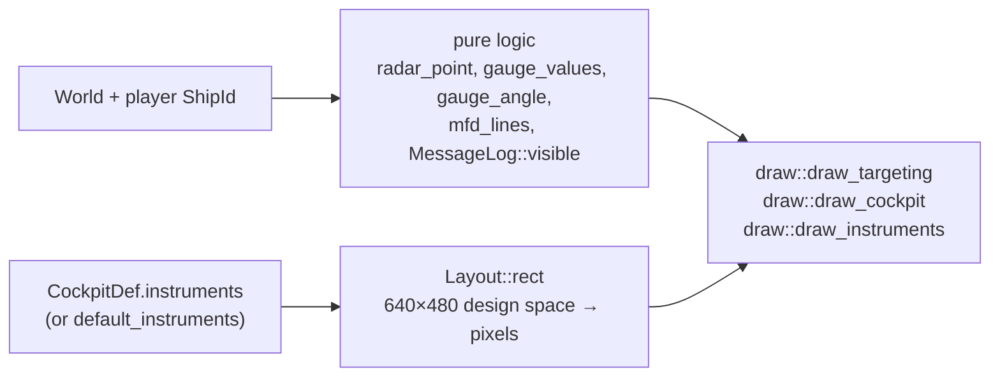

# Cockpit and HUD

`src/hud/`: the 2D layer over the 3D view. `hud/mod.rs` holds the pure logic (tested);
`hud/draw.rs` paints it with macroquad (verified by [manual tests](../testing/manual-tests.md)).
Plan: Stage 1.

## Architecture Overview

**Design space.** Cockpit art is 640×480; instruments are placed in that space
(`Instrument.mfd = x, y, w, h` in the rules). `Layout::new(screen)` scales by height and centres
horizontally, so a 4:3 cockpit sits in the middle of a wide screen.

**Instruments** (names used in cockpit rules):

| Name | Shows |
|---|---|
| `radar_front`, `radar_rear` | Contacts in the front / rear hemisphere; distance from the centre = angle off the axis (rim = 90°); rear scope mirrored left/right. Faction colours; stations drawn larger; the target boxed. Mobile contacts beyond `[flight] RadarRange` are hidden. |
| `mfd` | One of four pages (`MfdPage`): Target (name, faction, range, speed, shields, armour, hull, lock state), Weapons (beams, link mode, racks with the selected one marked `>`), Status (own shields/armour/hull/energy), Nav. |
| `gauge1`–`gauge4` | Needles for speed, energy, shields, hull (red below 25 %). |
| `message` | The newest message younger than 4 s. |

Ships without cockpit art, and the non-cockpit views, use **glass instruments**
(`default_instruments()` with dark backgrounds). A throttle/speed/REV/BURN/VCT strip is
drawn under the message line.

**Targeting** (forward views): a reticle; corner brackets sized by the target's angular size;
name and range; a lead circle (where to aim beams); a lock-progress ring, then a red lock
diamond and `LOCK`; an arrow on a ring when the target is off-screen. Nav points draw a blue
diamond.

## Key Symbols

| Symbol | What it is |
|---|---|
| `Layout` | `scale` and `offset`; `rect([x, y, w, h])`. |
| `radar_point(local_dir, front) -> Option<Vec2>` | Where a contact goes on a scope (unit disc). |
| `gauge_angle(fraction)`, `gauge_values(&Ruleset, &Ship) -> [f32; 4]` | Needle maths. |
| `MfdPage`, `mfd_lines(&World, ShipId, page, nav) -> Vec<String>` | MFD content. |
| `MessageLog` | Timestamped messages; `push`, `visible(now, n)`; bounded to 32. |
| `draw::HudFrame` | Everything a draw call needs that is not in the world. |

## API Reference

- `hud::default_instruments()`, `format_distance(m)`, `faction_color(&Ruleset, FactionId)`, `DESIGN`, `MESSAGE_TIME`.
- `draw::draw_instruments(&HudFrame)`, `draw_targeting(&HudFrame)`, `draw_cockpit(&Texture2D, Layout)`, `draw_caption`.

## Debugging

- If instruments sit in the wrong place on a cockpit, adjust the `Instrument.*` rectangles in
  the cockpit's rules section — no code change needed; positions are in 640×480 pixels of the
  art.
- The original cockpits' cyan colour key becomes transparent black on load; a cyan halo means
  the key was not applied (`load_image(.., colour_key = true)`).
