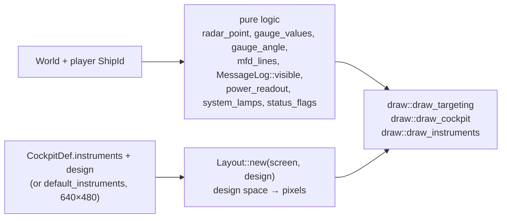

# Cockpit and HUD

`src/hud/`: the 2D layer over the 3D view. `hud/mod.rs` holds the pure logic (tested);
`hud/draw.rs` paints it with macroquad (verified by [manual tests](../testing/manual-tests.md)).
Plan: Stage 1; Stage 2 added the `power` and `systems` instruments, status flags and the MFD
Systems page.

## Architecture Overview

**Design space.** Instruments are placed in a cockpit's *design space*
(`Instrument.mfd = x, y, w, h` in the rules). The original cockpits use 640×480, the default;
a cockpit can declare its own with `Design = w, h` (the `default` campaign's Guard cockpit uses 1280×720).
`Layout::new(screen, design)` scales the design space as large as fits
(`min(screen.w / design.w, screen.h / design.h)`) and centres it: a 4:3 cockpit fills the
height of a 16:9 screen with space visible at the sides; a 16:9 design fills it exactly. The
cockpit image is stretched to the whole design space (`Layout::full`), whatever its pixel
size — which is why an HD repaint (e.g. 2560×1920 replacing a 640×480 original) keeps every
instrument aligned without changing a rule.

**Instruments** (names used in cockpit rules):

| Name | Shows |
|---|---|
| `radar_front`, `radar_rear` | Contacts in the front / rear hemisphere; distance from the centre = angle off the axis (rim = 90°); rear scope mirrored left/right. Faction colours; stations drawn larger; the target boxed. Mobile contacts beyond `[flight] RadarRange` are hidden. |
| `mfd` | One of five pages (`MfdPage`): Target (name, faction, range, speed, shields, armour, hull, lock state), Weapons (beams, link mode, racks with the selected one marked `>`), Status (own shields with balance, armour/hull/energy, and the power line `BEAM x SHLD y PWR used/budget`), Systems (one line per fitted system: `OK`, `ON`, `DMG n%`, `OUT`, `DESTROYED`, `*` while being repaired), Nav. |
| `gauge1`–`gauge4` | Needles for speed, energy, shields, hull (red below 25 %). |
| `message` | The newest message younger than 4 s. |
| `power` | `B-<level>` and `S-<level>` columns (charge settings), fore/aft shield bars with the favoured facing marked, `used/budget` in yellow when the budget is full (`power_readout`). |
| `systems` | A grid of lamps, one per fitted system with a three-letter label (`system_abbrev`): green OK, cyan switched on, amber damaged, red knocked out (blinking while repaired), grey destroyed (`system_lamps`, `Lamp`). |

**Fallback panels.** A cockpit that does not place `power` or `systems` gets them as small
panels at the top right of its *own design space* — x from 87.5 % of the design width, y from
9 % of its height — with a dark backdrop over cockpit art. The glass layout
(`default_instruments`) places both along the bottom.

Ships without cockpit art, and the non-cockpit views, use **glass instruments**
(`default_instruments()` with dark backgrounds). A throttle/speed/REV/BURN/VCT strip is
drawn under the message line, extended with `BRAKE` while braking and `HOLD n` while the
flight computer holds a speed, and the Stage 2 status flags (`status_flags`): `DISABLED`,
`CLOAKED`, `TRACTOR`, `ECM`, `JUMP n` (hyperspace countdown).

**Targeting** (forward views): a reticle; corner brackets sized by the target's angular size;
name and range; a lead circle (where to aim beams); a lock-progress ring, then a red lock
diamond and `LOCK`; an arrow on a ring when the target is off-screen. Nav points draw a blue
diamond.

## Key Symbols

| Symbol | What it is |
|---|---|
| `Layout` | `scale`, `offset`, `design`; `new(screen, design)`, `rect([x, y, w, h])`, `full()`. |
| `radar_point(local_dir, front) -> Option<Vec2>` | Where a contact goes on a scope (unit disc). |
| `gauge_angle(fraction)`, `gauge_values(&Ruleset, &Ship) -> [f32; 4]` | Needle maths. |
| `MfdPage`, `mfd_lines(&World, ShipId, page, nav) -> Vec<String>` | MFD content. |
| `MessageLog` | Timestamped messages; `push`, `visible(now, n)`; bounded to 32. |
| `PowerReadout`, `power_readout(&Ruleset, &Ship)` | What the `power` instrument shows: levels, steps used and budget, balance, fore/aft fractions. |
| `Lamp`, `system_lamps(&Ship)`, `system_abbrev(SystemKind)` | The `systems` instrument's lamps. |
| `status_flags(&Ship) -> Vec<String>` | The status-strip flags. |
| `draw::HudFrame` | Everything a draw call needs that is not in the world. |

## API Reference

- `hud::default_instruments()`, `format_distance(m)`, `faction_color(&Ruleset, FactionId)`, `DESIGN`, `MESSAGE_TIME`.
- `draw::draw_instruments(&HudFrame)`, `draw_targeting(&HudFrame)`, `draw_cockpit(&Texture2D, Layout)`, `draw_caption`.

## Debugging

- Power and systems panels appearing at the top right mean the cockpit has no
  `Instrument.power` / `Instrument.systems` rectangles; add them to place the instruments.
- In a 3D cockpit, instruments that drift off their bezels on a narrow window point to a
  `Design` that does not match the proportions the bezels were measured at; the field of view
  widens to fit the design's width (`app::flight::cockpit_fov`), see
  [Cockpits](../modding/cockpits.md).
- If instruments sit in the wrong place on a cockpit, adjust the `Instrument.*` rectangles in
  the cockpit's rules section — no code change needed; positions are in the cockpit's design
  space (640×480 unless `Design` says otherwise), not in the image's pixels.
- The original cockpits' cyan colour key becomes transparent black on load; a cyan halo means
  the key was not applied (`load_image(.., colour_key = true)`).
