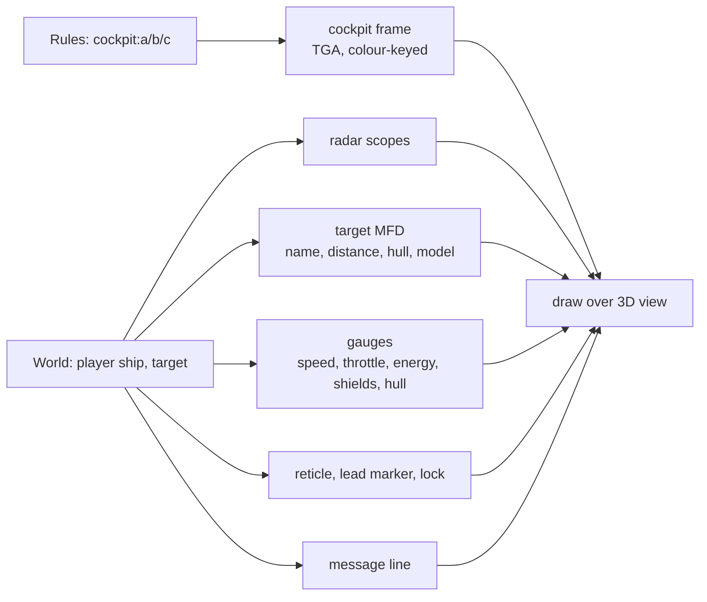

# Cockpit and HUD

`src/hud/`: the cockpit frame and every instrument. Plan: Stage 1, item 1.9.

## Architecture Overview

The 640×480 cockpit art is scaled to the window height and centred; instrument positions are
given in 640×480 coordinates in the `cockpit:` rules, so a modder can move them. In the
full-forward and chase views a minimal HUD is drawn instead.

## Key Symbols

| Symbol | What it is |
|---|---|
| `Hud` | Loaded cockpit textures and instrument layout for the current ship. |
| `CockpitLayout` | Rectangles for radar, MFD, gauges and message line in 640×480 space. |
| `Messages` | A short queue of timed text lines (target destroyed, weapons linked…). |

## API Reference

- `Hud::new(&Rules, &Assets, cockpit_id)`; `Hud::draw(&mut self, &World, view)`.

## Debugging

`--hud-layout` draws the instrument rectangles over the cockpit to check positions.
