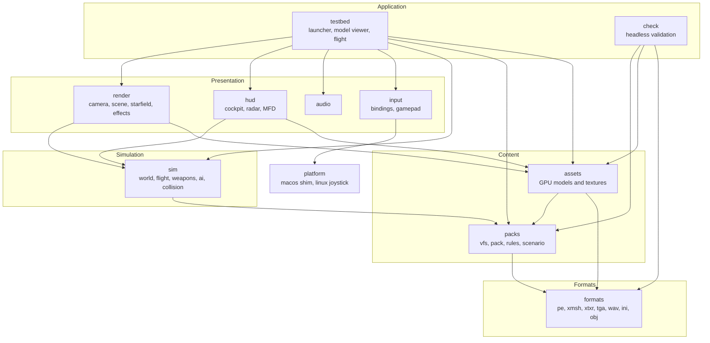
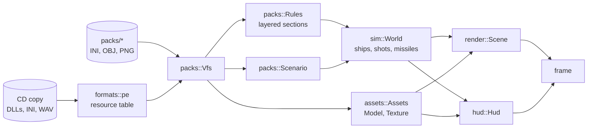
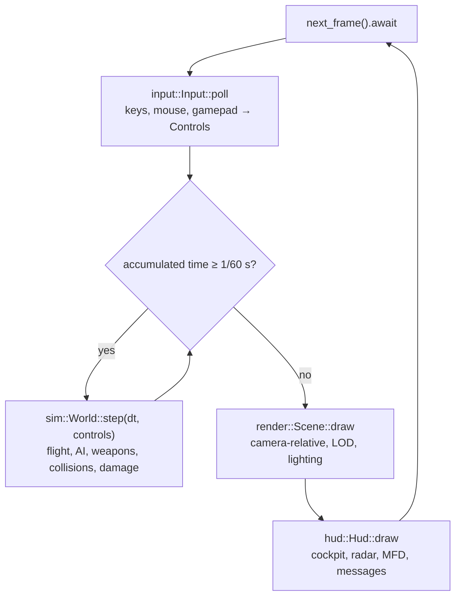

# Architecture

OpenInterceptor is one Rust binary, `openinterceptor` (crate `openinterceptor`, `src/main.rs`),
with one dependency, macroquad. It is built in **layers**: each layer uses only the layers below
it, so the lower layers can be tested without a window and reused by tools.

!!! note "Status"
    Written at the start of Stage 1. Symbol names are the planned ones; each page is updated as
    its module is built. No specification exists yet, so plan stages are cited instead of
    requirement IDs.

## Architecture Overview

### Layers

`sim` never calls `render`, `hud` or macroquad: it is plain data updated at a fixed rate, which
is what makes it testable and deterministic.

### Data flow: from the CD to a frame

### Logic flow: one frame

## Key Symbols

| Symbol | Kind | What it is, in plain words |
|---|---|---|
| `main` | function | Reads command-line flags, then either runs `check` or opens the window and runs the testbed. |
| `Vfs` | struct | One place to ask for a file by name, whether it is in a pack folder or inside an original DLL. |
| `Rules` | struct | Every rule section after all packs are layered: "what is a Lightning, what is a laser". |
| `Assets` | struct | Owns the GPU copies of models and textures, loaded once and shared by id. |
| `World` | struct | The state of the battle: ships, shots, missiles. Changed only by `World::step`. |
| `Scene` | struct | Draws a `World` with `Assets` from a camera. |
| `Hud` | struct | Draws the cockpit and instruments for the player's ship. |

## API Reference

Each layer's public API is on its own page: [Formats](formats.md), [Packs](packs.md),
[Assets](assets.md), [Simulation](sim.md), [Rendering](rendering.md), [HUD](hud.md),
[Input](input.md), [Audio](audio.md), [Platform](platform.md), [Testbed](testbed.md).

## Debugging

- `--check` loads everything without a window and prints what failed and why.
- `RUST_LOG`-style verbosity: `--verbose` prints pack loading and rule layering.
- The testbed's developer overlay (`F12`) shows FPS, object counts, the player's speed,
  angular rates and the current target's state.
- `RUST_BACKTRACE=1` for a panic's stack trace (panics are bugs: bad data must give an error).
