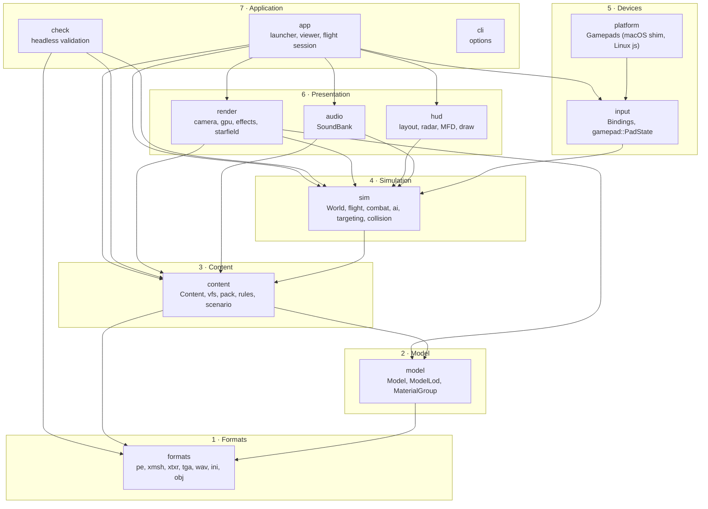
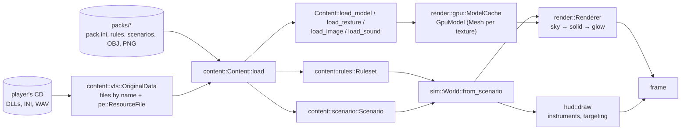
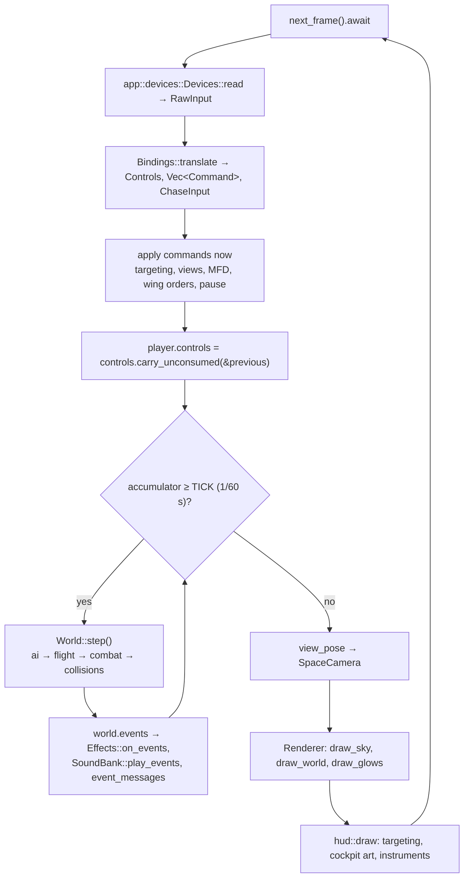
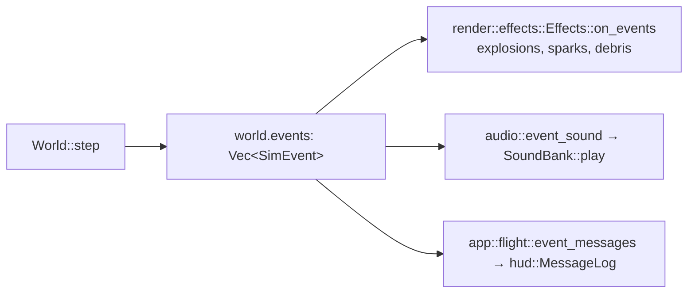

# Architecture

OpenInterceptor is a **library crate** (`src/lib.rs`, crate `openinterceptor`) with a thin
**binary** on top (`src/main.rs`, program `openinterceptor`). Almost all code lives in the
library, so every module can be unit-tested with `cargo test`. The engine is built in
**layers**: each layer uses only the layers below it.

!!! note "Status"
    Updated to the code as built at the end of the Stage 1 implementation (main `edd57aa`).
    No specification exists yet, so plan stages are cited instead of requirement IDs.

## Architecture Overview

### Layers

The order is the one written at the top of `src/lib.rs`:

`sim` never calls `render`, `hud`, `audio` or macroquad: it is plain data advanced at a fixed
rate, which is what makes it deterministic and unit-testable.

### Data flow: from the CD to a frame

### Logic flow: one frame of a flight session

`app::flight::FlightSession::frame`:

### Event flow

The simulation reports what happened as `sim::SimEvent` values in `world.events` (cleared at
the start of every `World::step`). Three consumers read them, none of which can change the
simulation:

## Key Symbols

| Symbol | Where | What it is, in plain words |
|---|---|---|
| `main` | `src/main.rs` | Parses the command line; runs `--help`/`--list`/`--check` without a window, otherwise opens one with `macroquad::Window::from_config` and runs `app::run`. |
| `Content` | `src/content/mod.rs` | Everything loaded: packs, the original data, the `Ruleset`, the scenarios; plus asset loaders. |
| `Ruleset` | `src/content/rules.rs` | Every ship, beam, missile, faction and cockpit after all packs are layered. |
| `Model` | `src/model.rs` | A format-neutral 3D model (from XMSH or OBJ): right-handed, −Z forward, LODs, per-texture triangle groups. |
| `World` | `src/sim/mod.rs` | The battle: ships, bolts, missiles, events. Changed only by `World::step`. |
| `Renderer` | `src/render/mod.rs` | Owns shaders and GPU caches; draws a `World` from a `SpaceCamera`. |
| `FlightSession` | `src/app/flight.rs` | One running scenario: world, camera view, HUD state, accumulator. |

## API Reference

Each layer's public API is on its own page: [Formats](formats.md), [Packs, VFS and
rules](packs.md), [Assets and GPU cache](assets.md), [Simulation](sim.md),
[Rendering](rendering.md), [HUD](hud.md), [Input](input.md), [Audio](audio.md),
[Platform](platform.md), [Testbed](testbed.md). `cargo doc --open` renders the `///` comments
of every item.

## Debugging

- `openinterceptor --check [--data <cd>]` loads and validates everything without a window and
  prints each error with the file and section it came from. `--list` prints packs, playable
  ships and scenarios.
- `openinterceptor --data <cd> --scenario flight-test --ship lightning --view chase` starts a
  scenario directly, skipping the launcher.
- `OI_DEBUG_KEYS=1` prints the name of every key pressed (the name to use in `bindings.ini`).
- Load problems that do not stop the program (missing texture, bad sound) are printed to
  standard error as `warning:` / `sound:` lines.
- `RUST_BACKTRACE=1` for a panic's stack trace. Panics are bugs: bad data must produce an error.
- Planned (not built): a developer overlay and a `--verbose` load trace.
