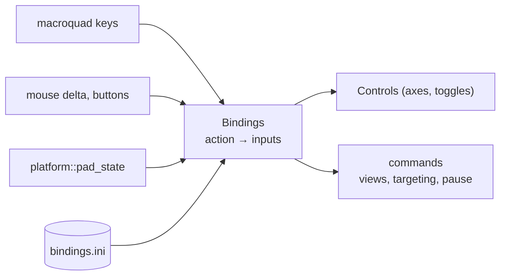

# Input and gamepads

`src/input/`: turns keys, mouse and gamepad into `sim::Controls` and testbed commands.
Plan: Stage 1, item 1.10.

## Architecture Overview

Axes from different devices are summed and clamped; buttons are "held" or "pressed this frame".

## Key Symbols

| Symbol | What it is |
|---|---|
| `Action` | An `enum` of everything bindable (`PitchUp`, `ThrottleUp`, `FireBeams`, `NextTarget`…). |
| `Binding` | One input: a key (with modifiers), a mouse button or axis, a pad button or axis. |
| `Bindings` | `HashMap<Action, Vec<Binding>>`, loaded from defaults then `bindings.ini`. |
| `PadState` | An XInput-shaped `#[repr(C)]` struct: buttons bitmask, two triggers, four stick axes. |

## API Reference

- `Bindings::load(path) -> Bindings` (defaults when the file is missing).
- `Input::poll(&mut self, &Bindings) -> (Controls, Vec<Command>)`.

## Debugging

The F12 overlay prints the raw pad state and the resulting axes.
