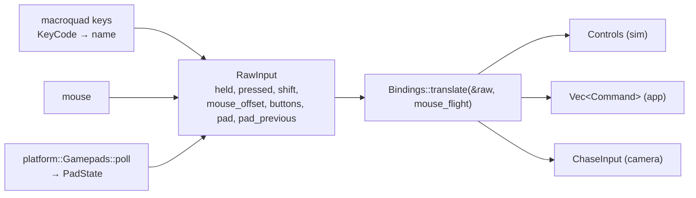

# Input and gamepads

`src/input/` turns device state into simulation `Controls` and one-shot `Command`s, using
bindings from an editable INI file. The device reading itself is in `src/app/devices.rs`
(keyboard, mouse) and `src/platform/` (gamepads). Plan: Stage 1. The default layout is on
[Controls](../original-game/controls.md).

## Architecture Overview



- **Key names** are macroquad's `KeyCode` variant names, lower-cased (`KeyCode::Kp7` →
  `kp7`), produced by `app::devices::key_name`. Every key macroquad knows is therefore bindable.
- **Held vs pressed**: axes, fire beams and afterburner are *held*; throttle steps, missile,
  link mode, targeting and views fire once per *press*. A `Shift+X` chord fires only with Shift
  held; a plain `X` only without it, so both can be bound to different actions.
- **Gamepad presses** are detected by comparing with last frame's `PadState`.
- **Sticks** add to the keys and are clamped; a dead zone is applied and rescaled
  (`input::dead`). Left stick: yaw and pitch (stick forward = nose down; `invert_pitch`);
  right stick: roll and vertical slide.
- **Mouse flight** (toggle `C`): cursor offset from the centre / `mouse range` gives yaw and
  pitch, cursor down = nose down (as the original readme states); left button = beams,
  right button = missile.
- **Bindings file**: `bindings.ini` in the user data folder (macOS
  `~/Library/Application Support/OpenInterceptor/`, Linux `$XDG_DATA_HOME/openinterceptor/` or
  `~/.local/share/openinterceptor/`). Created with the defaults on first run
  (`app::load_bindings`); keys not mentioned keep their defaults.

```ini
[keyboard]
fire_beams = Enter, LeftControl
wing_fire_at_will = Shift+F
[gamepad]
fire_beams = RightTrigger
dead_zone = 0.15
invert_pitch = no
[mouse]
range = 200
```

## Key Symbols

| Symbol | What it is |
|---|---|
| `Action` | Every bindable action (49). |
| `ACTIONS`, `PAD_ACTIONS` | `(ini name, Action, default keys)` tables — one source for parsing, defaults and docs. |
| `KeyChord` | A key name plus optional Shift. |
| `Bindings` | `keys`, `pad`, `dead_zone`, `mouse_range`, `pad_invert_pitch`; `from_ini`, `to_ini_text`, `translate`. |
| `RawInput` | One frame of device state. |
| `Command` | One-shot app requests: targeting, MFD, `View(View)`, wing orders, `NextNav`, `Pause`, `Menu`, `MouseFlight`. |
| `View` | `Cockpit`, `Forward`, `Left`, `Right`, `RearLeft`, `RearRight`, `Chase`, `ChaseManual`; `View::parse` for `--view`. |
| `ChaseInput` | Chase-camera yaw/pitch/zoom/reset this frame. |
| `gamepad::PadState`, `gamepad::Button` | XInput-layout controller state and button names. |
| `THROTTLE_STEP` | 0.1 (10 % per press, as in the original). |

## API Reference

- `Bindings::default()`, `Bindings::from_ini(&Ini)`, `bindings.to_ini_text()`.
- `bindings.translate(&RawInput, mouse_flight: bool) -> (Controls, Vec<Command>, ChaseInput)`.
- `KeyChord::parse("Shift+F")`, `input::canonical(name)`, `input::dead(v, dz)`.
- `Button::parse(name)`, `button.name()`, `PadState::button/set/axis_lx/…`.

## Debugging

- `OI_DEBUG_KEYS=1 openinterceptor …` prints the names of keys as they are pressed.
- One-shot inputs pressed in a frame that runs no simulation tick are carried over by
  `Controls::carry_unconsumed`, so a press is never lost on high-refresh displays.
- A gamepad that does nothing on Linux: check `/dev/input/js0` exists and is readable by your
  user (often the `input` group).
