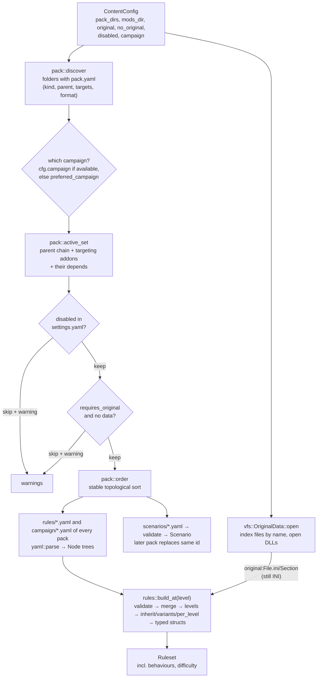
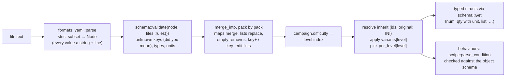
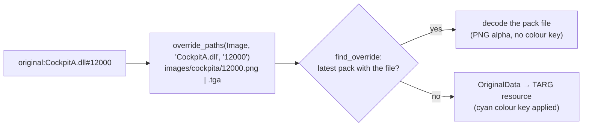

# Packs, VFS and rules

`src/content/`: answers "what is in the game?". Chooses the campaign and its active set of
packs, loads them in dependency order, indexes the player's original data, builds the typed
`Ruleset` (including ship systems, power and damage rules from `content::equipment`), parses
scenarios, and loads individual assets on demand as plain CPU data. Plan: Stage 1; Stage 2
added mod kinds, the active set, `equipment`, behaviours and difficulty, and moved every mod
file to **YAML checked against schemas** (mod format 2: `formats::yaml`, `content::schema`,
`content::files`). The user-facing side is in
[Modding](../modding/index.md).

## Architecture Overview

### From YAML text to typed rules

Logic flow of `rules::build_at(sources, original, level)`:

1. **Validate** every file against `files::rules()`; each problem becomes
   `<file>:<line>: <key path>: <message>`.
2. **Merge** the files in load order (`merge_into`): definitions of the eight definition
   sections by `(section, id)`, global sections by name; mappings merge recursively, values and
   lists are replaced, an empty value removes a key, `key+` / `key-` edit a list (kept until
   there is a list to edit, so they also work on an inherited list). Each entry remembers the
   pack and `file:line` that last wrote it.
3. **Difficulty**: the `campaign` section's `difficulty` list and the level asked for (else
   `default_difficulty`, else the middle level) give a level index.
4. **Resolve** each definition: `inherit` chains (same section, `section.id`, or
   `original:<file>/<section>` read through the `OriginalLookup` and renamed by `snake_case`;
   depth limit 16 catches cycles) → `variants[level]` merged over it → every
   `{per_level: […]}` replaced by its entry → dropped if `delete: true`.
5. **Type**: factions, beams, missiles (guidance, damage mode, cluster submunitions resolved by
   id), systems (built-ins of every `SystemKind` first), damage and power, the sound cue table
   (`audio.cue_table`; every `cue:<Name>` reference resolved), behaviours (with `prefer`
   selectors), looks — effects (the engine's `explosion` added if none), debris sets, model sets
   (texture swaps, damage levels, states) — (conditions parsed and checked against the object schema with the
   level names as constants; `builtin_attack` added if no pack defines it), then ships and
   objects (which refer to the others by id; `model_set`, or a model set made from the
   shorthand `model`/`debris`; `class_systems` resolves `systems`, `systems+`, `systems-`,
   `vct`; `modules` as `(slot, class)`), cockpits (with anchors), flight, sounds.

Every problem is collected; a broken definition is skipped, the rest still load. Scenarios go
through the same parse and `files::scenario()` validation (`Scenario::from_yaml`), and
manifests through `files::pack()` (`PackInfo::parse`).

The schemas are **data** (`schema::Ty` trees built in `files.rs`), so one description drives
validation, the JSON Schema export (`files::json_schemas`, `--write-schemas`; the committed
`schemas/*.schema.json` are checked by the gate) and the [Mod file reference](../modding/reference.md).

### Mod kinds and the active set

`pack::PackInfo` carries `kind` (`Campaign`, `Addon`, `Library`), `parent` (campaigns only),
`targets` (addons) and `format` (newer than `pack::FORMAT` = 2 is refused; a folder with only
a format-1 `pack.ini` is refused with a pointer to the docs). The player plays one
campaign; `Content::load` picks it from `ContentConfig.campaign` (command line `--campaign` or
`settings.yaml` `game.campaign`), and the difficulty from `ContentConfig.difficulty`, falling back with a warning to `preferred_campaign`:
`interceptor` when available, else `default`, else the first campaign found.

`--check` and the gate run once per campaign, each with its own active set. When no pack is a
campaign (a Stage 1 setup) every pack loads, as before.

### Asset loading and per-asset overrides

`Content::load_*` parses an `AssetRef`. Pack-relative paths resolve in the pack that defined
them. An `original:` reference first asks `find_override`: every active pack is searched,
**highest priority (latest in load order) first**, for a file at the asset's override path
(`vfs::override_paths`); only if none exists is the CD read.

| Original asset | Override path in a pack |
|---|---|
| mesh `INTTYPEA` | `models/inttypea.obj` |
| texture `CUBETOP` (named by a model) | `textures/cubetop.png` or `.tga` |
| image `CockpitA.dll#12000` | `images/cockpita/12000.png` or `.tga` |
| loose image file | `images/<file stem>.png` |
| sound `Xwinder.wav` | `sounds/xwinder.wav` |

Paths are lower-case. These are exactly the paths `--extract` writes
([Extractor](extract.md)), so an extracted, edited file dropped into a mod replaces the
original. Whole packs can be switched off with `packs.disabled` in `settings.yaml`
([Settings](settings.md)); a disabled pack contributes no rules, scenarios or overrides.

## Key Symbols

| Symbol | What it is |
|---|---|
| `Content` | Active packs in load order, `campaign` (the one loaded), `campaigns` (every playable `(id, name)`), `original: Option<OriginalData>`, `rules: Ruleset`, `scenarios`, `warnings`. |
| `ContentConfig` | Where to look, which packs are `disabled`, which `campaign` and `difficulty` to load; built by `cli::Options::content_config` from the command line and `settings.yaml`. |
| `preferred_campaign(&[PackInfo])` | The campaign loaded when none is chosen. |
| `vfs::AssetKind` | `Model`, `Texture`, `Image`, `Sound` — selects the override naming rule. |
| `pack::PackInfo` | A parsed `pack.yaml`: `id`, `name`, `version`, `description`, `kind`, `parent`, `targets`, `depends`, `requires_original`, `format`, `dir`. |
| `pack::PackKind`, `pack::FORMAT` | `Campaign`, `Addon`, `Library`; the newest mod-format version read (2). |
| `formats::yaml::Node`, `Value`, `YamlError` | A parsed YAML tree: `Value::{Null, Scalar { text, quoted }, Seq, Map}` (maps keep file order), each node with its line. |
| `schema::Ty`, `Unit`, `Field`, `Problem` | A schema as data (`Num`, `Qty(Unit)`, `Bool`, `Text`, `Name`, `Asset`, `Condition`, `Enum`, `Numbers(n)`, `List`, `Dict`, `Struct`, `Def`); a validation problem with line, path and message. |
| `schema::Get` | Typed reads from a node: `str`, `num`, `qty(key, unit)`, `bool`, `list`, `nums`, `map`, `node`. |
| `files::{pack, rules, scenario, section, json_schemas}` | The schemas of every mod file type. |
| `looks::ModelSet`, `DamageLevel`, `DebrisSet`, `EffectDef`, `Swaps`, `ModelSetId`, `DebrisId`, `EffectId` | Looks ([modder's guide](../modding/looks.md)); `ModelSet::swaps_for(hull, state)`, `looks::texture_key(reference)`. |
| `rules::Guidance`, `rules::DamageMode` | Missile steering kinds and warhead modes. |
| `behaviour::Selector` | A target-preference selector: `Player`, `Kind`, `Class`, `Faction`. |
| `behaviour::BehaviourDef`, `StateDef`, `Manoeuvre`, `Params`, `Transition`, `Skill`, `BehaviourId` | A parsed behaviour ([Behaviours](../modding/behaviours.md)). |
| `equipment::SystemKind` | The ten system kinds (`ALL`, `key`, `parse`, `is_switchable`). |
| `equipment::SystemDef`, `SystemId` | A `systems:` definition (`builtin(kind)`, `parse`) and its index in `Ruleset::systems`. |
| `equipment::PowerRules`, `DamageRules` | The `power` and `damage` sections, with defaults. |
| `vfs::AssetRef` | `PackFile(String)` or `Original { file, resource }`. Parsing normalises `..` inside the pack and refuses paths that leave it. |
| `vfs::OriginalData` | Lower-case file name → path for every file under the data folder (any CD/install layout), plus the opened resource DLLs. |
| `rules::Ruleset` | `ships`, `beams`, `missiles`, `factions`, `systems`, `behaviours`, `model_sets`, `debris_sets`, `effects`, `cockpits`, `flight: FlightRules` (with `hyperspace_time`), `power: PowerRules`, `damage: DamageRules`, `sounds`, `difficulty_levels`, `difficulty` (index played). |
| `rules::RulesSource`, `OriginalLookup` | One parsed rules file (`pack`, `file`, `doc`); the callback that finds an original INI section. |
| `rules::CockpitDef`, `rules::Anchor` | A cockpit (image, model, offset, design, instruments, anchors); an anchored instrument (`at`, `normal`, `size`). |
| `ShipClassId`, `BeamId`, `MissileId`, `FactionId` | Newtype indices (`u16`) into the ruleset's vectors. |
| `rules::ShipClass` | A craft or object: model reference, durability, flight model, power, weapons, `systems: Vec<SystemId>`, `repair_rate`, `capturable`, `behaviour: Option<BehaviourId>`, `turret_arc`, `model_set: ModelSetId`, `modules: Vec<(slot, ShipClassId)>`, `shield_generator`. `kind: ShipKind` (Fighter, Freighter, Capital, Drone, Station, Probe, Mine, Debris). |
| `rules::BeamClass`, `MissileClass`, `Faction`, `FlightRules`, `CockpitDef` | The other definitions. |
| `scenario::Scenario`, `Placement`, `AiRole`, `NavPoint` | A playable arena and its objects; `Placement` has `destroyed_systems`, `hull` and `behaviour` since Stage 2. |

## API Reference

- `Content::load(&ContentConfig) -> Result<Content, String>`.
- `content.load_model(reference, pack, scale) -> Result<Model, String>`.
- `content.load_texture(name, pack)`, `content.load_image(reference, pack, colour_key)` →
  `Result<Image, String>`; `content.load_sound(reference, pack) -> Result<Pcm, String>`.
- `content.scenario(id)`, `content.original_mesh_names()`, `content.read_pack_file(pack, path)`.
- `content.find_override(kind, file, resource) -> Option<(pack index, path)>`;
  `vfs::override_paths(kind, file, resource) -> Vec<String>` (pure, tested).
- `ruleset.ship_id(id)`, `.ship(ShipClassId)`, `.beam(..)`, `.missile(..)`, `.faction(..)`,
  `.faction_id(id)`, `.cockpit(id)`, `.hostile(a, b)`, `.playable_ships()`, `.system_id(id)`,
  `.behaviour(BehaviourId)`, `.behaviour_id(id)`, `.object_schema()`.
- `rules::build(&[RulesSource], &OriginalLookup) -> (Ruleset, Vec<String>)` and
  `rules::build_at(.., level: Option<&str>)` — pure, tested with an in-memory lookup;
  `rules::merge_into(&mut Node, &Node)`, `rules::snake_case("HitPoints")`.
- `formats::yaml::parse(text) -> Result<Node, YamlError>`, `node.get(key)`, `as_str`, `as_map`,
  `as_seq`, `to_yaml()`.
- `schema::validate(&Node, &Ty, path, &mut Vec<Problem>)`, `schema::quantity("2.4km",
  Unit::Distance) -> Result<f32, String>`, `schema::suggest(key, known)` (edit distance ≤ 2,
  counting a swap of neighbours as one edit), `schema::json_schema(title, &Ty) -> String`.
- `BehaviourDef::parse(id, Get, &Schema)`, `BehaviourDef::builtin_attack(&Schema)`.
- `Scenario::from_yaml(&Node, pack) -> Result<Scenario, String>`; `PackInfo::parse(text, dir)`;
  `pack::discover(dir)`; `pack::order(Vec<PackInfo>)`; `pack::campaigns(&[PackInfo])`;
  `pack::chain(&packs, id) -> Result<Vec<String>, String>`;
  `pack::active_set(&packs, id) -> Result<Vec<PackInfo>, String>`;
  `content::preferred_campaign(&packs) -> Option<String>`.
- `ruleset.model_set(ModelSetId)`, `.debris_set(DebrisId)`, `.effect(EffectId)`, `.effect_id(id)`;
  `DebrisSet::parse(id, Get, pack)`, `EffectDef::parse(id, Get)`, `EffectDef::builtin(id)`;
  `Selector::parse(text)`.
- `ruleset.system(SystemId)`; `SystemDef::builtin(kind)`, `SystemDef::parse(id, Get)`,
  `PowerRules::parse(Option<Get>)`, `PowerRules::levels()`, `PowerRules::letter(level)`,
  `DamageRules::parse(Option<Get>)`.
- `OriginalData::open(&Path)`, `.file_path(name)`, `.read_file(name)`,
  `.resource(kind, dll, name)` (a digit-only name is tried as a name, then as a number),
  `.resource_names(kind)`, `.resources_of(kind) -> Vec<(dll, id, &[u8])>`,
  `.files_with_extension(ext)`.

## Debugging

- `--check` prints every file problem as `file:line: key.path: message` and every rules error
  as `file:line: section.id: message`, plus model, texture, image, sound
  and scenario failures, per campaign. `--list` shows the campaigns (`*` = loaded) and what
  loaded. `--check --campaign <id>` checks one campaign.
- "campaign 'x' is not available; using the default" — the id is wrong, the pack is disabled,
  or it needs original data that was not found. "only a campaign may have a parent", "unknown
  pack kind", and "needs mod format n" come from `PackInfo::parse`.
- An addon that seems ignored: check its `targets` names the campaign being played (or the
  campaign's parent).
- "pack 'x' skipped" means it needs `--data` (or a dependency was skipped); "pack 'x' is
  disabled in settings" means `settings.yaml` switched it off.
- Is my override used? Open the launcher's **Asset browser**: overridden textures, images and
  sounds are marked `[overridden by <pack>]`.
- A key that "does nothing": check the section id prefix (`ship:` vs `object:`) and that a
  later pack does not override it; keys are case-insensitive, values are not.
- A YAML error such as "tabs are not allowed" or "anchors are not supported" names the line;
  see the supported subset on [Rulesets](../modding/rulesets.md#the-yaml-subset).
- A value that "does nothing" may be at the wrong level: `{per_level: …}` and `variants` are
  resolved before typing, so check which difficulty is loaded (the launcher header shows it).
