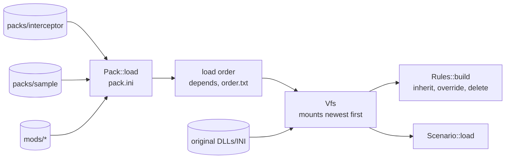

# Packs, VFS and rules

`src/packs/`: turns folders and original data into one namespace (`Vfs`), one layered rule set
(`Rules`) and loaded scenarios. See [Modding: packs](../modding/packs.md) for the user's view.

## Architecture Overview

Logic flow for rules: for each pack in order, parse every `rules/*.ini` → for each typed section,
merge keys into the existing entry (or create it; or delete it on `delete = yes`) → after all
packs, resolve `inherit` chains (with cycle detection) → convert entries into typed structs
(`ShipClass`, `BeamClass`, …), reporting unknown references.

## Key Symbols

| Symbol | What it is |
|---|---|
| `Pack` | One loaded `pack.ini`: id, name, version, dependencies, folder. |
| `Vfs` | Answers "give me `models/inttypea.obj`" or "give me mesh `inttypea`" by searching mounts. Holds the original DLL bytes and their resource tables. |
| `Rules` | All typed entries: `ships`, `beams`, `launchers`, `missiles`, `objects`, `factions`, `cockpits`, each a `HashMap<String, T>` keyed by id. |
| `ShipClass` | A ship's definition: model, cockpit, side, `FlightSpec` (rates, LockSpeed, MaxSpeed…), mounts, hit points, loadout. |
| `BeamClass`, `MissileClass` | Weapon definitions with the original's fields (damage, energy cost, rate of fire, speed, range; lock, duration). |
| `Scenario` | Title, environment and a list of `Placement`s (class, side, position, heading, ai). |

## API Reference

- `Vfs::new(original_data: Option<&Path>, packs: &[Pack]) -> Result<Vfs>`.
- `Vfs::read(path) -> Option<Vec<u8>>` (pack files), `Vfs::mesh(name)`, `Vfs::texture(name)`.
- `Rules::build(&Vfs) -> (Rules, Vec<Diagnostic>)`: diagnostics are warnings and errors with
  pack, file and section.
- `Scenario::load(&Vfs, id) -> Result<Scenario>`; `Scenario::list(&Vfs)`.

### Rule keys read in Stage 1

`ship:` `name`, `model`, `cockpit`, `side`, `playable`, `RollRate`, `YawRate`, `PitchRate`,
`AngularDamp`, `LockSpeed`, `MaxSpeed`, `HitPoints`, `MaxBeamWeapons`, `MaxMissileWeapons`,
`beams`, `missiles`, `ai`. `beam:` `name`, `Damage`, `EnergyCost`, `RateOfFire`, `Speed`,
`Range`, `colour`. `missile:` `name`, `Speed`, `Duration`, `ImpactDamage`, `ProximityDamage`,
`locktime`, `lockangle`. `object:` `name`, `model`, `HitPoints`. The final list is kept here as
the code lands.

## Debugging

`--verbose` prints the mount order and every override (`pack X overrides ship:lightning.MaxSpeed`).
`--check` lists unknown keys and references.
