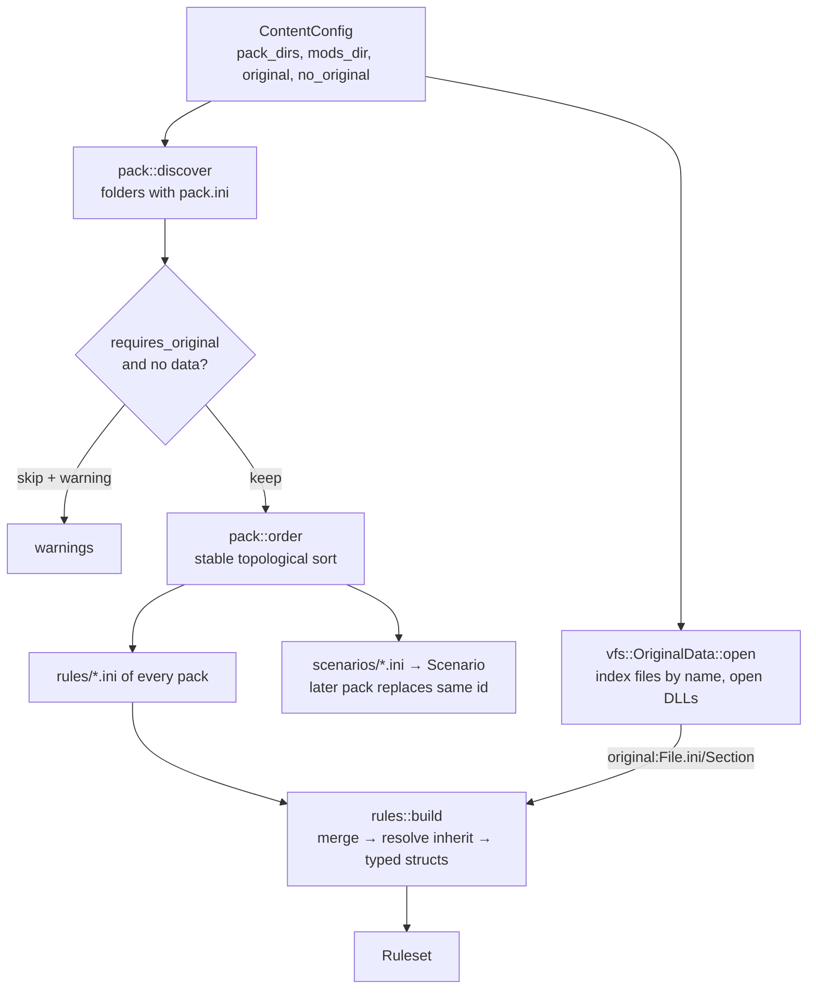

# Packs, VFS and rules

`src/content/`: answers "what is in the game?". Loads packs in dependency order, indexes the
player's original data, builds the typed `Ruleset`, parses scenarios, and loads individual
assets on demand as plain CPU data. Plan: Stage 1. The user-facing side is in
[Modding](../modding/index.md).

## Architecture Overview

Logic flow of `rules::build`: merge every file in load order (`Ini::merge_from`, key by key),
remembering which pack last touched each section → resolve `inherit` chains (other sections or
`original:` sections; depth limit 16 catches cycles) → drop sections with `delete = yes` →
build factions, beams, missiles, then ships (which refer to the others by id) → cockpits,
`[flight]`, `[sounds]`. Every problem is collected as a message; a broken definition is skipped,
the rest still load.

Asset loading (`Content::load_*`) parses an `AssetRef`: pack-relative paths resolve in the pack
that defined them; `original:` references go to `OriginalData`. Textures named inside a model
look for `textures/<name>.png|.tga` in every pack (latest first) before the original `XTXR` —
that is how a mod re-skins an original ship.

## Key Symbols

| Symbol | What it is |
|---|---|
| `Content` | Loaded packs, `original: Option<OriginalData>`, `rules: Ruleset`, `scenarios`, `warnings`. |
| `ContentConfig` | Where to look; built from the command line by `cli::Options::content_config`. |
| `pack::PackInfo` | A parsed `pack.ini`: `id`, `name`, `version`, `description`, `depends`, `requires_original`, `dir`. |
| `vfs::AssetRef` | `PackFile(String)` or `Original { file, resource }`. Parsing normalises `..` inside the pack and refuses paths that leave it. |
| `vfs::OriginalData` | Lower-case file name → path for every file under the data folder (any CD/install layout), plus the opened resource DLLs. |
| `rules::Ruleset` | `ships`, `beams`, `missiles`, `factions`, `cockpits`, `flight: FlightRules`, `sounds`. |
| `ShipClassId`, `BeamId`, `MissileId`, `FactionId` | Newtype indices (`u16`) into the ruleset's vectors. |
| `rules::ShipClass` | A craft or object: model reference, durability, flight model, power, weapons, debris. `kind: ShipKind` (Fighter, Freighter, Capital, Drone, Station, Probe, Mine, Debris). |
| `rules::BeamClass`, `MissileClass`, `Faction`, `FlightRules`, `CockpitDef` | The other definitions. |
| `scenario::Scenario`, `Placement`, `AiRole`, `NavPoint` | A playable arena and its objects. |

## API Reference

- `Content::load(&ContentConfig) -> Result<Content, String>`.
- `content.load_model(reference, pack, scale) -> Result<Model, String>`.
- `content.load_texture(name, pack)`, `content.load_image(reference, pack, colour_key)` →
  `Result<Image, String>`; `content.load_sound(reference, pack) -> Result<Pcm, String>`.
- `content.scenario(id)`, `content.original_mesh_names()`, `content.read_pack_file(pack, path)`.
- `ruleset.ship_id(id)`, `.ship(ShipClassId)`, `.beam(..)`, `.missile(..)`, `.faction(..)`,
  `.faction_id(id)`, `.cockpit(id)`, `.hostile(a, b)`, `.playable_ships()`.
- `rules::build(&[RulesSource], &OriginalLookup) -> (Ruleset, Vec<String>)` — pure, tested with
  an in-memory lookup.
- `Scenario::parse(text, pack) -> Result<Scenario, String>`; `PackInfo::parse(text, dir)`;
  `pack::discover(dir)`; `pack::order(Vec<PackInfo>)`.
- `OriginalData::open(&Path)`, `.file_path(name)`, `.read_file(name)`,
  `.resource(kind, dll, name)` (a digit-only name is tried as a name, then as a number),
  `.resource_names(kind)`.

## Debugging

- `--check` prints every rules error as `[kind:id]: message`, plus model, texture, image, sound
  and scenario failures. `--list` shows what loaded.
- "pack 'x' skipped" means it needs `--data` (or a dependency was skipped).
- A key that "does nothing": check the section id prefix (`ship:` vs `object:`) and that a
  later pack does not override it; keys are case-insensitive, values are not.
