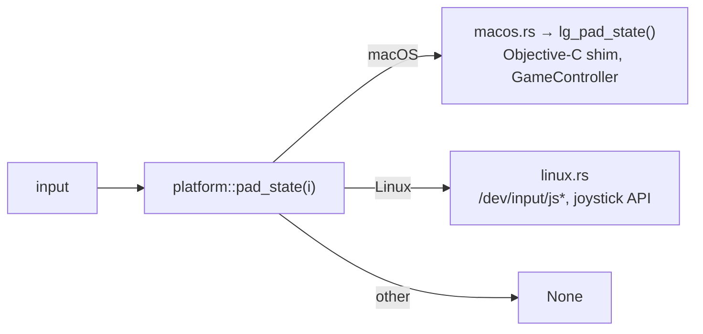

# Platform layer

`src/platform/`: the only place with OS-specific code. Everything else calls functions that work
(or quietly do nothing) on every OS. Plan: Stage 1, item 1.10.

## Architecture Overview

`build.rs` compiles `macos/shim/oi_platform.m` with `xcrun clang` and links the GameController
framework on macOS only. On Linux, a background-free reader opens `/dev/input/js0…3`
non-blocking and applies events each frame (the kernel's `struct js_event`: time, value, type,
number).

## Key Symbols

| Symbol | What it is |
|---|---|
| `PadState` | Controller state in XInput's layout (shared by all platforms). |
| `pad_state(index) -> Option<PadState>` | `None` when no controller is connected. |

## API Reference

All functions are safe to call on any platform. The `unsafe` FFI call to the shim is confined to
`platform/macos.rs`, with a comment explaining why it is sound.

## Debugging

The F12 overlay shows raw pad values. On Linux, check `/dev/input/js*` permissions (the user
must be in the `input` group on some distributions).
