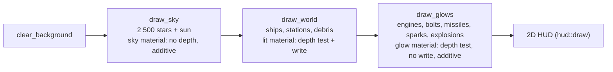

# Rendering

`src/render/`: draws one frame of the 3D scene with macroquad. It only *reads* the
simulation. Plan: Stage 1.

## Architecture Overview

### Frame structure

### Camera-relative rendering

`f32` loses precision far from the origin, and GPUs lose more. So no absolute world position
reaches the GPU: each object's model matrix is built from `position − camera.position`
(`SpaceCamera::model_matrix`), and the camera's view matrix is rotation-only
(`SpaceCamera::view_projection`). Near plane 1 m, far plane 200 km.

### Materials

| Material | Shader | GPU state | Used for |
|---|---|---|---|
| lit | vertex lighting: `0.30 + 0.85 × max(n·sun, 0)` × vertex colour × texture, plus a `Tint` uniform (hit flash) | depth test ≤, depth write | ships, stations, debris |
| sky | unlit | depth always, no write, additive | stars, sun |
| glow | unlit | depth test ≤, no write, `SrcAlpha + One` | engines, bolts, missiles, sparks, explosions |

Normals reach the shader through macroquad's spare `normal` vertex attribute. Per-object
transforms use macroquad's model-matrix stack (`push_model_matrix`), which breaks batches per
object and snapshots uniforms per draw call — so the hit `Tint` is per ship.

LOD choice: `GpuModel::lod(distance)` picks the first LOD whose `switch_distance` exceeds the
camera distance (the original values: e.g. 75 / 150 / 450 m / ∞ for the Lightning II).
Objects entirely behind the camera are skipped.

## Key Symbols

| Symbol | What it is |
|---|---|
| `Renderer` | Owns the three materials, a generated radial `glow_texture`, `models: ModelCache`, the star list, and reusable vertex/index buffers. |
| `camera::SpaceCamera` | `position`, `rotation`, `fov_y`, `aspect`; implements macroquad's `Camera` trait; `project` (world → screen pixels) and `local_direction` for the HUD. |
| `effects::Effects` | `explosions`, `sparks`, `debris`, created by `on_events(&World)` and aged by `update(dt)`. |
| `starfield::Star`, `starfield::generate(seed, count)` | Seeded, uniform-on-the-sphere star directions. |
| `push_billboard`, `push_streak` | Build camera-facing quads into the reusable buffers. |

## API Reference

- `Renderer::new() -> Result<Renderer, String>` (fails only if a shader is rejected).
- `draw_sky(&cam, seed, sun)`, `begin_solid(&cam, sun)`, `draw_model(&cam, &GpuModel, pos, rot, tint)`,
  `draw_model_lod(.., force_lod: Option<usize>)`, `draw_world(&Content, &World, &Effects, &cam, sun, hide)`,
  `draw_glows(&Content, &World, &Effects, &cam, hide)`, `draw_axes`, `ship_model`.
- `effects::explosion_curve(t) -> (size, brightness)`; `effects::DEBRIS_LIFE`, `SPARK_LIFE`.

## Debugging

- Reused buffers: `draw_glows` and `draw_sky` *move* their `Vec`s into a `Mesh` with
  `std::mem::take`, draw, then move them back — no allocation after the first frame.
- If a scene is black except the HUD, check the shader compile error returned by
  `Renderer::new` (shown on the start-up error screen).
- Engine glows come from rear-facing model attachments, else the back of the bounding box.
