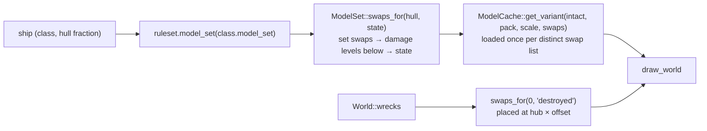

# Rendering

`src/render/`: draws one frame of the 3D scene with macroquad. It only *reads* the
simulation. Plan: Stage 1; Stage 2 added looks (model sets with texture swaps), debris sets,
effects with shock waves, station modules and their wrecks.

## Architecture Overview

### Frame structure


### Looks: which model to draw



`Renderer::ship_look` picks the model a ship shows now: its model set's intact model with the
texture swaps for its hull fraction (`content::looks::ModelSet::swaps_for`). Swaps match the
model's textures by `looks::texture_key` (file name without folder or extension, lower-case).
`ModelCache::get_variant` keys the cache by model, scale and swap list, so each damage level is
built once and drawing it per frame costs nothing extra. Destroyed station modules with a
`destroyed` state are drawn from `World::wrecks` on their hubs. OBJ `slot_<name>` groups are not
part of the drawn mesh at all (the OBJ reader sets them aside as attachment points).

**Effects** (`render::effects`). On a `Destroyed` event, `Effects::on_events` starts an
`Explosion` with the model set's `destroyed_effect` (size × radius, duration, colour, and a
**shock wave** — a ring of glows racing outwards in the wreck's plane — when `shockwave` is set),
and throws the **debris set**: `pick` distinct pieces chosen with the effects' generator, each
starting at its place in the object's model space with the object's velocity plus a random
outward push and tumble, plus the generic `chunks`; wreckage darkens as it cools over its last
third and disappears after the set's `life`. Missile detonations draw the missile's `explosion` effect
(`SimEvent::MissileExploded { position, effect }`; size in metres), else a 25 m, 0.8 s fireball.
**Point-defence tracers** (`SimEvent::PointDefence`) are short streaks in the glow pass.

### The 3D cockpit pass

A cockpit definition may name a `model` (see [Cockpits](../modding/cockpits.md)). It must always
appear in front of the world and may sit centimetres from the pilot's eye, which the normal
1 m near plane would clip. So `Renderer::draw_cockpit_model`:

1. flushes macroquad's batched draws (`InternalGlContext::flush`) so the world is on the GPU;
2. clears **only the depth buffer** (`quad_context.clear(None, Some(1.0), None)`) — the world's
   colour stays, but nothing in it can hide the cockpit;
3. draws the model with the lit material using `SpaceCamera::with_near(0.05)`, placed at the
   eye plus `ModelOffset` (in the eye's frame), always at LOD 0.

This and the model-matrix stack are the only uses of macroquad's internal GL state
(`unsafe_gl_context`, one documented `unsafe` block).

### Camera-relative rendering

`f32` loses precision far from the origin, and GPUs lose more. So no absolute world position
reaches the GPU: each object's model matrix is built from `position − camera.position`
(`SpaceCamera::model_matrix`), and the camera's view matrix is rotation-only
(`SpaceCamera::view_projection`). Near plane 1 m, far plane 200 km.

### Materials

| Material | Shader | GPU state | Used for |
|---|---|---|---|
| lit | vertex lighting: `0.30 + 0.85 × max(n·sun, 0)` × vertex colour × texture, plus a `Tint` uniform (hit flash); overlay depth bias | depth test ≤, depth write, **back faces culled** (counter-clockwise = front) | ships, stations, debris |
| sky | unlit | depth always, no write, additive | stars, sun |
| glow | unlit | depth test ≤, no write, `SrcAlpha + One` | engines, bolts, missiles, sparks, explosions |

Normals reach the shader through macroquad's spare `normal` vertex attribute. Per-object
transforms use macroquad's model-matrix stack (`push_model_matrix`), which breaks batches per
object and snapshots uniforms per draw call — so the hit `Tint` is per ship.

### One-sided faces (back-face culling)

Models are one-sided, as in the original game: the lit pipeline sets `cull_face: Back` with
counter-clockwise front faces. The original data winds every polygon counter-clockwise around
its outward plane normal, and models a surface seen from both sides as two polygons back to
back (shield rings, fins). Without culling both copies drew at the same depth and flickered
(z-fighting). `Model::from_xmsh` mirrors Z and reverses winding, so engine triangles stay
counter-clockwise seen from outside; mod OBJ models follow the same rule
([Models](../modding/models.md)).

### Overlay layers and the depth bias

A decal lying exactly on another face (station panels, alien hull markings) has the same depth
values as the face under it, so the depth test picks a winner at random per pixel — flicker.
At load, `model::assign_overlay_layers` compares every pair of faces in a LOD: faces in the same
plane (normals within 0.999, plane offsets within 1e-4 × radius), facing the same way, that
overlap by the *separating-axis* test get stacked layers. Which is on top: faces flagged
`POLY_OVERLAY`, then `POLY_TRANSLUCENT`, then ordinary faces; among equals the later face in
the file (the original painted in that order). OBJ models use file order only. The pass takes
about 8 ms for all 297 CD meshes; 119 of 17,284 LOD-0 faces get a layer above 0.

The layer travels per vertex in the spare `w` of the `normal` attribute (`ModelVertex::layer`).
The lit vertex shader does

```glsl
gl_Position.z -= normal.w * LAYER_BIAS * gl_Position.w;
```

which moves the face towards the camera **in depth only** (the image does not shift).
`LAYER_DEPTH_BIAS` = 2⁻¹⁸ in normalised device coordinates, about 32 steps of a 24-bit depth
buffer — the same idea as `glPolygonOffset`, done per vertex because a model is one draw call.
Multiplying by `w` keeps the shift constant after the perspective divide. GLSL cannot read a
Rust constant, so `lit_vertex_source()` pastes the number into the shader text at start-up.

Overlay-flagged faces are kept in their own material groups (`MaterialGroup::overlay`,
`GpuLod::overlay`), so `Renderer::show_overlays = false` hides them (the model viewer's **O**).

### Texture addressing

Original texture coordinates run outside 0..1 to tile a texture across a big face. Model
textures are set to **repeat** (`render::set_repeat`, via `texture_set_wrap` on the internal GL
context) instead of macroquad's default clamp, which smeared edge pixels across such faces
(the "incomplete" Patton, the asteroids, many debris chunks). The UV varying is `mediump`, not
`lowp`, so tiled coordinates keep their precision on GL ES devices.

### Bolt streaks

A bolt is drawn as a streak trailing behind its head. `Bolt::streak_length()` is
`min(muzzle_speed × 0.025 s, 80 m, muzzle_speed × age)`: never longer than the distance the bolt
has flown from the gun. Without the last term, a bolt fired this frame trailed up to 80 m back
past the muzzle, so in the chase view fire seemed to come from behind the ship.

LOD choice: `GpuModel::lod(distance)` picks the first LOD whose `switch_distance` exceeds the
camera distance (the original values: e.g. 75 / 150 / 450 m / ∞ for the Lightning II).
Objects entirely behind the camera are skipped.

## Key Symbols

| Symbol | What it is |
|---|---|
| `Renderer` | Owns the three materials, a generated radial `glow_texture`, `models: ModelCache`, the star list, and reusable vertex/index buffers. |
| `camera::SpaceCamera` | `position`, `rotation`, `fov_y`, `aspect`, `z_near`; `new(...)`, `with_near(..)`; implements macroquad's `Camera` trait; `project` (world → screen pixels) and `local_direction` for the HUD. |
| `effects::Effects` | `explosions`, `sparks`, `debris`, created by `on_events(&World)` (from effects and debris sets) and aged by `update(dt)`. |
| `effects::Explosion`, `Debris`, `Spark` | A fireball (with optional shock-wave plane), a tumbling piece with its life, a short spark. |
| `gpu::ModelCache::get_variant` | A model with texture swaps, cached per distinct swap list. |
| `Renderer::ship_look` | The model a ship shows now (model set + damage level). |
| `starfield::Star`, `starfield::generate(seed, count)` | Seeded, uniform-on-the-sphere star directions. |
| `push_billboard`, `push_streak` | Build camera-facing quads into the reusable buffers. |
| `LAYER_DEPTH_BIAS`, `lit_vertex_source()` | Depth shift per overlay layer and the shader text with it filled in. |
| `Renderer::show_overlays` | Draw overlay-flagged faces (default `true`; the viewer toggles it and restores it on exit). |
| `gpu::Chunk::overlay`, `GpuLod::overlay` | Per-mesh overlay flag, parallel to `GpuLod::meshes`. |
| `GpuModel::lod_index(distance)` | Index of the LOD to draw; shared between `GpuModel::lods` and `model.lods`. |
| `model::Face` | One original polygon: `first`, `count` (its corners are consecutive vertices), `group`, `flags`. |
| `model::assign_overlay_layers`, `model::face_plane` | The overlay pass; a face's plane by Newell's method. |

## API Reference

- `Renderer::new() -> Result<Renderer, String>` (fails only if a shader is rejected).
- `draw_sky(&cam, seed, sun)`, `begin_solid(&cam, sun)`, `draw_model(&cam, &GpuModel, pos, rot, tint)`,
  `draw_model_lod(.., force_lod: Option<usize>)`, `draw_world(&Content, &World, &Effects, &cam, sun, hide)`,
  `draw_glows(&Content, &World, &Effects, &cam, hide)`, `draw_cockpit_model(&cam, &GpuModel, offset, sun)`,
  `draw_axes`, `ship_model`, `ship_look(&Content, &World, &Ship)`.
- `ModelCache::get(content, reference, pack, scale)`, `get_variant(.., &Swaps)`.
- `effects::explosion_curve(t) -> (size, brightness)`; `effects::SPARK_LIFE`.

## Debugging

- Reused buffers: `draw_glows` and `draw_sky` *move* their `Vec`s into a `Mesh` with
  `std::mem::take`, draw, then move them back — no allocation after the first frame.
- If a scene is black except the HUD, check the shader compile error returned by
  `Renderer::new` (shown on the start-up error screen).
- Engine glows come from rear-facing model attachments, else the back of the bounding box;
  `GpuModel::engines` is computed once at load, so drawing glows allocates nothing per frame.
- A face that vanishes from one side is a back face: wind it the other way, or add a second
  face back to back if it must be seen from both sides. The viewer's wireframe (**W**) shows the
  missing face's outline.
- Flicker on a flat area means coplanar faces facing the same way that the overlay pass did not
  pair (they are not in the same plane within tolerance); select them with **[ ]** in the viewer
  and compare their `layer`.
- Stretched or single-colour faces on original models: check that the texture repeats (the
  face info line shows UVs beyond 0..1).
- A 3D cockpit that is invisible usually sits behind the eye: check `ModelOffset` and that the
  model's front faces −Z.
- A damage texture that never appears: the swap's key must be the model's texture *name*
  (no folder, no extension); open the class in the model viewer and press **D** to step through
  its looks, and `--check` reports swapped textures that fail to load.
- Debris that flies from the wrong place was modelled away from the object: pieces must be in
  the object's own model space. The viewer's debris look pulls them apart from where they sit.
