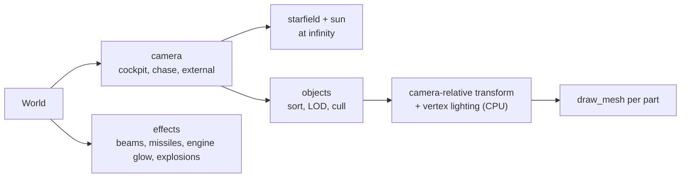

# Rendering

`src/render/`: draws a `World` from a camera. Plan: Stage 1, item 1.4.

## Architecture Overview

Logic flow per frame: build the camera → clear → draw stars and the sun with depth off → draw
objects (opaque) → draw effects (additive) → hand over to the HUD.

**Precision.** All positions are subtracted from the camera position *before* converting to
`f32` vertices, so objects near the camera are exact even far from the origin. The camera is
always at (0, 0, 0) in render space.

## Key Symbols

| Symbol | What it is |
|---|---|
| `View` | Which camera: `Cockpit(direction)`, `FullForward`, `Chase { manual }`. |
| `CameraState` | Position, orientation and field of view for this frame. |
| `Scene` | Holds the starfield and per-frame scratch buffers (reused, so no allocation per frame). |
| `Starfield` | A fixed random set of star directions and brightnesses. |

## API Reference

- `Scene::new()`; `Scene::draw(&mut self, &World, &Assets, &CameraState)`.
- `camera::for_view(&World, view, …) -> CameraState`.

## Debugging

F12 overlay shows draw calls and triangles. The model viewer isolates one model.
