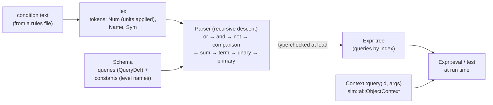

# Conditions (script)

`src/script/`: the condition language that behaviours (and, from Stage 3, missions and
events) use to decide things — `hull < 25% and not system_damaged(engines)`. A complete little
language implementation in four classic steps: lexing, recursive-descent parsing, type checking
against a schema, and evaluation. Plan: Stage 2 item 2.9 (object context); Stage 3 adds the
mission and event contexts and actions. The modder's view is on
[Behaviours and conditions](../modding/behaviours.md#the-condition-language).

## Architecture Overview

- **Lexing** (`lex`): whitespace-separated numbers, names and symbols. A unit written straight
  after a number is applied at once (`1.5km` → 1500, `25%` → 0.25; `m`, `km`, `s`, `min`, `h`,
  `day`, `%`). Names are lower-cased.
- **Parsing** (`Parser`): one method per precedence level, lowest first — `or`, `and`, `not`,
  comparison (`< <= > >= == !=`, not chained), `sum` (`+ -`), `term` (`* /`), `unary` (`-`),
  `primary` (number, `true`/`false`, constant, query with arguments, brackets). Each method
  returns the sub-tree **and its type** (`Num` or `Bool`).
- **Checking** happens while parsing, against the `Schema`: unknown names, wrong argument
  counts or kinds (`system_damaged(warp)`), and type errors (`hull and 3`, a comparison of
  booleans) are errors with a message; `parse_condition` also requires the whole expression to
  be true/false. Behaviours call it when the rules load, so a bad condition never reaches play.
- **Evaluation** (`Expr::eval`) walks the tree. `and`/`or` short-circuit; `==` and `!=` compare
  within 1e-6; division by zero gives 0. Queries are answered by a `Context`; arguments are
  evaluated first and passed as numbers (a name argument such as `engines` is resolved to its
  index while parsing).

There is no assignment, loop or user function, so evaluation cannot change the game and always
finishes. `random(p)` draws from the asking pilot's seeded generator, so runs are deterministic.

### The object context

`script::object` declares the queries a behaviour may use (`QUERIES`, with `doc` strings that
the docs table is made from) and `schema(levels)` adds the campaign's difficulty level ids as
numeric constants. `sim::ai::ObjectContext` implements `Context` for one ship: it holds
`&World`, the ship's id, the time in its current state and the pilot's random state in a
`Cell<u64>` — `Context::query` takes `&self`, but `random` must advance the generator, and a
`Cell` allows that for a `Copy` value without `&mut` (interior mutability).

## Key Symbols

| Symbol | What it is |
|---|---|
| `Token` | `Num(f32)`, `Name(String)`, `Sym(&'static str)`. |
| `Expr` | `Num`, `Bool`, `Query(u16, Vec<Expr>)`, `Not`, `Neg`, `Binary(Op, …)`. |
| `Op` | `Or`, `And`, `Lt`, `Le`, `Gt`, `Ge`, `Eq`, `Ne`, `Add`, `Sub`, `Mul`, `Div`. |
| `Type`, `Value` | `Num` / `Bool` at check time; `Value::Num(f32)` / `Value::Bool(bool)` at run time. |
| `QueryDef`, `Arg` | A query: `name`, `args` (`Arg::Num` or `Arg::Name(&[..])`), `result` type, `doc`. |
| `Schema` | The queries and named constants available in one context. |
| `Context` | The trait a game context implements: `query(id, &[f32]) -> Value`. |
| `object::QUERIES`, `object::id`, `object::SYSTEM_NAMES`, `object::schema` | The object context (20 queries). |
| `sim::ai::ObjectContext` | The simulation's answer to object queries. |

## API Reference

- `script::lex(&str) -> Result<Vec<Token>, String>`.
- `script::parse(&str, &Schema) -> Result<(Expr, Type), String>`;
  `script::parse_condition(&str, &Schema) -> Result<Expr, String>` (must be true/false).
- `expr.eval(&dyn Context) -> Value`, `expr.test(&dyn Context) -> bool`.
- `script::object::schema(&[String]) -> Schema`; `ruleset.object_schema()` builds it for the
  loaded campaign's levels.

## Debugging

- Every parse error is reported at load with the behaviour and transition it came from
  (`--check` lists them); messages say what was expected: "unknown name 'hul'", "takes 1
  argument(s), given 0", "expected ',' or ')' in threats(...)", "missing ')'", "'hull' is a
  number, not a condition (compare it: 'hull > 0')".
- To test a condition, write it in a behaviour and run `--check`; to see it fire, use a
  transition into an obviously different manoeuvre (`do: circle`) in a testbed scenario.
- The language is pure, so new queries are unit-tested with a stub `Context` (see the tests in
  `script/mod.rs`) before the simulation answers them.
