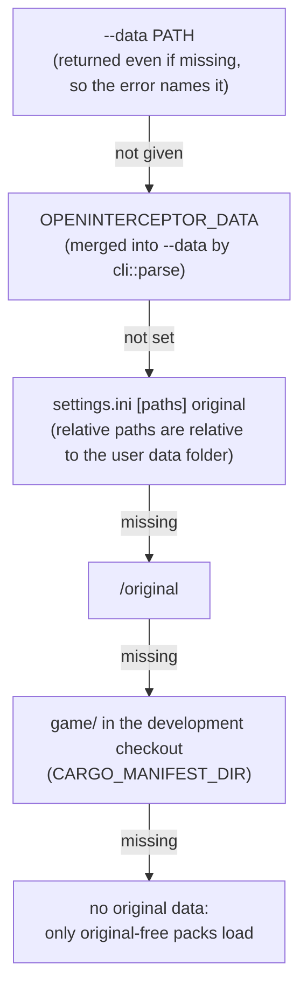

# Settings and data discovery

`src/settings.rs` and `src/cli.rs`: where the player's things live, and how the engine finds
the original Interceptor data without being told every time. Plan: Stage 1 (deployment
layout); the launcher grows a settings screen in Stage 5.

## Architecture Overview

An installed OpenInterceptor separates **what ships with the program** from **what belongs to
the player**:

```text
OpenInterceptor-0.2.0.app/Contents/          (the program — safe to share)
  MacOS/openinterceptor
  Resources/packs/interceptor, packs/sample  (built-in packs: no original content)

~/Library/Application Support/OpenInterceptor/      (macOS)
$XDG_DATA_HOME/openinterceptor/ or ~/.local/share/openinterceptor/   (Linux)
  settings.ini     [paths] original, mods; [packs] disabled
  bindings.ini     controls (created on first run)
  original/        optional copy of the CD (tools/build_bundle.py --install-data)
  mods/            one folder per mod
```

Finding the original data (`settings::resolve_original`) — the first candidate that exists
wins:



The mods folder is `--mods`, else `settings.ini` `[paths] mods`, else `<user data>/mods`.
`[packs] disabled` lists pack ids to switch off (whole-pack activation, like XWVM's Game
Content screen).

```ini
; settings.ini
[paths]
original = /Users/me/Interceptor CD
mods =

[packs]
disabled = hd-cockpit-test
```

`tools/build_bundle.py` presets `[paths] original` to the checkout's `game/` folder (or
`--data`), so a freshly built app finds the CD at once.

## Key Symbols

| Symbol | What it is |
|---|---|
| `Settings` | `original: Option<PathBuf>`, `mods: Option<PathBuf>`, `disabled_packs: Vec<String>`. |
| `settings::Source` | Which rule found the data: `CommandLine`, `Environment`, `SettingsFile`, `UserDataFolder`, `DevelopmentTree`. |
| `cli::user_data_dir()` | The per-user folder for this platform. |
| `cli::find_packs_dir(exe)` | `./packs`, next to the program, `../Resources/packs` inside an app bundle, then the source tree. |

## API Reference

- `Settings::parse(text)`, `Settings::load(dir)` (defaults if the file is missing),
  `settings.to_ini_text()`, `settings.save(dir)`.
- `resolve_original(cli, env, &settings, user_dir, dev_tree) -> Option<(PathBuf, Source)>` —
  pure apart from `is_dir` checks; tested with temporary folders.
- `cli::Options::content_config()` assembles a `ContentConfig` from all of the above.

## Debugging

- `openinterceptor --list` shows which packs loaded; if `interceptor` is missing, no data
  folder was found — check `settings.ini` or pass `--data`.
- Unknown keys in `settings.ini` are ignored, so a newer file still works with an older build.
