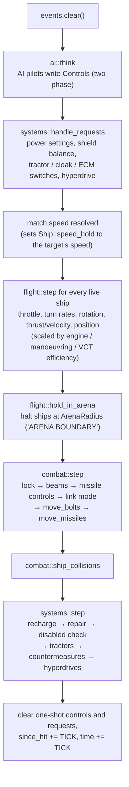
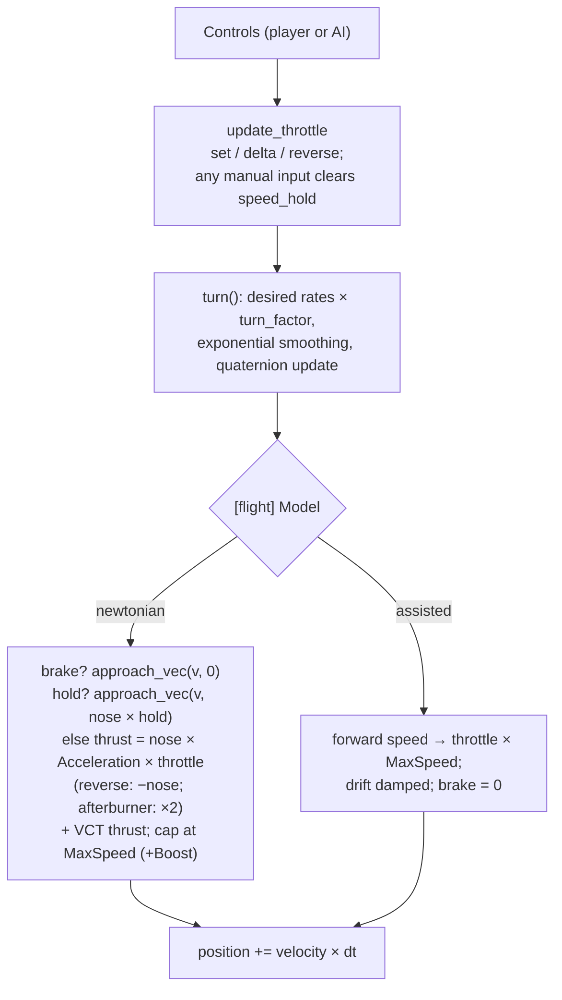
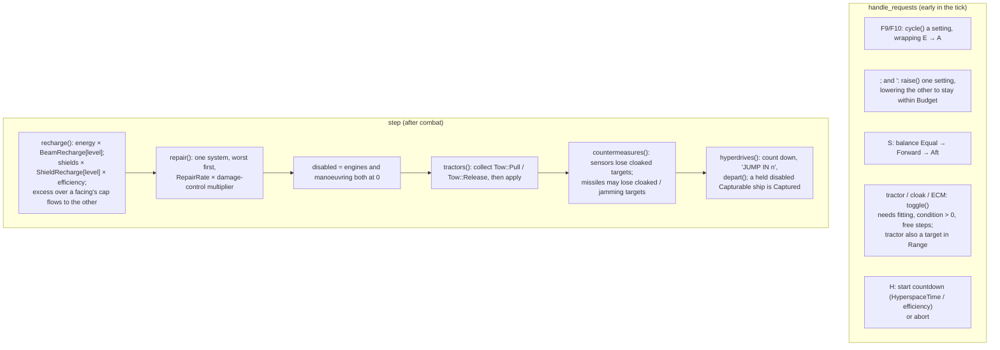

# Simulation

`src/sim/`: the battle as plain data, advanced by exactly `TICK` = 1/60 s per `World::step`.
No rendering, no input devices, no clock reads, no macroquad — only `glam` maths and the
`Ruleset`. That makes it deterministic and unit-testable (80+ tests). Plan: Stage 1 (flight,
weapons, basic AI); Stage 2 (in progress) adds ship systems, power, damage to systems, special
equipment, hyperspace and wingman orders (`sim::systems`), and will deepen the AI.

## Architecture Overview

### One tick: `World::step()`

In short: **AI → requests → flight → combat → collisions → systems**. Requests run before
flight so a switch pressed this tick (a cloak, a power change) already counts; systems run last
so that damage done this tick can knock a system out before repair and recharge look at it.

The player and the AI produce the **same** `Controls` struct and fly the same flight model.

### Flight model (`sim::flight`)

Two models, chosen per ruleset with `[flight] Model`:

**`newtonian` (default).** Space has no drag.

- **Throttle is thrust**: `Acceleration × throttle` along the nose. At zero throttle the ship
  coasts at its current velocity — it does not slow down.
- **Reverse** (`Z`) points the thrust backwards along the nose.
- **Brake** (hold `B`, gamepad B) retro-thrusts *against the velocity* at full
  `Acceleration` and stops exactly at zero (`approach_vec`).
- **Speed limit**: `MaxSpeed`, or `MaxSpeed + Boost` while the afterburner burns (double
  thrust, `Cost` energy per second). Thrust may not push past the cap; excess speed (after the
  burner stops) bleeds off at `Acceleration` per second.
- **Turning** changes the nose, not the velocity: a hard turn at speed makes the ship slide.
  VCT hulls add sideways/vertical thrust at `0.5 × Acceleration` (`VCT_THRUST_FRACTION`).
- **Flight computer (speed hold)**: `Controls::hold_speed` (set every tick by AI pilots) or
  `Ship::speed_hold` (set by match speed, `M`) drives the velocity towards
  `nose × hold` within the hull's acceleration — holding a forward speed *and* cancelling
  drift. Any manual throttle, reverse or brake input clears `speed_hold`. AI pilots therefore
  obey exactly the same thrust limits as the player.

**`assisted`** (the previous arcade model, kept for mods that want it): throttle sets a target
forward speed (`throttle × MaxSpeed`, reverse −½), the ship accelerates or decelerates towards
it, sideways drift is damped, VCT slides at 25 % of `MaxSpeed` (`VCT_SPEED_FRACTION`), brake
targets zero.

**Both models**: pitch and yaw rates scale with
`turn_factor(speed, LockSpeed) = clamp(1 − |speed| / LockSpeed, 0, 1)`; roll is not reduced.
Angular velocity approaches the desired value with `blend = 1 − exp(−dt / τ)`,
`τ = damping_time(AngularDamp) = 0.05 + 0.06 × AngularDamp`. Orientation is a quaternion
(`rotation × from_scaled_axis(ω·dt)`); body axes x = pitch (+ nose up), −y = yaw right,
−z = roll right. Static objects (`Kind = station`, mines) never translate but may spin.
Recharge of energy and shields moved to `systems::recharge` in Stage 2 (it now depends on the
power settings).

**System efficiencies.** Thrust and the afterburner scale with `efficiency(Engines)` (no
afterburner at 0), turn rates with `efficiency(Manoeuvring)`, VCT slides with
`efficiency(Vct)`. A craft whose list lacks engines, manoeuvring or sensors is treated as
having working ones that are not modelled; any other missing system does not work.

**Arena edge.** After flight, `hold_in_arena(ship, ArenaRadius)` places any ship beyond the
radius back on the boundary sphere and removes its outward velocity (tangential motion is
kept), emitting `Message "ARENA BOUNDARY"` when it first arrives. `ArenaRadius = 0` means no
limit. Default 60 000 m.

### Combat (`sim::combat`)

- **Lock**: the target inside the cone `[flight] LockAngleDegrees` and within
  `missile speed × duration` for the selected missile's `LockTime` seconds → `locked`,
  `SimEvent::LockAcquired`. Leaving the cone resets it. Lock builds at
  `efficiency(Sensors)` speed, halved again while the target's ECM is on.
- **Tractor and cloak**: while the tractor beam is on, beams do not fire ("BEAMS OFF-LINE:
  TRACTOR BEAM ON"); firing beams or a missile drops an active cloak ("CLOAK DROPPED").
- **Beams**: `LinkMode::Linked` fires mounts in pairs, `Full` all at once, `Unlinked` one at a
  time; each mount has a cooldown of `1 / RateOfFire`; energy is checked for the whole group
  (`NoEnergy` event and a 0.5 s hold if short). Bolts inherit the ship's velocity; life =
  range / speed.
- **Bolts and missiles** test the *segment* travelled this tick against every other ship's
  `collision::Shape` (sphere broad phase, triangle mesh for stations) so fast shots cannot
  tunnel.
- **Missiles** home with `rotate_towards` at `TurnRate`; impact damage on a hit; the proximity
  fuse detonates on a near *miss* (inside `ProximityRadius` and moving away); expired missiles
  pop harmlessly.
- **Damage** (`apply_damage`): fore or aft shield (by which side was hit) → armour → hull;
  hull ≤ 0 → `alive = false`, `Destroyed`, and every ship targeting or towing it lets go
  (`forget_ship`). Damage that gets past the armour without destroying the ship also strikes a
  system (`systems::damage_system`). A shield facing reaching zero says "FORE/AFT SHIELD DOWN".
- **Collisions**: fighter–fighter spheres (60 % of radius) push apart and swap half their
  velocities; a fighter sweeping into a station mesh is backed out and bounced. Damage =
  relative speed × 0.1.

### Systems (`sim::systems`, Stage 2)

Everything a pilot manages *inside* the ship. Data comes from `[system:<id>]`, `[power]` and
`[damage]` ([Rulesets](../modding/rulesets.md)); each ship has `power: Power`,
`systems: Vec<SystemState>` (one per fitted system), `repairing`, `towing`, `hyperspace`,
`disabled` and `departed`.

**Conditions.** `SystemState::condition()` is `Ok` above half its hit points (efficiency 1),
`Damaged` at half or below (0.5), `Inoperative` once its hit points reach 0 (0) and
`Destroyed` below `−DestroyBelow × max` (0, for the battle). `SystemState::set_hp` keeps an
`offline` flag: a knocked-out system stays `Inoperative` until repaired back to
`ONLINE_AT` = 25 % of its hit points, so the first moments of repair do not bring a wreck
straight back. A knocked-out switchable system switches off; a knocked-out hyperdrive aborts a
countdown.

**Damage.** `damage_system` strikes one random non-destroyed system with the damage that got
past the armour × `SystemShare`, and emits `SystemChanged` when the condition changes.

**Repair.** `repair` keeps working on the current job; otherwise it takes the worst-off system
(first in fitting order on a tie). Speed = class `RepairRate` × (1 + (`RepairRate` of the damage
control computer − 1) × its efficiency); the computer does not speed up its own repair.

**Power.** `raise` and `cycle` work on a plain `Power` value and the `PowerRules`, not on the
world, so they are tested exhaustively. `shield_caps(shields, balance, shift)` gives the fore
and aft capacities `shields × (1 ± shift)`.

**Tractor.** The beam holds its target on its current bearing at a distance between 1.2 × the
two radii and 0.6 × `Range`, steering the target's velocity towards the captor's by at most
`Strength × efficiency` m/s². The hold is lost beyond 1.5 × `Range`, if the target goes, or if
the tractor is knocked out ("TRACTOR BEAM RELEASED"). Because a pull changes *another* ship,
decisions are collected as `Tow` values first and applied afterwards (the two-phase pattern of
`ai::think`).

**Cloak and ECM.** `detectable(world, observer, other)` hides a cloaked ship of another faction
beyond its cloak's `Range`; targeting (`targeting::cycle`, nearest enemy) only offers detectable
ships and a sensor that loses its target says "TARGET LOST". Each second, a missile homing on a
ship loses its target with chance `Strength / 100 × efficiency` per active cloak, plus per active
ECM within `Range` of the missile.

**Hyperspace.** The countdown announces the last five seconds; at zero `depart` removes the
ship (`alive = false`, `departed = true`, `Departed` event). If its tractor holds a disabled,
`Capturable` ship, that ship departs too and `Captured { captor, prize }` is emitted.

### AI (`sim::ai`)

`think` reads the whole world into a list of decisions, then writes them (two-phase update).
Behaviours: `Idle`, `Target` (slow circle, never fires), `Wingman`, `Enemy` (nearest hostile
within 8 km, lead pursuit, fires inside ~5°, missiles when locked every 8 s, breaks off when
about to ram, VCT jinks when targeted). A **disabled** AI ship does nothing but drift.

Wingmen follow `WingOrder`s from their leader (`order_wingmen`); they fend for themselves if
the leader dies:

| Order | Behaviour |
|---|---|
| `Formation` (default; "ignore my target") | Hold the formation slot. |
| `AttackMyTarget` | Attack the leader's current target if it is hostile. |
| `FireAtWill` | Engage the nearest hostile near the leader. |
| `Evasive` | Break formation and weave near the leader for `EVASIVE_TIME` = 10 s, then form up. |
| `Retreat` | Run from the nearest hostile at full speed (afterburner while energy lasts) and start the hyperdrive. |

`wing_status(world, leader)` returns one line per wingman: name, hull and shield percentages,
current order, and `DISABLED` if so.

## Key Symbols

| Symbol | What it is |
|---|---|
| `World` | `rules: Arc<Ruleset>`, `shapes: Arc<Vec<Shape>>`, `ships`, `bolts`, `missiles`, `events`, `time`, deterministic xorshift `random()`. |
| `ShipId` | `{ index, generation }` — a generational handle. A destroyed ship's slot can be reused; the generation changes, so old ids resolve to `None`. |
| `Ship` | Class, faction, name, position, rotation (`Quat`), velocity, angular velocity, throttle, reverse, afterburning, `braking`, `speed_hold`, hull/armor/shields/energy, `controls`, `pilot`, `target`, link mode, beam cooldowns, missile racks, `lock`, `since_hit`, `alive`; Stage 2: `power`, `systems`, `repairing`, `towing`, `hyperspace`, `disabled`, `departed`. Helpers `system(kind)`, `efficiency(kind)`, `is_on(kind)`, `cloaked()`. |
| `Controls` | Pilot input for one tick: axes, slide, throttle set/delta, reverse toggle, match speed, afterburner, `brake` (held), `hold_speed` (flight computer target, m/s), fire, link/missile cycling, `requests`. `carry_unconsumed` keeps unconsumed one-shot presses across frames that run no tick. |
| `Requests` | Edge-triggered power and equipment presses: `beam_charge`, `shield_charge`, `power_to_shields`, `power_to_beams`, `shield_balance`, `tractor`, `cloak`, `ecm`, `hyperspace`; `merge`. |
| `Power`, `ShieldBalance` | Beam and shield level indices (0 = A) and `Equal` / `Forward` / `Aft`. |
| `SystemState`, `Condition` | One fitted system: `id`, `kind`, `hp`, `max`, `destroyed`, `offline`, `on`; `set_hp`, `condition()`, `ONLINE_AT`. `Condition::{Ok, Damaged, Inoperative, Destroyed}` with `efficiency()` 1 / 0.5 / 0 / 0. |
| `systems::Setting`, `systems::Tow` | Beam or shield (for `raise` / `cycle`); a tractor decision (`Pull(target, velocity, max accel)` or `Release(captor)`). |
| `ai::WingOrder`, `ai::EVASIVE_TIME` | Wingman orders (above). |
| `FlightModel` | `Newtonian` or `Assisted` (`[flight] Model`), in `FlightRules` with `arena_radius`. |
| `Pilot` | `External` (the player) or `Ai(AiState)`. |
| `SimEvent` | `BeamFired`, `MissileLaunched`, `Hit`, `Destroyed`, `MissileExploded`, `LockAcquired`, `Collision`, `Message`, `NoEnergy`; Stage 2: `SystemChanged { ship, system, condition, repaired }`, `Disabled { ship }`, `Departed { ship, position }`, `Captured { captor, prize }`, `Switched { ship, kind, on }`. |
| `Bolt`, `Missile`, `Lock`, `LinkMode` | Projectiles and weapon state. |
| `collision::Shape`, `TriMesh` | Bounding radius plus optional triangle mesh. |
| `TICK` | `1.0 / 60.0`. |

## API Reference

- `World::new(rules, shapes, seed)`, `World::from_scenario(&Scenario, rules, shapes, player_class) -> Result<(World, ShipId), String>`.
- `world.spawn(class, faction, name, position, rotation, pilot) -> ShipId`, `get`, `get_mut`,
  `id_of(index)`, `live_ids()`, `step()`.
- `flight::step(&mut Ship, &ShipClass, &FlightRules, dt)`, `turn_factor`, `damping_time`,
  `approach`, `approach_vec(v, target, max_step)`, `update_throttle`,
  `hold_in_arena(&mut Ship, radius) -> bool`; constants `VCT_THRUST_FRACTION`,
  `VCT_SPEED_FRACTION`.
- `combat::step(&mut World, dt)`, `apply_damage(world, id, amount, at)`, `ship_collisions`,
  `rotate_towards`, `mount_offset`.
- `combat::forget_ship(world, id)` — every ship targeting or towing `id` lets go.
- `systems::handle_requests(&mut World)`, `systems::step(&mut World, dt)`,
  `raise(&mut Power, Setting, &PowerRules, switched) -> bool`, `cycle(...) -> bool`,
  `shield_caps(shields, balance, shift) -> (f32, f32)`, `power_message(&Power, &PowerRules)`,
  `switched_power(&Ship, &Ruleset)`, `power_used(&Ship, &Ruleset)`,
  `recharge(&mut Ship, &ShipClass, &PowerRules, dt)`,
  `repair(&mut Ship, &ShipClass, &Ruleset, dt) -> Option<(index, before, after)>`,
  `damage_system(world, id, amount)`, `detectable(world, observer, other) -> bool`.
- `ai::think`, `ai::order_wingmen(world, leader, WingOrder) -> usize`,
  `ai::wing_status(world, leader) -> Vec<String>`, `steer_towards`, `lead_point`.
- `targeting::cycle`, `nearest_hostile`, `in_sights(world, me, max_angle_deg)`, `off_nose_angle`.
- `collision::segment_sphere`, `segment_triangle` (Möller–Trumbore), `segment_shape`.
- `sim::euler(Vec3 degrees)` — yaw/pitch/roll to a quaternion (positive yaw turns left).

## Debugging

- To compare the two flight models, set `[flight] Model = assisted` in a mod's rules (or a
  small addon to the `default` campaign) and fly the same scenario; the HUD status line shows `BRAKE` while braking and
  `HOLD n` while a speed hold is active.

- Because `step` is deterministic, a bug can be reproduced as a unit test: build a world with
  `sim::test_support::world()` (a tiny in-memory ruleset), place ships, set `controls`, call
  `step` in a loop, assert. Most tests in `sim/` are written exactly this way.
- `--view chase` or `--view chase-manual` shows the player's own ship to check orientation and
  engine glow; the MFD Status page shows shields, armour, hull and energy live, and the
  Systems page each system's condition.
- The `systems-trial` scenario (both campaigns) exercises power, tractor tow and capture,
  cloak and hyperspace. Scenario objects with `destroyed_systems = engines, manoeuvring` start
  disabled, and `hull = 0.3` starts them damaged, so a system state can be set up without
  fighting for it.
- Every power or equipment refusal is a pilot message ("INSUFFICIENT POWER FOR …",
  "NO TARGET IN TRACTOR RANGE", "… INOPERATIVE"); the message line and `L` (repeat) show why a
  switch did nothing.
