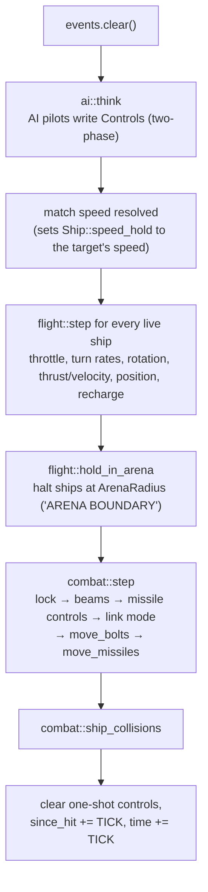
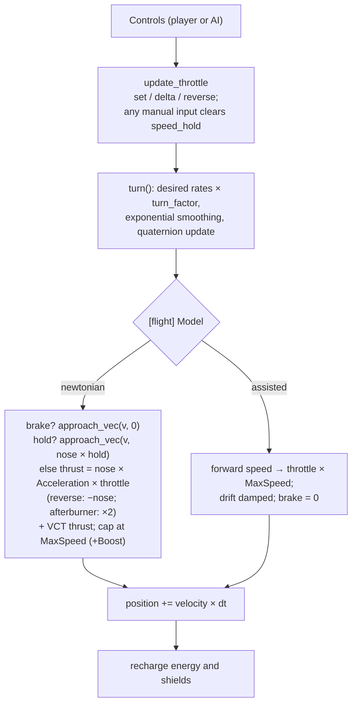

# Simulation

`src/sim/`: the battle as plain data, advanced by exactly `TICK` = 1/60 s per `World::step`.
No rendering, no input devices, no clock reads, no macroquad — only `glam` maths and the
`Ruleset`. That makes it deterministic and unit-testable (60+ tests). Plan: Stage 1 (flight,
weapons, basic AI); Stage 2 deepens combat and AI.

## Architecture Overview

### One tick: `World::step()`

The player and the AI produce the **same** `Controls` struct and fly the same flight model.

### Flight model (`sim::flight`)

Two models, chosen per ruleset with `[flight] Model`:

**`newtonian` (default).** Space has no drag.

- **Throttle is thrust**: `Acceleration × throttle` along the nose. At zero throttle the ship
  coasts at its current velocity — it does not slow down.
- **Reverse** (`Z`) points the thrust backwards along the nose.
- **Brake** (hold `B`, gamepad B) retro-thrusts *against the velocity* at full
  `Acceleration` and stops exactly at zero (`approach_vec`).
- **Speed limit**: `MaxSpeed`, or `MaxSpeed + Boost` while the afterburner burns (double
  thrust, `Cost` energy per second). Thrust may not push past the cap; excess speed (after the
  burner stops) bleeds off at `Acceleration` per second.
- **Turning** changes the nose, not the velocity: a hard turn at speed makes the ship slide.
  VCT hulls add sideways/vertical thrust at `0.5 × Acceleration` (`VCT_THRUST_FRACTION`).
- **Flight computer (speed hold)**: `Controls::hold_speed` (set every tick by AI pilots) or
  `Ship::speed_hold` (set by match speed, `M`) drives the velocity towards
  `nose × hold` within the hull's acceleration — holding a forward speed *and* cancelling
  drift. Any manual throttle, reverse or brake input clears `speed_hold`. AI pilots therefore
  obey exactly the same thrust limits as the player.

**`assisted`** (the previous arcade model, kept for mods that want it): throttle sets a target
forward speed (`throttle × MaxSpeed`, reverse −½), the ship accelerates or decelerates towards
it, sideways drift is damped, VCT slides at 25 % of `MaxSpeed` (`VCT_SPEED_FRACTION`), brake
targets zero.

**Both models**: pitch and yaw rates scale with
`turn_factor(speed, LockSpeed) = clamp(1 − |speed| / LockSpeed, 0, 1)`; roll is not reduced.
Angular velocity approaches the desired value with `blend = 1 − exp(−dt / τ)`,
`τ = damping_time(AngularDamp) = 0.05 + 0.06 × AngularDamp`. Orientation is a quaternion
(`rotation × from_scaled_axis(ω·dt)`); body axes x = pitch (+ nose up), −y = yaw right,
−z = roll right. Energy recharges (not while burning); fore and aft shields recharge. Static
objects (`Kind = station`, mines) never translate but may spin.

**Arena edge.** After flight, `hold_in_arena(ship, ArenaRadius)` places any ship beyond the
radius back on the boundary sphere and removes its outward velocity (tangential motion is
kept), emitting `Message "ARENA BOUNDARY"` when it first arrives. `ArenaRadius = 0` means no
limit. Default 60 000 m.

### Combat (`sim::combat`)

- **Lock**: the target inside the cone `[flight] LockAngleDegrees` and within
  `missile speed × duration` for the selected missile's `LockTime` seconds → `locked`,
  `SimEvent::LockAcquired`. Leaving the cone resets it.
- **Beams**: `LinkMode::Linked` fires mounts in pairs, `Full` all at once, `Unlinked` one at a
  time; each mount has a cooldown of `1 / RateOfFire`; energy is checked for the whole group
  (`NoEnergy` event and a 0.5 s hold if short). Bolts inherit the ship's velocity; life =
  range / speed.
- **Bolts and missiles** test the *segment* travelled this tick against every other ship's
  `collision::Shape` (sphere broad phase, triangle mesh for stations) so fast shots cannot
  tunnel.
- **Missiles** home with `rotate_towards` at `TurnRate`; impact damage on a hit; the proximity
  fuse detonates on a near *miss* (inside `ProximityRadius` and moving away); expired missiles
  pop harmlessly.
- **Damage** (`apply_damage`): fore or aft shield (by which side was hit) → armour → hull;
  hull ≤ 0 → `alive = false`, `Destroyed`, and every ship targeting it loses the target.
- **Collisions**: fighter–fighter spheres (60 % of radius) push apart and swap half their
  velocities; a fighter sweeping into a station mesh is backed out and bounced. Damage =
  relative speed × 0.1.

### AI (`sim::ai`)

`think` reads the whole world into a list of decisions, then writes them (two-phase update).
Behaviours: `Idle`, `Target` (slow circle, never fires), `Wingman` (formation slot; orders
`Formation`, `AttackMyTarget`, `FireAtWill`; fends for itself if the leader dies), `Enemy`
(nearest hostile within 8 km, lead pursuit, fires inside ~5°, missiles when locked every 8 s,
breaks off when about to ram, VCT jinks when targeted).

## Key Symbols

| Symbol | What it is |
|---|---|
| `World` | `rules: Arc<Ruleset>`, `shapes: Arc<Vec<Shape>>`, `ships`, `bolts`, `missiles`, `events`, `time`, deterministic xorshift `random()`. |
| `ShipId` | `{ index, generation }` — a generational handle. A destroyed ship's slot can be reused; the generation changes, so old ids resolve to `None`. |
| `Ship` | Class, faction, name, position, rotation (`Quat`), velocity, angular velocity, throttle, reverse, afterburning, `braking`, `speed_hold`, hull/armor/shields/energy, `controls`, `pilot`, `target`, link mode, beam cooldowns, missile racks, `lock`, `since_hit`, `alive`. |
| `Controls` | Pilot input for one tick: axes, slide, throttle set/delta, reverse toggle, match speed, afterburner, `brake` (held), `hold_speed` (flight computer target, m/s), fire, link/missile cycling. `carry_unconsumed` keeps unconsumed one-shot presses across frames that run no tick. |
| `FlightModel` | `Newtonian` or `Assisted` (`[flight] Model`), in `FlightRules` with `arena_radius`. |
| `Pilot` | `External` (the player) or `Ai(AiState)`. |
| `SimEvent` | `BeamFired`, `MissileLaunched`, `Hit`, `Destroyed`, `MissileExploded`, `LockAcquired`, `Collision`, `Message`, `NoEnergy`. |
| `Bolt`, `Missile`, `Lock`, `LinkMode` | Projectiles and weapon state. |
| `collision::Shape`, `TriMesh` | Bounding radius plus optional triangle mesh. |
| `TICK` | `1.0 / 60.0`. |

## API Reference

- `World::new(rules, shapes, seed)`, `World::from_scenario(&Scenario, rules, shapes, player_class) -> Result<(World, ShipId), String>`.
- `world.spawn(class, faction, name, position, rotation, pilot) -> ShipId`, `get`, `get_mut`,
  `id_of(index)`, `live_ids()`, `step()`.
- `flight::step(&mut Ship, &ShipClass, &FlightRules, dt)`, `turn_factor`, `damping_time`,
  `approach`, `approach_vec(v, target, max_step)`, `update_throttle`,
  `hold_in_arena(&mut Ship, radius) -> bool`; constants `VCT_THRUST_FRACTION`,
  `VCT_SPEED_FRACTION`.
- `combat::step(&mut World, dt)`, `apply_damage(world, id, amount, at)`, `ship_collisions`,
  `rotate_towards`, `mount_offset`.
- `ai::think`, `ai::order_wingmen(world, leader, WingOrder) -> usize`, `steer_towards`, `lead_point`.
- `targeting::cycle`, `nearest_hostile`, `in_sights(world, me, max_angle_deg)`, `off_nose_angle`.
- `collision::segment_sphere`, `segment_triangle` (Möller–Trumbore), `segment_shape`.
- `sim::euler(Vec3 degrees)` — yaw/pitch/roll to a quaternion (positive yaw turns left).

## Debugging

- To compare the two flight models, set `[flight] Model = assisted` in a mod's rules (or the
  sample pack) and fly the same scenario; the HUD status line shows `BRAKE` while braking and
  `HOLD n` while a speed hold is active.

- Because `step` is deterministic, a bug can be reproduced as a unit test: build a world with
  `sim::test_support::world()` (a tiny in-memory ruleset), place ships, set `controls`, call
  `step` in a loop, assert. Most tests in `sim/` are written exactly this way.
- `--view chase` or `--view chase-manual` shows the player's own ship to check orientation and
  engine glow; the MFD Status page shows shields, armour, hull and energy live.
