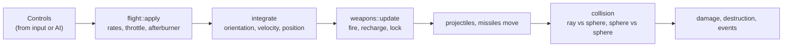

# Simulation

`src/sim/`: the battle as plain data. Fixed 60 Hz steps; no rendering, no macroquad, no clock
reads — the caller passes `dt` and the controls. Plan: Stage 1, items 1.5–1.8.

## Architecture Overview

Logic flow of `World::step(dt)`: AI writes `Controls` for non-player ships → every ship applies
its flight model → weapons fire and recharge → shots and missiles move → collisions → damage →
dead ships are removed and events (hit, kill, lock) are queued for HUD and audio.

### Flight model

- Angular rate limits from the hull: `rate(speed) = base × max(0, 1 − speed / LockSpeed)` for
  pitch and yaw (roll keeps a floor), in degrees per second.
- Stick input sets the target angular velocity; `AngularDamp` sets how quickly the actual
  velocity follows (0 tight … 10 loose).
- Throttle sets a target speed up to `MaxSpeed`; the ship accelerates along its nose. The
  afterburner adds `Boost` while draining energy. Reverse flips the target. Match speed copies
  the target's speed.
- VCT adds sideways/vertical slide velocity when fitted.

## Key Symbols

| Symbol | What it is |
|---|---|
| `World` | Everything in the arena: `ships: Vec<Ship>`, `shots`, `missiles`, `events`. |
| `ShipId` | A newtype index with a generation counter, so a stale id of a destroyed ship is detected instead of pointing at a new ship. |
| `Ship` | Class id, side, `Body` (position, orientation quaternion, velocity, angular velocity), throttle, energy, hull, weapons, target, AI state. |
| `Controls` | One frame of pilot input: pitch, yaw, roll (−1…1), throttle commands, fire flags. The player and the AI produce the same type. |
| `Event` | Something the presentation layer should know: `Fired`, `Hit`, `Destroyed`, `LockAcquired`. |

## API Reference

- `World::from_scenario(&Scenario, &Rules, &Assets) -> Result<World>`.
- `World::step(&mut self, dt: f32, player: &Controls)`.
- `World::drain_events(&mut self) -> impl Iterator<Item = Event>`.
- `flight::turn_rates(&FlightSpec, speed) -> Vec3` and other pure helpers, unit tested.

## Debugging

The developer overlay (F12) shows the player's speed, target speed, angular rates and energy.
Because `step` is deterministic, a bug can be reproduced by recording `Controls` per tick.
