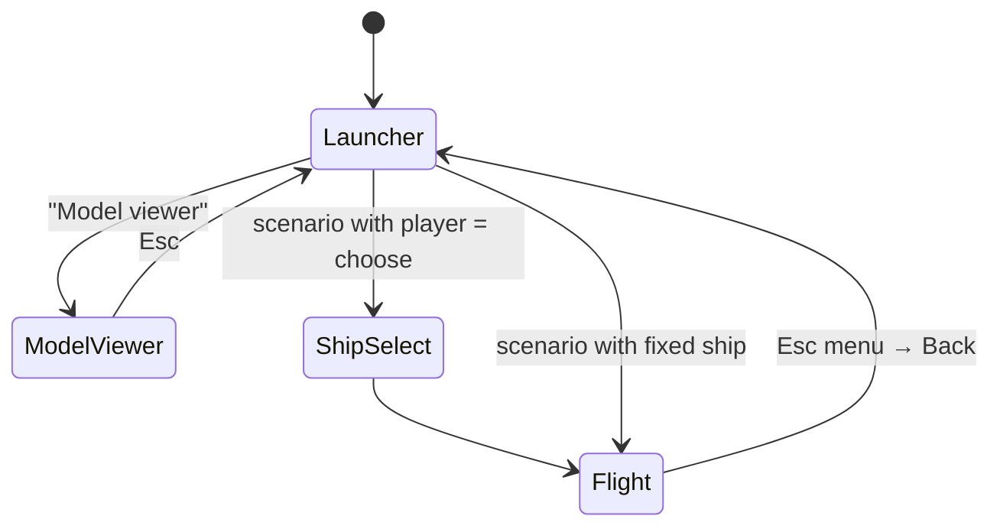

# Testbed

`src/testbed/`: the application a tester uses. A launcher lists every scenario from every loaded
pack and lets the tester pick a ship; each scenario is a live test environment.
Plan: Stage 1, item 1.11.

## Architecture Overview

## Key Symbols

| Symbol | What it is |
|---|---|
| `Screen` | An `enum` of the testbed's states (`Launcher`, `ShipSelect`, `ModelViewer`, `Flight`). |
| `FlightSession` | A running scenario: `World`, `Scene`, `Hud`, view, pause state. |

## API Reference

- `testbed::run(Config).await`: the window's main loop.
- Command-line: `--scenario <id>`, `--ship <id>` skip the launcher.

## Debugging

`F12` developer overlay; `--scenario` and `--ship` to reproduce a report directly.
