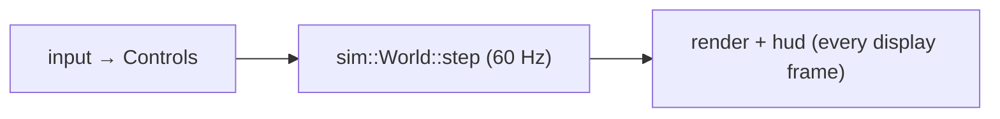

# Architectural design

## Layering

```
formats  →  packs / rules / assets  →  sim  →  render / hud / audio / input  →  testbed
```

Each layer depends only on layers to its left. Consequences:

- `formats` is pure functions on bytes: testable with hand-made inputs, reusable by tools.
- `sim` knows nothing about drawing or windows: testable, deterministic, and usable headless
  (for AI duels, replays, a future server).
- Presentation reads the simulation; it never changes it except through `Controls`.

## Data-driven design

The engine contains **no game content**. Ships, weapons, stations, cockpits and scenarios come
from packs. A quick test for a change: *could a modder do this with a pack?* If the answer
requires editing Rust, ask whether a rule key should exist instead. This is what makes the
Interceptor content "just one pack" and a custom campaign possible.

## Separate simulation from rendering



The simulation is the single source of truth. Rendering is a view of it; two views (cockpit and
model viewer) can draw the same world.

## Fixed timestep

The simulation advances in constant 1/60 s steps, run as many times as needed per display frame
(see [the loop](../learn-rust/async-loop.md)). Physics and AI then behave the same on a 60 Hz
laptop and a 144 Hz monitor, and a recorded input sequence replays identically.

## One owner per resource

Each long-lived resource has one owner: the `Testbed` owns the `Vfs`, `Rules` and `Assets`; a
`FlightSession` owns its `World`. Everything else borrows. No reference counting is needed in
the core, and lifetimes stay simple.

## Errors are values, diagnostics are collected

Loading returns `Result`s and collects warnings; nothing in the content path panics on bad data.
