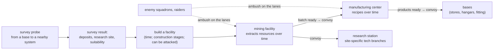

# Logistics: resources, facilities and supply lines

**Status: planned (design).** A strategy-layer capability requested for the **default
campaign** (*Perils of the Void*); the `interceptor` campaign does not use it (its economy stays
the original's outposts, OPPs and freighter deliveries, [Economy](format-strategy.md#economy)).
Everything below is data in YAML rules a modder can change or leave out: a campaign without
`facility_types`, `recipes` and `logistics` sections behaves as today. Owners:
[Stage 4](../implementation-plan/stage-4-strategy.md) (economy, facilities, logistics, convoys,
surveys), [Stage 3](../implementation-plan/stage-3-missions.md) (the two new mission types) and
[Stage 5](../implementation-plan/stage-5-campaign.md) (the rival's use of supply lines). Model
construction stages build on the model-set states of Stage 2.

## What the player does



1. **Survey.** A base launches a survey probe to a nearby system; when it arrives (and survives)
   it reports the system's deposits and whether it suits a mining facility, a research station
   or a manufacturing center.
2. **Build.** A facility is built in a system that meets its type's requirements. Building takes
   time and passes through **construction stages**, each with its own model; while unfinished
   the enemy may try to destroy it (a construction-defence mission).
3. **Produce.** Mining extracts resources over time; when a batch is ready it waits for pickup.
   Manufacturing turns resources into products by **recipes**, also over time.
4. **Ship.** When a batch or product is ready a **supply convoy** is dispatched along the lanes:
   mining → manufacturing (and → research stations), manufacturing → bases. Convoys are visible
   map entities; an enemy that meets one may attack it (a convoy-ambush mission). A convoy
   destroyed or captured never delivers its cargo.
5. **Research.** Research stations unlock tech branches that ordinary bases cannot research,
   and only in systems that meet their site criteria.
6. **Defend.** Fighters can be assigned to any facility: they defend its system and escort the
   convoys that leave it.

## Data model

All sections live in the campaign's `strategy/*.yaml` (the strategy-layer files of
[Format: strategy layer](format-strategy.md)). Quantities use the implemented units (`48h`,
`2.4km`, `40%`); conditions and expressions use the [condition language](format-behaviour.md#conditions)
with a **campaign context** (planned, Stage 3–4).

### Resources and deposits

```yaml
resources:
  cosmium:        {name: "@res.cosmium", unit: t, bulk: 1}      # bulk: cargo space per unit
  ore:            {name: "@res.ore", unit: t, bulk: 1}
  helium3:        {name: "@res.helium3", unit: t, bulk: 2}
  theremin_glass: {name: "@res.theremin_glass", unit: kg, bulk: 0.1, rare: true}

maps:
  reach:
    systems:
      ajax:
        pos: [4300, 1500]
        class: red_dwarf
        bodies: [planet:ice, belt:rich]
        deposits:                           # what can be mined, where, how fast, how much
          cosmium: {body: belt, rate: 6/day, reserve: 1800}
          ore:     {body: planet, rate: 20/day, reserve: unlimited}
        features: [nebula, pulsar_near]     # tags for research-site criteria
        hidden_deposits: true               # only a survey reveals them
```

- **Deposits** belong to a system (optionally a body). `rate` is the base extraction rate of a
  level-1 mining facility; `reserve` runs down as it is mined (`unlimited` allowed).
- **Features** are free tags a campaign defines (`nebula`, `pulsar_near`, `derelict`,
  `ion_storms`); research-site criteria test them. A generated map (Stage 4) rolls deposits and
  features from tables like its star classes and bodies.

### Facility types

The three new base types are `facility_types` — base types (`base_types` in
[Bases and modules](format-strategy.md#bases-and-modules)) with production roles:

```yaml
facility_types:
  mining_facility:
    name: "@fac.mining"
    hub: objects.guard_mining_rig             # an object class with a model set (construction states)
    role: mining
    placement: "survey_known(system) and deposit(system, any) > 0"
    max_per_system: 1
    build: {cost: 400000, time: 240h, stages: [build_25, build_50, build_75]}
    extracts: {rate: "deposit_rate(system, resource) * level", batch: 100t, storage: 400t}
    hangars: 2                                # fighters that can be assigned
    sensor_range: 1.5ly
    upgrades: {level_2: {cost: 250000, time: 120h, requires: "research(deep_drills)"}}

  research_station:
    name: "@fac.research"
    hub: objects.guard_research_station
    role: research
    placement: "survey_known(system) and research_site(system, any)"
    build: {cost: 900000, time: 480h, stages: [build_25, build_50, build_75]}
    consumes: {cosmium: 5/day, theremin_glass: 0.2/day}     # supplied by convoy
    research_rate: 40                          # work units per hour while supplied
    hangars: 2

  manufacturing_center:
    name: "@fac.manufacturing"
    hub: objects.guard_foundry
    role: manufacturing
    placement: "owned(system) and lane_distance(system, nearest_base) <= 2"
    build: {cost: 1200000, time: 360h, stages: [build_25, build_50, build_75]}
    lines: 2                                   # recipes running at once
    storage: 800t
    hangars: 4
```

| Key | Meaning |
|---|---|
| `role` | `mining`, `research` or `manufacturing` (engine behaviours); ordinary `base_types` keep theirs. |
| `hub` | The object class placed on the map and in battles at this facility — its model set has the construction stages. |
| `placement` | A campaign condition over the candidate system (`deposit(...)`, `research_site(...)`, `owned(...)`, `lane_distance(...)`, `survey_known(...)`). |
| `build` | `cost`, `time`, `stages` (state names of the hub's model set, in order), `requires` (research). |
| `extracts`, `consumes`, `lines`, `research_rate`, `storage` | Role parameters (below). |
| `hangars` | Fighter capacity for assignment. |
| `upgrades` | Levels with cost, time and requirements. |

### Research sites and tech branches

```yaml
research_sites:
  nebula_lab:
    name: "@site.nebula_lab"
    criteria: "feature(system, nebula) and star_class(system) in [red_dwarf, blue_giant]"
  pulsar_array:
    criteria: "feature(system, pulsar_near)"

research:
  theremin_shielding:
    size: 24000
    requires: "research(force_fields)"
    lab: research_station                     # only research stations can work on it
    site: nebula_lab                          # …and only one at a nebula lab site
  gravity_lens_targeting:
    size: 30000
    lab: research_station
    site: pulsar_array
```

`lab:` restricts a topic (or a whole branch, `branches: {theremin: {lab: research_station}}`) to
a facility type; `site:` further to stations in systems meeting a research site's criteria.
Topics without `lab:` are researched as today (the campaign's `research_model`).

### Production recipes

```yaml
recipes:
  alloy_plate:
    at: manufacturing_center
    inputs: {ore: 20t, cosmium: 2t}
    time: 24h
    output: {resource: alloy, amount: 10t}
  heat_ray:
    at: manufacturing_center
    inputs: {alloy: 4t, cosmium: 1t}
    time: 48h
    output: {item: heat_ray, amount: 1}
    requires: "research(heat_ray)"
  comet:
    at: manufacturing_center
    inputs: {alloy: 30t, cosmium: 8t}
    time: 240h
    output: {hull: comet, amount: 1}
```

A manufacturing center runs up to `lines` recipes at once from the player's queue; a recipe
starts when its inputs are **in that center's store** (delivered by convoy), takes `time`, and
puts its output in the store, ready for shipment.

### Supply routes and convoys

```yaml
logistics:
  routes:
    - {from: mining, to: manufacturing, cargo: [ore, cosmium, helium3]}
    - {from: mining, to: research, cargo: [cosmium, theremin_glass]}
    - {from: manufacturing, to: base, cargo: [items, hulls, alloy]}
  destination: nearest_by_lane                # or player-set per facility
  dispatch:
    when: "ready_cargo >= batch or waiting >= 72h"   # a batch is ready, or it has waited long enough
  convoy:
    ship: objects.guard_supply_rocket          # one freighter per capacity, or a list
    capacity: 200t
    escort: {from_assigned: true, max: 3}      # fighters assigned to the origin facility fly escort
    speed: lane                                # lane travel times
  losses:
    destroyed: lose_cargo
    captured: {cargo: captor}                  # the captor's faction receives it
    disabled_recovered: keep                   # a disabled freighter towed home keeps its load
```

- A **route rule** says which facility role ships which cargo to which role; `destination`
  picks the target facility.
- When `dispatch.when` holds at a facility, a **convoy** entity is created with the ready cargo
  (up to `capacity` per freighter), its escorts, and a path along the lanes.
- On arrival the cargo enters the destination's store. A destroyed convoy loses its cargo; a
  captured one gives it to the captor (the Dominion's cargo orbs and the Guard's supply rockets
  both obey this).
- Enemy logistics (the Dominion's cosmium shipments to the Eclipse Engine,
  [Stage 5 plans](format-campaign.md#rival-plans-planid)) use the same convoy entities, so the
  player can raid them.

### Mission types tied to logistics (Stage 3)

Two mission types (in the [mission format](format-missions.md#mission-types-missionid)) are
generated by the logistics layer:

```yaml
missions:
  convoy_ambush:                              # the enemy attacks a player convoy
    location: lane                            # a point on the convoy's lane
    generated: "hostile_squadron_meets(player_convoy)"
    roles:
      convoy: {from: convoy_ships, behaviour: freighter_run, protect: true}
      escorts: {from: convoy_escorts}
      attackers: {from: attacking_squadron}
      player: {from: launched_craft, optional: true}   # the player may also fly escort
    arrivals: {attackers: {distance: 5km, from_role: convoy, ambush: true}}
    objectives:
      win: "destroyed_all(attackers) or retreated_all(attackers) or departed_all(convoy)"
      lose: "destroyed_all(convoy) or captured_any(convoy)"
    outcomes:
      win: [deliver(convoy)]
      lose: [lose_cargo(convoy)]
    auto_resolve: true                         # without the player, resolved from forces

  construction_defence:                       # the enemy strikes a facility before it is finished
    location: facility
    generated: "facility_building(system) and hostile_squadron_targets(system)"
    roles:
      site: {from: target_facility, state: build_stage}   # the hub in its current stage model
      guards: {from: assigned_fighters}
      attackers: {from: attacking_squadron}
      player: {from: launched_craft}
    objectives:
      win: "destroyed_all(attackers) or retreated_all(attackers)"
      lose: "destroyed(site)"
    outcomes:
      lose: [lose_facility(site), refund(build, 25%)]
```

- `protect: true` on the convoy uses the implemented protected-objective marking.
- `state: build_stage` places the facility hub in the model-set state of its current
  construction stage; its hit points scale with progress (`hp_scale: progress`, so an early
  site is fragile).
- `auto_resolve` lets an unwatched ambush be settled from the forces involved, so supply lines
  matter even when the player is elsewhere.
- The default campaign's existing **Escort** and **Convoy raid** types become these generated
  missions on the strategy map.

### Survey probes

```yaml
probes:
  survey_probe:
    object: objects.sky_eye_probe              # the battle object (implemented, Stage 2)
    launch_from: base
    range: 2                                   # lanes from the launching base
    travel: lane
    survey_time: 24h
    reveals: [deposits, features, research_sites, suitability]
    lost_if: "hostile_sensors(system) and random(30%)"   # may be destroyed before reporting
```

A survey result records, per system: its deposits (and reserves), its features, which research
sites it qualifies for, and for each facility type whether `placement` holds — the
**suitability** shown on the star map. `survey_known(system)` is true afterwards.

### Fighter assignment

Squadrons ([format-missions](format-missions.md#squadrons-and-flight-plans)) can be **assigned**
to any facility with free `hangars`. Assigned fighters: defend the facility's system (they join
any mission there), fly escort for convoys leaving it (`escort.from_assigned`), and are lost
with the facility if it is destroyed while they are docked.

## Construction stages as model-set states

A facility hub's model set has one **state per construction stage**; each state may swap the
**mesh** (the engine is gaining mesh-swapping states now) as well as textures:

```yaml
modelsets:
  guard_mining_rig:
    intact: models/guard_mining_rig.obj
    states:
      build_25: {model: models/guard_mining_rig_build25.obj}   # scaffold and foundation
      build_50: {model: models/guard_mining_rig_build50.obj}   # frame up, no cladding
      build_75: {model: models/guard_mining_rig_build75.obj, textures: {rig_hull: textures/rig_primer.png}}
      destroyed: {textures: {rig_hull: textures/rig_hull_wrecked.png}}
```

The strategy layer sets the state from build progress: `stages: [build_25, build_50, build_75]`
are shown while progress is below 25 %, 50 % and 75 % respectively; from 75 % to completion the
last stage shows, and on completion the intact model. The same state is used on the strategy
map's 3D view and in battle (`construction_defence`). The default campaign's generator
(`tools/default_assets/`) will build each stage model from the finished model's parts
(foundation and scaffold first, cladding last).

## Engine pieces

| Piece | Stage | What it does |
|---|---|---|
| Campaign context for conditions | 3–4 | System and facility queries (`deposit`, `feature`, `research_site`, `survey_known`, `owned`, `lane_distance`, `ready_cargo`, `waiting`, `facility_building`) for `placement`, `criteria`, `dispatch`. |
| **Economy tick** (`campaign::economy`) | 4 | On the campaign clock (hourly): extraction (rate × level, reserves down, batches into storage), research-station consumption and research, recipe progress, construction progress and stage changes; storage limits stop production when full. Deterministic; unit-tested on synthetic campaigns. |
| **Logistics graph** (`campaign::logistics`) | 4 | Nodes = facilities and bases; edges = lanes with travel times; route rules give each node its destinations; shortest paths (risk-weighted later); recomputed when facilities or lanes change. |
| **Convoy entities** (`campaign::convoys`) | 4 | Map entities with cargo, freighters, escorts and a path; move along lanes with the clock; visible to sensors; on arrival deliver; on loss apply `losses`. Shared with the rival's plan shipments. |
| **Mission generation hooks** | 3–4 | When a hostile squadron and a convoy (or a building facility) meet in sensor range, instantiate `convoy_ambush` / `construction_defence` with roles from the situation; auto-resolve when the player does not fly it. |
| Surveys | 4 | Probe dispatch, travel, survey timer, loss roll, survey results stored per system and shown on the map. |
| Research labs and sites | 4 | `lab:` and `site:` restrictions in the research model; research-station supply. |
| Fighter assignment | 4 | Squadrons housed at facilities; escort and defence hand-off to missions. |
| Construction states | 2 (in progress) → 4 | Mesh-swapping model-set states; the strategy layer selects the stage state. |
| Rival use | 5 | The Dominion strategist builds its own mines and ships cosmium by convoy; raids the Guard's lanes; strikes facilities under construction. |
| Screens | 4 (functional) → 6 (skinned) | Facility screen (production, store, queue, assigned fighters), survey overlay, convoy list and lane traffic on the star map. |
| Saves | 4 | Stores, queues, build progress, convoys in flight, survey results. |

## Open questions

1. **Transport model.** Do supply ships move along lanes only (the default campaign's travel
   model), or may a modder allow free flight between systems? Should cargo capacity limit
   throughput, or is one convoy per ready batch enough?
2. **Who flies the convoys.** Are supply ships player-purchased hulls (a fleet to manage), or
   created by the facility automatically when cargo is ready (simpler)? The sketch assumes
   automatic, with escorts from assigned fighters.
3. **Routing control.** Automatic nearest-destination routing, or may the player set each
   facility's destination and priorities (and pause a route)?
4. **Resource list.** Which resources does the default campaign need beyond cosmium — ore,
   helium-3, a rare research resource? How many recipes and intermediate goods (alloy)?
5. **Research-station criteria.** Which system features exist, and which tech branches does
   each research site unlock? Can a branch be unlocked at more than one kind of site?
6. **Station-only research.** Must research stations be **supplied** to work (consumption by
   convoy), or does a convoy only start them? What happens to progress when supply stops?
7. **Survey probe.** How far can a probe reach (lanes), is it consumed, and can it be shot down
   (a small mission or only a chance)? Do surveys expire (deposits change)?
8. **Ambush frequency and auto-resolve.** How often may convoys be attacked, and how are
   unwatched ambushes resolved (force strength, escorts, difficulty)? Should the player be
   offered every ambush as a mission, or only those near their squadrons?
9. **Capture.** When the enemy captures a convoy, does its cargo feed the Eclipse Engine
   (story effect)? Can the player recapture it?
10. **Construction defence.** At which progress points can a construction-defence mission occur,
    and does a destroyed unfinished facility refund anything? Can the player pause or speed
    construction?
11. **Fighter assignment.** Are assigned fighters a separate pool from base hangars, and can
    they be moved between facilities in flight?
12. **Construction stage count.** Three stages (25/50/75 %) for every facility, or per type?
    Do stage models also need debris sets (an unfinished frame breaking up)?
13. **Interceptor.** Should any of this ever apply to the `interceptor` campaign (as an optional
    addon), or stay default-campaign only?
14. **Third parties.** Do Prospector and Cartel convoys use the same system (their deliveries
    affecting relations), or remain scripted escort missions?
