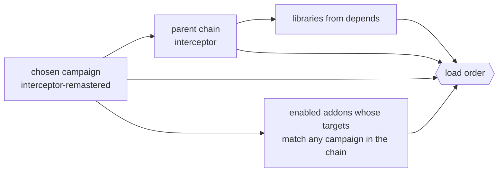

# Mod structure

**Status: partly implemented (Stage 2).** `kind`, `parent`, `targets`, `format`, the active
set built from the chosen campaign and its load order, **YAML mod files checked against
schemas (mod format 2)** and `<key>+` / `<key>-` list edits are **implemented** (see
[Packs](../modding/packs.md#mod-kinds-and-the-active-set)); `conflicts`, a load-order setting,
saves naming their mods, text keys and the other folders and sections below are still design.
A pack without `kind` is an `addon`. Mod files are YAML; original INI files are still read,
section by section, through `inherit: original:<file>/<section>`.

## Mod kinds

OpenXcom distinguishes *master mods* (a whole game: UFO Defense, Terror From the Deep) from
mods that change one. OpenInterceptor does the same, with one addition: a campaign can be built
on another campaign.

| Kind | What it is | Examples |
|---|---|---|
| `campaign` | A complete, playable game: a campaign ruleset plus all the content it uses. The player chooses **one** campaign when starting a new game. | `interceptor`, `default`, `interceptor-remastered` |
| `addon` | Changes a campaign: balance, new ships, new missions, replacement art. Applies only when its target campaign is being played. | `faster-lightning`, an HD cockpit |
| `library` | Shared content with no campaign of its own: models, textures, sounds, behaviours that several mods use. Loaded only when something depends on it. | `common-effects` |

## `pack.yaml` { #packini }

```yaml
# yaml-language-server: $schema=../../schemas/pack.schema.json
id: interceptor-remastered
name: "X-COM: Interceptor — Remastered"
version: "0.1"
kind: campaign
parent: interceptor           # this campaign is the interceptor campaign plus my changes
requires_original: true       # inherited from the parent anyway; stated for the launcher
depends: [common-effects]     # libraries loaded before this mod
description: Sharper textures and upgraded models for modern screens.
authors: ...
licence: MIT                  # shown in the launcher; the engine never enforces it
format: 2                     # mod format version this mod was written for
```

| Key | Applies to | Meaning |
|---|---|---|
| `id`, `name`, `version`, `description`, `authors`, `licence` | all | As today; `authors` and `licence` are informational. |
| `kind` | all | `campaign`, `addon` (default) or `library`. **Implemented.** |
| `parent` | campaign | Another campaign this one **extends**: the parent's whole content loads first, then this mod's files override and add. Chains are allowed (`remastered` → `interceptor`); a cycle is an error. **Implemented.** |
| `targets` | addon | Campaign ids the addon applies to (`targets: [interceptor]`). An addon targeting `interceptor` also applies to every campaign whose parent chain contains `interceptor`. `targets: ["*"]` applies to all. **Implemented** (no `targets` also applies to all). |
| `depends` | all | Libraries (or other addons) that must load before this mod. |
| `requires_original` | all | `true` when the mod reads the player's CD. Inherited through `parent`. |
| `format` | all | The mod-format version. The engine refuses newer formats with a clear message. **Implemented**: the current format is **2** (YAML); a format-1 pack (a folder with `pack.ini` and INI rules) is refused with a message pointing to the YAML format. |
| `conflicts` | addon | Ids that must not be active at the same time. |

## Which mods load

When a game starts (or a save loads) the active set is built from the chosen campaign:



**Load order** — later overrides earlier:

1. Libraries, in dependency order.
2. The root campaign (end of the parent chain), then each child down to the chosen campaign.
3. Enabled addons that target the chain, in dependency order, then by a load-order list in
   `settings.yaml`, then by folder name.

The order is computed once, deterministically, and **written into every save**, so a save
names exactly the mods (and versions) it was made with. Loading a save with a missing mod is
refused with the list of what is missing; with a different version it warns.

As implemented in Stage 2, the testbed launcher shows the scenarios of the active set only, and
**Tab** switches campaign (remembered as `game: campaign:` in `settings.yaml`; `--campaign` on
the command line). Libraries and dependencies load first, then the parent chain root first,
then the addons — the load-order tie-break is not implemented yet (addons keep folder-name
order). A full campaign selection screen is still Stage 4.

## Folder layout

A mod is a folder. Every folder is optional; files are found by convention (and every file in
a rules folder is loaded, in file-name order).

```text
<mod>/
  pack.yaml                 manifest (required)
  campaign/*.yaml           campaign ruleset: difficulty (implemented); game flow, start state, victory
  rules/*.yaml              ships, objects, weapons, systems, factions, flight, power, damage,
                            sounds, cockpits, behaviours (implemented)
  strategy/*.yaml           star map, relations, economy, research, bases and modules, pilots
  missions/*.yaml           mission types, generators, objectives
  events/*.yaml             scripted campaign events
  behaviours/*.yaml         AI and object behaviours (today in rules/*.yaml as `behaviours:`)
  scenarios/*.yaml          testbed arenas (implemented)
  interface/*.yaml          screen layouts, skins, fonts, HUD and cockpit layouts
  text/<language>/*.yaml    every player-visible string; encyclopaedia; messages
  scripts/*.lua             optional scripts (Tier 2, see Behaviours and scripting)
  models/                   OBJ + MTL
  textures/                 PNG/TGA; also re-skins any model texture by name
  images/                   UI art, cockpit art; images/<dll>/<id>.png overrides original images
  sounds/                   WAV (and OGG, Stage 5)
  music/                    WAV/OGG loops and tracks
  video/                    cut-scenes (Stage 5)
  recipes/*.yaml            generated-asset recipes (see below)
```

## Ids and overriding

- Every definition has a **kind and an id**: it is written under its section's key —
  `ships: {lightning: …}`, `research: {plasma_beam: …}`, `events: {nova_theft: …}`. Ids are
  lower case `a-z 0-9 _ -`.
- Ids are global across the active set. A mod that defines `ships: {lightning: …}` again
  **overrides it key by key** (mappings merge, values and lists are replaced); `delete: true`
  removes it, and an empty value (`model:`) removes one key. **Implemented.**
- `inherit: <id>` (same section) or `inherit: ships.<id>` copies another definition first
  (variants); `inherit: original:<file>/<section>` copies a section of an original INI file,
  whose keys map to field names by spelling (`HitPoints` → `hit_points`). **Implemented.**
- **List keys** can be replaced or edited: `beams: [a, b]` replaces; `beams+: [c]` and
  `beams-: [a]` edit the inherited (or earlier pack's) list without restating it.
  **Implemented** for every list key; `systems+` also edits a class's default system list.
  This matters for addons (adding one research topic's unlock without copying the topic).
- **Difficulty**: `variants: {<level>: {…}}` inside a definition gives only the keys that
  differ at that level; any number may be `{per_level: [80, 100, 120]}`. **Implemented.**
- **Text is never in rules.** A rule names a text key (`name: "@ship.lightning.name"`); the
  string lives in `text/<language>/`. A plain value without `@` is used as written, so small
  mods can skip translation tables.
- Assets keep the Stage 1 rules: pack-relative paths, `original:` references, and per-asset
  overrides at the [override paths](../modding/overrides.md).

## Generated assets (recipes)

Some content must be *derived* from the player's own files: an upscaled texture is a
conversion of an original texture, so it can never be shipped. A **recipe** describes how to
make an asset; the engine runs it on the player's machine and caches the result.

```yaml
# recipes/textures.yaml
recipes:
  all-textures-x4:
    kind: upscale              # built-in generators: upscale, mesh-patch, recolour, composite
    inputs: original:*.xtxr    # every original texture
    scale: 4
    method: edge-directed      # built-in, deterministic (see Interceptor Remastered)
    output: "textures/{name}.png"
```

- Outputs land in `<user data>/cache/<mod id>/<mod version>/` and are treated as if they were
  files of the mod at their `output` paths — so they take part in overrides like any file.
- The cache is keyed by the recipe text, the mod version and the input file's hash; a change to
  any of them rebuilds. `--build-recipes` builds everything ahead of time with progress output;
  otherwise the launcher builds on first use.
- Recipes are deterministic and in-crate (no external tools), so two players get identical
  results and a recipe can be unit-tested on synthetic inputs.

Built-in generators: `upscale` (textures and images), `mesh-patch` (edits to an original mesh:
see [Interceptor Remastered](remastered.md)), `recolour` (palette or hue changes: faction
colour variants), `composite` (layer images: decals, damage overlays).

## Validation

`--check --campaign <id>` loads the active set for that campaign and validates every
definition, reference and condition, reporting each problem with its file, line and key
path (YAML syntax and schema errors: `rules/ships.yaml:12: ships.comet.max_sped: unknown key
(did you mean 'max_speed'?)`; conditions are type-checked at load). A campaign must pass with **no** addons, and each addon must pass with its targets.
