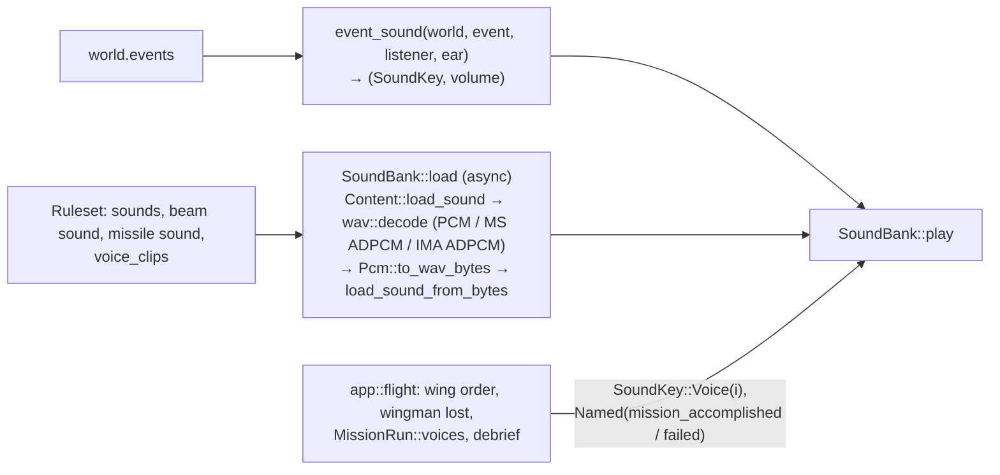
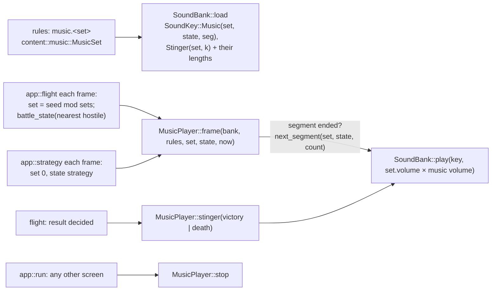

# Audio

`src/audio.rs`: sound effects driven by simulation events, radio voice clips and interactive
music. Plan: Stage 1 (event sounds); radio voices Stage 3.7 (app 0.6.2); interactive music Stage
6.4 (app 0.11.0) with the volumes of app 0.12.1; CD audio tracks are not built.

## Architecture Overview

`event_sound` is pure and tested: beam and missile sounds use the firing ship's weapon;
hits use `shield_hit` or `hull_hit`; destruction uses `big_explosion` for objects with radius
over 100 m, else `explosion` (always at least 15 % volume); `lock` and `denied` only for the
listener; since Stage 2, `system_damage` when one of the listener's systems is damaged
(`SystemChanged`, not repairs), `tractor` / `cloak` / `ecm` when a switchable system goes on or
off (`Switched`; quieter when switching off, attenuated for other ships) and `hyperspace` when a
ship jumps out (`Departed`), `point_defence` for each point-defence shot (`PointDefence`, at 40 %
of the distance volume); a destruction whose model set's `destroyed_effect`, or a missile blast
whose `explosion` effect, has a `sound` plays that sound instead of the usual event; everything else is attenuated by distance (`attenuate`: full within 50 m, half at
about 350 m).

**Cue table (Stage 2, item 2.12).** Sound references are resolved when the rules load
(`rules::build_at`): a reference written `cue:<Name>` is looked up in the table named by
`audio.cue_table` — `original:<file>/<section>` of an original INI file, the original game's
`soundfx.ini` — whose entry's file name becomes `original:<file>.wav`. By the time `SoundBank`
loads, every reference is an ordinary asset, so cues need no run-time code. Unknown cues and a
missing table are load errors.

**Radio voices (Stage 3.7, app 0.6.2).** The rules collect every voice clip in one list,
`Ruleset::voice_clips` (`(reference, pack)` pairs): first each voice set's clips
(`voices: {<set>: {<line>: clip or [clips]}}`, kept as `VoiceSet { id, lines }` with the clip
indices), then each mission chatter line's `voice:`. `SoundBank::load` loads clip `i` as
`SoundKey::Voice(i)`, beside the named sounds. The audio layer does not decide *when* a voice
speaks: the flight screen (`app::flight`) does —

- a wing order plays `acknowledge` and a status request `status`, from the first living wingman
  of the player whose ship has a voice set with that line (`flight::wingman_voice`; the clip is
  picked from the line's list by the battle time);
- when one of the player's wingmen is destroyed, *another* wingman says `down`;
- chatter clips are queued by the mission (`MissionRun::voices`) as their lines are said, and
  the screen plays and clears them each frame;
- when the debrief appears, the named sound `mission_accomplished` (a win) or `mission_failed`
  (any other result) plays — the computer voice.

A ship's voice is resolved to an index when the ship spawns (`Ship::voice`); an unknown set
named by a ship is a rules error. Voice lines without a clip, and ships without a voice, are
simply silent.

### Music (app 0.11.0)

`content::music` parses a set (`states` — each a list of asset references, or one — `stingers`,
`threat_range` 12 km, `battle_range` 4 km and `volume` 60 % by default) and holds the pure rule
`battle_state(set, distances)`: `battle` within `battle_range` of the nearest live hostile,
`threat` within `threat_range`, else `cruise`. `MusicSet::segments(state)` falls back to
`cruise`, then the first state.

`SoundBank::load` loads every segment and stinger beside the other sounds, and keeps each one's
**length** (`Pcm::duration`) in `SoundBank::lengths`, because macroquad's audio cannot say when a
sound has finished. `MusicPlayer` (owned by `AppContext::music`) is called every frame by the
screens that have music with the set and state they want. It does nothing while the current
segment has time left (to 20 ms before its end); then it plays the next segment —
`next_segment(set, set_index, state, count)` picks the wanted state's segment `count mod n`, so
each state walks its list in turn — and records its end time. Changing set stops the playing
segment and restarts the count. This is the original's `segment_end` transition; its `.wtl`
transition tables are not read ([DEV-053](../deviations/index.md)).

- **Which set:** a battle uses set `seed mod sets` (`FlightSession::frame`), so a battle always
  has the same music; the strategy screen uses set 0 with the `strategy` state.
- **Stingers:** when a mission's result is decided, `victory` for a win and `death` otherwise,
  with the computer voice. `good` and `bad` are loaded but not played.
- **Silence:** `app::run` stops the music on every screen other than `Screen::Flight` and
  `Screen::Strategy`, and before a video.

**Volumes (app 0.12.1).** `settings.yaml` `audio: {music, effects}` (0 – 100 %, default 70 % and
100 %) is read at start-up: `MusicPlayer::volume` multiplies each set's own `volume`, and
`SoundBank::effects_volume` multiplies **every other** key in `SoundBank::play` (music and
stinger keys already carry the music volume). The launcher's M and V keys step them by quarters
and save them (`app::remember_audio`). A reload (Tab) re-reads the effects volume for the new
bank. Video soundtracks are played by `app::video` directly, at a fixed 0.9.

Playback uses macroquad's `audio` feature (quad-snd: CoreAudio on macOS, ALSA on Linux).

## Key Symbols

| Symbol | What it is |
|---|---|
| `SoundKey` | `Named(&'static str)`, `Beam(u16)`, `Missile(u16)`, `Effect(u16)`, since app 0.6.2 `Voice(u32)` (an index into `Ruleset::voice_clips`), and since app 0.11.0 `Music(set, state, segment)` and `Stinger(set, stinger)` (indices into `Ruleset::music`). |
| `content::music::MusicSet`, `battle_state` | A music set (`states`, `stingers`, ranges, volume, pack); the battle state from the hostiles' distances (pure, tested). |
| `MusicPlayer`, `next_segment` | Plays one segment at a time and changes state only at a segment's end; the next segment's key (pure, tested). `volume` is the player's music volume. |
| `NAMED` | The eighteen named sounds: since app 0.6.2 `mission_accomplished` and `mission_failed` (the computer voice at the debrief), and the event names `explosion`, `big_explosion`, `shield_hit`, `hull_hit`, `lock`, `missile_launch`, `afterburner`, `target`, `denied`, `collision`, and since Stage 2 `system_damage`, `tractor`, `cloak`, `ecm`, `hyperspace`, `point_defence`. |
| `SoundKey::Effect(i)` | The sound of effect `i` (an event name from `sounds:` or an asset in the effect's pack), loaded with the bank. |
| `rules::VoiceSet`, `VoiceSet::clips(line)` | A voice set: `id` and `lines` (line name → clip indices); `clips` is empty for a line the voice lacks. |
| `Ruleset::voices`, `Ruleset::voice_clips` | The voice sets, and every voice clip (sets first, then chatter) as `(reference, pack)`. |
| `flight::wingman_voice(&World, player, except, line, pick)` | A clip of `line` from the first living wingman of `player` (not `except`) with a voice that has it (pure, tested). |
| `SoundBank` | Decoded sounds by key, music lengths, `effects_volume` (app 0.12.1), and `errors` for sounds that failed. |

## API Reference

- `SoundBank::load(&Content).await`, `bank.play(&SoundKey, volume)`,
  `bank.play_events(&World, listener, ear)`; since app 0.11.0 – 0.13.0 `bank.play_named(name, volume)`
  (a cutscene's sounds), `bank.length(&SoundKey)`, `bank.stop(&SoundKey)`.
- `MusicPlayer::new(volume)`, `player.frame(&SoundBank, &Ruleset, set, state, now)`,
  `player.stinger(&SoundBank, &Ruleset, name)`, `player.stop(&SoundBank)`;
  `next_segment(&MusicSet, set_index, state, count) -> Option<SoundKey>`;
  `content::music::battle_state(&MusicSet, distances) -> &'static str`.
- `event_sound(&World, &SimEvent, ShipId, Vec3) -> Option<(SoundKey, f32)>`, `attenuate(distance)`.

## Debugging

- Sounds that fail to load are printed at start-up as `sound: …` lines; `--check` loads every
  referenced sound too.
- A wingman that says nothing: its ship class needs `voice: <set>`, the set needs the line
  (`acknowledge`, `status`, `down`), and the clip must load (a failed clip prints a `sound: …`
  line). Only the player's own wingmen (AI `wingman` led by the player) speak.
- No music: the campaign needs a `music:` section, the screen must be a flight or the strategy
  screen, `audio.music` must be above 0, and the segment files must load (a failure prints a
  `sound: …` line). The default campaign's music WAVs are generated, not committed: run
  `python3 tools/default_assets/make_all.py` after cloning.
- The music does not change when an enemy closes in: it changes at the **end of the segment**
  playing, by design; check `threat_range` and `battle_range` against the battle's distances.
- No sound at all on Linux: the build needs the ALSA development package (`libasound2-dev`).
- A `cue:` sound that is silent: `--check` names unknown cues (`sounds.x: unknown sound cue 'Y'`);
  if the cue resolves, the asset browser shows whether the original file (or its override)
  loads.
