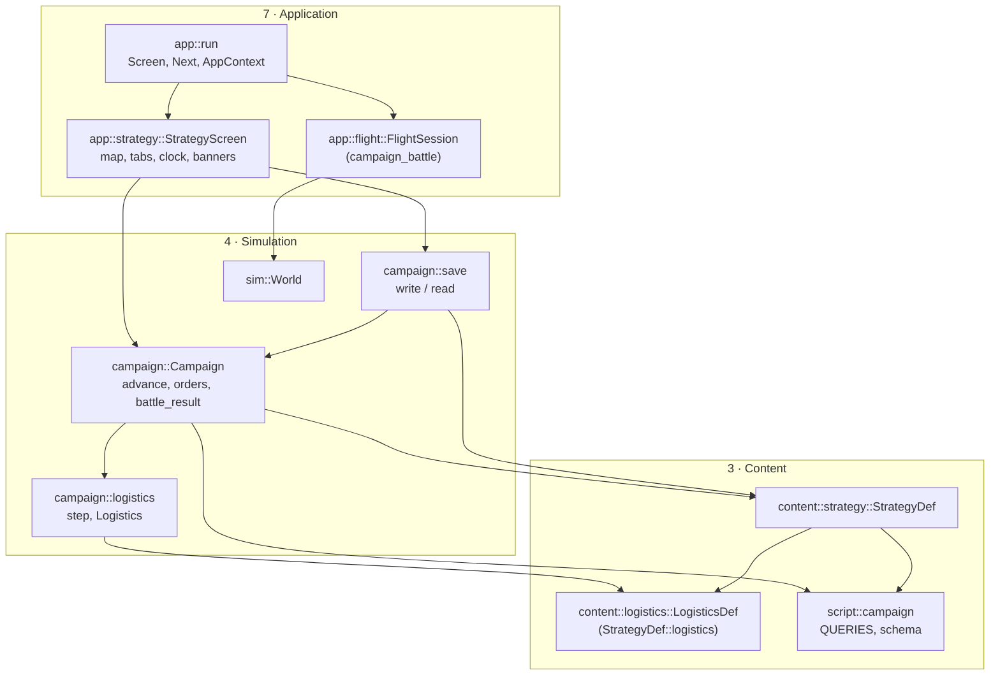
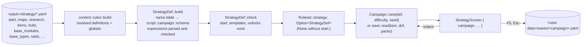
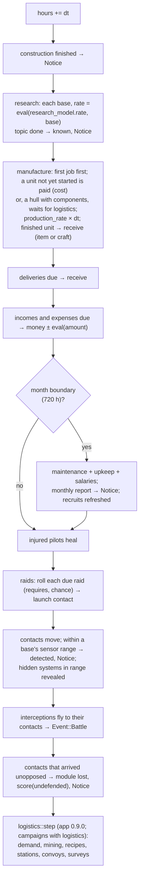
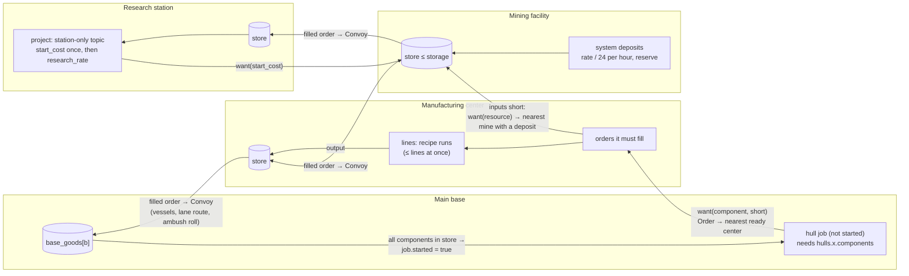
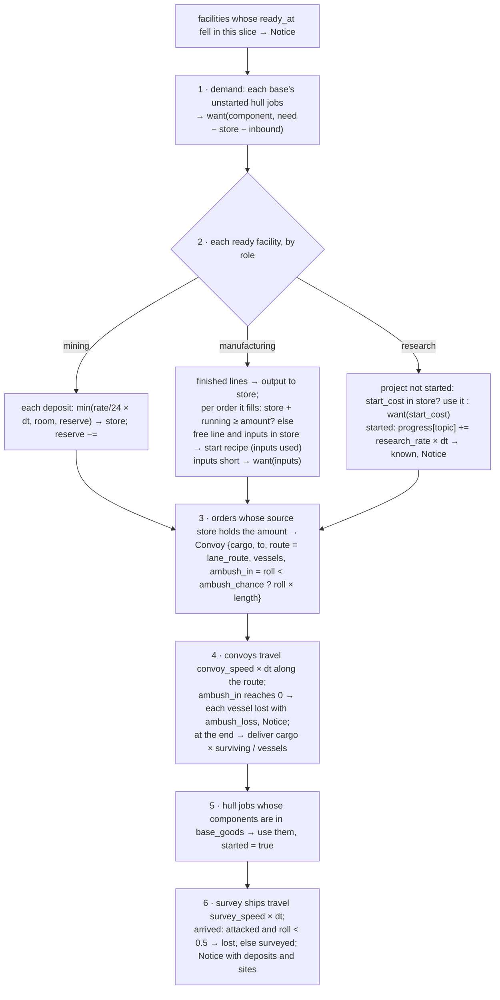

# Campaign (strategy layer)

`src/campaign/` (`mod.rs`, `logistics.rs`, `save.rs`) with its data in `src/content/strategy.rs`
and `src/content/logistics.rs`, its expression context in `src/script/campaign.rs` and its screen
in `src/app/strategy.rs`: the real-time strategy game around the battles (Stage 4, app 0.7.0 –
0.9.0). The modder's view is
[Strategy layer](../../modding/strategy.md); the player's is
[User guide › Campaign](../../user-guide/campaign.md). Requirements: R-STR-001 – R-STR-027 on
[Strategy & logistics](../../specification/requirements/strategy-logistics.md).

## Architecture Overview

### Where it sits

The campaign is a **simulation layer beside `sim`**: deterministic, plain data, no macroquad, no
rendering, no input. It reads the content layer (`StrategyDef`) and the script layer (it is a
`script::Context`), and the application layer drives it.



`campaign` never calls `sim`: a battle is handed to the app, which flies it in an ordinary
`FlightSession` and hands the debrief back. The two simulations meet only through strings (the
mission id, the result, the outcome's action texts) and a kill count.

### Data flow: from YAML to the screen



1. **Rules.** The strategy sections are ordinary rules sections: definition sections (`maps`,
   `star_classes`, `research`, `items`, `hulls`, `base_modules`, `base_types`, `raids`, `incomes`,
   `expenses`: `content::strategy::DEF_SECTIONS`) layer across packs like ships do; globals
   (`start`, `research_model`, `pilots`, `scores`, `economy`, `flags`, `tech_ids`, `logistics`)
   are read once; the logistics definitions (`content::logistics::DEF_SECTIONS`: `resources`,
   `components`, `recipes`, `facility_types`, `research_sites`) layer like the others (app
   0.9.0). `start.money_from: original:<file>/<key>` is resolved here, while the original's files
   are at hand: `content::rules::build_at` reads the key from the section named after the
   difficulty level and merges it into `start` as `money` (app 0.8.0). Their
   schema (`content::strategy::sections`) joins the rules file schema, so `--check` and the
   editor JSON Schema know every key.
2. **Names.** `StrategyDef::build` first collects every id it defines, plus factions, ship
   classes, missions and the flags missions set, into one sorted table (`names`). That table
   becomes the constants of `script::campaign::schema`, so `research(heat_rays)` compiles to
   *query 0 with argument 7* and a misspelling is a load error.
3. **The original's numbers** (app 0.8.0). Data inherited from the original names prerequisites
   by number (`prereq1` – `prereq3` on topics, `tech_required`, `tech_required2` on items, hulls
   and modules). When a definition has no `requires:` and the campaign has a `tech_ids` table,
   `StrategyDef::build` turns the numbers it lists into `research(<id>) and …` text before
   parsing it like any written condition, so the result is checked the same way. Costs, prices,
   upkeep and maintenance are multiplied by `economy.cost_scale`; with `economy.module_time:
   days`, a module's `prod_time` becomes its build time in days.
4. **Logistics** (app 0.9.0). `LogisticsDef::build` reads the logistics definitions, the start
   map's systems (their `deposits` and `features`), each hull's `components` and each topic's
   `lab`, `site` and `start_cost` — into vectors **in the same order** as the map's systems, the
   hulls and the topics, so a hull index or topic index finds its logistics data directly. It
   returns `None` when no facility type is defined: `StrategyDef::logistics` is an `Option`, and
   everything downstream starts with `let Some(l) = def.logistics.as_ref() else { return }`.
5. **Check.** Cross-references (start bases, systems, craft, templates, unlocks) are checked;
   `content::rules` adds the outside ones (a raid's mission and faction, a hull's ship class).
6. **Play.** `Campaign::new` builds the starting state: the map's systems (generated now for a
   generated map), the starting bases with finished modules, craft, pilots who take the craft in
   order, recruits, the first times for every income, expense and raid roll; with logistics, an
   empty `Logistics` with every system unsurveyed and each deposit's full reserve.

### Logic flow: the hour step

`Campaign::advance(def, hours)` loops `step` in slices of **at most one hour**, and returns as
soon as a step produced an event, so the screen can stop the clock. The order inside `step` is
fixed, which is what makes a campaign replay exactly from a save:



Every roll (raids, launch points, pilots, recruits, generated maps, `random(p)`) draws from one
**xorshift** generator stored in the campaign (`Campaign::rng`), so `same_seed_same_campaign`
can assert that two campaigns from one seed are equal after the same time.

### Expressions: the campaign as a `script::Context`

`Campaign` answers the 16 queries of `script::campaign::QUERIES` through a small context struct
(`Cx`) that holds `&Campaign`, an optional base (so `module_count` in a research rate counts the
base being evaluated) and the generator in a `Cell<u64>` — `Context::query` takes `&self`, but
`random(p)` must advance the generator, the same interior-mutability trick as
`sim::ai::ObjectContext` ([Conditions](script.md#the-object-context)). After evaluating,
`Campaign::eval` copies the advanced generator back.

### The battle hand-off

```mermaid
sequenceDiagram
    participant S as StrategyScreen
    participant A as app::run
    participant C as AppContext
    participant F as FlightSession
    S->>S: advance → Event::Battle{contact}; banner "fly or break off"
    S-->>A: Enter → Next::CampaignBattle{mission, ship, loadout}
    A->>C: mem::replace(screen, Launcher); ctx.campaign = Some(strategy screen)
    A->>F: start_mission(mission, ship); apply_loadout(loadout); campaign_battle = true
    F-->>C: debrief + Enter/Esc → ctx.battle_report = {result, actions, kills}
    F-->>A: Next::Strategy
    A->>C: ctx.campaign.take(), ctx.battle_report.take()
    A->>S: battle_done(report) → Campaign::battle_result
```

- The strategy screen cannot stay the current `Screen` while a flight runs, and it must not be
  dropped (it owns the campaign). `app::run` moves it out of `screen` with
  `std::mem::replace` and parks it in `AppContext::campaign` (`Option<Box<StrategyScreen>>`).
  `Next::Strategy` takes it back with `Option::take` ([Learn Rust › Ownership](../../learning/rust/ownership.md#moving-a-value-out-of-a-place-memreplace-and-take)).
- **The loadout** (app 0.7.2). `Campaign::loadout(def, craft)` turns the first craft's `fit` into
  beam ids (one per fitted beam slot) and missile ids with rounds. `flight::apply_loadout` sets
  them on the player's class — but beams belong to a ship *class* in the shared `Ruleset`,
  which every other screen also reads. The battle's `World` holds the rules as an `Arc<Ruleset>`,
  so `Arc::make_mut` gives the battle **its own copy** the first time it is changed
  (copy-on-write) and the shared content stays untouched. Ids that are not weapons of the
  campaign are skipped; with no beams fitted the class's own are kept.
- The flight screen fills `AppContext::battle_report` (`BattleReport {result, actions, kills}`)
  from the debrief: the result, the outcome's campaign actions as written (`score(x)`,
  `money(n)`, `salvage`, `set_flag(x)`, …) and the kill count. Leaving from the pause menu
  is `retreat`; a mission that cannot start is counted as `retreat` too, with the error printed.
- `Campaign::battle_result` applies the actions it knows (`score`, `money`, `set_flag`, `salvage`;
  `lose` is logged, the rest ignored until Stage 5), credits the party's pilots, removes a
  `killed` leader's craft (re-indexing pilots' craft handles), sends the rest home, and removes
  the contact on `win` or `draw`.

!!! note "Fixed in app 0.9.0: `salvaged(x)` and manufacture costs"
    Until app 0.9.0 `salvage` recorded the raid's display **name** while `salvaged(x)` compared
    the **id**, so the default campaign's `saucer_hulls` and `robot_brains` could never start;
    `battle_result` now records `def.raids[contact.raid].id`. Manufacture was free; each `Job` now
    has a `started` flag, and the hour step takes the unit's `cost` when it starts (or waits for
    the money). `campaign::tests::manufacture_is_paid_per_unit_and_salvage_names_the_raid_by_id`
    covers both.

### Travel on the map

Positions are map units and everything moves in straight hops at its speed per hour
(`travel`). On a `travel: lanes` map (app 0.7.3) contacts and craft carry a `route`: the system
positions still to pass, consumed one by one before the final leg. `Campaign::lane_route(def,
from, to)` finds the shortest way along the lanes with **Dijkstra's algorithm** — repeatedly
settle the unsettled system with the shortest known distance and relax its lanes, then walk the
`prev` links back. With seven systems a linear scan for the minimum is simpler than a heap and
fast enough. A raid enters at the free system farthest from its target; an interception flies
the lanes to the system nearest the contact (`nearest_system`), then straight to it, and home
along the lanes. Routes are part of the saved state.

### Logistics

`campaign::logistics` (app 0.9.0, plan items 4.14 – 4.17) is the runtime of
`content::logistics::LogisticsDef`. Its state is one more plain struct inside the campaign,
`Campaign::logistics: Logistics` — facilities, open orders, convoys and survey ships in flight,
which systems are surveyed, what each deposit has left, and each base's store of components —
and `logistics::step(campaign, def, dt, events)` runs one slice of it at the end of the hour step.
The modder's view is [Strategy layer › Logistics](../../modding/strategy.md#logistics).

#### Data flow: demand pulls, convoys carry



An **order** is `{goods, amount, to: Dest, source}`: `amount` of `goods` wanted at `to` (a base
or a facility, the `Dest` enum of two index variants), to be filled by facility `source`.
`Campaign::want(l, goods, amount, to)` tops up the open orders for that destination and goods
to `amount`; the shortfall is computed by the caller as *needed − in store − already in convoys*
(`inbound`), so the same demand never produces two orders. A resource goes to the nearest
ready mining facility whose system has a deposit of it, a component to the nearest ready
manufacturing center (`Campaign::supplier`, by straight-line distance between systems). No
supplier means no order: the demand waits and is asked again next hour.

#### Logic flow: `logistics::step`



Design points worth noticing:

- **Everything is an index.** Facilities refer to their type and system by index, orders to
  their source facility, `Dest` to a base or facility, `Line` to a recipe; stores are short
  `Vec<(String, f32)>` lists of goods and amounts (`logistics::amount`, `add`). A save is then a
  direct walk, and the borrow checker never sees two live references into the campaign.
- **Copy out, then mutate.** `step` takes `&mut Campaign` and often needs to read one part while
  changing another (an order's amount while changing the source facility's store). It clones
  the small thing it reads first — `let o = c.logistics.orders[k].clone();`, the list of
  `(goods, amount)` a center must fill — and then mutates freely. With a few dozen orders the
  clones cost nothing, and the code stays free of `RefCell` and of index juggling.
- **Rolls are made when something launches**, not when it arrives: the ambush and its point
  along the route, and a survey ship's attack. The outcome is then part of the saved state
  (`Convoy::ambush_in`, `Survey::attacked`), so a save loaded before the ambush replays it the
  same way. Ambushes are auto-resolved per vessel here; flying them as `convoy_ambush` is the
  hookup still to come (R-STR-019).
- **Fixed placement rules** (`Campaign::facility_allowed`): mining needs a surveyed system with
  deposits, research a surveyed research site, manufacturing at most two lanes
  (`lane_route(...).len() <= 2`) from a base; one facility of each type per system. The design's
  `placement:` expressions are not built (DEV-049).
- **Hulls with components** are not paid in money: the manufacture step in `Campaign::advance`
  sees `hull_components` and leaves the job for `logistics::step` to start once its components
  are in the base's store.
- **Station-only topics** (`station_topics[t]` is `Some`) are filtered out of
  `Campaign::researchable`, so bases never offer them; `start_station_research` starts one at a
  research station of the right `lab` type on the right `site`.

### The X-COM data (app 0.8.0)

`tools/interceptor_strategy.py` (Python, standard library) is a build-time helper, not part of
the engine: it reads the player's `GameSettings.ini` and `Interceptor.exe` and writes
`packs/interceptor/strategy/references.yaml` — the `tech_ids:` table and `inherit:` references
to the original's sections, with no values. The engine then treats the X-COM campaign like any
other: inheritance reads the values from the player's file at load, `tech_ids` turns the numeric
prerequisites into conditions (above), and `cost_scale`, `module_time` and `money_from` adapt the
original's units. The executable's table layout (12-byte entries: a pointer to the `R_` section
name, a string id, the tech id) is *derived*; see [Strategy layer › the `interceptor`
campaign](../../modding/strategy.md#the-interceptor-campaign-from-the-players-data).

### Testbed cheats (app 0.8.1)

`Campaign::cheat_payday`, `cheat_knowitall`, `cheat_quickbase` and `cheat_jump(contact)` are the
original's own cheat list as plain methods on the campaign (so they are unit-tested like any
order); `app::strategy` binds them to Ctrl+M, Ctrl+K, Ctrl+B and Ctrl+J. `cheat_jump` puts the
first ready craft with a ready pilot at the contact (`away = Some((contact, pos))`, route
cleared), so the next step's interception check reports `Event::Battle` at once. Each cheat is
logged in the message list.

### Saves

`campaign::save` writes the whole `Campaign` as a YAML document (`write`) and reads it back
(`read`), using the engine's own YAML reader and writer (`formats::yaml`). Because the state
holds only numbers, text and **indices** into the rules, the save is a direct walk:

```yaml
# OpenInterceptor campaign save
save: 1
campaign: default
packs: [{id: default, version: 0.7.1}]
hours: 1234
money: 2150000
…
```

Reading checks the format version, then that **every pack listed is loaded** (else "this save
needs packs that are not loaded: …"), then every index against the loaded rules (module, item,
topic, income/expense/raid counts; else "save: … does not match the loaded rules (was a mod
changed?)"). Since app 0.9.0 a `logistics:` block follows (`write_logistics` / `read_logistics`):
facilities with their stores, lines and projects, orders, convoys with their routes, vessels and
pending ambush, survey ships, the surveyed flags, the reserves and the bases' stores;
destinations are written `base:<i>` / `facility:<i>`. Its indices are checked like the rest, a
campaign without logistics saves an empty block, and a save with facilities is refused by a
campaign that has no logistics. A changed mod is refused with a message instead of crashing or silently changing
the game. The screen saves to `<user data>/saves/<campaign id>.yaml` (`strategy::save_path`) on
F5 and when leaving with Esc; *Campaign: continue* loads it.

## Key Symbols

| Symbol | Where | What it is |
|---|---|---|
| `StrategyDef` | `content/strategy.rs` | The strategy layer's rules: `start`, `map`, `star_classes`, `research`, `research_model`, `items`, `hulls`, `modules`, `base_types`, `raids`, `incomes`, `expenses`, `pilots`, `scores`, `delivery`, `salvage`, the `names` table and `logistics: Option<LogisticsDef>` (app 0.9.0). |
| `Date` | `content/strategy.rs` | A Gregorian calendar date (`parse`, `plus_days`). |
| `MapKind`, `Travel`, `RaidTarget`, `ResearchMode` | `content/strategy.rs` | Fixed / generated maps; free / lane travel; base / system raids; download / labs. |
| `Campaign` | `campaign/mod.rs` | One game in progress: `hours`, `money`, `systems`, `bases`, `known`, `progress`, `craft`, `pilots`, `recruits`, `contacts`, `deliveries`, flow and raid timers, score, flags, salvaged, messages. |
| `Base`, `ModuleInst`, `Job`, `Craft`, `Pilot`, `Contact`, `Delivery` | `campaign/mod.rs` | The parts of the state, each referring to the others by index. |
| `Event` | `campaign/mod.rs` | `Notice(String)` (stop the clock, show it) or `Battle { contact }`. |
| `LogisticsDef`, `FacilityType`, `Role`, `Recipe`, `Deposit`, `SystemGoods`, `StationTopic` | `content/logistics.rs` | The logistics rules (app 0.9.0): resources, components, recipes, facility types, sites, per-system goods, per-hull components, per-topic station restrictions, supply settings. |
| `Logistics`, `Facility`, `Line`, `Order`, `Convoy`, `Survey`, `Dest` | `campaign/logistics.rs` | The logistics state inside `Campaign::logistics`. |
| `logistics::step`, `amount` | `campaign/logistics.rs` | One slice of logistics time; goods in a store. |
| `Campaign::cheat_payday`, `cheat_knowitall`, `cheat_quickbase`, `cheat_jump` | `campaign/mod.rs` | Testbed cheats (app 0.8.1). |
| `campaign::autoplay` | `campaign/mod.rs` | The automatic player of `--strategy-soak` and the six-month test (public since app 0.8.0). |
| `Campaign::fit_best`, `loadout`, `lane_route`, `nearest_system` | `campaign/mod.rs` | Fitting a craft from its base's store (0.7.2); its battle weapons; the shortest lane route (0.7.3). |
| `flight::apply_loadout` | `app/flight.rs` | Refits the player's class in the battle's own copy of the rules. |
| `MONTH` | `campaign/mod.rs` | 720 hours: reports, salaries, maintenance. |
| `save::write`, `save::read`, `save::PackRef`, `save::FORMAT` | `campaign/save.rs` | Saves and their pack header. |
| `script::campaign::QUERIES`, `id`, `schema` | `script/campaign.rs` | The campaign context. |
| `StrategyScreen`, `Tab`, `SPEEDS`, `BattleReport`, `save_path`, `map_transform` | `app/strategy.rs` | The screen. |
| `Next::NewCampaign`, `LoadCampaign`, `CampaignBattle`, `Strategy`; `AppContext::campaign`, `battle_report` | `app/mod.rs` | The screen changes around a campaign battle. |

## API Reference

- `Campaign::new(&StrategyDef, difficulty, seed) -> Campaign`.
- `campaign.advance(&def, hours) -> Vec<Event>` — the only way time passes.
- Orders, each `-> Result<(), String>` with a message for the player: `start_research(def, base,
  topic)`, `build_module(def, base, module)`, `build_base(def, base_type, system, name)`,
  `buy(def, base, Product, count)`, `sell(def, base, item, count)`, `manufacture(def, base,
  Product, count)`, `hire(def, recruit)`, `intercept(def, contact, &[craft])`, `fit_best(def, craft) -> Result<String, String>`; `assign(pilot,
  Option<craft>)`.
- Logistics orders (app 0.9.0), each `-> Result<(), String>`: `survey(def, base, system)`,
  `build_facility(def, facility_type, system)`, `start_station_research(def, facility, topic)`;
  the check alone: `facility_allowed(def, facility_type, system)`.
- Cheats (app 0.8.1): `cheat_payday()`, `cheat_knowitall()`, `cheat_quickbase()`,
  `cheat_jump(contact) -> Result<usize, String>` (the craft sent).
- `campaign::autoplay(&def, seed, days) -> Campaign` — plays with the automatic player.
- Queries: `date(def)`, `eval(def, &Expr, base)`, `holds(def, Option<&Expr>)`, `stock_of(item)`,
  `effect(def, base, name)`, `sensor_range(def, base)`, `hangar(def, base)`, `available(def,
  "items.x")`, `researchable(def)`, `Campaign::rank(def, &pilot)`, `battle_party(contact)`.
- `campaign.battle_result(def, contact, result, &actions, kills)`.
- `save::write(&campaign, campaign_id, &[PackRef]) -> String`; `save::read(text, &def,
  &[PackRef]) -> Result<Campaign, String>`.

## Debugging

- `openinterceptor --check --campaign default` reports every strategy-data error with where it
  came from (`research.x.requires: unknown name 'y'`, `raids.x: unknown mission 'y'`).
- `openinterceptor --no-original --strategy` opens a new default campaign straight away.
- A save is readable YAML: open `<user data>/saves/default.yaml` to see the whole state.
- The message log (Messages tab) records every payment, arrival, research result, battle and
  report with its date.
- `openinterceptor --campaign <id> --strategy-soak 180` plays six months headless with
  `campaign::autoplay` and prints a one-line summary (app 0.8.0): the quickest check that a
  modded strategy layer runs — six-month results at app 0.8.0: `interceptor` 4 of 71 topics on
  one downlink, `default` 12 of 14.
- Logistics: the Supply tab's last row counts open orders, convoys and survey ships; the message
  log records every survey, completed facility and ambush. An order that never appears usually
  means no ready facility can fill it (a resource no mined system has, or no manufacturing
  center); a hull job that never starts is waiting for its `components`.
- The campaign is unit-testable without a window: `campaign::autoplay` plays any
  `StrategyDef` with a simple automatic player (keeps every base researching, builds a lab and a
  workshop when it can, intercepts every contact it sees, alternates battle results). The tests
  build small synthetic strategy layers from one YAML document (`content::strategy::tests::build`) and also play the real default campaign for six months.
