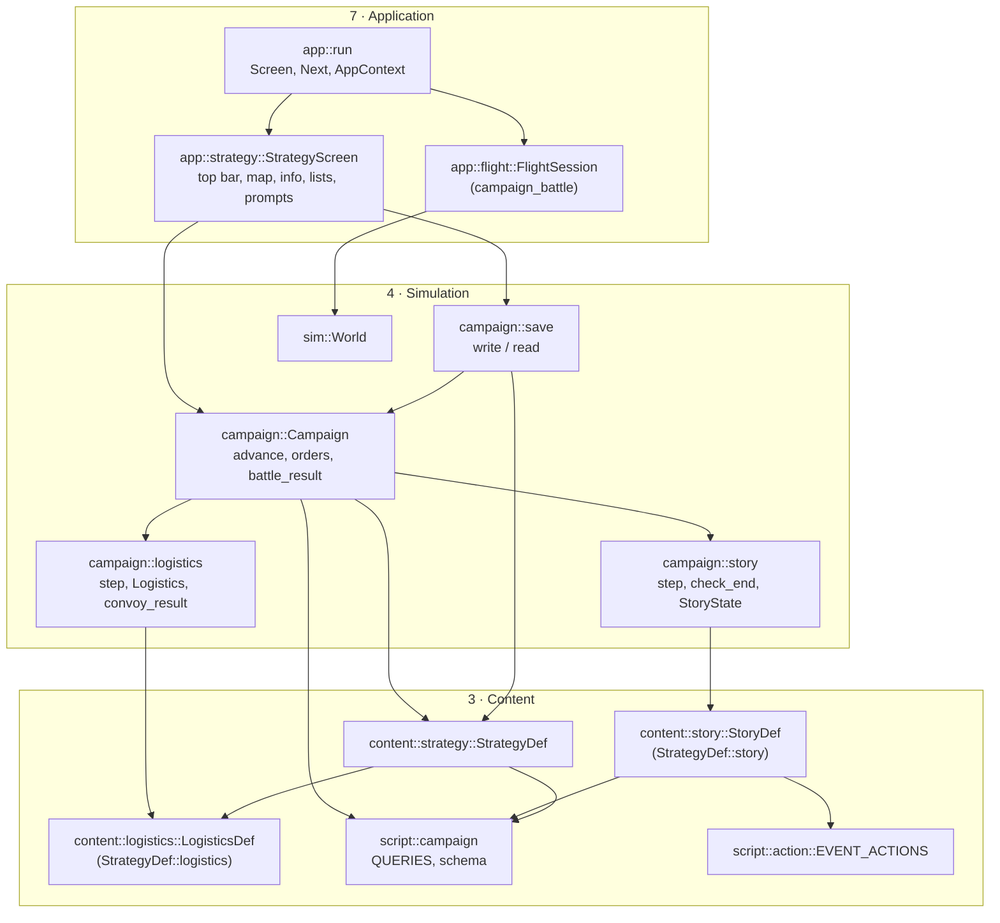
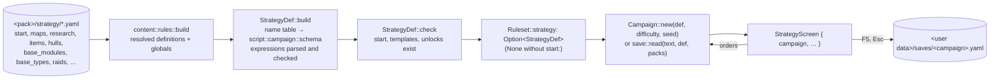
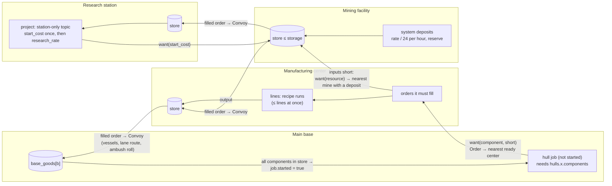
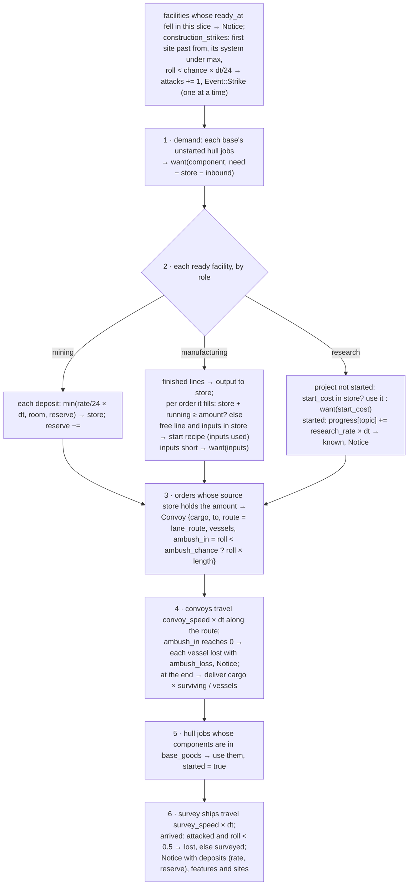
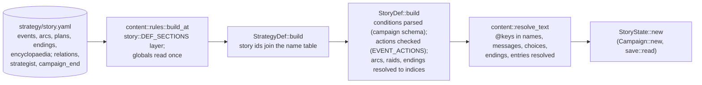
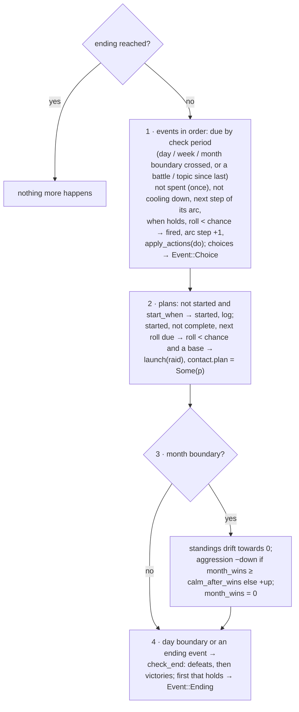

# Campaign (strategy layer)

`src/campaign/` (`mod.rs`, `logistics.rs`, `story.rs`, `save.rs`) with its data in
`src/content/strategy.rs`, `src/content/logistics.rs` and `src/content/story.rs`, its expression
context in `src/script/campaign.rs`, its story actions in `src/script/action.rs` and its screen
in `src/app/strategy.rs`: the real-time strategy game around the battles (Stage 4, app 0.7.0 –
0.9.2, filled in by app 0.16.1 – 0.16.14) and the story on top of it (Stage 5, app 0.10.0 – 0.10.3; its
testbed tools in 0.16.13). The modder's view is
[Strategy layer](../../modding/strategy.md) and [Story layer](../../modding/story.md); the
player's is [User guide › Campaign](../../user-guide/campaign.md). Requirements: R-STR-001 –
R-STR-027 on [Strategy & logistics](../../specification/requirements/strategy-logistics.md),
R-CPN-007 – R-CPN-010 on [Campaigns](../../specification/requirements/campaigns.md).

## Architecture Overview

### Where it sits

The campaign is a **simulation layer beside `sim`**: deterministic, plain data, no macroquad, no
rendering, no input. It reads the content layer (`StrategyDef`) and the script layer (it is a
`script::Context`), and the application layer drives it.



`campaign` never calls `sim`: a battle is handed to the app, which flies it in an ordinary
`FlightSession` and hands the debrief back. The two simulations meet only through strings (the
mission id, the result, the outcome's action texts), a kill count, the share of cargo still
aboard (app 0.9.2) and, going in, the factions' stances (app 0.10.3).

### Data flow: from YAML to the screen



1. **Rules.** The strategy sections are ordinary rules sections: definition sections (`maps`,
   `star_classes`, `research`, `items`, `hulls`, `base_modules`, `base_types`, `raids`, `incomes`,
   `expenses`: `content::strategy::DEF_SECTIONS`) layer across packs like ships do; globals
   (`start`, `research_model`, `pilots`, `scores`, `economy`, `flags`, `tech_ids`, `logistics`)
   are read once; the logistics definitions (`content::logistics::DEF_SECTIONS`: `resources`,
   `components`, `recipes`, `facility_types`, `research_sites`) layer like the others (app
   0.9.0). `start.money_from: original:<file>/<key>` is resolved here, while the original's files
   are at hand: `content::rules::build_at` reads the key from the section named after the
   difficulty level and merges it into `start` as `money` (app 0.8.0). Their
   schema (`content::strategy::sections`) joins the rules file schema, so `--check` and the
   editor JSON Schema know every key.
2. **Names.** `StrategyDef::build` first collects every id it defines, plus factions, ship
   classes, missions and the flags missions set, into one sorted table (`names`). That table
   becomes the constants of `script::campaign::schema`, so `research(heat_rays)` compiles to
   *query 0 with argument 7* and a misspelling is a load error.
3. **The original's numbers** (app 0.8.0). Data inherited from the original names prerequisites
   by number (`prereq1` – `prereq3` on topics, `tech_required`, `tech_required2` on items, hulls
   and modules). When a definition has no `requires:` and the campaign has a `tech_ids` table,
   `StrategyDef::build` turns the numbers it lists into `research(<id>) and …` text before
   parsing it like any written condition, so the result is checked the same way. Costs, prices,
   upkeep and maintenance are multiplied by `economy.cost_scale`; with `economy.module_time:
   days`, a module's `prod_time` becomes its build time in days.
4. **Logistics** (app 0.9.0). `LogisticsDef::build` reads the logistics definitions, the start
   map's systems (their `deposits` and `features`), each hull's `components` and each topic's
   `lab`, `site` and `start_cost` — into vectors **in the same order** as the map's systems, the
   hulls and the topics, so a hull index or topic index finds its logistics data directly. It
   returns `None` when no facility type is defined: `StrategyDef::logistics` is an `Option`, and
   everything downstream starts with `let Some(l) = def.logistics.as_ref() else { return }`.
5. **Check.** Cross-references (start bases, systems, craft, templates, unlocks) are checked;
   `content::rules` adds the outside ones (a raid's mission and faction, a hull's ship class).
6. **Play.** `Campaign::new` builds the starting state: the map's systems (generated now for a
   generated map), the starting bases with finished modules, craft, pilots who take the craft in
   order, recruits, the first times for every income, expense and raid roll; with logistics, an
   empty `Logistics` with every system unsurveyed and each deposit's full reserve.

### Logic flow: the hour step

`Campaign::advance(def, hours)` loops `step` in slices of **at most one hour**, and returns as
soon as a step produced an event, so the screen can stop the clock. The order inside `step` is
fixed, which is what makes a campaign replay exactly from a save:

```mermaid
flowchart TD
    A["hours += dt"] --> B["construction finished → Notice"]
    B --> C["research: each base, rate = eval(research_model.rate, base)<br/>topic done → known, Notice"]
    C --> D["manufacture: first job first; a unit not yet started is paid (cost)<br/>or, a hull with components, waits for logistics;<br/>production_rate × dt; finished unit → receive (item or craft)"]
    D --> E["deliveries due → receive<br/>(or lost: roll < economy.delivery_loss → Notice)"]
    E --> F["incomes and expenses due → money ± eval(amount);<br/>pilots in training: stats += gain × dt/24, money −= cost × dt/24"]
    F --> G{"month boundary<br/>(720 h)?"}
    G -->|yes| H["maintenance + upkeep + salaries;<br/>evaluations: first that holds → its actions, rating;<br/>monthly report → Notice; recruits refreshed"]
    G -->|no| I
    H --> I["injured pilots heal"]
    I --> J["raids: roll each due raid (requires, chance) → launch contact"]
    J --> K["contacts move; within a base's sensor range → detected, Notice;<br/>hidden systems in range revealed"]
    K --> L["interceptions fly to their contacts → Event::Battle"]
    L --> M["contacts that arrived unopposed → score(undefended), Notice;<br/>roll < 1 − 0.85^defence → driven off, else module lost"]
    M --> N["logistics::step (app 0.9.0; campaigns with logistics):<br/>construction strikes → Event::Strike (0.16.4);<br/>demand, mining, recipes, stations, convoys, surveys"]
    N --> O["story::step (app 0.10.0): events, plans,<br/>monthly drift and aggression, the end conditions"]
```



Since app 0.10.0 a raid's roll uses `chance × story.aggression`, and is skipped while
`raids_allowed` says its faction is no longer hostile. The evaluation (app 0.16.8), training
(0.16.7), delivery losses (0.16.11) and the `defence` roll (0.16.10) joined the step later; each
is skipped when its data is absent, so an older pack plays as before.

**Notices outside the clock** (app 0.16.2). `advance` returns its events, but some changes
happen in a debrief, outside `advance` — a `relation(…)` outcome that changes a stance, a
`lose(<facility>)`, a construction strike's result — and a save loaded with a changed pack
version. These push their text onto `Campaign::notices: Vec<String>` (not saved: the screen
shows them before the next save is possible); the strategy screen pops one into its Report
prompt whenever no other prompt is up, and stops the clock.

Every roll (raids, launch points, pilots, recruits, generated maps, `random(p)`) draws from one
**xorshift** generator stored in the campaign (`Campaign::rng`), so `same_seed_same_campaign`
can assert that two campaigns from one seed are equal after the same time.

### Expressions: the campaign as a `script::Context`

`Campaign` answers the 29 queries of `script::campaign::QUERIES` (16 until app 0.9.2; `arc`,
`plan`, `relation`, `fired` and `battles_won` came with the story; the eight logistics queries
with app 0.16.3, answered by `Campaign::logistics_query` — `lane_distance` by `Campaign::lane_hops`,
a breadth-first search counting lanes, not distance) through a small context struct
(`Cx`) that holds `&Campaign`, an optional base (so `module_count` in a research rate counts the
base being evaluated) and the generator in a `Cell<u64>` — `Context::query` takes `&self`, but
`random(p)` must advance the generator, the same interior-mutability trick as
`sim::ai::ObjectContext` ([Conditions](script.md#the-object-context)). After evaluating,
`Campaign::eval` copies the advanced generator back.

### The battle hand-off

```mermaid
sequenceDiagram
    participant S as StrategyScreen
    participant A as app::run
    participant C as AppContext
    participant F as FlightSession
    S->>S: advance → Event::Battle{contact} | Convoy{convoy} | Mission{mission}; banner
    S-->>A: Enter → flying = PendingBattle::Contact | Convoy | Story;<br/>Next::CampaignBattle{mission, ship, loadout, stances}
    A->>C: mem::replace(screen, Launcher); ctx.campaign = Some(strategy screen)
    A->>F: start_mission(mission, ship); apply_loadout(loadout);<br/>apply_stances(stances); campaign_battle = true
    F-->>C: debrief + Enter/Esc → ctx.battle_report = {result, actions, kills, cargo}
    F-->>A: Next::Strategy
    A->>C: ctx.campaign.take(), ctx.battle_report.take()
    A->>S: battle_done(report) → battle_result | convoy_result | mission_result;<br/>story::check_end
```

**Four kinds of campaign battle** (app 0.9.2 – 0.16.4). `StrategyScreen::flying` is an enum,
`PendingBattle`, saying what the battle was *for*, so that the one report coming back is routed
to the right place:

| `PendingBattle` | Started by | The report goes to |
|---|---|---|
| `Contact(id)` | `Event::Battle` — an interception reached its contact | `Campaign::battle_result(def, id, …)` |
| `Convoy(v)` | `Event::Convoy` — an ambushed convoy (with `logistics.ambush_mission`) | `Campaign::convoy_result(def, v, share)`: `lose` → `Some(0.0)`, `retreat` → `None` (fights on alone), anything else → `Some(report.cargo.unwrap_or(1.0))` |
| `Story` | `Event::Mission` — a story event's `mission(x)` offer | `Campaign::mission_result(def, …)`: `battle_result` with an id no contact has, so the outcome's actions and the win apply |
| `Strike(f)` (app 0.16.4) | `Event::Strike { facility }` — a construction strike, flown with `logistics.construction_strikes.mission` | `Campaign::strike_result(def, f, won)`: `win` → `Some(true)` (beaten off), `lose` → `Some(false)` (the site removed), anything else → `None` (set back); then `mission_result` for the outcome's actions |

A flown **convoy** escort also runs `mission_result` since app 0.16.3, so its outcome's score and
actions apply like any battle's. **Auto-resolve** (app 0.16.12) never leaves the screen: the
Interception prompt's second button calls `balance::win_chance(rules, mission, hull ids)`, rolls
`Campaign::roll` against it and hands `battle_result` the mission's own outcome actions for the
rolled `win` or `lose` (rendered back to text with `Action::display`), with the hostile roles'
minimum counts as kills on a win. **Prizes** (app 0.16.3): the flight screen adds
`captured(<class id>)` to the report's actions for each prize the player's tractor brought home;
`battle_result` keeps them as salvage only when the outcome also says `capture`.

After any of them `story::check_end` runs, because a battle (a flag set by a finale's win, a
last base lost) can end the campaign.

- The strategy screen cannot stay the current `Screen` while a flight runs, and it must not be
  dropped (it owns the campaign). `app::run` moves it out of `screen` with
  `std::mem::replace` and parks it in `AppContext::campaign` (`Option<Box<StrategyScreen>>`).
  `Next::Strategy` takes it back with `Option::take` ([Learn Rust › Ownership](../../learning/rust/ownership.md#moving-a-value-out-of-a-place-memreplace-and-take)).
- **The loadout** (app 0.7.2). `Campaign::loadout(def, craft)` turns the first craft's `fit` into
  beam ids (one per fitted beam slot) and missile ids with rounds. `flight::apply_loadout` sets
  them on the player's class — but beams belong to a ship *class* in the shared `Ruleset`,
  which every other screen also reads. The battle's `World` holds the rules as an `Arc<Ruleset>`,
  so `Arc::make_mut` gives the battle **its own copy** the first time it is changed
  (copy-on-write) and the shared content stays untouched. Ids that are not weapons of the
  campaign are skipped; with no beams fitted the class's own are kept. Since app 0.15.0 the
  loadout is a `campaign::Loadout` struct — `beams`, `missiles`, and `shields` / `armor` as
  `Option<f32>`: the strongest fitted `shield` item's `protection` and the sum of the fitted
  `armor` items' (`None`: keep the class's own). `apply_loadout(world, player, &Loadout)` writes
  them into the battle's copy of the class and fills the player's facings and armour.
  An item's protection is `content::strategy::protection_of(kind, Get)`: its `protection:` key,
  else, for an item inheriting the original's equipment, `Special` (shield) or `HitPoints`
  (armour) — *derived*. The same function serves `fitted:` on ship classes, applied while the
  rules are resolved (`rules::apply_fitted`, on each definition once its `inherit:` chain is
  merged; a `shields` / `armor` already present, own or inherited, wins), so a class names its
  default equipment instead of copying numbers ([Strategy layer › items](../../modding/strategy.md#items-and-hulls)).
- **The stances** (app 0.10.3). With dynamic relations, `StrategyScreen::stances` lists every
  faction with a standing as `(faction, hostile)` — hostile when its stance is `hostile`.
  `flight::apply_stances` calls `Ruleset::set_hostile(player_faction, faction, hostile)` for
  each (never for the player's own faction), which edits both factions' `hostile` lists — in the
  battle's own copy of the rules through `Arc::make_mut`, exactly like the loadout. Without
  dynamic relations the list is empty and the factions' own hostility stands.
- The flight screen fills `AppContext::battle_report` (`BattleReport {result, actions, kills,
  cargo}`) from the debrief: the result, the outcome's campaign actions as written (`score(x)`,
  `money(n)`, `salvage`, `set_flag(x)`, …), the kill count and — when the mission names a
  `cargo:` role — the share of its cargo still aboard (`mission::cargo_share`). Leaving from the pause menu
  is `retreat`; a mission that cannot start is counted as `retreat` too, with the error printed.
- `Campaign::battle_result` applies the actions it knows (`score`, `money`, `set_flag`, `salvage`,
  since app 0.12.1 `relation(f, n)` through `change_standing` — since 0.16.2 a stance change it
  causes becomes a notice; since 0.16.3 `capture` / `captured(<class>)`, `lose(<facility type>)`
  through `Campaign::remove_facility` — which removes the facility's orders and inbound convoys
  and moves every later facility index down by one — and `cargo_lost` / `cargo_captured`,
  logged),
  marks a battle for `after_battle` events, counts a win for the story, credits the party's pilots, removes a
  `killed` leader's craft (re-indexing pilots' craft handles), sends the rest home, and removes
  the contact on `win` or `draw`.

!!! note "Fixed in app 0.9.0: `salvaged(x)` and manufacture costs"
    Until app 0.9.0 `salvage` recorded the raid's display **name** while `salvaged(x)` compared
    the **id**, so the default campaign's `saucer_hulls` and `robot_brains` could never start;
    `battle_result` now records `def.raids[contact.raid].id`. Manufacture was free; each `Job` now
    has a `started` flag, and the hour step takes the unit's `cost` when it starts (or waits for
    the money). `campaign::tests::manufacture_is_paid_per_unit_and_salvage_names_the_raid_by_id`
    covers both.

### Travel on the map

Positions are map units and everything moves in straight hops at its speed per hour
(`travel`). On a `travel: lanes` map (app 0.7.3) contacts and craft carry a `route`: the system
positions still to pass, consumed one by one before the final leg. `Campaign::lane_route(def,
from, to)` finds the shortest way along the lanes with **Dijkstra's algorithm** — repeatedly
settle the unsettled system with the shortest known distance and relax its lanes, then walk the
`prev` links back. With seven systems a linear scan for the minimum is simpler than a heap and
fast enough. A raid enters at the free system farthest from its target; an interception flies
the lanes to the system nearest the contact (`nearest_system`), then straight to it, and home
along the lanes. Routes are part of the saved state.

### Logistics

`campaign::logistics` (app 0.9.0, plan items 4.14 – 4.17) is the runtime of
`content::logistics::LogisticsDef`. Its state is one more plain struct inside the campaign,
`Campaign::logistics: Logistics` — facilities, open orders, convoys and survey ships in flight,
which systems are surveyed, what each deposit has left, and each base's store of components —
and `logistics::step(campaign, def, dt, events)` runs one slice of it at the end of the hour step.
The modder's view is [Strategy layer › Logistics](../../modding/strategy.md#logistics).

#### Data flow: demand pulls, convoys carry



An **order** is `{goods, amount, to: Dest, source}`: `amount` of `goods` wanted at `to` (a base
or a facility, the `Dest` enum of two index variants), to be filled by facility `source`.
`Campaign::want(l, goods, amount, to)` tops up the open orders for that destination and goods
to `amount`; the shortfall is computed by the caller as *needed − in store − already in convoys*
(`inbound`), so the same demand never produces two orders. A resource goes to the nearest
ready mining facility whose system has a deposit of it, a component to the nearest ready
manufacturing center (`Campaign::supplier`, by straight-line distance between systems). No
supplier means no order: the demand waits and is asked again next hour.

#### Logic flow: `logistics::step`



Design points worth noticing:

- **Everything is an index.** Facilities refer to their type and system by index, orders to
  their source facility, `Dest` to a base or facility, `Line` to a recipe; stores are short
  `Vec<(String, f32)>` lists of goods and amounts (`logistics::amount`, `add`). A save is then a
  direct walk, and the borrow checker never sees two live references into the campaign.
- **Copy out, then mutate.** `step` takes `&mut Campaign` and often needs to read one part while
  changing another (an order's amount while changing the source facility's store). It clones
  the small thing it reads first — `let o = c.logistics.orders[k].clone();`, the list of
  `(goods, amount)` a center must fill — and then mutates freely. With a few dozen orders the
  clones cost nothing, and the code stays free of `RefCell` and of index juggling.
- **Rolls are made when something launches**, not when it arrives: the ambush and its point
  along the route, and a survey ship's attack. The outcome is then part of the saved state
  (`Convoy::ambush_in`, `Survey::attacked`), so a save loaded before the ambush replays it the
  same way.
- **An ambush waits for the player** (app 0.9.2). With `logistics.ambush_mission` set, a convoy
  reaching its ambush point is marked `held` (saved), a message names its cargo, and
  `Event::Convoy { convoy }` goes to the screen; a held convoy does not move. The screen either
  flies the ambush mission (`PendingBattle::Convoy`) or calls `Campaign::convoy_result(def,
  convoy, None)`, which auto-resolves it per vessel as before. `convoy_result(…, Some(share))`
  scales every cargo amount by the share that got through. Without an ambush mission the
  ambush is auto-resolved on the spot, as in app 0.9.0.
- **Fixed placement rules** (`Campaign::facility_allowed`): mining needs a surveyed system with
  deposits, research a surveyed research site, manufacturing at most two lanes
  (`lane_route(...).len() <= 2`) from a base; one facility of each type per system. The design's
  `placement:` expressions are not built (DEV-049).
- **Hulls with components** are not paid in money: the manufacture step in `Campaign::advance`
  sees `hull_components` and leaves the job for `logistics::step` to start once its components
  are in the base's store.
- **Construction strikes** (app 0.16.4, R-STR-023): `LogisticsDef::strikes: Option<Strikes>`
  (`from`, `max`, `chance`, `mission`, `setback`). The roll is per hour for each site whose
  progress `1 − (ready_at − now) / time` has passed `from` and whose system's facilities have
  suffered fewer than `max` strikes in all (`Facility::attacks`, saved); the first hit raises
  `Event::Strike` and stops the loop, so strikes come one at a time. `strike_result` settles it:
  beaten off, destroyed (`remove_facility`), or set back (`ready_at += time × setback`), with a
  message and a notice. The automatic player lets every strike be.
- **Station-only topics** (`station_topics[t]` is `Some`) are filtered out of
  `Campaign::researchable`, so bases never offer them; `start_station_research` starts one at a
  research station of the right `lab` type on the right `site`.

### The story (app 0.10.0)

`campaign::story` is the runtime of `content::story::StoryDef` (`StrategyDef::story`, always
present, empty for a campaign without story sections). Its state is one more plain struct,
`Campaign::story: StoryState` — per event the times fired and the hour it last fired, per arc the
steps done, per plan whether it has started, components done, the next roll's hour and the
warnings given, the standings, the aggression, battles won (in all and this month), two
"something happened" latches for `after_battle` and `on_research`, and the ending reached. As
everywhere in the campaign these are vectors parallel to the definitions, indexed by position.

#### Data flow



The story ids are added to the strategy layer's **name table** before any expression is parsed,
so `arc(serial)`, `plan(eclipse_engine)` and `fired(ch07)` compile to checked constants like
every other name. Actions are parsed with `script::action::parse(text, EVENT_ACTIONS)`; a
single-text action (`message`, `news`) keeps its whole argument, commas included, while every
other action splits on commas.

#### Logic flow: `story::step`



- **One place changes the campaign.** `Campaign::apply_actions(def, actions, events)` is the only
  code that turns story actions into changes — money, flags, standings, research, raids, plan
  progress, aggression, endings — and into events for the screen (`Notice`, `Mission`,
  `Ending`, and since app 0.11.1 – 0.13.0 `Card { title, text }`, `Video { reference }` and
  `Cutscene { id }`, which change nothing in the campaign: `card` only logs its title). Events, choices (`Campaign::choose`), plan warnings and completion all call it.
- **Shipments reuse raids.** A plan's shipment is an ordinary `Contact` with `plan: Some(p)`, so
  detection, interception and the battle need nothing new. Only the arrival differs:
  `Campaign::unopposed` sees `plan` and calls `shipment_arrived` (one more component) instead of
  striking. A shipment destroyed or driven off is simply removed with its contact.
- **Relations reach two places.** `Campaign::raids_allowed` stops a non-hostile faction's raids
  in the hour step; `StrategyScreen::stances` carries the stances into battle (above). A change
  of stance is announced in `change_standing`.
- **Arc order by data, not code.** An event's arc index is set from the arc's `steps` while
  building, so the step check is one comparison: `arcs[a].steps.get(arc_step[a]) == Some(&e)`.

The screen (`app::strategy`) holds what is waiting for the player — `convoy`, `choice`, `offer`,
`ending` — as `Option`s on `StrategyScreen`, checked in that order before normal input: an
ending takes Enter/Esc to leave, a choice takes the number keys, an offer and a convoy take
Enter (fly) or Esc (decline); a title card (`card`, app 0.11.1) waits for Enter, Esc or a click.
A video or cutscene event makes the screen return `Next::Video` / `Next::Cutscene` and the app
parks it until the film is over ([Presentation](presentation.md#who-plays-what-the-apps-routing)).
An ending's `video` plays before its banner; loading a save whose story has ended sets
`StrategyScreen::ending` again, so a finished campaign shows its ending (app 0.12.1). The
automatic player (`autoplay_from`) ignores the three presentation events. The **Archive** tab (`Tab::Archive`) lists the started plans, the
standings with their stances, the aggression and battles won, and `Campaign::encyclopaedia`'s
unlocked entries.

### The X-COM data (app 0.8.0)

`tools/interceptor_strategy.py` (Python, standard library) is a build-time helper, not part of
the engine: it reads the player's `GameSettings.ini` and `Interceptor.exe` and writes
`packs/interceptor/strategy/references.yaml` — the `tech_ids:` table and `inherit:` references
to the original's sections, with no values. The engine then treats the X-COM campaign like any
other: inheritance reads the values from the player's file at load, `tech_ids` turns the numeric
prerequisites into conditions (above), and `cost_scale`, `module_time` and `money_from` adapt the
original's units. The executable's table layout (12-byte entries: a pointer to the `R_` section
name, a string id, the tech id) is *derived*; see [Strategy layer › the `interceptor`
campaign](../../modding/strategy.md#the-interceptor-campaign-from-the-players-data).

### The economy's later rules (app 0.16.6 – 0.16.11)

- **Hidden and either-or research** (0.16.6): `Topic::hidden` filters a topic out of
  `researchable` until the flag `discovered.<topic>` exists, which the story action `discover`
  sets (with a notice). `requires_any: [a, b]` is not a new mechanism: while the rules are built
  it becomes the text `research(a) or research(b)`, joined to `requires:` as `(…) and (…)`, and
  is parsed like any condition — so a misspelt topic is reported at `research.<id>.requires`.
- **Training and dismissal** (0.16.7): `Pilot::training` (saved as `yes`/`no`; older saves read
  as not training); `PilotRules::train_gain` / `train_cost` from `pilots.training`.
  `Campaign::dismiss(p)` removes the pilot; no other structure holds a pilot index (a craft's
  pilot is the `Pilot::craft` back-reference), so nothing needs renumbering.
- **Evaluations** (0.16.8): `StrategyDef::evaluations: Vec<Evaluation {rating, when, actions}>`;
  at the month the first whose `when` holds runs its actions through `apply_actions` (the story's
  action runner) and names the rating in the report. `evaluations` must be in the rules' list of
  strategy globals (`rules::build_at`) to reach `StrategyDef` at all — it was missing until
  0.16.9, which the unit test did not catch because it builds the strategy layer directly.
- **Base effects** (0.16.10): `Campaign::quarters(def)` (all bases' type `quarters` plus
  `quarters` effects; 0 = no limit) checked by `hire`; `Campaign::storage(def, base) ->
  (Option<capacity>, used)` — `None` when no module in the campaign has `storage` — checked by
  `buy` for items; the raid's `defence` roll in the unopposed-strike code;
  `Campaign::dismantle_module(def, base, m)` refunding `StrategyDef::dismantle_refund`. On the
  screen `Row::default_act` keeps `Dismantle`, `Dismiss` and (0.16.11) `CancelJob` off Enter
  and the double click.
- **Queues and deliveries** (0.16.11): `Campaign::raise_job(base, j)` swaps a job with the one
  above; `cancel_job(base, j)` removes an unstarted job, or cuts a started one to its paid unit;
  `StrategyDef::delivery_loss` rolls each arriving delivery.

### Testbed cheats (app 0.8.1)

`Campaign::cheat_payday`, `cheat_knowitall`, `cheat_quickbase` and `cheat_jump(contact)` are the
original's own cheat list as plain methods on the campaign (so they are unit-tested like any
order); `app::strategy` binds them to Ctrl+M, Ctrl+K, Ctrl+B and Ctrl+J. `cheat_jump` puts the
first ready craft with a ready pilot at the contact (`away = Some((contact, pos))`, route
cleared), so the next step's interception check reports `Event::Battle` at once. Each cheat is
logged in the message list.

**The event debugger and start-at-chapter** (app 0.16.13): `Campaign::fire_event(def, e) ->
Vec<Event>` counts the event as fired, advances its arc only when it is the arc's next step,
runs its actions and offers its choice — the same steps as `story::step`, minus the checks;
`campaign::autoplay_to_chapter(def, c, step, max_days)` repeats `autoplay_from` five days at a
time until `story.arc_step[0] >= step` or `max_days` pass ([Testbed](testbed.md)).

### Saves

`campaign::save` writes the whole `Campaign` as a YAML document (`write`) and reads it back
(`read`), using the engine's own YAML reader and writer (`formats::yaml`). Because the state
holds only numbers, text and **indices** into the rules, the save is a direct walk:

```yaml
# OpenInterceptor campaign save
save: 1
campaign: default
packs: [{id: default, version: 0.7.1}]
hours: 1234
money: 2150000
…
```

Reading checks the format version, then that **every pack listed is loaded** (else "this save
needs packs that are not loaded: …"), then every index against the loaded rules (module, item,
topic, income/expense/raid counts; else "save: … does not match the loaded rules (was a mod
changed?)"). Since app 0.9.0 a `logistics:` block follows (`write_logistics` / `read_logistics`):
facilities with their stores, lines and projects, orders, convoys with their routes, vessels and
pending ambush and (app 0.9.2) whether it is `held`, survey ships, the surveyed flags, the
reserves and the bases' stores;
destinations are written `base:<i>` / `facility:<i>`. Its indices are checked like the rest, a
campaign without logistics saves an empty block, and a save with facilities is refused by a
campaign that has no logistics. Since app 0.10.0 a `story:` block follows too (`write_story` /
`read_story`): events fired and when, arc steps, plan state, standings, aggression, battles won,
the two latches and the ending; a contact's `plan`. Never-fired events hold `-inf` for their last
firing, which YAML numbers cannot carry, so it is written as a very old hour (−10¹²) and read
back as `-inf`. A save whose events, arcs or plans no longer match the rules is refused. A changed mod is refused with a message instead of crashing or silently changing
the game. Since app 0.16.2 the pack **versions** are compared too: a pack still loaded at another
version loads, with a notice per pack (*Pack x is now version a (this save was made with b)*) in
`Campaign::notices`. Since 0.16.3 each facility saves its `attacks`, since 0.16.7 each pilot
`training`; older saves read them as 0 and not training. The screen saves to
`<user data>/saves/<campaign id>.yaml` (`strategy::save_path`, slot 0) on F5, when leaving with
Esc and at the ending; *Campaign: continue* loads it. Since app 0.16.14 the top bar's *Save*
writes slot 1 – 3, `<campaign id>-<n>.yaml` (`strategy::slot_path`), loaded from the main
menu's *Load game* page ([Presentation](presentation.md#the-main-menu-and-credits-appmenu-appcredits)).

## Key Symbols

| Symbol | Where | What it is |
|---|---|---|
| `StrategyDef` | `content/strategy.rs` | The strategy layer's rules: `start`, `map`, `star_classes`, `research`, `research_model`, `items`, `hulls`, `modules`, `base_types`, `raids`, `incomes`, `expenses`, `pilots`, `scores`, `evaluations` (0.16.8), `dismantle_refund` (0.16.10), `delivery_loss` (0.16.11), `delivery`, `salvage`, the `names` table and `logistics: Option<LogisticsDef>` (app 0.9.0). |
| `Evaluation`, `Topic::hidden`, `PilotRules::train_gain`, `train_cost` | `content/strategy.rs` | A monthly rating; a hidden topic; training (app 0.16.6 – 0.16.8). |
| `Strikes`, `LogisticsDef::strikes` | `content/logistics.rs` | `logistics.construction_strikes` (app 0.16.4). |
| `Date` | `content/strategy.rs` | A Gregorian calendar date (`parse`, `plus_days`). |
| `MapKind`, `Travel`, `RaidTarget`, `ResearchMode` | `content/strategy.rs` | Fixed / generated maps; free / lane travel; base / system raids; download / labs. |
| `Campaign` | `campaign/mod.rs` | One game in progress: `hours`, `money`, `systems`, `bases`, `known`, `progress`, `craft`, `pilots`, `recruits`, `contacts`, `deliveries`, flow and raid timers, score, flags, salvaged, messages, and `notices` (app 0.16.2, not saved). |
| `Base`, `ModuleInst`, `Job`, `Craft`, `Pilot`, `Contact`, `Delivery` | `campaign/mod.rs` | The parts of the state, each referring to the others by index. |
| `Event` | `campaign/mod.rs` | `Notice(String)` (stop the clock, show it), `Battle { contact }`, and since app 0.9.2 – 0.10.0 `Convoy { convoy }` (an ambush waiting for the player), `Choice { event }`, `Mission { mission }` (an offer) and `Ending { ending }`; since 0.16.4 `Strike { facility }`. |
| `StoryDef`, `EventDef`, `Check`, `Choice`, `ArcDef`, `PlanDef`, `Stage`, `Relations`, `Strategist`, `Ending`, `Entry` | `content/story.rs` | The story rules (app 0.10.0); `story::DEF_SECTIONS`, `GLOBALS`, `sections()` (the schema). |
| `StoryState` | `campaign/story.rs` | The story state inside `Campaign::story`; `standing`, `plan_progress`. |
| `story::step`, `story::check_end` | `campaign/story.rs` | One slice of story time; the end conditions. |
| `Campaign::apply_actions`, `choose`, `mission_result`, `raids_allowed`, `encyclopaedia` | `campaign/story.rs` | Story actions; a choice; a story mission's result; whether a faction raids; unlocked entries. |
| `Campaign::convoy_result`, `Convoy::held` | `campaign/logistics.rs` | Settling an ambushed convoy (app 0.9.2). |
| `Campaign::strike_result`, `remove_facility`, `lane_hops`, `logistics_query`, `Facility::attacks` | `campaign/logistics.rs` | Settling a construction strike; losing a facility safely; lane jumps; the logistics queries (app 0.16.3 – 0.16.4). |
| `Campaign::fire_event`, `campaign::autoplay_to_chapter` | `campaign/story.rs`, `campaign/mod.rs` | The event debugger; start-at-chapter (app 0.16.13). |
| `Campaign::set_training`, `dismiss`, `quarters`, `storage`, `dismantle_module`, `raise_job`, `cancel_job` | `campaign/mod.rs` | Pilots, base effects and queues (app 0.16.7 – 0.16.11). |
| `balance::power`, `balance::win_chance` | `balance.rs` | Auto-resolve odds (app 0.16.12). |
| `script::action::EVENT_ACTIONS` | `script/action.rs` | The story actions: 14 in app 0.10.0, 17 with `card`, `video`, `play_cutscene`, 18 with `discover` (0.16.6). |
| `PendingBattle` | `app/strategy.rs` | `Contact`, `Convoy`, `Story` or (0.16.4) `Strike`: what the battle being flown is for. |
| `flight::apply_stances`, `Ruleset::set_hostile` | `app/flight.rs`, `content/rules.rs` | The campaign's relations in the battle's own rules (app 0.10.3). |
| `LogisticsDef`, `FacilityType`, `Role`, `Recipe`, `Deposit`, `SystemGoods`, `StationTopic` | `content/logistics.rs` | The logistics rules (app 0.9.0): resources, components, recipes, facility types, sites, per-system goods, per-hull components, per-topic station restrictions, supply settings. |
| `Logistics`, `Facility`, `Line`, `Order`, `Convoy`, `Survey`, `Dest` | `campaign/logistics.rs` | The logistics state inside `Campaign::logistics`. |
| `logistics::step`, `amount` | `campaign/logistics.rs` | One slice of logistics time; goods in a store. |
| `Campaign::cheat_payday`, `cheat_knowitall`, `cheat_quickbase`, `cheat_jump` | `campaign/mod.rs` | Testbed cheats (app 0.8.1). |
| `campaign::autoplay`, `autoplay_from` | `campaign/mod.rs` | The automatic player of `--strategy-soak` and the six-month and year-long tests (public since app 0.8.0; `autoplay_from` continues an existing campaign, app 0.10.3). It lets ambushed convoys fight through, takes every choice's first option and flies offered missions as two wins and a loss in turn. |
| `Campaign::fit_best`, `loadout`, `lane_route`, `nearest_system` | `campaign/mod.rs` | Fitting a craft from its base's store (0.7.2); its battle weapons; the shortest lane route (0.7.3). |
| `flight::apply_loadout` | `app/flight.rs` | Refits the player's class in the battle's own copy of the rules (beams, missiles, and since 0.15.0 shields and armour). |
| `Loadout`, `content::strategy::protection_of` | `campaign/mod.rs`, `content/strategy.rs` | A craft's battle fit (0.15.0); an item's protection. |
| `MONTH` | `campaign/mod.rs` | 720 hours: reports, salaries, maintenance. |
| `save::write`, `save::read`, `save::PackRef`, `save::FORMAT` | `campaign/save.rs` | Saves and their pack header. |
| `script::campaign::QUERIES`, `id`, `schema` | `script/campaign.rs` | The campaign context. |
| `StrategyScreen`, `Tab` (eleven with `Reports` since 0.16.8, and the testbed's `Debug`), `SPEEDS`, `BattleReport` (with `cargo`), `save_path`, `slot_path`, `map_transform` | `app/strategy.rs` | The screen. |
| `Next::NewCampaign`, `LoadCampaign`, `LoadSlot` (0.16.14), `CampaignBattle` (with `stances`), `Strategy`; `AppContext::campaign`, `battle_report` | `app/mod.rs` | The screen changes around a campaign battle. |

## API Reference

- `Campaign::new(&StrategyDef, difficulty, seed) -> Campaign`.
- `campaign.advance(&def, hours) -> Vec<Event>` — the only way time passes.
- Orders, each `-> Result<(), String>` with a message for the player: `start_research(def, base,
  topic)`, `build_module(def, base, module)`, `build_base(def, base_type, system, name)`,
  `buy(def, base, Product, count)`, `sell(def, base, item, count)`, `manufacture(def, base,
  Product, count)`, `hire(def, recruit)`, `intercept(def, contact, &[craft])`, `fit_best(def, craft) -> Result<String, String>`; `assign(pilot,
  Option<craft>)`.
- Logistics orders (app 0.9.0), each `-> Result<(), String>`: `survey(def, base, system)`,
  `build_facility(def, facility_type, system)`, `start_station_research(def, facility, topic)`;
  the check alone: `facility_allowed(def, facility_type, system)`.
- Cheats (app 0.8.1): `cheat_payday()`, `cheat_knowitall()`, `cheat_quickbase()`,
  `cheat_jump(contact) -> Result<usize, String>` (the craft sent).
- `campaign::autoplay(&def, seed, days) -> Campaign` — plays with the automatic player;
  `autoplay_from(&def, campaign, days)` continues one until it is `days` old.
- Story (app 0.10.0): `apply_actions(def, &[Action], &mut events)`, `choose(def, event, choice)
  -> Vec<Event>`, `mission_result(def, result, &actions, kills)`, `raids_allowed(def, faction)`,
  `encyclopaedia(def) -> Vec<(title, text)>`; `story::step(c, def, dt, &mut events)`,
  `story::check_end(c, def, &mut events)`.
- Convoys (app 0.9.2): `convoy_result(def, convoy, Option<share>)`.
- Strikes (app 0.16.4): `strike_result(def, facility, Option<won>)`; `remove_facility(f)`;
  `lane_hops(def, a, b) -> Option<u32>`.
- Pilots, bases and queues (app 0.16.7 – 0.16.11), each `-> Result<(), String>`:
  `set_training(def, pilot, on)`, `dismiss(pilot)`, `dismantle_module(def, base, module)`,
  `raise_job(base, job)`, `cancel_job(base, job)`; queries `quarters(def) -> u32`,
  `storage(def, base) -> (Option<f32>, f32)`.
- Testbed (app 0.16.13): `fire_event(def, event) -> Vec<Event>`;
  `campaign::autoplay_to_chapter(&def, campaign, step, max_days) -> Campaign`.
- Auto-resolve (app 0.16.12): `balance::win_chance(&Ruleset, &MissionDef, &[&str]) -> f32`.
- Queries: `date(def)`, `eval(def, &Expr, base)`, `holds(def, Option<&Expr>)`, `stock_of(item)`,
  `effect(def, base, name)`, `sensor_range(def, base)`, `hangar(def, base)`, `available(def,
  "items.x")`, `researchable(def)`, `Campaign::rank(def, &pilot)`, `battle_party(contact)`.
- `campaign.battle_result(def, contact, result, &actions, kills)`.
- `save::write(&campaign, campaign_id, &[PackRef]) -> String`; `save::read(text, &def,
  &[PackRef]) -> Result<Campaign, String>`.

## Debugging

- `openinterceptor --check --campaign default` reports every strategy-data error with where it
  came from (`research.x.requires: unknown name 'y'`, `raids.x: unknown mission 'y'`).
- `openinterceptor --no-original --strategy` opens a new default campaign straight away.
- A save is readable YAML: open `<user data>/saves/default.yaml` to see the whole state.
- The message log (Messages tab) records every payment, arrival, research result, battle and
  report with its date; the Reports list (app 0.16.8) keeps the monthly reports with their
  ratings.
- **Ctrl+D** on the strategy screen (app 0.16.13) lists every arc's step and every event's fired
  count and whether its condition holds now; *Fire now* fires one. `--strategy --chapter N`
  starts a new campaign played forward to chapter N.
- `openinterceptor --campaign <id> --strategy-soak 180` plays six months headless with
  `campaign::autoplay` and prints a one-line summary (app 0.8.0): the quickest check that a
  modded strategy layer runs — six-month results at app 0.8.0: `interceptor` 4 of 71 topics on
  one downlink, `default` 12 of 14. Since app 0.10.1 – 0.10.2 it also prints the last monthly
  report and a story line — `story: arcs [serial 12/12], plans [eclipse_engine 61%],
  aggression 1.20, ending none` (an example of the form) — so a story that stalls shows which arc
  stopped where.
- The story: the Archive tab shows plan progress, standings and aggression; the message log
  records every chapter, choice (*Chose: …*), shipment that got through, stance change and the
  ending. An arc that never moves usually has a step whose `when` cannot hold (a flag nobody
  sets, a plan that never starts because its `start_when` is never true).
- `campaign::tests::the_default_campaign_runs_a_year_with_its_story_and_stays_consistent` is the
  year-long consistency soak: it plays a month at a time with `autoplay_from` and checks after
  each month that every craft, pilot, base, contact and facility index is in range, money and
  score are finite, and arcs never go backwards.
- Logistics: the Supply tab's last row counts open orders, convoys and survey ships; the message
  log records every survey, completed facility and ambush. An order that never appears usually
  means no ready facility can fill it (a resource no mined system has, or no manufacturing
  center); a hull job that never starts is waiting for its `components`.
- The campaign is unit-testable without a window: `campaign::autoplay` plays any
  `StrategyDef` with a simple automatic player (keeps every base researching, builds a lab and a
  workshop when it can, intercepts every contact it sees, alternates battle results). The tests
  build small synthetic strategy layers from one YAML document (`content::strategy::tests::build`) and also play the real default campaign for six months.
