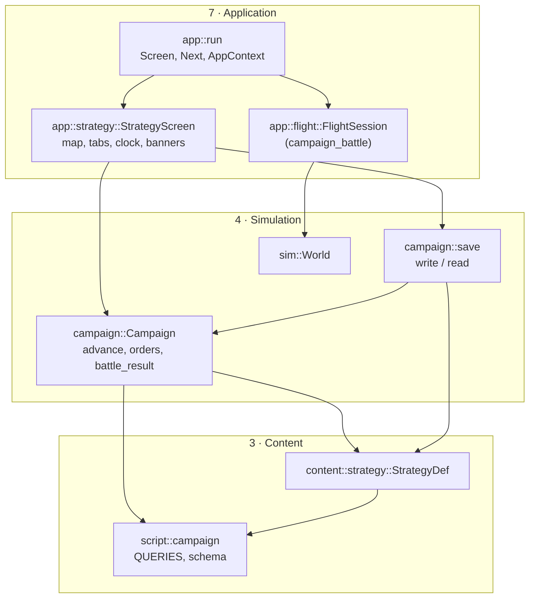
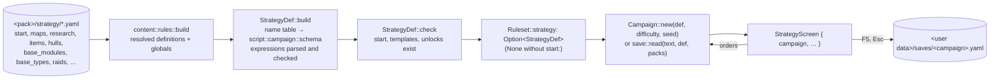
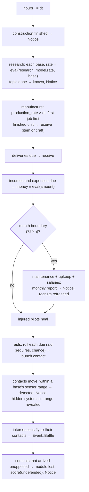

# Campaign (strategy layer)

`src/campaign/` (`mod.rs`, `save.rs`) with its data in `src/content/strategy.rs`, its expression
context in `src/script/campaign.rs` and its screen in `src/app/strategy.rs`: the real-time
strategy game around the battles (Stage 4, app 0.7.0 – 0.7.3). The modder's view is
[Strategy layer](../../modding/strategy.md); the player's is
[User guide › Campaign](../../user-guide/campaign.md). Requirements: R-STR-001 – R-STR-011 on
[Strategy & logistics](../../specification/requirements/strategy-logistics.md).

## Architecture Overview

### Where it sits

The campaign is a **simulation layer beside `sim`**: deterministic, plain data, no macroquad, no
rendering, no input. It reads the content layer (`StrategyDef`) and the script layer (it is a
`script::Context`), and the application layer drives it.



`campaign` never calls `sim`: a battle is handed to the app, which flies it in an ordinary
`FlightSession` and hands the debrief back. The two simulations meet only through strings (the
mission id, the result, the outcome's action texts) and a kill count.

### Data flow: from YAML to the screen



1. **Rules.** The strategy sections are ordinary rules sections: definition sections (`maps`,
   `star_classes`, `research`, `items`, `hulls`, `base_modules`, `base_types`, `raids`, `incomes`,
   `expenses`: `content::strategy::DEF_SECTIONS`) layer across packs like ships do; globals
   (`start`, `research_model`, `pilots`, `scores`, `economy`, `flags`) are read once. Their
   schema (`content::strategy::sections`) joins the rules file schema, so `--check` and the
   editor JSON Schema know every key.
2. **Names.** `StrategyDef::build` first collects every id it defines, plus factions, ship
   classes, missions and the flags missions set, into one sorted table (`names`). That table
   becomes the constants of `script::campaign::schema`, so `research(heat_rays)` compiles to
   *query 0 with argument 7* and a misspelling is a load error.
3. **Check.** Cross-references (start bases, systems, craft, templates, unlocks) are checked;
   `content::rules` adds the outside ones (a raid's mission and faction, a hull's ship class).
4. **Play.** `Campaign::new` builds the starting state: the map's systems (generated now for a
   generated map), the starting bases with finished modules, craft, pilots who take the craft in
   order, recruits, the first times for every income, expense and raid roll.

### Logic flow: the hour step

`Campaign::advance(def, hours)` loops `step` in slices of **at most one hour**, and returns as
soon as a step produced an event, so the screen can stop the clock. The order inside `step` is
fixed, which is what makes a campaign replay exactly from a save:



Every roll (raids, launch points, pilots, recruits, generated maps, `random(p)`) draws from one
**xorshift** generator stored in the campaign (`Campaign::rng`), so `same_seed_same_campaign`
can assert that two campaigns from one seed are equal after the same time.

### Expressions: the campaign as a `script::Context`

`Campaign` answers the 16 queries of `script::campaign::QUERIES` through a small context struct
(`Cx`) that holds `&Campaign`, an optional base (so `module_count` in a research rate counts the
base being evaluated) and the generator in a `Cell<u64>` — `Context::query` takes `&self`, but
`random(p)` must advance the generator, the same interior-mutability trick as
`sim::ai::ObjectContext` ([Conditions](script.md#the-object-context)). After evaluating,
`Campaign::eval` copies the advanced generator back.

### The battle hand-off

```mermaid
sequenceDiagram
    participant S as StrategyScreen
    participant A as app::run
    participant C as AppContext
    participant F as FlightSession
    S->>S: advance → Event::Battle{contact}; banner "fly or break off"
    S-->>A: Enter → Next::CampaignBattle{mission, ship, loadout}
    A->>C: mem::replace(screen, Launcher); ctx.campaign = Some(strategy screen)
    A->>F: start_mission(mission, ship); apply_loadout(loadout); campaign_battle = true
    F-->>C: debrief + Enter/Esc → ctx.battle_report = {result, actions, kills}
    F-->>A: Next::Strategy
    A->>C: ctx.campaign.take(), ctx.battle_report.take()
    A->>S: battle_done(report) → Campaign::battle_result
```

- The strategy screen cannot stay the current `Screen` while a flight runs, and it must not be
  dropped (it owns the campaign). `app::run` moves it out of `screen` with
  `std::mem::replace` and parks it in `AppContext::campaign` (`Option<Box<StrategyScreen>>`).
  `Next::Strategy` takes it back with `Option::take` ([Learn Rust › Ownership](../../learning/rust/ownership.md#moving-a-value-out-of-a-place-memreplace-and-take)).
- **The loadout** (app 0.7.2). `Campaign::loadout(def, craft)` turns the first craft's `fit` into
  beam ids (one per fitted beam slot) and missile ids with rounds. `flight::apply_loadout` sets
  them on the player's class — but beams belong to a ship *class* in the shared `Ruleset`,
  which every other screen also reads. The battle's `World` holds the rules as an `Arc<Ruleset>`,
  so `Arc::make_mut` gives the battle **its own copy** the first time it is changed
  (copy-on-write) and the shared content stays untouched. Ids that are not weapons of the
  campaign are skipped; with no beams fitted the class's own are kept.
- The flight screen fills `AppContext::battle_report` (`BattleReport {result, actions, kills}`)
  from the debrief: the result, the outcome's campaign actions as written (`score(x)`,
  `money(n)`, `salvage`, `set_flag(x)`, …) and the kill count. Leaving from the pause menu
  is `retreat`; a mission that cannot start is counted as `retreat` too, with the error printed.
- `Campaign::battle_result` applies the actions it knows (`score`, `money`, `set_flag`, `salvage`;
  `lose` is logged, the rest ignored until Stage 5), credits the party's pilots, removes a
  `killed` leader's craft (re-indexing pilots' craft handles), sends the rest home, and removes
  the contact on `win` or `draw`.

!!! bug "Known issue: `salvaged(x)` never matches a raid id (app 0.7.1)"
    `salvage` records the raid's display **`name`** in `Campaign::salvaged` ("Saucer raid"), but
    the `salvaged(x)` query compares against the **id** in the expression (`saucer_raid`). With the
    default data the two differ, so `saucer_hulls` and `robot_brains` (and everything after them)
    can never become researchable. The fix is to record the raid's id; the six-month test does not
    notice because four topics are reachable without salvage.

### Travel on the map

Positions are map units and everything moves in straight hops at its speed per hour
(`travel`). On a `travel: lanes` map (app 0.7.3) contacts and craft carry a `route`: the system
positions still to pass, consumed one by one before the final leg. `Campaign::lane_route(def,
from, to)` finds the shortest way along the lanes with **Dijkstra's algorithm** — repeatedly
settle the unsettled system with the shortest known distance and relax its lanes, then walk the
`prev` links back. With seven systems a linear scan for the minimum is simpler than a heap and
fast enough. A raid enters at the free system farthest from its target; an interception flies
the lanes to the system nearest the contact (`nearest_system`), then straight to it, and home
along the lanes. Routes are part of the saved state.

### Saves

`campaign::save` writes the whole `Campaign` as a YAML document (`write`) and reads it back
(`read`), using the engine's own YAML reader and writer (`formats::yaml`). Because the state
holds only numbers, text and **indices** into the rules, the save is a direct walk:

```yaml
# OpenInterceptor campaign save
save: 1
campaign: default
packs: [{id: default, version: 0.7.1}]
hours: 1234
money: 2150000
…
```

Reading checks the format version, then that **every pack listed is loaded** (else "this save
needs packs that are not loaded: …"), then every index against the loaded rules (module, item,
topic, income/expense/raid counts; else "save: … does not match the loaded rules (was a mod
changed?)"). A changed mod is refused with a message instead of crashing or silently changing
the game. The screen saves to `<user data>/saves/<campaign id>.yaml` (`strategy::save_path`) on
F5 and when leaving with Esc; *Campaign: continue* loads it.

## Key Symbols

| Symbol | Where | What it is |
|---|---|---|
| `StrategyDef` | `content/strategy.rs` | The strategy layer's rules: `start`, `map`, `star_classes`, `research`, `research_model`, `items`, `hulls`, `modules`, `base_types`, `raids`, `incomes`, `expenses`, `pilots`, `scores`, `delivery`, `salvage`, and the `names` table. |
| `Date` | `content/strategy.rs` | A Gregorian calendar date (`parse`, `plus_days`). |
| `MapKind`, `Travel`, `RaidTarget`, `ResearchMode` | `content/strategy.rs` | Fixed / generated maps; free / lane travel; base / system raids; download / labs. |
| `Campaign` | `campaign/mod.rs` | One game in progress: `hours`, `money`, `systems`, `bases`, `known`, `progress`, `craft`, `pilots`, `recruits`, `contacts`, `deliveries`, flow and raid timers, score, flags, salvaged, messages. |
| `Base`, `ModuleInst`, `Job`, `Craft`, `Pilot`, `Contact`, `Delivery` | `campaign/mod.rs` | The parts of the state, each referring to the others by index. |
| `Event` | `campaign/mod.rs` | `Notice(String)` (stop the clock, show it) or `Battle { contact }`. |
| `Campaign::fit_best`, `loadout`, `lane_route`, `nearest_system` | `campaign/mod.rs` | Fitting a craft from its base's store (0.7.2); its battle weapons; the shortest lane route (0.7.3). |
| `flight::apply_loadout` | `app/flight.rs` | Refits the player's class in the battle's own copy of the rules. |
| `MONTH` | `campaign/mod.rs` | 720 hours: reports, salaries, maintenance. |
| `save::write`, `save::read`, `save::PackRef`, `save::FORMAT` | `campaign/save.rs` | Saves and their pack header. |
| `script::campaign::QUERIES`, `id`, `schema` | `script/campaign.rs` | The campaign context. |
| `StrategyScreen`, `Tab`, `SPEEDS`, `BattleReport`, `save_path`, `map_transform` | `app/strategy.rs` | The screen. |
| `Next::NewCampaign`, `LoadCampaign`, `CampaignBattle`, `Strategy`; `AppContext::campaign`, `battle_report` | `app/mod.rs` | The screen changes around a campaign battle. |

## API Reference

- `Campaign::new(&StrategyDef, difficulty, seed) -> Campaign`.
- `campaign.advance(&def, hours) -> Vec<Event>` — the only way time passes.
- Orders, each `-> Result<(), String>` with a message for the player: `start_research(def, base,
  topic)`, `build_module(def, base, module)`, `build_base(def, base_type, system, name)`,
  `buy(def, base, Product, count)`, `sell(def, base, item, count)`, `manufacture(def, base,
  Product, count)`, `hire(def, recruit)`, `intercept(def, contact, &[craft])`, `fit_best(def, craft) -> Result<String, String>`; `assign(pilot,
  Option<craft>)`.
- Queries: `date(def)`, `eval(def, &Expr, base)`, `holds(def, Option<&Expr>)`, `stock_of(item)`,
  `effect(def, base, name)`, `sensor_range(def, base)`, `hangar(def, base)`, `available(def,
  "items.x")`, `researchable(def)`, `Campaign::rank(def, &pilot)`, `battle_party(contact)`.
- `campaign.battle_result(def, contact, result, &actions, kills)`.
- `save::write(&campaign, campaign_id, &[PackRef]) -> String`; `save::read(text, &def,
  &[PackRef]) -> Result<Campaign, String>`.

## Debugging

- `openinterceptor --check --campaign default` reports every strategy-data error with where it
  came from (`research.x.requires: unknown name 'y'`, `raids.x: unknown mission 'y'`).
- `openinterceptor --no-original --strategy` opens a new default campaign straight away.
- A save is readable YAML: open `<user data>/saves/default.yaml` to see the whole state.
- The message log (Messages tab) records every payment, arrival, research result, battle and
  report with its date.
- The campaign is unit-testable without a window: `campaign::tests::autoplay` plays any
  `StrategyDef` with a simple automatic player (keeps every base researching, builds a lab and a
  workshop when it can, intercepts every contact it sees, alternates battle results). The tests
  build small synthetic strategy layers from one YAML document (`content::strategy::tests::build`) and also play the real default campaign for six months.
