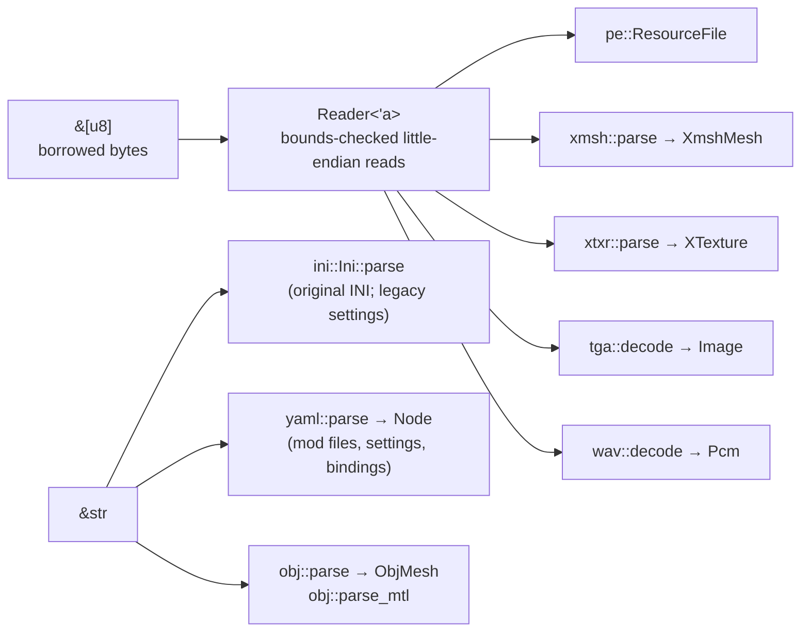

# Formats layer

`src/formats/`: turns bytes into plain Rust data. Nothing here knows about windows, GPUs,
rules or the simulation, so every reader is tested with small byte buffers built inside the
test itself — never with original game files. Plan: Stage 1 (formats needed for flight).

## Architecture Overview

Logic flow of a typical reader: check the signature (`BadMagic` if wrong) → read the header
with `Reader` (every read returns `FResult`, so `?` propagates a `Truncated` error) → read the
tables the header points to → validate cross-references (edge and vertex indices, palette
indices) → return owned data.

| Module | Reads | Notes |
|---|---|---|
| `formats::pe` | Win32 resource tables in the original DLLs | Names are stored with quotes (`"INTTYPEA"`); `ResId::name` strips and upper-cases them. |
| `formats::xmsh` | `XMSH` meshes | LODs, signed edge references, BSP walked with an explicit stack and a node budget. |
| `formats::xtxr` | `XTXR` palettised textures | Palette 0 (full brightness) of 16 RGB555 shade palettes; top mip only. |
| `formats::tga` | TGA (16/24/32-bit, raw or RLE) | Optional colour key (cockpit cyan `0x03DF`) → transparent black. |
| `formats::wav` | RIFF WAVE: PCM 8/16, MS ADPCM, IMA ADPCM | Re-encodes to PCM WAV in memory for playback. |
| `formats::ini` | INI text | Case-insensitive sections/keys, `;` comments, layered merge. Since Stage 2 used for the **original** CD's INI files (`inherit: original:…`) and to migrate old `settings.ini` / `bindings.ini`; mod files are YAML. |
| `formats::yaml` | A strict subset of YAML | Block and flow mappings and sequences, plain/quoted scalars, `|` and `>` block text, `#` comments. Rejects tabs, anchors, aliases, tags, several documents, complex keys and multi-line plain scalars with a line number. Every scalar stays text (with a `quoted` flag); the schema layer gives it a type. Also writes YAML (`to_yaml`). Why hand-written: DEV-030. |
| `formats::obj` | Wavefront OBJ + MTL | The mod model format. Negative indices, `v/vt/vn` forms. Faces in a `g`/`o` named `slot_<name>` are not kept as geometry: each such group becomes an attachment point `(name, centre of its faces, first face's normal)` in `ObjMesh::slots`. |

## Key Symbols

| Symbol | What it is |
|---|---|
| `Reader<'a>` | A *borrowed view* of bytes with checked `u16/i16/u32/i32/f32/name` reads. The lifetime `'a` ties it to the buffer, so it can never outlive the data. |
| `FormatError` | Why decoding failed: `Truncated { offset, wanted, len }`, `BadMagic { expected }`, `Invalid(String)`, `Unsupported(String)`. Implements `Display` and `std::error::Error`. |
| `FResult<T>` | Short for `Result<T, FormatError>`. |
| `pe::ResourceFile` | Owns a DLL's bytes and its resource index; `find(kind, id)` returns a borrowed slice. |
| `pe::ResId` | `Num(u32)` or `Name(String)` — a resource id. |
| `xmsh::XmshMesh`, `Lod`, `Polygon`, `XVertex`, `Manipulator` | The mesh exactly as stored (Direct3D coordinates). Polygons store a `first`/`count` range into one shared `polygon_vertices` vector. |
| `xtxr::XTexture` | Width, height, palette 0 and the top mip's indices; `to_rgba()`. |
| `tga::Image` | RGBA, rows top to bottom (also used as `content::Image`). |
| `wav::Pcm` | Interleaved `i16` samples; `to_wav_bytes()`, `duration()`. |
| `ini::Ini`, `ini::Section` | Parsed INI; `get`, `get_f32`, `get_bool`, `get_floats`, `merge_from`. |
| `yaml::Node`, `yaml::Value`, `yaml::YamlError` | A YAML value with its 1-based line: `Null`, `Scalar { text, quoted }`, `Seq`, `Map` (entries in file order); an error with line and message. |
| `obj::ObjMesh`, `obj::ObjMaterial` | Positions, uvs, normals, faces (as corner ranges), material names, `slots` (attachment points). |

## API Reference

- `Reader::new(&[u8])`, `.u16/.i16/.u32/.i32/.f32(offset)`, `.bytes(offset, n)`, `.name(offset, n)`.
- `pe::ResourceFile::parse(Vec<u8>)`, `::open(&Path)`, `.find(&ResId, &ResId) -> Option<&[u8]>`,
  `.entries()`, `.names_of(&ResId)`.
- `xmsh::parse(&[u8]) -> FResult<XmshMesh>`; `Lod::polygon_indices(&Polygon) -> &[u32]`.
- `xtxr::parse(&[u8]) -> FResult<XTexture>`; `xtxr::rgb555(u16) -> [u8; 3]`.
- `tga::decode(&[u8], key: Option<u16>) -> FResult<Image>`; `tga::COCKPIT_KEY_555`.
- `wav::decode(&[u8]) -> FResult<Pcm>`.
- `Ini::parse(&str)`, `Ini::parse_bytes(&[u8])` (UTF-8 or Latin-1), `Ini::parse_with_warnings`,
  `ini.section(name)`, `ini.get(section, key)`, `ini.merge_from(&other)`.
- `obj::parse(&str) -> FResult<ObjMesh>`, `obj::parse_mtl(&str) -> Vec<ObjMaterial>`.
- `yaml::parse(&str) -> Result<Node, YamlError>`; `Node::null(line)`, `Node::text(s, line)`,
  `node.get(key)`, `as_str`, `as_map`, `as_seq`, `is_null`, `to_yaml()`.

Test-only builders (`#[cfg(test)]`, crate-visible): `pe::build_test_pe`,
`xmsh::build_test_xmsh`, `xtxr::build_test_xtxr`, `tga::build_test_tga` — so other modules'
tests can make fake DLLs and meshes.

## Debugging

- `openinterceptor --check --data <cd>` parses **every** original mesh and texture and reports
  each failure by resource name (1 096 resources, 0 errors on the reference CD).
- A `Truncated` error names the offset and size requested: compare with the byte tables on the
  [format pages](../../specification/original-formats/index.md).
- To inspect a resource by hand, the format pages describe the layout field by field; the
  `build_test_*` helpers show the same layout as code.
- A YAML problem reads `line N: message` (callers add the file name). The reader works line by
  line: a block parser for indentation (`BlockParser`) and a small flow parser for `[…]` and
  `{…}`, which may wrap over several lines inside the brackets.
