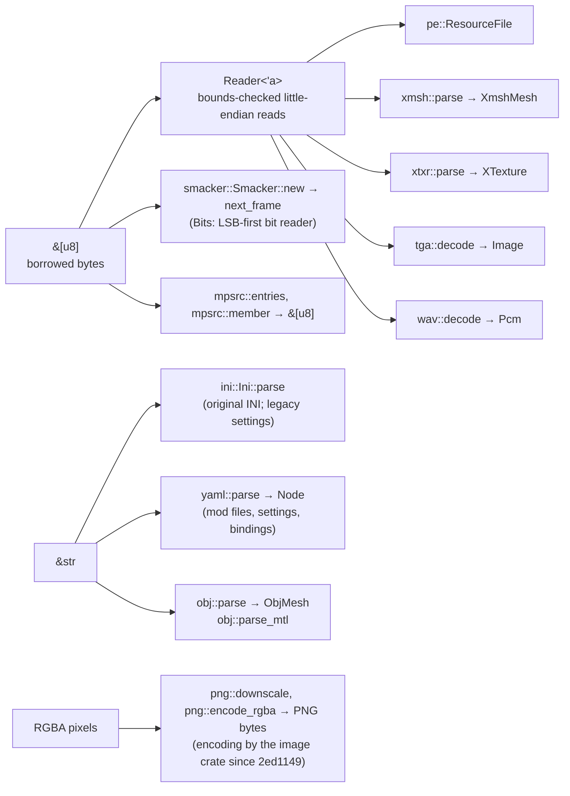

# Formats layer

`src/formats/`: turns bytes into plain Rust data. Nothing here knows about windows, GPUs,
rules or the simulation, so every reader is tested with small byte buffers built inside the
test itself — never with original game files. Plan: Stage 1 (formats needed for flight).

## Architecture Overview

Logic flow of a typical reader: check the signature (`BadMagic` if wrong) → read the header
with `Reader` (every read returns `FResult`, so `?` propagates a `Truncated` error) → read the
tables the header points to → validate cross-references (edge and vertex indices, palette
indices) → return owned data.

| Module | Reads | Notes |
|---|---|---|
| `formats::pe` | Win32 resource tables in the original DLLs | Names are stored with quotes (`"INTTYPEA"`); `ResId::name` strips and upper-cases them. |
| `formats::xmsh` | `XMSH` meshes | LODs, signed edge references, BSP walked with an explicit stack and a node budget. |
| `formats::xtxr` | `XTXR` palettised textures | Palette 0 (full brightness) of 16 RGB555 shade palettes; top mip only. |
| `formats::tga` | TGA (16/24/32-bit, raw or RLE) | Optional colour key (cockpit cyan `0x03DF`) → transparent black. |
| `formats::wav` | RIFF WAVE: PCM 8/16, MS ADPCM, IMA ADPCM | Re-encodes to PCM WAV in memory for playback. |
| `formats::ini` | INI text | Case-insensitive sections/keys, `;` comments, layered merge. Since Stage 2 used for the **original** CD's INI files (`inherit: original:…`) and to migrate old `settings.ini` / `bindings.ini`; mod files are YAML. |
| `formats::yaml` | A strict subset of YAML | Block and flow mappings and sequences, plain/quoted scalars, `|` and `>` block text, `#` comments. Rejects tabs, anchors, aliases, tags, several documents, complex keys and multi-line plain scalars with a line number. Every scalar stays text (with a `quoted` flag); the schema layer gives it a type. Also writes YAML (`to_yaml`). Why hand-written: DEV-030. |
| `formats::png` | *(writes)* RGBA → PNG | App 0.6.7, for the console's textured target model. Since main `2ed1149` `encode_rgba(w, h, rgba)` calls the `image` crate's `PngEncoder` — `image` is already a direct dependency for decoding (its `png` feature encodes too), so the in-crate writer of app 0.6.7 (stored deflate blocks, its own CRC-32 and Adler-32) was removed as a duplicate; a length mismatch gives an empty result rather than a panic. The module keeps what the console needs first: shrinking a texture by averaging blocks. Test: the encoded PNG decodes back to the same pixels ([Dependency policy](../../learning/best-practices/dependencies.md#png-encoding-the-image-crate-already-in-the-tree)). |
| `formats::smacker` | Smacker video `SMK2` / `SMK4` | App 0.12.0. A complete in-crate decoder ([below](#smacker-formatssmacker)): Huffman trees with the escape cache, the four block types, delta palettes, DPCM audio. |
| `formats::mpsrc` | MPSRC packs (`.mps`) | Main `319a31b`. The bundle `mfdanim.mps` (113 talking-head Smacker clips): [below](#mpsrc-formatsmpsrc). |
| `formats::obj` | Wavefront OBJ + MTL | The mod model format. Negative indices, `v/vt/vn` forms. Faces in a `g`/`o` named `slot_<name>` are not kept as geometry: each such group becomes an attachment point `(name, centre of its faces, first face's normal)` in `ObjMesh::slots`. |

### Smacker (`formats::smacker`)

The original's films are Smacker files ([format page](../../specification/original-formats/smacker.md)).
`Smacker::new(&[u8])` reads the 104-byte header (signature, size, frame count, frame rate,
flags, seven audio tracks' sizes and rates), the frame size and type tables and the four big
Huffman trees, and keeps a borrow of the bytes. `next_frame()` then decodes one frame into the
public `pixels` (palette indices) and `palette` and returns its audio, `(track, samples)` per
track present; `rgba()` converts the current frame. The decoder keeps no history beyond those
two buffers, so `skip_to(n)` can resume at frame `n` after a caller restores them — which is how
`app::video` steps a decoder it cannot store ([Presentation › Videos](presentation.md#videos-appvideo)).

How it is built, layer by layer:

- **Bits.** `Bits<'a>` reads bits least-significant first from a borrowed slice; running out is
  an error (`bitstream ended early`), never a panic.
- **Trees.** A small tree (8-bit leaves) is an arena of `Leaf`/`Node` entries read recursively.
  A **big tree** (16-bit leaves) is built from two small trees (low and high byte) plus three
  escape values; a leaf equal to an escape returns one of a three-slot **cache** of recent
  values instead, and every decoded value is pushed into it. The caches are reset each frame.
- **Blocks.** The `type` tree gives a block kind and a run length — `SIZES`, a 64-entry table
  built by a `const` block at compile time (1 – 59, then 128 … 2048) — over 4 × 4 blocks in
  raster order: **mono** (two colours from `mclr`, a 16-bit pattern from `mmap`), **full**
  (16 pixels from `full`; version 4 adds two half-resolution modes), **skip** (unchanged) and
  **solid** (one colour).
- **Palette.** A frame may carry a palette chunk: runs that keep entries, copy a range from the
  previous palette, or set an entry from three 6-bit components (expanded to 8 bits).
- **Audio.** Each track chunk is DPCM: per-channel Huffman trees of deltas from a first sample,
  8- or 16-bit, mono or stereo (interleaved), or raw PCM; `decode_audio` returns 16-bit samples.
- **Line doubling.** Files flagged as doubled or interlaced report `out_height() = 2 × height`.

Unit tests build bitstreams by hand (`W`, an LSB-first writer): trees with the cache, palettes
(kept, copied and explicit entries), a one-frame file with a solid block, and 8-bit mono DPCM.
The decoder was checked by hand against **all eleven** of the reference CD's videos — every
frame and its audio decode — with the ignored test `real_smacker_file_decodes`, which reads a
file named by `OI_SMK`. No original file is in the repository.

### MPSRC (`formats::mpsrc`)

An MPSRC pack is a named-file bundle ([format page](../../specification/original-formats/mpsrc.md)):
an 8-byte `MPSRC` signature, a `u32` count and `count` 136-byte entries (a zero-padded 128-byte
name, `u32` size, `u32` offset), then the files. `entries(&[u8])` returns the table, checking
every entry lies inside the data; `member(&[u8], name)` returns one file's bytes as a **borrowed
slice** — no copy — matching the name without regard to case. `Content::read_asset` uses it for
references written `original:<pack>.mps#<member>` (the `#` part, which for DLLs names a
resource, names the member). Test: `a_pack_lists_and_returns_its_members` (a two-member pack built in the
test: the table, a case-insensitive lookup, a missing member, a foreign file).

## Key Symbols

| Symbol | What it is |
|---|---|
| `Reader<'a>` | A *borrowed view* of bytes with checked `u16/i16/u32/i32/f32/name` reads. The lifetime `'a` ties it to the buffer, so it can never outlive the data. |
| `FormatError` | Why decoding failed: `Truncated { offset, wanted, len }`, `BadMagic { expected }`, `Invalid(String)`, `Unsupported(String)`. Implements `Display` and `std::error::Error`. |
| `FResult<T>` | Short for `Result<T, FormatError>`. |
| `pe::ResourceFile` | Owns a DLL's bytes and its resource index; `find(kind, id)` returns a borrowed slice. |
| `pe::ResId` | `Num(u32)` or `Name(String)` — a resource id. |
| `xmsh::XmshMesh`, `Lod`, `Polygon`, `XVertex`, `Manipulator` | The mesh exactly as stored (Direct3D coordinates). Polygons store a `first`/`count` range into one shared `polygon_vertices` vector. |
| `xtxr::XTexture` | Width, height, palette 0 and the top mip's indices; `to_rgba()`. |
| `tga::Image` | RGBA, rows top to bottom (also used as `content::Image`). |
| `wav::Pcm` | Interleaved `i16` samples; `to_wav_bytes()`, `duration()`. |
| `ini::Ini`, `ini::Section` | Parsed INI; `get`, `get_f32`, `get_bool`, `get_floats`, `merge_from`. |
| `yaml::Node`, `yaml::Value`, `yaml::YamlError` | A YAML value with its 1-based line: `Null`, `Scalar { text, quoted }`, `Seq`, `Map` (entries in file order); an error with line and message. |
| `smacker::Smacker<'a>`, `AudioTrack`, `FrameAudio`, `SmkError` | A Smacker file being decoded (borrowing its bytes): `width`, `height`, `frames`, `frame_time`, `tracks`, the current `pixels` and `palette`; one audio track's rate and format; a frame's audio per track; a decoding error. |
| `mpsrc::Entry`, `mpsrc::entries`, `mpsrc::member` | One file in an MPSRC pack (name, offset, size); the table; one member's bytes. |
| `smacker::Bits<'a>`, `smacker::Big` | The LSB-first bit reader; a big Huffman tree with its escape cache. |
| `obj::ObjMesh`, `obj::ObjMaterial` | Positions, uvs, normals, faces (as corner ranges), material names, `slots` (attachment points). |

## API Reference

- `Reader::new(&[u8])`, `.u16/.i16/.u32/.i32/.f32(offset)`, `.bytes(offset, n)`, `.name(offset, n)`.
- `pe::ResourceFile::parse(Vec<u8>)`, `::open(&Path)`, `.find(&ResId, &ResId) -> Option<&[u8]>`,
  `.entries()`, `.names_of(&ResId)`.
- `xmsh::parse(&[u8]) -> FResult<XmshMesh>`; `Lod::polygon_indices(&Polygon) -> &[u32]`.
- `xtxr::parse(&[u8]) -> FResult<XTexture>`; `xtxr::rgb555(u16) -> [u8; 3]`.
- `tga::decode(&[u8], key: Option<u16>) -> FResult<Image>`; `tga::COCKPIT_KEY_555`.
- `wav::decode(&[u8]) -> FResult<Pcm>`.
- `Ini::parse(&str)`, `Ini::parse_bytes(&[u8])` (UTF-8 or Latin-1), `Ini::parse_with_warnings`,
  `ini.section(name)`, `ini.get(section, key)`, `ini.merge_from(&other)`.
- `smacker::Smacker::new(&[u8]) -> Result<Smacker, SmkError>`, `.next_frame() -> Result<Option<FrameAudio>, SmkError>`,
  `.rgba()`, `.out_height()`, `.skip_to(n)`; `smacker::decode_palette(&[u8], &old)`, `smacker::decode_audio(&[u8], AudioTrack)`.
- `obj::parse(&str) -> FResult<ObjMesh>`, `obj::parse_mtl(&str) -> Vec<ObjMaterial>`.
- `yaml::parse(&str) -> Result<Node, YamlError>`; `Node::null(line)`, `Node::text(s, line)`,
  `node.get(key)`, `as_str`, `as_map`, `as_seq`, `is_null`, `to_yaml()`.

Test-only builders (`#[cfg(test)]`, crate-visible): `pe::build_test_pe`,
`xmsh::build_test_xmsh`, `xtxr::build_test_xtxr`, `tga::build_test_tga` — so other modules'
tests can make fake DLLs and meshes.

## Debugging

- `openinterceptor --check --data <cd>` parses **every** original mesh and texture and reports
  each failure by resource name (1 096 resources, 0 errors on the reference CD).
- A `Truncated` error names the offset and size requested: compare with the byte tables on the
  [format pages](../../specification/original-formats/index.md).
- To inspect a resource by hand, the format pages describe the layout field by field; the
  `build_test_*` helpers show the same layout as code.
- A YAML problem reads `line N: message` (callers add the file name). The reader works line by
  line: a block parser for indentation (`BlockParser`) and a small flow parser for `[…]` and
  `{…}`, which may wrap over several lines inside the brackets.
