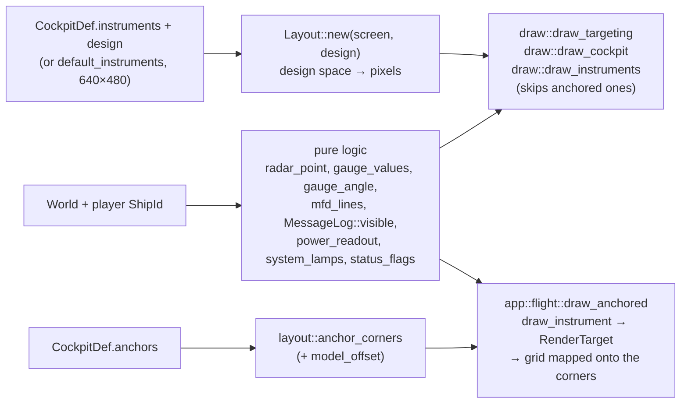

# Cockpit and HUD

`src/hud/`: the 2D layer over the 3D view. `hud/mod.rs` holds the pure logic (tested);
`hud/draw.rs` paints it with macroquad (verified by [manual tests](../testing/manual-tests.md)).
`hud/layout.rs` holds the pure maths of 3D-cockpit anchors and the cockpit layout editor.
Plan: Stage 1; Stage 2 added the `power` and `systems` instruments, status flags, the MFD
Systems page, text fitted to each instrument, instruments **anchored in perspective** on a 3D
cockpit and the **layout editor** (F12).

## Architecture Overview

**Anchored instruments (3D cockpits).** An anchor (`at`, `normal`, `size`, metres from the
eye) is a rectangle lying on the cockpit model's surface. `anchor_corners` builds its four
corners: "up" is world +Y with its component along the normal removed (Gram–Schmidt), "right"
completes the frame. Each frame, `draw_anchored` (in `app::flight`) projects the corners to
measure the instrument's on-screen footprint, draws the instrument with
`draw::draw_instrument` into a `RenderTarget` at about twice that size (so lines stay sharp),
and maps the texture onto the rectangle through a grid of small quads
(`anchor_point` interpolates the corners), because one quad of two triangles would bend
straight lines at its diagonal. The instrument then sits in its bezel at any window shape and
field of view. `HudFrame::anchored` names the instruments drawn this way, and
`draw_instruments` skips them.

**Text fitted to instruments.** Every instrument painter sizes its text to its box
(`fit_size`: the longest line, measured once at a reference size, scaled to fit the width and
the row count to fit the height, capped at a maximum). The MFD uses one size for every page,
fitted to the longest page, so text does not jump when pages change. Lines and text also scale
with an anchored instrument's texture.

**Design space.** Instruments are placed in a cockpit's *design space*
(`instruments: {mfd: [x, y, w, h]}` in the rules). The original cockpits use 640×480, the default;
a cockpit can declare its own with `design: [w, h]` (the `default` campaign's Guard cockpit uses 1280×720).
`Layout::new(screen, design)` scales the design space as large as fits
(`min(screen.w / design.w, screen.h / design.h)`) and centres it: a 4:3 cockpit fills the
height of a 16:9 screen with space visible at the sides; a 16:9 design fills it exactly. The
cockpit image is stretched to the whole design space (`Layout::full`), whatever its pixel
size — which is why an HD repaint (e.g. 2560×1920 replacing a 640×480 original) keeps every
instrument aligned without changing a rule.

**Instruments** (names used in cockpit rules):

| Name | Shows |
|---|---|
| `radar_front`, `radar_rear` | Contacts in the front / rear hemisphere; distance from the centre = angle off the axis (rim = 90°); rear scope mirrored left/right. Faction colours; stations drawn larger; the target boxed. Mobile contacts beyond `[flight] RadarRange` are hidden. |
| `mfd` | One of five pages (`MfdPage`): Target (name, faction, range, speed, shields, armour, hull, lock state), Weapons (beams, link mode, racks with the selected one marked `>`), Status (own shields with balance, armour/hull/energy, and the power line `BEAM x SHLD y PWR used/budget`), Systems (one line per fitted system: `OK`, `ON`, `DMG n%`, `OUT`, `DESTROYED`, `*` while being repaired), Nav. |
| `gauge1`–`gauge4` | Needles for speed, energy, shields, hull (red below 25 %). |
| `message` | The newest message younger than 4 s. |
| `power` | `B-<level>` and `S-<level>` columns (charge settings), fore/aft shield bars with the favoured facing marked, `used/budget` in yellow when the budget is full (`power_readout`). |
| `systems` | A grid of lamps, one per fitted system with a three-letter label (`system_abbrev`): green OK, cyan switched on, amber damaged, red knocked out (blinking while repaired), grey destroyed (`system_lamps`, `Lamp`). |

**Fallback panels.** A cockpit that does not place `power` or `systems` gets them as small
panels at the top right of its *own design space* — x from 87.5 % of the design width, y from
9 % of its height — with a dark backdrop over cockpit art. The glass layout
(`default_instruments`) places both along the bottom.

Ships without cockpit art, and the non-cockpit views, use **glass instruments**
(`default_instruments()` with dark backgrounds). A throttle/speed/REV/BURN/VCT strip is
drawn under the message line, extended with `BRAKE` while braking and `HOLD n` while the
flight computer holds a speed, and the Stage 2 status flags (`status_flags`): `DISABLED`,
`CLOAKED`, `TRACTOR`, `ECM`, `JUMP n` (hyperspace countdown).

**Drift readout (app 0.3.1).** The status line reads `THR 60%  312 m/s  X+45 Y-12`: throttle,
forward speed, then sideways (X, + right) and vertical (Y, + up) drift in whole metres per
second, signed (`drift_text`). All three come from `Ship::body_velocity()`, the velocity turned
into the ship's own axes ([Simulation](sim.md)). In newtonian flight a turn changes the nose, not
the motion, so after a hard turn X or Y shows how far the ship is sliding.

**Flight-path marker.** `draw_targeting` projects a point 1 km along the ship's velocity
(when faster than 5 m/s) and draws a circle with three ticks (left, right, up) there: where the
craft is actually going. With no drift it sits on the crosshair; sideways drift slides it off to
the side.

**Targeting** (forward views): a reticle; corner brackets sized by the target's angular size;
name and range; a lead circle (where to aim beams); a lock-progress ring, then a red lock
diamond and `LOCK`; an arrow on a ring when the target is off-screen. Nav points draw a blue
diamond.

## Key Symbols

| Symbol | What it is |
|---|---|
| `Layout` | `scale`, `offset`, `design`; `new(screen, design)`, `rect([x, y, w, h])`, `full()`. |
| `radar_point(local_dir, front) -> Option<Vec2>` | Where a contact goes on a scope (unit disc). |
| `gauge_angle(fraction)`, `gauge_values(&Ruleset, &Ship) -> [f32; 4]` | Needle maths. |
| `MfdPage`, `mfd_lines(&World, ShipId, page, nav) -> Vec<String>` | MFD content. |
| `MessageLog` | Timestamped messages; `push`, `visible(now, n)`; bounded to 32. |
| `PowerReadout`, `power_readout(&Ruleset, &Ship)` | What the `power` instrument shows: levels, steps used and budget, balance, fore/aft fractions. |
| `Lamp`, `system_lamps(&Ship)`, `system_abbrev(SystemKind)` | The `systems` instrument's lamps. |
| `status_flags(&Ship) -> Vec<String>` | The status-strip flags. |
| `draw::drift_text(body_velocity)` | `X+45 Y-12`: the drift part of the status line. |
| `draw::HudFrame` | Everything a draw call needs that is not in the world, incl. `anchored` (instruments drawn on the 3D cockpit) and `text_scale`. |
| `draw::INSTRUMENTS` | The ten instrument names, in the editor's Tab order. |
| `layout::anchor_corners`, `anchor_point` | An anchor's corners in the camera frame; a point inside by (u, v). |
| `layout::cursor_ray`, `ray_triangle`, `pick` | The editor's 3D placement: a ray through the cursor, Möller–Trumbore intersection, the nearest hit on the cockpit's triangles with the normal turned towards the eye. |
| `layout::Grip`, `grip`, `drag_rect` | The editor's 2D placement: `Move` inside a rectangle, `Resize` at its bottom-right corner. |
| `layout::scale_anchor`, `layout_yaml` | Resize an anchor; the YAML the editor saves. |

## API Reference

- `layout::anchor_corners(&Anchor, offset) -> [Vec3; 4]`, `layout::cursor_ray(cursor, screen,
  fov_y, aspect) -> Vec3`, `layout::pick(triangles, offset, dir) -> Option<(at, normal)>`,
  `layout::grip(rect, point, handle) -> Option<Grip>`, `layout::drag_rect(rect, grip, delta,
  min)`, `layout::layout_yaml(cockpit, &instruments, &anchors) -> String`.
- `hud::default_instruments()`, `format_distance(m)`, `faction_color(&Ruleset, FactionId)`, `DESIGN`, `MESSAGE_TIME`.
- `draw::draw_instrument(&HudFrame, &Ship, name, rect)` (one painter per instrument),
  `draw::draw_instruments(&HudFrame)`, `draw_targeting(&HudFrame)`, `draw_cockpit(&Texture2D, Layout)`, `draw_caption`.

## Debugging

- Power and systems panels appearing at the top right mean the cockpit has no
  `instruments.power` / `instruments.systems` rectangles; add them to place the instruments.
- In a 3D cockpit, instruments that drift off their bezels on a narrow window point to a
  `Design` that does not match the proportions the bezels were measured at; the field of view
  widens to fit the design's width (`app::flight::cockpit_fov`), see
  [Cockpits](../../modding/cockpits.md).
- Press **F12** in the cockpit view to move instruments with the mouse (layout editor, see
  [Cockpits](../../modding/cockpits.md#the-cockpit-layout-editor-f12)); **S** saves the result as an
  addon you can inspect.
- An anchored instrument that looks mirrored or upside down has its `normal` pointing into the
  surface; the editor's ray pick always turns the normal towards the eye.
- If instruments sit in the wrong place on a cockpit, adjust the `instruments` rectangles in
  the cockpit's rules section — no code change needed; positions are in the cockpit's design
  space (640×480 unless `Design` says otherwise), not in the image's pixels.
- The original cockpits' cyan colour key becomes transparent black on load; a cyan halo means
  the key was not applied (`load_image(.., colour_key = true)`).
