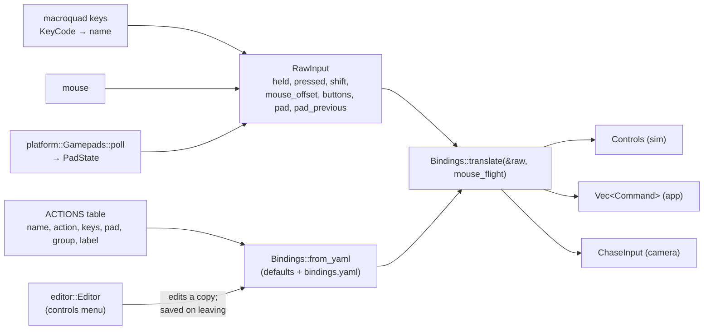
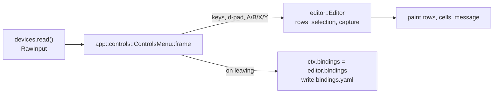

# Input and gamepads

`src/input/` turns device state into simulation `Controls` and one-shot `Command`s, using
bindings from an editable YAML file (`bindings.yaml`). The device reading itself is in `src/app/devices.rs`
(keyboard, mouse) and `src/platform/` (gamepads). The in-game controls menu is modelled in
`src/input/editor.rs` and drawn by `src/app/controls.rs`. Plan: Stage 1; Stage 2 added the
power, equipment and wingman actions, gamepad chords and the controls menu; app 0.3.1 the keys
overlay (`help`, `help_rows`). The default layout
is on [Controls](../../reference/original-game/controls.md).

## Architecture Overview



- **One table.** `ACTIONS` lists every action once: its `bindings.yaml` name, the `Action`, its
  default keys, its default pad chords, its menu `Group` and its label. Parsing, defaults,
  `to_yaml_text`, the controls menu and the [Controls](../../reference/original-game/controls.md) tables all
  come from it, so they cannot drift apart. Entries are built with a `const fn a(…)` so the
  whole table is a compile-time constant.
- **Keys overlay** (app 0.3.1). `help_rows(&Bindings)` turns the table into the overlay's
  content: every `Group` in table order, each with `(label, keys)` rows showing the player's
  *current* keys, then pad buttons (`pad A`), or "unbound". The action `help` (`?` =
  Shift+Slash, and Shift+F1) toggles it; `app::flight::draw_help` paints it. A new action
  therefore appears in parsing, the defaults, the controls menu, the overlay and (later) the
  console without further work. F12 is not bound to it: in a custom cockpit F12 opens the
  layout editor ([Cockpits](../../modding/cockpits.md)).
- **Remote action sets** (the control console, interlude C1, app 0.4.0). `RawInput`
  gains `remote_held` and `remote_pressed` (sets of `Action`) and `remote_throttle`. A remote
  surface — the tablet console, later a USB panel — fills them, and `translate` treats a held or
  tapped remote action exactly like a key bound to it, so the console needs no second path into
  the simulation. A remote throttle position sets `Controls::throttle_set` (clamped to 0–1).
  `remote::RemoteInput` fills the sets each frame from the console's events (one held set per
  console, released when it disconnects); see [Remote console](remote.md#input-path).

- **Key names** are macroquad's `KeyCode` variant names, lower-cased (`KeyCode::Kp7` →
  `kp7`), produced by `app::devices::key_name`. Every key macroquad knows is therefore bindable.
- **Held vs pressed**: axes, fire beams and afterburner are *held*; throttle steps, missile,
  link mode, targeting, views, power and equipment switches fire once per *press*. A `Shift+X`
  chord fires only with Shift held; a plain `X` only without it, so both can be bound to
  different actions. While Shift is held, a key used in any Shift chord is ignored by *held*
  actions bound to the plain key (`shifted_keys`): `Shift+E` (wingmen evasive) does not also
  roll the ship on `E`.
- **Gamepad chords.** A `PadChord` is a button with an optional modifier button
  (`LeftShoulder+A`). Any button used as a modifier somewhere (`modifiers()`) does nothing on its
  own, and a plain binding does not fire while another modifier is held — holding the modifier
  switches the pad to its second layer. The defaults use the left shoulder as the only modifier.
- **Gamepad presses** are detected by comparing with last frame's `PadState`.
- **Sticks** add to the keys and are clamped; a dead zone is applied and rescaled
  (`input::dead`). `StickLayout::Space` (default): left stick yaw and pitch, right stick roll
  and vertical slide; `StickLayout::Aircraft` swaps yaw and roll (the original's Alt+J). Stick
  forward = nose down unless `invert_pitch`.
- **Mouse flight** (toggle `C`): cursor offset from the centre / `mouse range` gives yaw and
  pitch, cursor down = nose down (as the original readme states) unless `mouse_invert`; left
  button = beams, right button = missile.
- **Bindings file**: `bindings.yaml` in the user data folder (macOS
  `~/Library/Application Support/OpenInterceptor/`, Linux `$XDG_DATA_HOME/openinterceptor/` or
  `~/.local/share/openinterceptor/`). Created with the defaults on first run
  (`app::load_bindings`); keys not mentioned keep their defaults; the controls menu rewrites it
  in full when it saves. A `bindings.ini` of an earlier build is read once with the legacy
  reader (`Bindings::from_ini`) and saved as `bindings.yaml`.

```yaml
keyboard:
  fire_beams: [Enter, LeftControl]
  wing_fire_at_will: [Shift+F]
gamepad:
  fire_beams: [RightTrigger]
  hyperspace: [LeftShoulder+A]
options:
  dead_zone: 0.15
  invert_pitch: false
  stick_layout: space
  mouse_range: 200
  mouse_invert: false
```

### The controls menu



`Editor` holds a working copy of the `Bindings` and the list of `Row`s: a `Header` per `Group`,
an `Action` row per action, then a `Setting` row per device option (dead zone, invert pitch,
stick layout, mouse range, mouse invert). Each action row has four cells (`COLUMNS`): two key
slots and two pad slots. `activate` starts a `Capture`:

- `Capture::Key` — `capture_key(key, shift)` binds the next key with Shift as a chord; a lone
  Shift is ignored (waiting for its key), Escape cancels.
- `Capture::Pad { first }` — the capture cannot tell from the first button whether it is a
  plain press or a chord, so it waits: a second button pressed while the first is held makes
  `first+second`; the first released alone makes a plain binding.

`assign_key` / `assign_pad` remove the chord from **every other action** before setting it
(the status line names the actions that lost it), so a chord is bound to at most one action.
`clear`, `reset_selected` and `reset_all` restore defaults. The screen is a component with a
`frame` method so the launcher and the in-flight pause menu (`K`) can both host it; it gives up
a capture after 8 s (`CAPTURE_TIMEOUT`).

## Key Symbols

| Symbol | What it is |
|---|---|
| `Action` | Every bindable action (65, with `Help`). |
| `ACTIONS`, `ActionInfo`, `info(action)` | The single table: `name`, `action`, `keys`, `pad`, `group`, `label` — one source for parsing, defaults, the menu and docs. |
| `Group` | `Flight`, `Throttle`, `Weapons`, `Targeting`, `Power`, `Wingmen`, `Views`, `Camera`, `Interface`; `title()`. |
| `KeyChord` | A key name plus optional Shift; `parse`, `text`. |
| `PadChord` | A button plus optional modifier button; `plain`, `parse`, `text`. |
| `StickLayout` | `Space` or `Aircraft`. |
| `Bindings` | `keys: HashMap<Action, Vec<KeyChord>>`, `pad: HashMap<Action, Vec<PadChord>>`, `dead_zone`, `mouse_range`, `pad_invert_pitch`, `stick_layout`, `mouse_invert`; `from_yaml`, `to_yaml_text`, legacy `from_ini`, `translate`. |
| `RawInput` | One frame of device state (keys, mouse, pad; remote action sets filled by the console). |
| `Command` | One-shot app requests: targeting, MFD, `View(View)`, `WingMenu`, wing orders (`WingFireAtWill`, `WingAttackMyTarget`, `WingFormation`, `WingEvasive`, `WingRetreat`, `WingStatus`), `RepeatMessage`, `NextNav`, `Pause`, `Menu`, `MouseFlight`, `Help`. Power and equipment presses go to `Controls::requests` instead. |
| `View` | `Cockpit`, `Forward`, `Left`, `Right`, `RearLeft`, `RearRight`, `Chase`, `ChaseManual`; `View::parse` for `--view`. |
| `ChaseInput` | Chase-camera yaw/pitch/zoom/reset this frame. |
| `gamepad::PadState`, `gamepad::Button` | XInput-layout controller state and button names. |
| `THROTTLE_STEP` | 0.1 (10 % per press, as in the original). |
| `editor::Editor`, `Row`, `Setting`, `Capture`, `COLUMNS` | The controls menu's model (above). |
| `app::controls::ControlsMenu` | The controls menu screen component. |

## API Reference

- `Bindings::default()`, `Bindings::from_yaml(&yaml::Node)`, `bindings.to_yaml_text()`;
  `Bindings::from_ini(&Ini)` for migrating an old `bindings.ini`.
- `bindings.translate(&RawInput, mouse_flight: bool) -> (Controls, Vec<Command>, ChaseInput)`.
- `KeyChord::parse("Shift+F")`, `PadChord::parse("LeftShoulder+A")`, `input::canonical(name)`,
  `input::dead(v, dz)`, `input::info(Action) -> &ActionInfo`,
  `input::help_rows(&Bindings) -> Vec<(Group, Vec<(&str, String)>)>`.
- `Editor::new(&Bindings)`, `row`, `move_row`, `move_column`, `activate`, `cancel`,
  `capture_key(key, shift)`, `capture_pad(&now, &previous)`, `assign_key`, `assign_pad`,
  `clear`, `reset_selected`, `reset_all`, `adjust(delta)`, `cell(action, column)`,
  `setting_text`; `editor::pretty_key`, `editor::pretty_pad`.
- `ControlsMenu::new(&AppContext)`, `menu.frame(&mut AppContext) -> bool` (true when left).
- `Button::parse(name)`, `button.name()`, `PadState::button/set/axis_lx/…`.

## Debugging

- `OI_DEBUG_KEYS=1 openinterceptor …` prints the names of keys as they are pressed.
- One-shot inputs pressed in a frame that runs no simulation tick are carried over by
  `Controls::carry_unconsumed`, so a press is never lost on high-refresh displays.
- An action that "does nothing": open the controls menu and look at its cells — a chord moved
  to another action is removed from the old one, and the status line said which. A pad button
  that does nothing on its own is probably used as a modifier in some chord.
- A broken `bindings.yaml` cannot lock you out (a file that does not parse is reported and the
  defaults are used): Shift+D in the controls menu restores every
  default, and deleting the file recreates it on the next run.
- A gamepad that does nothing on Linux: check `/dev/input/js0` exists and is readable by your
  user (often the `input` group).
