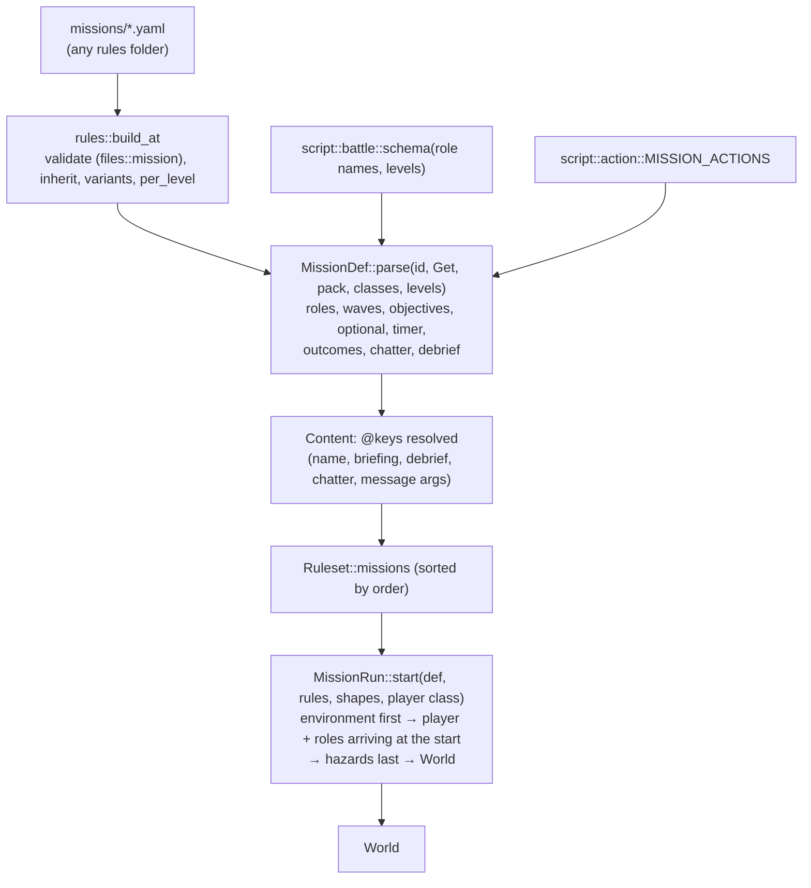
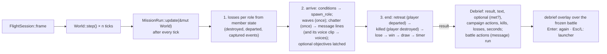

# Missions

`src/content/mission.rs` (definitions) and `src/mission/` (the runtime): battles described by
roles, waves, objectives and outcomes, refereed on top of the simulation. The battle conditions
are `src/script/battle.rs`, the outcome actions `src/script/action.rs`. Plan: Stage 3 part 1
(app 0.3.0). The modder's view is [Missions](../../modding/missions.md).

## Architecture Overview

**Layering.** `mission` sits between `sim` and `app`: it reads and spawns into a `World` (through
`World::spawn_placement`, the same path scenario objects take), but the simulation knows nothing
about missions, so `sim` stays testable on its own.

**Start order (Stage 3).** `MissionRun::start` sets the mission's `environment:` on the new
`World` **first** (`World::set_environment`), so that ground installations among the roles are
set down on its terrain (app 0.6.1); then places the player and the roles that arrive at the
start; and applies `hazards:` **last** (`World::apply_hazards`), so asteroids and mines keep
300 m clear of every craft already placed. `World::from_scenario` follows the same order for
scenarios. See [Simulation](sim.md#hazards-simhazards-app-051).

### One frame of a mission

- **Placement** (`spawn_role`): the count is rolled from `[min, max]`, each member's class from
  the role's list; the arrival point is `distance` along `bearing` (yaw, pitch; `[0, 0]` = −Z
  from the player's start; random within ±20° pitch when absent) from the player's start or the
  centre of the `from` role's survivors; members stand side by side `spread` apart across the
  line of sight and face the player's start. Placed members get the role's faction, AI role,
  behaviour, protect flag, state, hull, destroyed systems and speed.
- **Counting**: a member that has left the world is *departed* (hyperspace) if its slot still
  holds it (`World::same_slot`) and it departed, otherwise destroyed; captures come from
  `Captured` events. Kills are hostile losses, losses the player's own faction's.
- **Determinism**: the mission's random choices come from its own generator seeded by
  `starfield_seed`, and condition `random(p)` from the same stream, so a mission replays
  identically with the same inputs.
- **Chatter voices** (app 0.6.2): a chatter line with `voice:` also pushes its clip (an index
  into `Ruleset::voice_clips`) onto `MissionRun::voices` when it is said; the flight screen
  plays and clears that list every frame, and plays the computer voice (`mission_accomplished`
  or `mission_failed`) when the debrief appears ([Audio](audio.md)).
- **Spawning over a ground** (app 0.6.4): over a terrain, `World::spawn` lifts any craft placed
  less than 300 m above the ground to 300 m (ground installations are still set down on it). A
  role placed `from` a ground installation would otherwise start inside a hill.
- **Conditions** are evaluated through `BattleCx`, which implements the script language's
  `Context` for this battle; role names are constants of the battle schema, compiled to indices.

### The `killed` result (app 0.3.1)

When the player's craft is destroyed — its slot no longer holds it (`!World::same_slot`, the
slot may have been reused) or it is not `alive` — the result is `killed`, checked **before** the
mission's own conditions. Before 0.3.1 a mission whose `lose` condition included
`not player_alive` reported the player's death as a loss, and the debrief showed the `lose`
text, which usually describes the objective failing ("the base was destroyed"). Measured with
the idle soak pilot, that was what players of `xcom_base_defense` saw on veteran: the base was
fine, the player had been killed in 15–18 s.

`killed` takes the mission's own `outcomes: {killed: …}` if it has any, else its `lose`
outcomes; the debrief text is `debrief: {killed: …}` if given, else empty. The debrief panel's
headline is "YOUR CRAFT WAS DESTROYED".

### Launcher, `--mission`, soak

The launcher lists missions after the scenarios (*Mission: name*, the briefing as the
description, the ship choice when `player.class` is `choose`) and scrolls the list to keep the
selection near the middle (`launcher::Menu::first_visible`, "^ more" / "v more" markers).
Selecting one returns `Next::Mission { mission, ship }`; `--mission <id>` starts one directly.
`soak::run_mission` plays a mission headless with the passive, AI or idle pilot and reports the
result (`--soak <mission id>`). A unit test holds the balance promise of R-MSN-011: in the
default campaign at cadet, `defend_station` with the idle pilot is still running after 150 s.
Since app 0.6.4 the soak report counts kills while the mission is still running
(`MissionRun::kills()`); before, a mission that ran out of time read 0 kills.

### The simulator (app 0.6.3)

The simulator (`app::simulator`, [Testbed](testbed.md#the-simulator-app-063)) flies a
**modified copy** of a mission: `simulator::apply` returns a new `MissionDef` with the chosen
environment and hazards and its enemy roles and waves scaled, and `FlightSession::start_custom`
starts it through the same `MissionRun` as any other mission. Nothing in `mission` knows it is
a simulation.

### Cargo, escorts and repeating waves (app 0.9.2)

- **`cargo(role)`** and the debrief's cargo share come from `mission::cargo_share(world, role)`:
  the cargo containers (modules of a `cargo: true` class) still mounted on a live member — or
  departed with a departed member — over every cargo slot of the members' classes. A container
  torn off has no `mount`; a destroyed one is neither alive nor departed. `Debrief::cargo` is
  `Some(share)` when the mission names a `cargo:` role, and it reaches the campaign in the
  `BattleReport`.
- **Escorts**: when a role with `escort:` spawns, each member's AI gets the newest live member
  of the escorted role as its leader and a slot of its formation (`sim::ai`'s `escort`
  manoeuvre flies it).
- **Repeating waves**: `MissionRun::waves_again` holds, per wave with `every:`, the battle time
  it may come again; a wave that has come is skipped unless that time has passed and its `when`
  still holds.

### AI changes made with missions

Enemies now launch missiles only when closing in (within 2.5 × their attack `range`, at least
2 km); the first launch comes 3 s plus a random part of one interval into the attack, and each
interval varies by ±25 %. Every AI pilot's random sequence is seeded per ship in `World::spawn`,
so pilots that start together do not act together.

## Key Symbols

| Symbol | What it is |
|---|---|
| `content::mission::MissionDef` | A parsed mission: `id`, `name`, `briefing`, `order`, `player_class`, `player_position`, `roles`, `waves`, `win`/`lose`/`draw`, `optional`, `timer`, `outcomes`, `chatter`, `debrief`, `starfield_seed`. |
| `RoleDef`, `Arrival`, `WaveDef`, `ChatterDef` | A role (classes, count range, faction, AI, behaviour, protect, state, hull, destroyed systems, speed, `at`, `arrive`); an arrival (`distance`, `bearing`, `from`, `spread`); a wave; a radio line (`when`, `line`, and since app 0.6.2 `voice` with its `voice_clip` index, filled in by the rules). |
| `mission::MissionRun` | The running mission: its definition, the player's id, per-role `RoleRun`s, wave/chatter/optional latches, its generator, kills, losses, `debrief`, and `voices` (chatter clips said and not yet played). `kills()` reads the kills so far, also while the battle runs; `evaluate` answers the condition console (app 0.16.5). |
| `mission::RoleRun` | `members`, `arrived`, `destroyed`, `retreated`, `captured`. |
| `mission::Debrief` | `result` (`win`, `lose`, `draw`, `retreat`, `killed`), `text`, `optional: Vec<(name, met)>`, `campaign` actions (as text), `kills`, `losses`, `seconds`. |
| `mission::BattleCx` | The battle `Context` for conditions. |
| `script::battle::QUERIES`, `schema(roles, levels)` | The battle context's queries. |
| `script::action::{ActionDef, Action, Scope, MISSION_ACTIONS}` | Outcome actions with `Battle` or `Campaign` scope. |
| `schema::Ty::Either` | A schema type with two accepted forms (`count`, `bearing`, `class`). |
| `World::spawn_placement`, `World::same_slot` | Spawn one placed object; whether an id's slot still holds its ship. |
| `app::Next::Mission`, `FlightSession::start_mission` | Starting a mission from the launcher or `--mission`. |
| `app::Next::Simulate`, `FlightSession::start_custom` | Starting a simulator mission: a ready-made, modified `MissionDef` (app 0.6.3). |

## API Reference

- `MissionDef::parse(id, Get, pack, classes, levels) -> Result<MissionDef, String>`;
  `def.outcome(result) -> &[Action]`.
- `MissionRun::start(&MissionDef, Arc<Ruleset>, Arc<Vec<Shape>>, Option<ShipClassId>) ->
  Result<(World, MissionRun), String>`; `run.update(&mut World) -> Vec<String>` (message lines);
  `run.spawn_role(&mut World, role, count, at) -> Result<usize, String>`; `run.kills() -> u32`;
  `run.voices` (drained by the flight screen).
- `script::battle::schema(&[String], &[String]) -> Schema`;
  `script::action::parse(text, MISSION_ACTIONS) -> Result<Action, String>`; `action.display()`.
- `run.evaluate(&World, text, &levels) -> Result<String, String>` — a condition or expression
  evaluated now, on a copy of the mission's generator (the condition console, app 0.16.5).
- `soak::run_mission(&Content, id, ship, seconds, pilot)`.

## Debugging

- `--check` reports every mission problem with file, line and path (`missions.x: roles.y…`,
  unknown roles in conditions, unknown actions).
- `--mission <id> --ship <id>` jumps straight in; `--soak <id> --difficulty <level>
  [--soak-pilot ai|idle]` plays it headless and prints `soak mission <id> (<level>, <pilot>): <result>
  after <n> s; <k> kills` — the quickest way to check that a mission can be both won and lost.
- A role that never appears: its `arrive:` condition never held, or its `at.from` role has no
  survivors (it then appears at the player's start). `arrived(role)` in a chatter line makes
  arrivals visible in play.
- A "MISSION ERROR: …" message line means a role could not be spawned (an unknown slot in a
  station's modules, for example).
- Press `` ` `` in the battle to type any condition and see its value now — `arrived(raiders)`,
  `count(foes)`, the `win:` expression itself (app 0.16.5). The battle pauses meanwhile.
