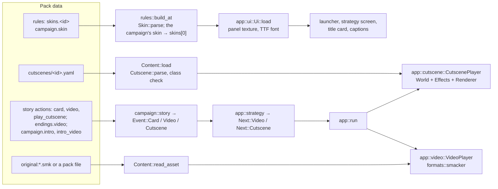
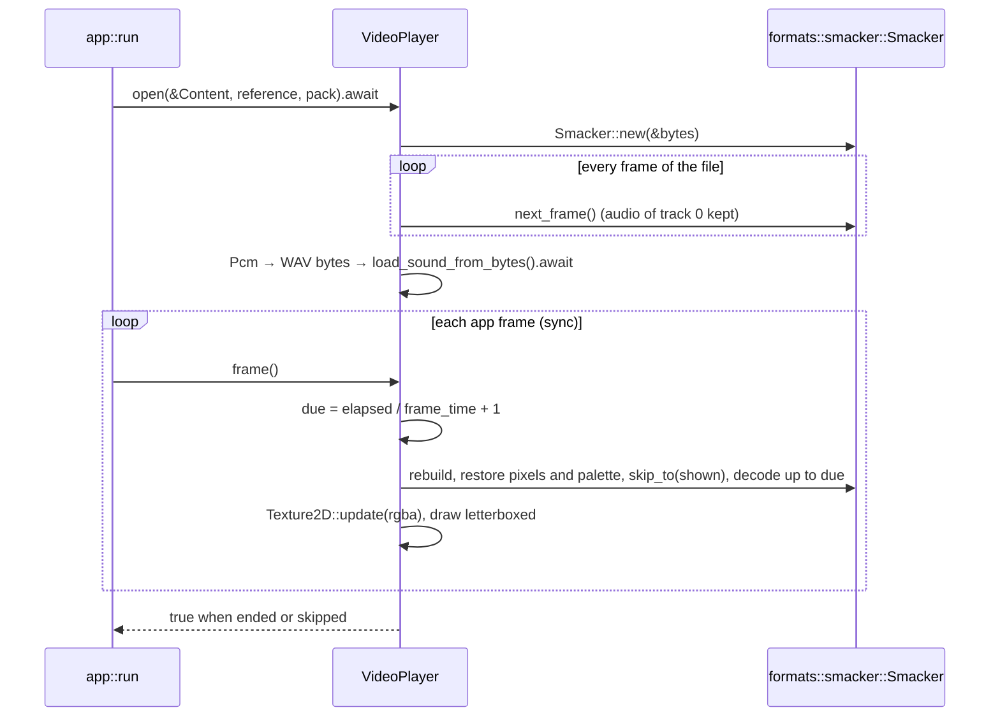
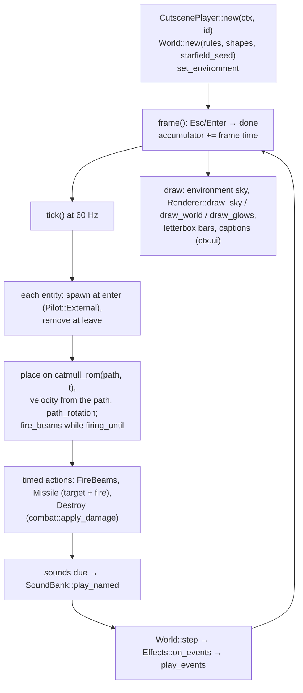
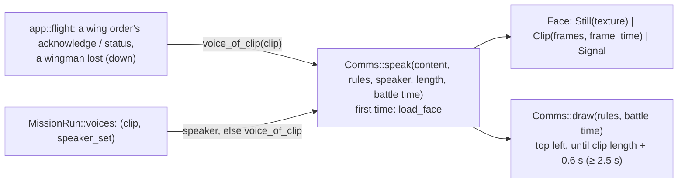
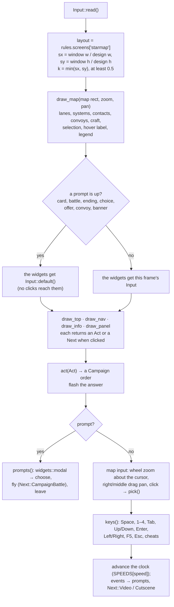

# Presentation: skins, videos and cutscenes

`src/app/ui.rs`, `src/app/video.rs`, `src/app/cutscene.rs`, `src/app/comms.rs`, with their data
in `src/content/skin.rs`, `src/content/cutscene.rs` and the voice sets of `src/content/rules.rs`.
Plan: Stage 6.1 (skins, app 0.11.1), 6.8 (title cards), 6.3 (videos, app 0.12.0), MD2
(cutscenes, app 0.13.0), 6.6 (the comms panel, app 0.13.1) and 6.2 (the main menu and credits,
`src/app/menu.rs`, `src/app/credits.rs`, `src/content/front.rs`, app 0.14.0), and the widgets
and screen layouts (`src/app/widgets.rs`, `src/content/screens.rs`, app 0.16.0). Music is on
[Audio](audio.md#music-app-0110); the Smacker decoder on [Formats](formats.md#smacker-formatssmacker).

These are application-layer screens and helpers: they read `Content` and draw with macroquad,
and the cutscene player drives a `sim::World` the same way a flight session does. Nothing in
`content`, `sim` or `formats` knows they exist.

## Architecture Overview

### Data flow

### Skins (`app::ui`)

`Ui::load(&Content)` takes `rules.skins[0]` — `rules::build_at` has already swapped the skin named
by `campaign.skin` to the front — and loads its panel image (`Content::load_image`, linear
filtering) and its font (`Content::read_pack_file` → `load_ttf_font_from_bytes`). A failure of
either is printed and left out, so a skin never stops a screen from drawing. With no skins the
fallback `Skin::fallback()` reproduces the colours the screens had before skins.

`AppContext::ui` holds the result. It is built once at start-up, before `content` moves into
the context, and rebuilt when the launcher switches campaign (`Next::Reload`). Screens draw
through three helpers:

| Helper | Draws |
|---|---|
| `Ui::colour(role)` | A macroquad `Color` from the skin's role (`background`, `panel`, `border`, `text`, `dim`, `accent`, `highlight`; an unknown role gets `text`). |
| `Ui::panel(x, y, w, h)` | The nine-slice frame, or the panel colour with a border line when the skin has no image. |
| `Ui::text(s, x, y, size, role)`, `Ui::text_in(…, Color)`, `Ui::measure(s, size)` | Text in the skin's font (or the built-in one). |

**Nine-slice** maths is the pure function `nine_slice(iw, ih, s, scale, rect) -> Vec<Piece>`:
the source and destination rectangles of the nine pieces. Corners keep their size (shrunk if
the rectangle is smaller than two corners), edges stretch one way, the centre both — tested by
`app::ui::tests::nine_slices_keep_corners_and_stretch_the_rest`.

The launcher and the strategy screen draw through `ctx.ui`. The strategy screen's **title card**
(`StrategyScreen::card`, set by `Event::Card`) is a 70 % × 50 % panel over a dimmed screen: the
title in the `border` colour, the text word-wrapped beneath; Enter, Esc or a click clears it.

### Videos (`app::video`)

`VideoPlayer::open` is **async**: it reads the bytes (`Content::read_asset`), decodes the whole
file once to collect the first audio track's samples, and turns them into a macroquad `Sound`
(which needs `.await`). `VideoPlayer::frame` is an **ordinary** function: it starts the sound on
its first call, then shows whatever frame the clock has reached — a slow frame is skipped, the
film never slows — so picture and sound stay together. The decoder borrows the file's bytes,
so it cannot be stored beside them in the same struct; instead each step rebuilds a `Smacker`
from `data`, restores the previous frame's pixels and palette, skips to the next frame and
decodes forward ([Learn Rust › Async](../../learning/rust/async-loop.md#an-async-open-and-a-sync-play-srcappvideors)).

The picture is scaled to fit the window, centred, on black. Enter, Esc or a left click skips; at
the end (or on a skip) the sound is stopped. The soundtrack plays at 0.9 × the effects volume
(`VideoPlayer::frame(volume)`, app 0.14.1). `open` tries the given pack first, then every pack,
latest first, for a pack path.

### Cutscenes (`app::cutscene`)

A `CutscenePlayer` owns its own `World` (built like a battle's: the rules, collision shapes
from the models, the scene's star-field seed as the world's seed, the environment by id) and its
own `Effects`. Every tick each entity that is in the scene is **placed** on its path rather than
flown: `position`, `velocity` (from the path one tick ahead), `rotation` (`path_rotation`: nose
along the path, banked by the sideways acceleration, at most 60°), zero angular velocity and
cleared controls. So the scene is deterministic without depending on the flight model; the
simulation still moves bolts and missiles, resolves hits and makes the events that drive
effects and sounds — which is why a cutscene looks and sounds exactly like a battle.

Timed actions call the battle's code: holding `controls.fire_beams`, setting a target and
`controls.fire_missile`, or `combat::apply_damage` with an overwhelming amount after zeroing
shields and armour. A `harmless` entity's ship id goes into `World::harmless` when it spawns; `sim::combat` gives its bolts and missiles zero damage (app 0.14.1), so their hits, flashes and sounds still play. The camera at time *t* is the cut in force (`Cutscene::camera_at`): a fixed
camera on its spline looking at an entity or a point with a level horizon, or an attached
camera behind its entity at the keyed distance, rotated by the entity's rotation then the keyed
yaw and pitch.

The path maths is pure and in `content::cutscene`: `catmull_rom` (centripetal, α = ½, evaluated
with the Barry–Goldman pyramid of lerps, clamped at the ends), `path_rotation` and `scalar`
(linear keys). Tests: `catmull_rom_passes_through_keys_without_overshoot`,
`cutscenes_parse_and_check_their_references`.

`finish` clears the sky, planet and nebula it set on the renderer, so the next screen starts
clean.

### The comms panel (`app::comms`)

`Comms` lives on the `FlightSession`. Every place the flight screen plays a voice clip also calls
`Comms::speak` with the speaker's voice set — a chatter line's `speaker` (resolved to
`ChatterDef::speaker_set` when the rules load), else the set whose lines contain the clip
(`Ruleset::voice_of_clip`) — and the clip's length (`SoundBank::length`, which since app 0.13.1
records voice clips as well as music). `showing_for(length)` is the clip clamped to 0.5 – 30 s
plus 0.6 s, at least 2.5 s (3 s when the length is unknown); the time is in **battle** seconds,
so a paused battle keeps the panel up.

A voice's face is loaded the first time it speaks (`load_face`): a `.smk` reference is read with
`Content::read_asset` — which since main `319a31b` also opens a member of an MPSRC pack,
`original:<pack>.mps#<member>` ([Formats › MPSRC](formats.md#mpsrc-formatsmpsrc)) — and every
frame becomes a texture, played in a loop from when the voice started; any other reference is a
still picture; no face, or a failure (printed once), is the signal graphic. `signal_bars(n, t)`
— a pulse moving across the bars — is pure and tested with `showing_for` in
`app::comms::tests::the_panel_lasts_the_clip_and_the_signal_moves`. The name is the set's `name`
(else its id) in capitals, or *COMMS* for a clip with no speaker.

### Widgets and screen layouts (`app::widgets`, `content::screens`)

*App 0.16.0, main `ac7ae62`.* The strategy screen is built from **immediate-mode** widgets: a
screen calls `widgets::button(ui, input, rect, label, enabled)` every frame with where the
button is and what it says, and the call draws it and returns whether it was clicked this frame.
No widget objects live between frames, so there is nothing to keep in step with the campaign's
own state: the rows, labels and enabled flags are recomputed from the campaign each frame. The
little state that must persist — a list's scroll position and selected row — is a plain
`ListView` the screen owns. ([Learn Rust › Immediate-mode UI](../../learning/rust/immediate-mode-ui.md)
explains the pattern and why it suits Rust's borrowing rules.)

| Widget | What it is |
|---|---|
| `Input::read()` | The frame's mouse position, left click, wheel, Enter and Esc, read once and passed to every widget — so a prompt can hand the screen beneath an empty `Input::default()` and the screen takes no input. |
| `button`, `button_row`, `grid` | A button in the skin's colours (filled with `panel`, `highlight` under the mouse, outlined in `border`, centred text, `dim` when disabled); a row of buttons of one width; equal cells for a grid of buttons. |
| `ListView {first, selected}`, `fit`, `scroll`, `step` | A list's scroll and selection: `step` moves the selection and scrolls just enough to keep it in view; `scroll` moves the view and clamps it to the last screenful; `fit` pulls both in when the list shrinks. |
| `wrap(text, width, measure)` | Word wrapping by a measuring function (a giant word is cut; newlines kept). |
| `modal(ui, input, title, body, buttons)` | A prompt over a dimmed screen: title, wrapped body, a row of buttons; Enter picks the first, Esc the last. |

`wrap`, `ListView`, `grid` and `contains` are pure and tested
(`text_wraps_between_words_and_cuts_only_giant_words`, `lists_keep_the_selection_in_view`,
`grids_and_hits`), with a fake 10-pixels-a-character measure so no font or window is needed.

**Screen layouts.** `content::screens::ScreenLayout {id, design, background, widgets, pack}` is
`screens.<id>` from the rules. `rules::build_at` starts from the engine's `default_starmap()`
(1280 × 720: `top`, `map`, `nav`, `info`, `panel`) and lets each pack's entry override only the
widgets it names (`ScreenLayout::parse`, which rejects names outside `STARMAP_WIDGETS`;
tested by `a_layout_moves_only_what_it_names`). `Ruleset::screens` always holds a `starmap`.

**One frame of the strategy screen** (`StrategyScreen::frame`):

- **Stretch, not fit.** A cockpit keeps its proportions and is centred (`hud::Layout`); a screen
  scales x and y separately (`sx`, `sy`) so its panels reach the window's edges, and sizes text
  and button heights by `k`.
- **Map transform.** `map_transform` fits the systems into the map rectangle (tested by
  `the_map_fits_its_rectangle_centred`); `map_view` applies the zoom about the rectangle's centre
  and the pan in map units. Zooming about the cursor keeps the map point under the cursor fixed:
  the pan is corrected by the difference between that point before and after the zoom.
  Zoom is clamped to ×0.5 – ×12.
- **Picking.** `pick(point, scale, origin, reach)` returns the nearest system, detected contact,
  convoy, survey ship or craft in flight within `reach` pixels (22 for a click, 18 for the hover
  label); moving things are favoured by 4 pixels because they are smaller targets.
- **Rows carry their actions.** A list row is `Row {text, acts: Vec<(&'static str, Act)>}`; the
  first action is the default (Enter, a double click within 0.4 s), and all of them are the
  buttons under the selected row. The info panel builds its own `(label, Act)` list for the
  selection (`info()`), at most four buttons.

### The main menu and credits (`app::menu`, `app::credits`)

Since app 0.14.0 `app::run` opens `Screen::Menu(MainMenu)` instead of the launcher when the
campaign has a strategy layer (`rules.strategy.is_some()`); `Next::Menu` — from the launcher's
Esc, from leaving the strategy screen, from the end of a film or cutscene with no campaign parked,
and from the credits — goes there too, or to the launcher for a campaign without one.

- **Data:** `content::front::MenuDef` (`campaign.menu`: `title`, `subtitle`, `showcase`,
  `starfield_seed`, default 7) and `CreditsDef` (`campaign.credits`: `lines`, `video`), on
  `Ruleset::menu` and `Ruleset::credits`. `CreditsDef::roll()` is the campaign's lines, two blank
  lines, then `ENGINE_CREDITS`.
- **Menu:** two pages. The pure functions `items(has_save)` (Continue only with a save; then New
  campaign, Battles & tools, Options, Credits, Quit) and `settings(campaigns, simple_allowed)`
  (Campaign only with more than one, Difficulty, Physics only where Simple is allowed, Music,
  Effects, Back) build the rows; `step_volume(v, up)` moves a volume a quarter and clamps.
  Items return `Next::LoadCampaign`, `NewCampaign`, `Launcher`, `Credits` or `Quit`; a campaign
  or difficulty change returns `Next::Reload`, after which `app::run` reopens the menu on its
  options page (`MainMenu::on_options`). Volumes and physics are saved at once
  (`remember_audio`, `remember_physics`). The screen draws the starfield, the showcase ship
  turning off to the right, the title, and the rows in a skin panel; it keeps the music playing
  (the first set's `menu` state, else `strategy`).
- **Credits:** `Next::Credits` plays `credits.video` through the video player when there is one,
  else `Screen::Credits`: the roll rises from below the screen at a fixed speed (`line_y`), headings
  in the skin's `accent`, and ends when its last line passes the top (`finished`) or on Esc or
  Enter. `--credits` opens on it.

### Who plays what: the app's routing

| Trigger | Path |
|---|---|
| `--video <ref>` / `--cutscene <id>` | `app::run` opens `Screen::Video` / `Screen::Cutscene` instead of the launcher. |
| A new campaign (`Next::NewCampaign`) | The strategy screen is built and parked in `AppContext::campaign`; `rules.intro` plays as a cutscene, else `rules.intro_video` as a video; otherwise the strategy screen opens at once. |
| A story event's `card` | `Event::Card` → `StrategyScreen::card` (drawn by the strategy screen itself). |
| A story event's `video` / `play_cutscene`, an ending's `video` | `Event::Video` / `Event::Cutscene` / the ending → the strategy screen returns `Next::Video` / `Next::Cutscene`; `app::run` parks the screen in `AppContext::campaign` and opens the player. An ending reached after a battle is held in `StrategyScreen::pending_video` and handed over on the next frame. |
| The end of a video or cutscene | Back to `Next::Strategy` when a campaign is parked, else `Next::Menu` (the launcher before app 0.14.0). A player that fails to open prints the error and returns to the parked campaign. |

Music is stopped on every screen except flights and the strategy screen, so videos and cutscenes
play without it.

## Key Symbols

| Symbol | Where | What it is |
|---|---|---|
| `Skin`, `skin::ROLES`, `Skin::fallback`, `Skin::colour` | `content::skin` | A skin: seven RGBA colours by role, an optional `(image, slice)` panel, an optional font, the pack that named them. |
| `Ui`, `Piece`, `nine_slice` | `app::ui` | The resolved skin with its GPU texture and font; one nine-slice piece; the pure slicing function. |
| `VideoPlayer` | `app::video` | A Smacker file being played: its bytes, size, timing, last frame's pixels and palette, texture and sound. |
| `Cutscene`, `Entity`, `Action`, `Camera`, `Target` | `content::cutscene` | A parsed cutscene: entities with paths and sorted timed actions, cameras (fixed or attached), cuts as `(time, camera index)`, sounds, captions. |
| `catmull_rom`, `path_rotation`, `scalar`, `cutscene::schema` | `content::cutscene` | Path, facing and scalar-key evaluation; the editor schema (`schemas/cutscene.schema.json`). |
| `CutscenePlayer` | `app::cutscene` | A cutscene being played on its own `World` and `Effects`. |
| `Content::cutscenes`, `Content::read_asset` | `content` | Every pack's cutscenes (a later pack replaces an id); the bytes of a file asset (`original:<file>` or a pack path). |
| `Event::Card`, `Event::Video`, `Event::Cutscene` | `campaign` | Story events for the screen to present. |
| `Next::Video`, `Next::Cutscene`, `Screen::Video`, `Screen::Cutscene` | `app` | The routing above. |
| `AppContext::ui`, `AppContext::music` | `app` | The skin and the music player, shared by every screen. |
| `widgets::{Input, button, button_row, grid, ListView, wrap, modal, contains, Rect4}` | `app::widgets` | Immediate-mode widgets for the strategy screen (app 0.16.0); the arithmetic pure and tested. |
| `ScreenLayout`, `default_starmap`, `STARMAP_WIDGETS`, `screens::schema` | `content::screens` | `screens.<id>`: design space, background, widget rectangles; the engine's strategy-screen layout. |
| `menu::fit_size(width, size, room)` | `app::menu` | The text size that fits a menu option value beside its label, never below half (app 0.14.2). |
| `MainMenu`, `menu::Item`, `menu::Setting`, `menu::items`, `menu::settings`, `menu::step_volume` | `app::menu` | The main menu (app 0.14.0) and its pure row logic. |
| `Credits`, `credits::line_y`, `credits::finished` | `app::credits` | The credits roll and its pure scrolling maths. |
| `MenuDef`, `CreditsDef`, `CreditsDef::roll`, `ENGINE_CREDITS` | `content::front` | `campaign.menu` and `campaign.credits`. |
| `Comms`, `showing_for`, `signal_bars` | `app::comms` | The comms panel's state (faces per voice set, who is speaking until when); its timing and signal graphic (pure). |
| `VoiceSet::name`, `VoiceSet::face`, `Ruleset::voice_of_clip`, `ChatterDef::speaker` / `speaker_set` | `content::rules`, `content::mission` | A speaker's name and face; the set a clip belongs to; a chatter line's speaker. |

## API Reference

- `Ui::load(&Content) -> Ui`; `ui.colour(role)`, `ui.panel(x, y, w, h)`, `ui.text(s, x, y, size, role)`,
  `ui.text_in(s, x, y, size, Color)`, `ui.measure(s, size)`; `nine_slice(iw, ih, s, scale, [x, y, w, h])`.
- `VideoPlayer::open(&Content, reference, pack).await -> Result<VideoPlayer, String>`; `player.frame() -> bool` (over).
- `CutscenePlayer::new(&mut AppContext, id) -> Result<CutscenePlayer, String>`; `player.frame(&mut AppContext) -> bool`;
  `player.finish(&mut AppContext)`.
- `Cutscene::parse(Get, pack) -> Result<Cutscene, String>`, `cutscene.camera_at(t)`;
  `catmull_rom(&[(f32, Vec3)], t) -> Vec3`, `path_rotation(&[(f32, Vec3)], t) -> Quat`, `scalar(&[(f32, f32)], t) -> f32`.
- `Comms::speak(&Content, &Ruleset, speaker, length, now)`, `comms.draw(&Ruleset, now)`, `comms.clear()`;
  `showing_for(Option<f32>) -> f32`, `signal_bars(n, t) -> Vec<f32>`.
- `widgets::button(&Ui, &Input, Rect4, label, enabled) -> bool`, `widgets::button_row(&Ui, &Input, Rect4, &[(&str, bool)], w, gap) -> Option<usize>`,
  `widgets::grid(Rect4, n, cols, gap) -> Vec<Rect4>`, `widgets::modal(&Ui, &Input, title, body, &[&str]) -> Option<usize>`,
  `widgets::wrap(text, width, &dyn Fn(&str) -> f32) -> Vec<String>`; `ListView::step(by, n, visible)`, `scroll(rows, n, visible)`, `fit(n, visible)`.
- `ScreenLayout::parse(id, Get, base, known, pack) -> Result<ScreenLayout, String>`, `layout.widget(name) -> Option<[f32; 4]>`, `screens::default_starmap()`.
- `Skin::parse(id, Get, pack) -> Result<Skin, String>`, `Skin::fallback()`, `skin.colour(role) -> [f32; 4]`.

## Debugging

- `openinterceptor --no-original --cutscene intro` plays the default intro on its own;
  `openinterceptor --video original:alientrans1.smk` plays one of the player's films. Each
  returns to the launcher.
- A cutscene or video that does not start prints `cutscene <id>: …`, `intro: …`,
  `video <ref>: …` or `intro video <ref>: …` on standard error, and the game carries on.
- Cutscene file mistakes are load errors (`--check`), with the file and key.
- A skin whose image or font does not load prints `skin <id>: panel: …` / `skin <id>: font: …`.
- A Smacker file that will not decode: run the ignored test against it —
  `OI_SMK=<file> OI_SMK_OUT=/tmp/f.png cargo test --lib real_smacker -- --ignored --nocapture`
  prints its size, frame count, frame time and audio tracks and writes the middle frame.
- A comms panel showing signal bars instead of a face: the set has no `face`, or it failed to
  load (`voices.<id>: face …` on standard error). *COMMS* instead of a name: the chatter line has
  no `speaker` and its clip is not one of a set's lines.
- A video pack path not found: `open` looks in every active pack (latest first, app 0.14.1); the
  error names the first pack's path.
- A strategy screen whose panels overlap or leave gaps: a pack's `screens.starmap` changed
  `design` without restating every widget (the rest keep the engine's 1280 × 720 numbers, read in
  the new space). `--check` lists the layout errors; there is no on-screen layout editor yet.
- A button that does not respond: a prompt is up (the screen beneath gets an empty `Input`), or
  the button is outside its widget's rectangle on a very small window.
