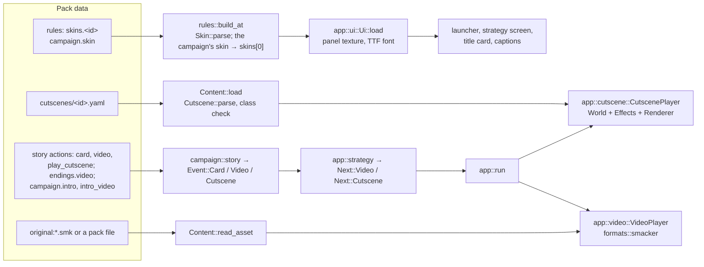
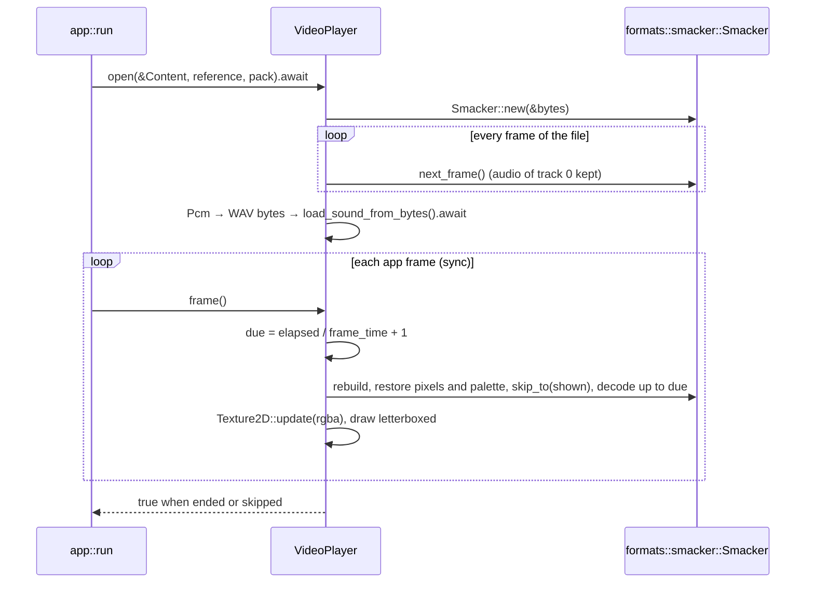
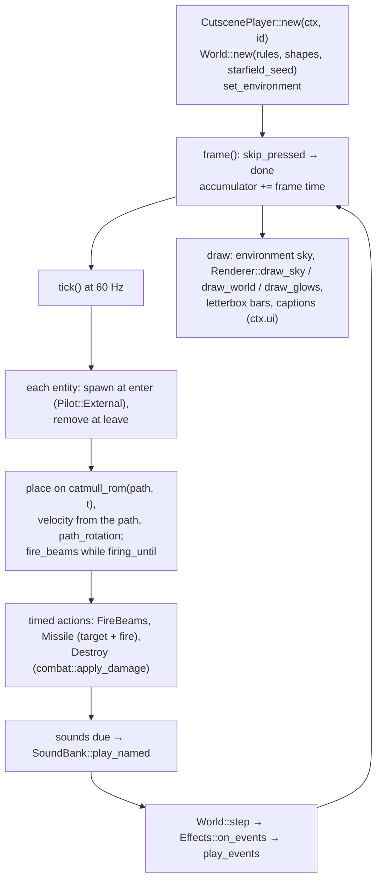
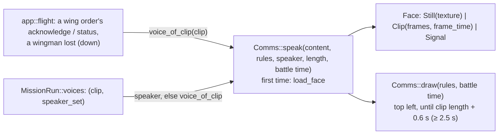
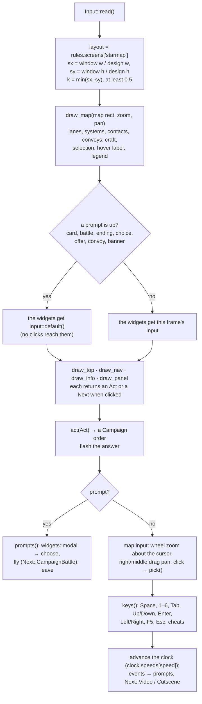
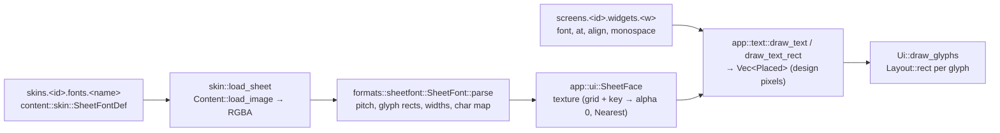

# Presentation: skins, videos and cutscenes

`src/app/ui.rs`, `src/app/video.rs`, `src/app/cutscene.rs`, `src/app/comms.rs`, with their data
in `src/content/skin.rs`, `src/content/cutscene.rs` and the voice sets of `src/content/rules.rs`.
Plan: Stage 6.1 (skins, app 0.11.1), 6.8 (title cards), 6.3 (videos, app 0.12.0), MD2
(cutscenes, app 0.13.0), 6.6 (the comms panel, app 0.13.1) and 6.2 (the main menu and credits,
`src/app/menu.rs`, `src/app/credits.rs`, `src/content/front.rs`, app 0.14.0), and the widgets
and screen layouts (`src/app/widgets.rs`, `src/content/screens.rs`, app 0.16.0). Music is on
[Audio](audio.md#music-app-0110); the Smacker decoder on [Formats](formats.md#smacker-formatssmacker).

These are application-layer screens and helpers: they read `Content` and draw with macroquad,
and the cutscene player drives a `sim::World` the same way a flight session does. Nothing in
`content`, `sim` or `formats` knows they exist.

## Architecture Overview

### Data flow

### Skins (`app::ui`)

`Ui::load(&Content)` takes `rules.skins[0]` — `rules::build_at` has already swapped the skin named
by `campaign.skin` to the front — and loads its panel image (`Content::load_image`, linear
filtering) and its font (`Content::read_pack_file` → `load_ttf_font_from_bytes`). A failure of
either is printed and left out, so a skin never stops a screen from drawing. With no skins the
fallback `Skin::fallback()` reproduces the colours the screens had before skins.

`AppContext::ui` holds the result. It is built once at start-up, before `content` moves into
the context, and rebuilt when the launcher switches campaign (`Next::Reload`). Screens draw
through three helpers:

| Helper | Draws |
|---|---|
| `Ui::colour(role)` | A macroquad `Color` from the skin's role (`background`, `panel`, `border`, `text`, `dim`, `accent`, `highlight`; an unknown role gets `text`). |
| `Ui::panel(x, y, w, h)` | The nine-slice frame, or the panel colour with a border line when the skin has no image. |
| `Ui::text(s, x, y, size, role)`, `Ui::text_in(…, Color)`, `Ui::measure(s, size)` | Text in the skin's font (or the built-in one). |

**Nine-slice** maths is the pure function `nine_slice(iw, ih, s, scale, rect) -> Vec<Piece>`:
the source and destination rectangles of the nine pieces. Corners keep their size (shrunk if
the rectangle is smaller than two corners), edges stretch one way, the centre both — tested by
`app::ui::tests::nine_slices_keep_corners_and_stretch_the_rest`.

The launcher and the strategy screen draw through `ctx.ui`. The strategy screen's **title card**
(`StrategyScreen::card`, set by `Event::Card`) is a 70 % × 50 % panel over a dimmed screen: the
title in the `border` colour, the text word-wrapped beneath; Enter, Esc or a click clears it.

### Videos (`app::video`)

`VideoPlayer::open` is **async**: it reads the bytes (`Content::read_asset`), decodes the whole
file once to collect the first audio track's samples, and turns them into a macroquad `Sound`
(which needs `.await`). `VideoPlayer::frame` is an **ordinary** function: it starts the sound on
its first call, then shows whatever frame the clock has reached — a slow frame is skipped, the
film never slows — so picture and sound stay together. The decoder borrows the file's bytes,
so it cannot be stored beside them in the same struct; instead each step rebuilds a `Smacker`
from `data`, restores the previous frame's pixels and palette, skips to the next frame and
decodes forward ([Learn Rust › Async](../../learning/rust/async-loop.md#an-async-open-and-a-sync-play-srcappvideors)).

The picture is scaled to fit the window, centred, on black. Enter, Esc, a left click or a
gamepad's Start, A or B skips; at the end (or on a skip) the sound is stopped. The soundtrack
plays at 0.9 × the effects volume (`VideoPlayer::frame(volume, skip)`, app 0.14.1). Since app
0.16.2 the player no longer reads the keys itself: `app::skip_pressed(ctx)` decides for both
players — Esc, Enter, a left click, or a pad button newly pressed this frame (`raw.pad` against
`raw.pad_previous`, so a button held from the menu does not skip at once) — and `app::run`
passes the answer in as `skip`. `open` tries the given pack first, then every pack,
latest first, for a pack path.

### Cutscenes (`app::cutscene`)

A `CutscenePlayer` owns its own `World` (built like a battle's: the rules, collision shapes
from the models, the scene's star-field seed as the world's seed, the environment by id) and its
own `Effects`. Every tick each entity that is in the scene is **placed** on its path rather than
flown: `position`, `velocity` (from the path one tick ahead), `rotation` (`path_rotation`: nose
along the path, banked by the sideways acceleration, at most 60°), zero angular velocity and
cleared controls. So the scene is deterministic without depending on the flight model; the
simulation still moves bolts and missiles, resolves hits and makes the events that drive
effects and sounds — which is why a cutscene looks and sounds exactly like a battle.

Timed actions call the battle's code: holding `controls.fire_beams`, setting a target and
`controls.fire_missile`, or `combat::apply_damage` with an overwhelming amount after zeroing
shields and armour. A `harmless` entity's ship id goes into `World::harmless` when it spawns; `sim::combat` gives its bolts and missiles zero damage (app 0.14.1), so their hits, flashes and sounds still play. The camera at time *t* is the cut in force (`Cutscene::camera_at`): a fixed
camera on its spline looking at an entity or a point with a level horizon, or an attached
camera behind its entity at the keyed distance, rotated by the entity's rotation then the keyed
yaw and pitch.

The path maths is pure and in `content::cutscene`: `catmull_rom` (centripetal, α = ½, evaluated
with the Barry–Goldman pyramid of lerps, clamped at the ends), `path_rotation` and `scalar`
(linear keys). Tests: `catmull_rom_passes_through_keys_without_overshoot`,
`cutscenes_parse_and_check_their_references`.

`finish` clears the sky, planet and nebula it set on the renderer, so the next screen starts
clean.

### The comms panel (`app::comms`)

`Comms` lives on the `FlightSession`. Every place the flight screen plays a voice clip also calls
`Comms::speak` with the speaker's voice set — a chatter line's `speaker` (resolved to
`ChatterDef::speaker_set` when the rules load), else the set whose lines contain the clip
(`Ruleset::voice_of_clip`) — and the clip's length (`SoundBank::length`, which since app 0.13.1
records voice clips as well as music). `showing_for(length)` is the clip clamped to 0.5 – 30 s
plus 0.6 s, at least 2.5 s (3 s when the length is unknown); the time is in **battle** seconds,
so a paused battle keeps the panel up.

A voice's face is loaded the first time it speaks (`load_face`): a `.smk` reference is read with
`Content::read_asset` — which since main `319a31b` also opens a member of an MPSRC pack,
`original:<pack>.mps#<member>` ([Formats › MPSRC](formats.md#mpsrc-formatsmpsrc)) — and every
frame becomes a texture, played in a loop from when the voice started; any other reference is a
still picture; no face, or a failure (printed once), is the signal graphic. `signal_bars(n, t)`
— a pulse moving across the bars — is pure and tested with `showing_for` in
`app::comms::tests::the_panel_lasts_the_clip_and_the_signal_moves`. The name is the set's `name`
(else its id) in capitals, or *COMMS* for a clip with no speaker.

### Widgets and screen layouts (`app::widgets`, `content::screens`)

*App 0.16.0, main `ac7ae62`.* The strategy screen is built from **immediate-mode** widgets: a
screen calls `widgets::button(ui, input, rect, label, enabled)` every frame with where the
button is and what it says, and the call draws it and returns whether it was clicked this frame.
No widget objects live between frames, so there is nothing to keep in step with the campaign's
own state: the rows, labels and enabled flags are recomputed from the campaign each frame. The
little state that must persist — a list's scroll position and selected row — is a plain
`ListView` the screen owns. ([Learn Rust › Immediate-mode UI](../../learning/rust/immediate-mode-ui.md)
explains the pattern and why it suits Rust's borrowing rules.)

| Widget | What it is |
|---|---|
| `Input::read()` | The frame's mouse position, left click, wheel, Enter and Esc, read once and passed to every widget — so a prompt can hand the screen beneath an empty `Input::default()` and the screen takes no input. |
| `button`, `button_row`, `grid` | A button in the skin's colours (filled with `panel`, `highlight` under the mouse, outlined in `border`, centred text, `dim` when disabled); a row of buttons of one width; equal cells for a grid of buttons. |
| `ListView {first, selected}`, `fit`, `scroll`, `step` | A list's scroll and selection: `step` moves the selection and scrolls just enough to keep it in view; `scroll` moves the view and clamps it to the last screenful; `fit` pulls both in when the list shrinks. |
| `wrap(text, width, measure)` | Word wrapping by a measuring function (a giant word is cut; newlines kept). |
| `modal(ui, input, title, body, buttons)` | A prompt over a dimmed screen: title, wrapped body, a row of buttons; Enter picks the first, Esc the last. |

`wrap`, `ListView`, `grid` and `contains` are pure and tested
(`text_wraps_between_words_and_cuts_only_giant_words`, `lists_keep_the_selection_in_view`,
`grids_and_hits`), with a fake 10-pixels-a-character measure so no font or window is needed.

**Screen layouts.** `content::screens::ScreenLayout {id, design, background, widgets, pack}` is
`screens.<id>` from the rules. `rules::build_at` starts from the engine's `default_starmap()`
(1280 × 720: `top`, `map`, `nav`, `info`, `panel`) and lets each pack's entry override only the
widgets it names (`ScreenLayout::parse`, which rejects names outside `STARMAP_WIDGETS`;
tested by `a_layout_moves_only_what_it_names`). `Ruleset::screens` always holds a `starmap`.
Since app 0.16.2 the strategy screen draws the layout's `background` over the whole window
before the map: the image is loaded on the first frame into `StrategyScreen::background:
Option<Option<Texture2D>>` — the outer `Option` says "tried yet", the inner "found" — so a
missing file is reported once and never retried.

**One frame of the strategy screen** (`StrategyScreen::frame`):

- **Stretch, not fit.** A cockpit keeps its proportions and is centred (`hud::Layout`); a screen
  scales x and y separately (`sx`, `sy`) so its panels reach the window's edges, and sizes text
  and button heights by `k`.
- **Map transform.** `map_transform` fits the systems into the map rectangle (tested by
  `the_map_fits_its_rectangle_centred`); `map_view` applies the zoom about the rectangle's centre
  and the pan in map units. Zooming about the cursor keeps the map point under the cursor fixed:
  the pan is corrected by the difference between that point before and after the zoom.
  Zoom is clamped to ×0.5 – ×12.
- **Picking.** `pick(point, scale, origin, reach)` returns the nearest system, detected contact,
  convoy, survey ship or craft in flight within `reach` pixels (22 for a click, 18 for the hover
  label); moving things are favoured by 4 pixels because they are smaller targets.
- **Rows carry their actions.** A list row is `Row {text, acts: Vec<(&'static str, Act)>}`; the
  first action is the default (Enter, a double click within 0.4 s), and all of them are the
  buttons under the selected row. The info panel builds its own `(label, Act)` list for the
  selection (`info()`), at most four buttons.

### Screen sets (`content::screens`, `StrategyScreen::draw_set`)

*App 0.17.0 – 0.17.1, main `4c29f89`, `deba9f5` (plan item 6.9).* A `screens.<id>` widget entry
that is a mapping parses as a `WidgetDef {name, kind: WidgetKind, rect, images: [Option<String>; 4],
action: Option<UiAction>, source, size, colour, align, label, round}` into `ScreenLayout::items`
(a bare rectangle still moves a testbed widget); `dialog` marks a screen drawn over the one under
it. `UiAction::parse` reads `open(<screen>)`, `back`, `speed(n)`, `save`, `menu`, `testbed`, and
`rules::build_at` checks every `open()` target once all packs are read. The images are
`[up, down, hover, disabled]` in a fixed array indexed by the button's state, so drawing needs
no lookup by name.

`Ruleset::strategy_screen` (`campaign.strategy_screen`) switches the strategy screen into **set
mode** unless `StrategyScreen::testbed` is set (Ctrl+T, a `testbed` button). The screen keeps
`stack: Vec<String>` of open screen ids — the first screen at the bottom, dialogs on top — and
`draw_set` draws from the last full screen up: each in its own `hud::Layout` (one scale factor,
centred, as cockpits), only the top one given the frame's `Input`. Widgets reuse the testbed
screen's own drawing — a `list` opens its tab and calls `draw_panel`, a `map` calls `draw_map`
(clipped to a circle when `round`), `info` calls `draw_info` — so the two layouts share one set of
campaign logic. A `map` with `source: minimap` draws the whole map at zoom 1 with no names by
setting the view aside for the call. Textures are cached by reference in `StrategyScreen::images`
(`HashMap<String, Option<Texture2D>>`: `None` remembers a failed load). A button's action is
collected during the draw and applied after it, so the stack is not changed while it is being
walked. `value()` maps a value name to text; `weekday` uses `Date::weekday` (Zeller's congruence,
0 = Monday; tested by `weekdays_follow_the_calendar`). `--screen <id>` calls
`StrategyScreen::open_screen`, which puts that screen over the first.

### Sheet fonts and text anchors (`formats::sheetfont`, `app::text`)

*App 0.22.50, branch `parity/m2` (plan M2, issue #122; RQ-UI-03/04).* The original strategy
screens draw text with bitmap **sheet fonts** placed by two routines; the engine had guessed
TrueType baselines (`r[1] + r[3]/2 + 0.35·size`), which is why text looked mis-sized and off its
controls. Three layers now reproduce the original:

- **`formats::sheetfont`** turns a sheet's RGBA pixels into metrics only: the grid colour
  (pixel 0,0), the key colour (bottom-right), the pitch (first grid line in column 1), each
  glyph's box and trimmed width, the line height, the widest *mapped* glyph (the monospace cell)
  and the fixed char → glyph table `CHAR_MAP` (the exe's table at 0x6af488).
- **`app::text`** is pure layout in `i32`, so its divisions truncate toward zero exactly like the
  exe's `cdq; sub; sar` idiom: `draw_text` (DrawText 0x5fe4ad: x by flag, glyph top = y − `top`,
  accented glyphs +1), `draw_text_rect` (DrawTextRect 0x5fed2b: one fitting line at the rect's
  vertical centre, else `wrap` and a block whose first y is centred or `top + lh/2 + lh`, plus
  `wrap_offset`, step `lh + lh/3`), `width` and `wrap` (words split at spaces and `~`; a `~`
  just before a word forces the break, as the exe tests the byte before each `strtok` token).
- **`app::ui`** loads each skin font once (`Ui::load`), uploads it with `FilterMode::Nearest` (a
  pixel font must not be smoothed) and draws `Placed` glyphs through the screen's `Layout`.
- **`StrategyScreen::draw_set`** calls `sheet_text` for `value` and `text` widgets; it returns
  `false` when the widget has no (loaded) sheet font, and the old TrueType path runs. The glyph
  list is a `Vec` owned by the screen and cleared each time, so drawing text allocates nothing
  per frame once it has grown.
- `--check` loads every skin's fonts through the same reader and reports a widget naming a font
  the campaign's skin lacks.

Tests: `formats::sheetfont::tests` (a synthetic sheet built in the test: pitch, trim, char map,
space rule, a short sheet, the key cleared), `app::text::tests` (the CSD time centred on x 561 at
y 370 → tops at 363; right alignment; accented drop; monospace cells; a fitting line centred in
the status bar; wrapping, forced breaks and both block placements),
`content::skin::tests::sheet_fonts_parse_with_their_anchor_rules` and
`the_default_campaigns_generated_fonts_are_grid_sheets`, and `check::tests` (bad sheet, unknown
widget font).

### Captions, text buttons, lists and dialogs (`app::caption`, `content::smallfont`)

*App 0.22.50, branch `parity/m2` (plan M2, issue #123; RQ-UI-05/06, audit D-32 – D-40).* In the
original every caption is drawn by its control's paint routine from the control's rectangle.
`app::caption` holds those rules as pure functions over integer design-space rectangles:

| Function | Rule (Interceptor.exe) |
|---|---|
| `text_button(rect)` | Caption anchor at the centre (flag 1 with the 6 px font: y − 2), lines on the rect inflated (−5, +2), pressed fill on (0, −4) (0x41932d). |
| `capsule_caption(rect, pressed)` | (cx, cy − 2), pressed (cx + 1, cy − 1), font 23010 (0x41835a). Used by the dialog frames (#127). |
| `check_label(rect)` | left + 20 on the centre line (0x419997). |
| `stack_buttons(dialog, n, step)` | 20 px buttons, width − 20, the last at bottom − 25 − 20 (MsgBox.cpp). |
| `dialog_layout`, `button_block`, `rows_that_fit`, `ellipsize` | A prompt's parts; a list's action buttons as a row or a column; rows by pitch and size; "..." cutting. |

`draw_text_button` and `dialog` draw them through the skin. `widgets::modal` asks for
`caption::dialog` first when the skin has a `dialog` style. `StrategyScreen::draw_list_art`
replaces `draw_panel` for a list with a sheet font. It places the title, rows, detail and buttons
from the widget's `ListStyle` rectangles, clamped to them, and reuses the screen's glyph buffer.

**`builtin:small`** (`content::smallfont`) is the engine's own 6-row pixel font, with the exe's
per-character advances (`advances()`, read from the width routine 0x617487's jump table). It is
built in memory as a grid sheet (`sheet()`), so it goes through `SheetFont::parse` and the same
texture path as any sheet. `SheetFont::with_advances` makes the given advances replace the glyph
widths. `Face::centre_raise` is the font's `y −= 2` when centred.

Tests: `app::caption::tests` (the parts of a TextButton, capsule and check-row anchors, dialog
stacking and layout, rows that fit, button blocks, "..."), `content::smallfont::tests` (the exe's
advances, every design narrower than its advance, the sheet reads),
`formats::sheetfont::tests` (given advances win), `app::text::tests` (centre raise, top-aligned
detail text), `content::skin::tests::text_button_and_dialog_styles_parse_over_the_originals_look`,
`content::screens::tests` (list keys), `cli::tests` (`--notice`, `--hover`).

### The compact list box (`app::listbox`)

*App 0.22.50, branch `parity/m2` (plan M2, issue #124; RQ-UI-13).* `app::listbox` holds the original
ListBox's rules (0x51b7c6) as pure functions:

- `visible_rows(h, lh)`: rounds in integers.
- `columns(face, template)`: the exe's 0x51c46b. Each column starts where the previous `~` token
  ends, measured in the header font, `#` marking the editable one. The token split also takes
  newlines, since the text tables turn `~` into them.
- `column_width`.
- `pulse_step(ticks)` and `pulse_level(n)`: the selection bar.
- `Repeat`: a held button's fire-on-press and 20/5-tick auto-repeat (0x41767b).

`StrategyScreen::draw_list_art` uses them when `ListStyle::compact` is set:

- It fills `Row::cells` (market, factory, hangar) under the template's columns.
- It keeps one `Repeat` per arrow in `StrategyScreen::arrows`.
- It loads arrow images through `image_keyed`, which keys them by their corner colour
  (`tga::key_corner`, since app 0.22.10; 0.22.9 keyed pure cyan `0x03FF` only) and samples them
  without smoothing.

Tests:

- `app::listbox::tests`: rounding, columns from a synthetic font, the pulse curve and period, the
  repeat timeline 0/20/25/30/35.
- `content::screens::tests`: `style`, `columns`, `up`, `down`.
- `check::tests`: a missing arrow image.

### Sprite buttons, toggles and radio groups (`formats::spritetable`, `app::button`)

*App 0.22.50, branch `parity/m2` (plan M2, issue #125; RQ-UI-01/02/07/08).*

- **`formats::spritetable`** finds the original's sprite table in `Interceptor.exe` by content:
  the first run of 64 or more 20-byte rows numbered 0, 1, 2, … with sane hot spots. It reads
  `SpriteRow {index, resource, hot, keep_format, surface}`. Also: `hot_offset` (−1 → 0,
  −2 → −size/2) and `parse_index` (`372`, `372+1`).
- **`Content::sprite(index)`** reads the table once (`OnceLock` in `Content`).
  `Content::load_image` resolves `original:sprite#N(+k)`: the row's `TARG` resource from any
  DLL, keyed by its corner colour (`tga::key_corner`).
- **`app::button`** holds the button rules as pure functions:
  - `look(enabled, pressed_inside, latched, states, has_disabled) → Nothing | State(k) | Disabled`
    (0x41773f);
  - `Press::update(inside, went_down, went_up, fire_on_press)`: armed by a press inside, fired
    by the release anywhere;
  - `sprite_rect(Place, w, h)`: the image + 1 px;
  - `latch(chosen, members)`: a radio group's latched member.
- **`StrategyScreen::draw_set`** keeps the per-widget state in plain maps: `presses` (each
  button's `Press` and `Repeat`, by screen and widget index), `radios` (by screen and group) and
  `checks`.
- **Placed sprites:** `widget_rect` and `draw_widget_image` place them at their image's size,
  sampled without smoothing.
- **`--check`** loads each sprite widget's first and last state.

Tests:

- `formats::spritetable::tests`: a synthetic table found among other bytes, group ends, hot
  spots, flags, a short run refused, references.
- `app::button::tests`: the state rules for S = 1 and 2, latched and disabled; release
  semantics; CSD and Bases placements; radio fall-backs.
- `formats::tga::tests::a_sprite_is_keyed_by_its_corner_colour`.
- `content::screens::tests`: the new keys and their errors.
- `check::tests`: a missing sprite.

### History, clock and message boxes (`app::history`, `app::caption`)

*App 0.22.50, branch `parity/m2` (plan M2, issue #127; RQ-UI-14/15/16, RQ-S-18).*

- **`app::history::History`** replaces the screen set's `Vec<String>` stack. It holds `home`,
  `current`, `trail` (Back's screens), `dialogs` and `limit`. Its operations follow the exe
  (0x4b5bfe – 0x4b5e5b):
  - `push`: home clears; no duplicates; nothing added when full.
  - `menu`: a run of menu switches remembers once.
  - `replace`, `back`, `open_dialog`.
  - `shown()` lists what to draw.
  - `UiAction` gained `MenuOpen` and `Replace`.
- **The clock.** `draw_set` sets `screen_holds_clock` from the top screen's
  `ScreenLayout::clock_runs`, and the time step skips while it is set (set mode only). Prompts
  already stop time through `prompting`.
- **RQ-S-18.** `ClockDef::notices` (`NoticeClock::{Drop, Keep, Ask}`) and `notice_buttons`
  decide whether a notice changes the speed. With `Ask` the Report prompt shows both buttons,
  and the second sets `on_event`.
- **`caption::dialog`** draws, in order: the `fill` tiled over the body, the `frame` pieces
  (`frame_piece`: anchor, offset, tiling along a side), then the buttons. The buttons are
  message-box capsules (`capsule_parts`: caps and a tiled middle; `capsule_row`; caption at
  `capsule_caption`) when the style has a `capsule`, else stacked text buttons.
- **`Ui` loads the dialog's images** once at start (`Ui::image`), unsmoothed.
- **`--check`** loads them too.

Tests:

- `app::history::tests`: home clears, duplicates and the limit, menu runs, replace, dialogs.
- `app::caption::tests`: frame anchors and tiling, the original's ornament position,
  capsules, a capsule-row layout.
- `content::skin::tests`: fill, capsule and frame keys and errors.
- `content::strategy` clock tests: `notices`, `notice_buttons`.
- `content::screens::tests`: `clock`, `history`, `menu(x)`, `replace(x)`.
- `check::tests`: a missing dialog image.

### The original's message box (`app::msgbox`)

*App 0.22.50, branch `parity/m2` (follow-up to #127; `ui-framework.md` §4).*

`app::msgbox` holds the exe's message-box rules as pure functions:

| Function | Rule |
|---|---|
| `base_size` | Width max(325, caption, body); wrap at 425; height 100 → ≤ 400. |
| `button_rows`, `button_width` | max(100, text + 20) × 14, 10 apart, rows of ≤ 465, up to 4. |
| `layout` | The exe's order (§4.2): content size, the style kit's side edges, rows breaking past width − 70, the kit for the row count (`kit_choice`), the style's box change, the bands, styles 2/3 rounded; row k's top = final bottom − 25 − 17k + `row_change` − 5 × (rows − 1); the 1- or 2-button rules; the text rect from the final kit's insets. |
| `kit_pieces` | The 8-row kit: edges tiled at natural size from the exe's start and end points, corners last. |
| `fill_rect` | The fill centred on one rect and clipped to another (the exe: both the text rect). |
| `step`, `knob_frame`, `slider_offset`, `ornament_on` | The live pieces on the 5-tick dialog counter (knob ping-pong; sliders one tile every 7 ticks, bouncing; ornament 4 of 8 steps). |

`caption::kit_dialog` draws a prompt with them when the skin has `dialog.kits`, in the style `DialogStyle::style_for(kind)` gives for the prompt's kind (`widgets::modal_kind`, `strategy::ask`): the
`DialogStyle::images` (kit rows, live pieces, `fill`, `fill_large`, capsules) are loaded by
`Ui` at start. The campaign tags each notice with a `NoticeKind`
(`campaign::Event::Notice(text, kind)`); `ClockDef::asks(kind)` decides whether the Report
offers "OK (5 secs)" (`clock.ask_for`).

Tests:

- `app::msgbox::tests`: size and wrapping; buttons and their rows; the style extensions and
  rounding; centred and offset buttons; kit tiling with corners last; fill clipping; the knob,
  sliders and ornament timings.
- The clock tests: `ask_for`.
- `content::skin::tests`: `kits`, `styles`, `fill_large`.

### Sounds, hover help, the dial and lamps (`app::floater`)

*App 0.22.50, branch `parity/m2` (plan M2, issue #126; RQ-UI-09 – 12).*

- **Sounds.** The `SoundBank` loads every non-event `sounds:` entry as `SoundKey::Ui`.
  `strategy::play_ui(ctx, own, default)` plays a widget's `sound` (`none` silences it), else the
  skin's `UiSounds` default for its kind. It plays on the press, in `draw_set` for buttons and
  check rows and in `draw_list_art` for arrows and action buttons. Prompts go through
  `strategy::ask`, which plays the capsule or text-button sound on a click. The box-opening
  sound plays when a prompt appears (`StrategyScreen::prompt_up`).
- **Hover help.** `floater::tip_box(widths, rect, cursor_x, right)` places the box and its
  lines (Floaters.cpp rules). `floater::Floater<K>` opens it when the cursor rests with no
  button down and closes it when the hovered control changes. `draw_set` records the hovered
  widget with a `tip`; `draw_floater` draws it in the skin's `TooltipStyle`.
- **Animations.** `floater::anim_frame(ticks, interval, n)` gives the frame. `with_clock`
  animations use `StrategyScreen::clock_seconds`, which advances only while time runs.
  Original frames are keyed by their corner colour.
- **The dial.** Speed buttons latch while `self.speed` is theirs. `ClockDef::first_key` maps
  the number keys.

Tests:

- `app::floater::tests`: box placement over, under and pushed left, multi-line; open and close
  on rest, leaving and a held button; lamp frames at 4 ticks × 10 and 6 ticks × 5.
- `content::screens::tests`: `anim`, `sound`, `tip`, `interval`.
- `content::skin::tests`: `sounds`, `tooltip`.
- The clock tests: `first_key`.
- `check::tests`: an unknown widget sound.

### The main menu and credits (`app::menu`, `app::credits`)

Since app 0.14.0 `app::run` opens `Screen::Menu(MainMenu)` instead of the launcher when the
campaign has a strategy layer (`rules.strategy.is_some()`); `Next::Menu` — from the launcher's
Esc, from leaving the strategy screen, from the end of a film or cutscene with no campaign parked,
and from the credits — goes there too, or to the launcher for a campaign without one.

- **Data:** `content::front::MenuDef` (`campaign.menu`: `title`, `subtitle`, `showcase`,
  `starfield_seed`, default 7) and `CreditsDef` (`campaign.credits`: `lines`, `video`), on
  `Ruleset::menu` and `Ruleset::credits`. `CreditsDef::roll()` is the campaign's lines, two blank
  lines, then `ENGINE_CREDITS`.
- **Menu:** three pages. The pure functions `items(has_save, has_slots)` (Continue only with the
  automatic save; New campaign; **Load game** only when a numbered slot holds a save, app
  0.16.14; then Battles & tools, Options, Credits, Quit) and `settings(campaigns,
  simple_allowed)` (Campaign only with more than one, Difficulty, Physics only where Simple is
  allowed, Music, Effects, **Full screen** and **Controls** since app 0.16.14, Back) build the
  rows. The **load page** (`MainMenu::load: Option<usize>`) lists slot 0 (*Automatic save*) and
  slots 1 – `strategy::SLOTS` with `menu::age_text(seconds)` of each file's modification time
  (*just now*, *n minutes/hours/days ago*) or *empty*, then *Back*; Enter on a slot that exists
  returns `Next::LoadSlot { slot }`. The slot ages are read from the file system each frame the
  page is shown (`slot_ages`). *Full screen* calls macroquad's `set_fullscreen` and
  `remember_fullscreen` (`graphics.fullscreen` in `settings.yaml`); *Controls* returns
  `Next::Controls`, and the controls screen now always returns `Next::Menu`; `step_volume(v, up)` moves a volume a quarter and clamps.
  Items return `Next::LoadCampaign`, `NewCampaign`, `Launcher`, `Credits` or `Quit`; a campaign
  or difficulty change returns `Next::Reload`, after which `app::run` reopens the menu on its
  options page (`MainMenu::on_options`). Volumes and physics are saved at once
  (`remember_audio`, `remember_physics`). The screen draws the starfield, the showcase ship
  turning off to the right, the title, and the rows in a skin panel; it keeps the music playing
  (the first set's `menu` state, else `strategy`).
- **Credits:** `Next::Credits` plays `credits.video` through the video player when there is one,
  else `Screen::Credits`: the roll rises from below the screen at a fixed speed (`line_y`), headings
  in the skin's `accent`, and ends when its last line passes the top (`finished`) or on Esc or
  Enter. `--credits` opens on it.
- **Save slots** (app 0.16.14): `strategy::slot_path(campaign, slot)` — slot 0 is the automatic
  save `<user data>/saves/<campaign>.yaml` (F5, leaving the map, the ending), slot *n* is
  `<campaign>-<n>.yaml` beside it. The strategy screen's *Save* button sets
  `StrategyScreen::saving`, a modal with *Slot 1* – *Slot 3* and *Cancel*; `save_slot` /
  `load_slot` read and write through `campaign::save` as before, so a slot is an ordinary save.
- **The ending screen** (app 0.16.14): while `StrategyScreen::ending` is set the screen draws,
  over the darkened map, a panel 70 % of the window with *VICTORY* (the skin's `border` colour) or
  *DEFEAT* (`accent`), the ending's text wrapped, and the record — `Campaign::date`, the score,
  `story.battles_won`, bases and craft — with a `button_row` of *Credits* (`Next::Credits`) and
  *Main menu* (`Next::Menu`); Enter and Esc take *Main menu*. Each saves to slot 0 first.

### Who plays what: the app's routing

| Trigger | Path |
|---|---|
| `--video <ref>` / `--cutscene <id>` | `app::run` opens `Screen::Video` / `Screen::Cutscene` instead of the launcher. |
| A new campaign (`Next::NewCampaign`) | The strategy screen is built and parked in `AppContext::campaign`; `rules.intro` plays as a cutscene, else `rules.intro_video` as a video; otherwise the strategy screen opens at once. |
| A story event's `card` | `Event::Card` → `StrategyScreen::card` (drawn by the strategy screen itself). |
| A story event's `video` / `play_cutscene`, an ending's `video` | `Event::Video` / `Event::Cutscene` / the ending → the strategy screen returns `Next::Video` / `Next::Cutscene`; `app::run` parks the screen in `AppContext::campaign` and opens the player. An ending reached after a battle is held in `StrategyScreen::pending_video` and handed over on the next frame. |
| The end of a video or cutscene | Back to `Next::Strategy` when a campaign is parked, else `Next::Menu` (the launcher before app 0.14.0). A player that fails to open prints the error and returns to the parked campaign. |

Music is stopped on every screen except flights and the strategy screen, so videos and cutscenes
play without it.

## Key Symbols

| Symbol | Where | What it is |
|---|---|---|
| `Skin`, `skin::ROLES`, `Skin::fallback`, `Skin::colour` | `content::skin` | A skin: seven RGBA colours by role, an optional `(image, slice)` panel, an optional font, the pack that named them. |
| `Ui`, `Piece`, `nine_slice` | `app::ui` | The resolved skin with its GPU texture and font; one nine-slice piece; the pure slicing function. |
| `VideoPlayer` | `app::video` | A Smacker file being played: its bytes, size, timing, last frame's pixels and palette, texture and sound. |
| `Cutscene`, `Entity`, `Action`, `Camera`, `Target` | `content::cutscene` | A parsed cutscene: entities with paths and sorted timed actions, cameras (fixed or attached), cuts as `(time, camera index)`, sounds, captions. |
| `catmull_rom`, `path_rotation`, `scalar`, `cutscene::schema` | `content::cutscene` | Path, facing and scalar-key evaluation; the editor schema (`schemas/cutscene.schema.json`). |
| `CutscenePlayer` | `app::cutscene` | A cutscene being played on its own `World` and `Effects`. |
| `Content::cutscenes`, `Content::read_asset` | `content` | Every pack's cutscenes (a later pack replaces an id); the bytes of a file asset (`original:<file>` or a pack path). |
| `Event::Card`, `Event::Video`, `Event::Cutscene` | `campaign` | Story events for the screen to present. |
| `Next::Video`, `Next::Cutscene`, `Screen::Video`, `Screen::Cutscene` | `app` | The routing above. |
| `AppContext::ui`, `AppContext::music` | `app` | The skin and the music player, shared by every screen. |
| `SheetFont`, `Glyph`, `CHAR_MAP`, `char_table`, `ACCENTED_FIRST` | `formats::sheetfont` | A grid sheet font's metrics and the fixed char → glyph table (app 0.22.5). |
| `SheetFontDef`, `skin::load_sheet`, `Skin::fonts` | `content::skin` | `skins.<id>.fonts.<name>`; reading a sheet with its background made transparent. |
| `caption::{text_button, capsule_caption, check_label, stack_buttons, dialog_layout, button_block, rows_that_fit, ellipsize, draw_text_button, dialog}`; `StrategyScreen::draw_list_art`, `notice` | `app::caption`, `app::strategy` | Captions from their control's rect; text buttons, lists and dialogs in the original's look (app 0.22.7). |
| `msgbox::{layout, MsgBox, Kit, insets, base_size, button_rows, button_width, kit_pieces, fill_rect, knob_frame, slider_offset, ornament_on}`; `caption::kit_dialog`; `DialogStyle::{kits, styles, kit, style_for, fill_large, row}`; `msgbox::{KitChoice, kit_choice, row_change, full_width}`; `widgets::modal_kind`; `NoticeKind`, `ClockDef::{ask_for, asks}`, `StrategyScreen::banner_kind` | `app::msgbox`, `app::caption`, `content::skin`, `content::strategy`, `campaign`, `app::strategy` | The original's message box and which notices ask (app 0.22.15, #127 follow-up). |
| `floater::{tip_box, Floater, anim_frame, LINE}`; `strategy::{play_ui, ask, draw_floater}`; `SoundKey::Ui`, `SoundBank::{ui_names, play_ui}`; `UiSounds`, `TooltipStyle`; `WidgetDef::{sound, tip, frames, interval, with_clock}`, `WidgetKind::Anim`; `ClockDef::first_key` | `app::floater`, `app::strategy`, `audio`, `content::skin`, `content::screens`, `content::strategy` | Interface sounds, hover help, animations and the dial (app 0.22.15). |
| `history::{History, DEFAULT_LIMIT}`; `UiAction::{MenuOpen, Replace}`; `ScreenLayout::{clock_runs, history, empty}`; `StrategyScreen::{history, screen_holds_clock}`; `NoticeClock`, `ClockDef::{notices, notice_buttons}`; `caption::{frame_piece, capsule_parts, capsule_row}`; `DialogStyle::{fill, capsule, frame, images}`, `FramePiece`, `Anchor`; `Ui::image` | `app::history`, `content::screens`, `app::strategy`, `content::strategy`, `app::caption`, `content::skin`, `app::ui` | The history stack, the clock by screen and notice, message-box fills, capsules and frames (app 0.22.12). |
| `spritetable::{SpriteRow, parse, hot_offset, parse_index}`; `Content::sprite`; `tga::key_corner`; `button::{look, Look, Press, sprite_rect, latch}`; `Place`, `WidgetKind::Check`, `WidgetDef::{sprite, states, place, fire_on_press, repeat, group, selected}`; `StrategyScreen::{presses, radios, checks}`, `widget_rect`, `draw_widget_image` | `formats`, `content`, `app::button`, `content::screens`, `app::strategy` | Sprite references, button states, press semantics, toggles and radio groups (app 0.22.10). |
| `listbox::{visible_rows, columns, Column, column_width, pulse_step, pulse_level, PRESSED, Repeat}`; `Row::cells`; `StrategyScreen::arrows`, `image_keyed`; `Content::load_image_keyed`; `ListStyle::{compact, columns, bar, up, down}`, `Arrow` | `app::listbox`, `app::strategy`, `content`, `formats::tga`, `content::screens` | The original's compact list box (app 0.22.9). |
| `smallfont::{REFERENCE, advances, sheet}`; `SheetFont::with_advances`; `TextButtonStyle`, `DialogStyle`, `ListStyle` | `content::smallfont`, `formats::sheetfont`, `content::skin`, `content::screens` | The built-in 6 px caption font; the skin's `text_button` and `dialog`; a list's part rectangles. |
| `text::{Face, Placed, Align, draw_text, draw_text_rect, draw_text_top, wrap, width}` | `app::text` | The original's DrawText and DrawTextRect as pure layout (app 0.22.5). |
| `SheetFace`, `Ui::sheet`, `Ui::draw_glyphs`; `strategy::sheet_text`; `WidgetDef::{font, at, monospace}` | `app::ui`, `app::strategy`, `content::screens` | Loaded sheet fonts and their drawing; a widget's text in its sheet font. |
| `widgets::{Input, button, button_row, grid, ListView, wrap, modal, contains, Rect4}` | `app::widgets` | Immediate-mode widgets for the strategy screen (app 0.16.0); the arithmetic pure and tested. |
| `ScreenLayout`, `default_starmap`, `STARMAP_WIDGETS`, `screens::schema` | `content::screens` | `screens.<id>`: design space, background, widget rectangles; the engine's strategy-screen layout. |
| `WidgetDef`, `WidgetKind`, `WIDGET_KINDS`, `UiAction`, `ScreenLayout::items`, `ScreenLayout::dialog` | `content::screens` | A screen set's widgets and actions (app 0.17.0). |
| `Ruleset::strategy_screen`, `StrategyScreen::draw_set`, `stack`, `testbed`, `open_screen`, `value`; `Date::weekday` | `content::rules`, `app::strategy`, `content::strategy` | Set mode, the stack of open screens, the bound values (app 0.17.0 – 0.17.1). |
| `menu::fit_size(width, size, room)` | `app::menu` | The text size that fits a menu option value beside its label, never below half (app 0.14.2). |
| `MainMenu`, `menu::Item`, `menu::Setting`, `menu::items`, `menu::settings`, `menu::step_volume`, `menu::age_text` | `app::menu` | The main menu (app 0.14.0) and its pure row logic; the load page's ages (app 0.16.14). |
| `app::skip_pressed` | `app` | Whether a film or cutscene is skipped this frame: Esc, Enter, a click, a pad's Start, A or B (app 0.16.2). |
| `strategy::slot_path`, `SLOTS`, `StrategyScreen::save_slot`, `load_slot`, `Next::LoadSlot`, `app::remember_fullscreen` | `app::strategy`, `app` | Save slots and the full-screen choice (app 0.16.14). |
| `Credits`, `credits::line_y`, `credits::finished` | `app::credits` | The credits roll and its pure scrolling maths. |
| `MenuDef`, `CreditsDef`, `CreditsDef::roll`, `ENGINE_CREDITS` | `content::front` | `campaign.menu` and `campaign.credits`. |
| `Comms`, `showing_for`, `signal_bars` | `app::comms` | The comms panel's state (faces per voice set, who is speaking until when); its timing and signal graphic (pure). |
| `VoiceSet::name`, `VoiceSet::face`, `Ruleset::voice_of_clip`, `ChatterDef::speaker` / `speaker_set` | `content::rules`, `content::mission` | A speaker's name and face; the set a clip belongs to; a chatter line's speaker. |

## API Reference

- `Ui::load(&Content) -> Ui`; `ui.colour(role)`, `ui.panel(x, y, w, h)`, `ui.text(s, x, y, size, role)`,
  `ui.text_in(s, x, y, size, Color)`, `ui.measure(s, size)`; `nine_slice(iw, ih, s, scale, [x, y, w, h])`.
- `VideoPlayer::open(&Content, reference, pack).await -> Result<VideoPlayer, String>`; `player.frame(volume, skip) -> bool` (over).
- `CutscenePlayer::new(&mut AppContext, id) -> Result<CutscenePlayer, String>`; `player.frame(&mut AppContext) -> bool`;
  `player.finish(&mut AppContext)`.
- `Cutscene::parse(Get, pack) -> Result<Cutscene, String>`, `cutscene.camera_at(t)`;
  `catmull_rom(&[(f32, Vec3)], t) -> Vec3`, `path_rotation(&[(f32, Vec3)], t) -> Quat`, `scalar(&[(f32, f32)], t) -> f32`.
- `Comms::speak(&Content, &Ruleset, speaker, length, now)`, `comms.draw(&Ruleset, now)`, `comms.clear()`;
  `showing_for(Option<f32>) -> f32`, `signal_bars(n, t) -> Vec<f32>`.
- `widgets::button(&Ui, &Input, Rect4, label, enabled) -> bool`, `widgets::button_row(&Ui, &Input, Rect4, &[(&str, bool)], w, gap) -> Option<usize>`,
  `widgets::grid(Rect4, n, cols, gap) -> Vec<Rect4>`, `widgets::modal(&Ui, &Input, title, body, &[&str]) -> Option<usize>`,
  `widgets::wrap(text, width, &dyn Fn(&str) -> f32) -> Vec<String>`; `ListView::step(by, n, visible)`, `scroll(rows, n, visible)`, `fit(n, visible)`.
- `ScreenLayout::parse(id, Get, base, known, pack) -> Result<ScreenLayout, String>`, `layout.widget(name) -> Option<[f32; 4]>`, `screens::default_starmap()`.
- `WidgetDef::parse(name, Get) -> Result<WidgetDef, String>`, `UiAction::parse(&str) -> Result<UiAction, String>`; `StrategyScreen::open_screen(&AppContext, id)`; `Date::weekday() -> u32` (0 = Monday).
- `Skin::parse(id, Get, pack) -> Result<Skin, String>`, `Skin::fallback()`, `skin.colour(role) -> [f32; 4]`.

## Debugging

- `openinterceptor --no-original --cutscene intro` plays the default intro on its own;
  `openinterceptor --video original:alientrans1.smk` plays one of the player's films. Each
  returns to the launcher.
- A cutscene or video that does not start prints `cutscene <id>: …`, `intro: …`,
  `video <ref>: …` or `intro video <ref>: …` on standard error, and the game carries on.
- Cutscene file mistakes are load errors (`--check`), with the file and key.
- A skin whose image or font does not load prints `skin <id>: panel: …` / `skin <id>: font: …`.
- A Smacker file that will not decode: run the ignored test against it —
  `OI_SMK=<file> OI_SMK_OUT=/tmp/f.png cargo test --lib real_smacker -- --ignored --nocapture`
  prints its size, frame count, frame time and audio tracks and writes the middle frame.
- A comms panel showing signal bars instead of a face: the set has no `face`, or it failed to
  load (`voices.<id>: face …` on standard error). *COMMS* instead of a name: the chatter line has
  no `speaker` and its clip is not one of a set's lines.
- A video pack path not found: `open` looks in every active pack (latest first, app 0.14.1); the
  error names the first pack's path.
- A strategy screen whose panels overlap or leave gaps: a pack's `screens.starmap` changed
  `design` without restating every widget (the rest keep the engine's 1280 × 720 numbers, read in
  the new space). `--check` lists the layout errors; there is no on-screen layout editor yet.
- A button that does not respond: a prompt is up (the screen beneath gets an empty `Input`), or
  the button is outside its widget's rectangle on a very small window.
- A layout `background` that does not show: standard error has `screens.starmap.background
  <file>: …` once (it is loaded on the screen's first frame and not retried).
- A cutscene caption that shows a key: the key is missing for the language (`--check` reports
  `text: missing key … (cutscenes/<id>)`).

### Map labels (`app::maplabel`)

The CSD labels only what is under the cursor (D-39, `notes/re/unknowns-2026-11.md` §1.3). The
pure part is three functions in design pixels, unit-tested without a window:

| Function | Does |
|---|---|
| `in_box(obj, cursor, size)` | Whether an object lies in the `size` square centred on the cursor. |
| `chord_x(x, y, w, centre, radius, margin)` | The label's centre x, pushed so a `w`-wide label at row `y` stays `margin` px inside the circle. |
| `turn(n, ticks, cycle)` | Which of `n` queued labels shows now, each for `cycle` ticks. |

`StrategyScreen::draw_map_labels` gathers the systems and bases in the box (bases get
" BUILDING" while built), picks one with `turn`, places it with `chord_x` on a round map and draws
it with `text::draw_text` / `Ui::draw_glyphs` in the widget's sheet font. The labels config
(`content::screens::MapLabels`) and the layout it is placed in are set per frame in
`StrategyScreen::map_labels` by the `map` widget (or the testbed layout's `map` item, in screen
pixels scaled by the text scale). Star-class icons are textures loaded once per frame through the
keyed image cache (`star_icons`). Tests: `app::maplabel::tests`, `content::content tests`
(`list_section`), `campaign::tests::readouts_never_show_negative_zero`.

### Report graphs (`app::graph`)

`graph::layout(panel, axes, values)` places a status report's line graph in design pixels
(`Axes`: the original's margins 60 / 30 / 15 / 40, 22 months, a `Scale::Fixed` range in
whole-pixel steps or `Scale::Auto`) — the plot area, the grid lines with their values, the month
columns' centres and the series' points; `graph::years` groups the months for the year
brackets; `activity_class(total, months)` picks an
activity map's colour class. `StrategyScreen::draw_graph` and `draw_activity_map` draw them from
`Campaign::history` (`MonthRecord`s closed each month), `this_month` and `activity` (per system,
`count_activity`), which the campaign layer fills and saves. Tests: `app::graph::tests`,
`campaign::tests` (records, `roll_count`), `campaign::save::tests` (the history round-trips).

