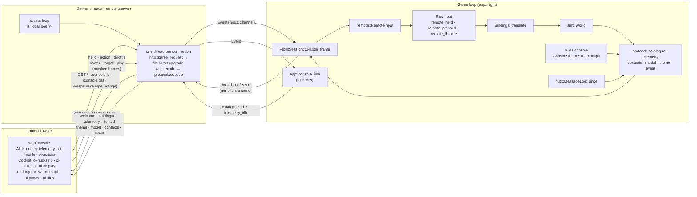
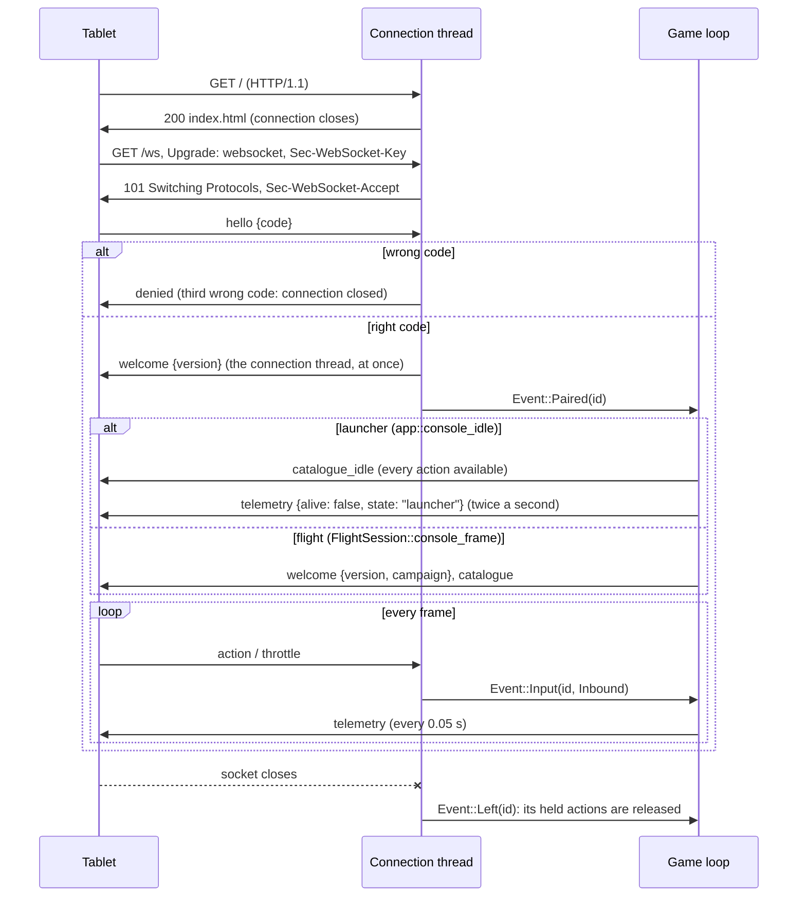
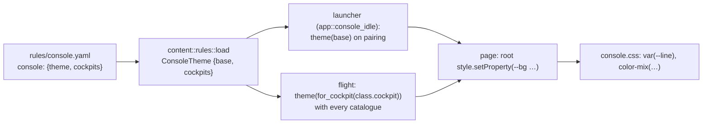

# Remote console

`src/remote/`: the **tablet control console** (interlude item C1, app 0.4.0, main `dfff71b`;
pairing from any screen in 0.4.7, main `c42d773`; keeping the tablet awake in 0.4.8, main
`f1c8be8`; the two layouts and tiles, C2, in 0.4.11, main `db2f264`; the target viewport, C3,
in 0.4.14, main `e51eca9`; the map, contacts and events, C4, in 0.4.15, main `e2b5012`; campaign
themes, C2b, in 0.5.0, main `0a1c340`). Console items C1 – C4 are complete; only the serial
panel (C5) remains.
The game serves a web page and a WebSocket to a tablet on the local network; the tablet shows
the craft's condition live and sends the pilot's button presses back. Requirements
[R-CON-009 – R-CON-026](../../specification/requirements/control-console.md#r-con-009-console-server);
the wire format is the [Console protocol](../../specification/console-protocol.md); the
player's guide is [Tablet console](../../user-guide/console.md).

Everything — HTTP, the WebSocket handshake and frames, SHA-1, base64 and JSON — is written in
the crate: no dependency was added ([dependency policy](../../learning/best-practices/dependencies.md)).
The page in `web/console/` is plain HTML, CSS and custom elements, plus a 2 KB video clip,
built into the binary with `include_bytes!` (which embeds a file's bytes at compile time).

`remote` sits in the application layer: it uses threads and sockets, and reads the world only
to describe it. `sim` knows nothing about it.

## Architecture Overview



The game loop must never wait on the network, so the server runs on its own threads and talks
to the game only through channels (`std::sync::mpsc`). The game calls `ConsoleServer::poll`
once a frame (it never blocks) and `broadcast` / `send` to queue outgoing frames; each
connection thread drains its own queue between reads. The only lock guards the short list of
connected clients.

### A connection's life



### Pairing on any screen (app 0.4.7)

Before 0.4.7 only `FlightSession::console_frame` answered `Event::Paired`, so a tablet paired
while the launcher was open waited for ever. Now:

- the **connection thread** writes `welcome {version}` straight onto its own socket the moment
  the code is right (`remote::server::serve`), so the page knows it is paired whatever the game
  is doing;
- the **launcher** calls `app::console_idle(ctx, "launcher")` each frame: on `Event::Paired` it
  broadcasts `protocol::catalogue_idle()` (every action of `input::ACTIONS`, all available, as
  there is no craft yet), and twice a second `protocol::telemetry_idle("launcher")`
  (`{alive: false, state: "launcher"}`), counted by `AppContext::console_idle_tick`. Console
  input is ignored until a battle starts;
- in a battle the flight screen still sends `welcome {version, campaign}` and the real
  catalogue.

The **page** (`web/console/console.js`, `OiPairing`) pairs as soon as the sixth digit is typed
(iPad number pads have no Enter key), shows *Connecting…* and errors (*Could not reach the
game*, the `denied` reason, *Disconnected*), takes `?code=123456` from the address, and switches
to the console on `welcome` rather than `catalogue`. `console.css` has
`[hidden] { display: none !important; }`: the custom elements' own `display: grid` rules had
beaten the `hidden` attribute, so the pairing screen could not hide.

### Keeping the tablet awake

`keepAwake()` in `console.js` (app 0.4.8,
[R-CON-022](../../specification/requirements/control-console.md#r-con-022-keep-the-tablet-awake)):

1. `navigator.wakeLock.request("screen")` where the browser allows it. Safari allows it only on
   secure (https) pages, and the console is plain http on the local network, so on an iPad this
   usually fails.
2. Otherwise a hidden `<video>` (1 px, almost transparent) plays `keepawake.mp4` muted, inline
   (`playsinline`) and looping: browsers do not let the screen sleep during video playback. iOS
   allows muted inline playback reliably only after a tap, so it is started from the pairing tap
   and retried on every `pointerdown` until it runs.

Both are released by the browser when the page is hidden, so `visibilitychange` takes them
again. The state is shown in the telemetry grid's **Tablet** cell. The clip (black, 2 KB) is
made by `tools/console_assets/make_keepawake.swift` with AVFoundation — the project's own
output, not a third-party file.

iOS Safari fetches video in byte ranges and will not play it from a server that ignores them, so
`remote::http::file_response` answers `Range: bytes=a-b`, `bytes=a-` and `bytes=-n` with
`206 Partial Content` and a `Content-Range` header, and every whole-file answer carries
`Accept-Ranges: bytes`. Several ranges at once, or a range outside the file, get the whole file.

### Press feedback and hit static (app 0.4.9)

Every button shows its pressed state — background filled with its border colour, black text —
while held, or for at least 150 ms after a tap
([R-CON-023](../../specification/requirements/control-console.md#r-con-023-button-press-feedback)).
`telemetry` carries running counts `hits` and `hull_hits` for the player's craft; when either
rises the page plays about 0.4 s of fading static, stronger for a hull hit
([R-CON-024](../../specification/requirements/control-console.md#r-con-024-hit-static)). Counts
rather than one-off events mean a dropped or merged telemetry message never loses a hit.

### Two layouts and tiles (C2, app 0.4.11)

`index.html` holds both layouts in one page; `oi-mode` switches between them, remembers the
choice per tablet (`localStorage`) and accepts `?mode=` in the address
([R-CON-026](../../specification/requirements/control-console.md#r-con-026-two-console-layouts)):

- **All-in-one** (`#allinone`): the C1 elements, `oi-telemetry`, `oi-throttle`, `oi-actions`.
- **Cockpit** (`#cockpit`): `oi-hud-strip` (the exterior-view HUD figures), `oi-shields`
  (shield rings and the balance buttons), `oi-display` (the display console, with **Target**
  and **Map** tabs), `oi-power` (beam and shield charge sliders) and `oi-tiles` (one status card
  per catalogue group; tapping one opens a full-width strip of its buttons and folds the rest).

Every element listens to the same `link` event target (one `EventTarget` that re-dispatches each
message by its `type`), so both layouts stay live and switching costs nothing. The power
sliders send `power {beam, shield, balance}`; the game applies them with
`sim::systems::set_level` and the balance request, within the power budget, and `telemetry`
carries `balance`.

### Target viewport (C3, app 0.4.14)

`oi-target-view` in the Target tab draws the target's model with **WebGL 1, written by hand**
(no library; a 4×4 projection and a quaternion-to-matrix in a few lines,
[R-CON-015](../../specification/requirements/control-console.md#r-con-015-target-viewport)):

1. **Game side.** `FlightSession::console_frame` remembers the class the consoles last received
   (`console_target`). When the player's target has another class — or a tablet pairs, which
   clears it — it loads the class's model (`Content::load_model`), takes each material group's
   colour (`protocol::average_color` of its texture, or the vertex colour if untextured) and
   builds `protocol::model`: the most detailed LOD with at most
   `protocol::MODEL_TRIANGLE_BUDGET` (3000) triangles, normalised to radius 1, positions rounded
   to 3 decimals. The text is cached per class in `console_models`
   (`HashMap<ShipClassId, Rc<String>>`), so retargeting a class costs one broadcast.
2. **Page side.** Each group becomes a vertex buffer of un-indexed triangles with a face normal
   per triangle (flat shading). The light comes from the upper left; the model is turned by
   `telemetry.target.rotation`, already the target's orientation in the player's body axes, so
   the page needs nothing else. The clear colour is transparent, so the themed panel shows
   through.

**Textures (app 0.6.7, from the user's playtest).** Each textured group is now sent with its
image and uvs: the flight screen loads the group's texture, `protocol::texture_url` shrinks it
to at most 128 pixels a side (`formats::png::downscale`, averaging blocks) and encodes it as an
uncompressed PNG (`formats::png::encode_rgba`) in a base64 `data:` URL; `protocol::model` adds
`texture` and `uvs` (two per vertex) to that group. On the page, each group is a draw range of
one vertex buffer (`[x y z nx ny nz r g b u v]` per corner); a textured group's image is loaded
into an `Image`, **redrawn onto a 128 × 128 canvas** — WebGL 1 repeats a texture only when its
sides are powers of two, and the original models' uvs run past 0..1 — and uploaded with
`REPEAT` wrapping. The fragment shader samples it when `textured` is set, else uses the group's
colour, which also shows until the image has loaded. A model message grows from tens to a few
hundred kilobytes, once per class. The ignored helper `serve_for_a_browser` now sends a
checkerboard-textured sample so the image path can be tried in a browser; it was checked in
headless Chrome. A video stream of the game's own rendering stays on GitHub issue #3 as a
possible later upgrade.

### Map (C4, app 0.4.15)

[R-CON-016](../../specification/requirements/control-console.md#r-con-016-3d-map-view),
[R-CON-014](../../specification/requirements/control-console.md#r-con-014-console-telemetry):

- **`contacts`** every 0.2 s (`console_contacts_clock`): `protocol::contacts(&World, player)`
  lists every live craft for which `sim::systems::on_radar` is true, with relative position and
  velocity turned into the player's axes by the conjugate of the player's rotation (and z
  negated so that **z is ahead**). The id is `"slot:generation"`.
- **`event`**: `MessageLog` counts every line ever pushed (`total`); `since(seen)` returns the
  lines after a count, as many as are still kept. The flight screen sends each new line as
  `event {text}` and remembers `console_messages_seen`, so no line is sent twice and none is
  lost between frames.
- **`target {id}`** decodes to `Inbound::Target { index, generation }`; the flight screen sets
  the player's target only if that ship still exists and is on the player's radar, so a console
  cannot target what the pilot could not.

`oi-map` is a 2D canvas with its own small perspective projection: the player's axes are
rotated by the orbit's yaw and pitch, then projected from a camera 2.2 units back (positions
scaled by the radar range and the zoom). Per frame it draws range rings at ¼, ½ and 1 × the
radar range and spokes on the plane at the player's height, then the contacts sorted far to
near, each with a height stalk to that plane, a relation-coloured mark, a label with name and
range, and a tick to where it will be in 2 seconds. Presets **Behind**, **Top**, **Side**;
pointer drag orbits, two pointers pinch-zoom, the wheel zooms (0.5 × – 8 ×). A pointer-up that
moved less than 8 px is a tap, and targets the nearest drawn contact within 28 px. The list
beside the map shows the nearest 14 contacts by range; tapping a row targets it. The map skips
drawing while its tab is hidden. `oi-display` also keeps the last four `event` lines under the
target data.

### Themes (C2b, app 0.5.0)

[R-CON-020](../../specification/requirements/control-console.md#r-con-020-console-theme-from-the-active-pack),
[R-CON-021](../../specification/requirements/control-console.md#r-con-021-console-theme-assets-are-original-free):



- `rules::ConsoleTheme` holds the campaign's `base` `ThemeLayer` and one layer per cockpit id
  (lower-cased). `ThemeLayer` is `colors: Vec<(String, [f32; 3])>` plus optional `font` and
  `corner`; unknown colour names are load errors listing `rules::CONSOLE_COLORS`.
- `ConsoleTheme::for_cockpit(Some("A"))` clones the base and lays the cockpit's values over it.
- `protocol::theme` turns a layer into CSS variables (`#rrggbb`, `--font`, `--corner` in px).
- The page removes the variables of the previous theme before setting the new ones, so a cockpit
  without an override returns to the base, and an empty theme to the page's defaults.
  `console.css` derives every colour from about nine variables, mixing tints with
  `color-mix(in srgb, var(--line) 25%, var(--panel))`, so a pack sets a whole look with a few
  values.

### Input path

A console button reaches the simulation the same way a key does:

1. The connection thread decodes `{"type":"action","name":"fire_beams","value":1}` into
   `Inbound::Action { action: Action::FireBeams, down: true }` (`protocol::decode`; a name
   outside `input::ACTIONS` is refused) and sends `Event::Input(id, …)` to the game.
2. `RemoteInput::apply` keeps **held** actions (`protocol::HELD`: turns, slides, afterburner,
   brake, fire beams, chase camera) in a set per console until the matching `value: 0`; any
   other action is a one-frame **tap**. A `throttle` message sets a one-frame throttle position.
3. `RemoteInput::merge_into(&mut raw)` adds them to this frame's `RawInput` (`remote_held`,
   `remote_pressed`, `remote_throttle`) and clears the taps.
4. `Bindings::translate` treats `remote_held` like a held key bound to the action and
   `remote_pressed` like a pressed one; `remote_throttle` sets `Controls::throttle_set`. From
   here on nothing knows the input came from a tablet.

`Event::Left` removes that console's held set, so a tablet that drops off the Wi-Fi in the
middle of a turn does not leave the craft turning. Each console has its own held set, so one
letting go does not release another's buttons.

### Safety (R-CON-009)

- **Off by default**: `--console`, `--console-port N` or `console: {enabled: true}`.
- **Local network only**: `accept_loop` checks every peer with `is_local`: IPv4 private
  (10/8, 172.16/12, 192.168/16), link-local (169.254/16) and loopback; IPv6 loopback,
  unique-local (fc00::/7) and link-local (fe80::/10); IPv4-mapped IPv6 by its IPv4 address.
  Anything else is dropped without an answer.
- **Pairing**: a 6-digit code from the clock at start-up (`pairing_code`, xorshift). Until a
  connection sends the right `hello`, its other messages are ignored; three wrong codes close
  it. The code only has to be unguessable to someone on the same network who cannot see the
  screen.
- **Limits**: a request head over 16 KB (`http::MAX_HEAD`) and a WebSocket frame over 64 KB (`ws::MAX_FRAME`) are
  protocol errors that end the connection; unmasked client frames and unknown opcodes too. Only
  the three embedded files are served; any other path is a 404.

## Key Symbols

| Symbol | What it is |
|---|---|
| `remote::server::ConsoleServer` | The running server as the game sees it: `port`, `code`, `url` (e.g. `http://192.168.1.20:8765`), the event receiver and the client list. Dropping it stops the accept loop. |
| `remote::server::Event` | What the server tells the game: `Paired(id)`, `Input(id, Inbound)`, `Left(id)`. |
| `remote::server::DEFAULT_PORT` | 8765. |
| `remote::RemoteInput` | The consoles' input state: held actions per console, this frame's taps and throttle. |
| `remote::protocol::Inbound` | A decoded console message: `Hello { code }`, `Action { action, down }`, `Throttle(f32)`, `Ping`, `Power { beam, shield, balance }`, `Target { index, generation }`. |
| `remote::protocol::MODEL_TRIANGLE_BUDGET` | 3000: the most triangles in a `model` message; the most detailed LOD under it is sent. |
| `content::rules::ConsoleTheme`, `ThemeLayer`, `CONSOLE_COLORS` | The `console:` rules section: the base layer and per-cockpit layers; the nine colour names. |
| `hud::MessageLog::total`, `since` | Lines pushed in all; the lines after a count. The console's `event` source. |
| `FlightSession::console_target`, `console_models` | The target class the consoles have; the cached `model` messages per class. |
| `FlightSession::console_contacts_clock`, `console_messages_seen` | The 5 Hz `contacts` timer; how many log lines were sent as events. |
| `remote::protocol::HELD` | The actions that act while held; every other action is a tap. |
| `remote::protocol::VERSION` | The protocol version sent in `welcome` (1). |
| `remote::ws::Frame`, `ws::Opcode` | One WebSocket frame: `fin`, opcode (`Text`, `Binary`, `Close`, `Ping`, `Pong`, `Continuation`), unmasked payload. |
| `remote::http::Request` | A parsed request head: method, path (no query), lower-cased headers. |
| `remote::json::Json` | A parsed JSON value (`Null`, `Bool`, `Num`, `Str`, `Arr`, `Obj` with key order kept). |
| `remote::json::Obj` | A builder that writes a JSON object straight into a `String` (the 20 Hz telemetry costs one allocation). |
| `AppContext::console`, `AppContext::remote` | The server (when on) and the `RemoteInput`, owned by the app and passed to each screen. |
| `FlightSession::console_frame` | One frame of console work in flight: poll, apply (including `target`), `welcome {version, campaign}`, (re)send the catalogue and theme, the target's `model`, 20 Hz telemetry, 5 Hz contacts, new log lines as events, merge input. |
| `app::console_idle` | One frame of console work outside a battle (the launcher): the idle catalogue on pairing, idle telemetry twice a second; input ignored. |
| `AppContext::console_idle_tick` | The half-second count of the last idle telemetry. |
| `remote::server::FILES` | The embedded page files (`&[u8]`): `index.html`, `console.js`, `console.css`, `keepawake.mp4`. |
| Page elements | `oi-pairing`, `oi-mode`, `oi-telemetry`, `oi-throttle`, `oi-actions`, `oi-hud-strip`, `oi-shields`, `oi-display`, `oi-target-view`, `oi-map`, `oi-power`, `oi-tiles`, `oi-static` (`web/console/console.js`). |

## API Reference

- **Server** (`remote::server`):
  `ConsoleServer::start(port, seed) -> Result<ConsoleServer, String>` (binds `0.0.0.0:port`;
  the error names the port and the settings key); `poll(&self) -> Vec<Event>`;
  `broadcast(&self, text)` (every paired console; forgets clients whose thread has ended);
  `send(&self, id, text)`; `paired(&self) -> usize`. Helpers: `pairing_code(seed) -> String`,
  `is_local(IpAddr) -> bool`, `local_address() -> Option<IpAddr>` (asks the OS which interface
  would route to a documentation address; nothing is sent).
- **Protocol** (`remote::protocol`):
  `decode(text) -> Result<Inbound, String>`;
  `catalogue(&Ruleset, &World, ShipId) -> String`;
  `catalogue_idle() -> String` (every action, all available: no craft yet);
  `telemetry(&World, ShipId, time) -> String`;
  `telemetry_idle(screen) -> String` (`{alive: false, state: screen}`);
  `model(name, &Model, colors: &[[f32; 3]]) -> String`; `average_color(rgba: &[u8]) -> [f32; 3]`;
  `contacts(&World, ShipId) -> String`; `event(text) -> String`;
  `theme(&ThemeLayer) -> String`;
  `available(&Ruleset, &World, ShipId, Action) -> bool` (cloak, ECM, tractor need the system
  fitted; VCT slides need `vct`; missiles need missiles aboard; beam actions need beams).
- **WebSocket** (`remote::ws`): `sha1(&[u8]) -> [u8; 20]`, `base64(&[u8]) -> String`,
  `accept_key(client_key) -> String`, `decode(&[u8]) -> Result<Option<(Frame, usize)>, String>`
  (`Ok(None)` = wait for more bytes), `encode(Opcode, payload) -> Vec<u8>` (unmasked, final).
- **HTTP** (`remote::http`): `parse_request(&[u8]) -> Result<Option<(Request, usize)>, String>`,
  `Request::header`, `Request::is_websocket`, `response(status, content_type, body)`,
  `file_response(content_type, body, range: Option<&str>)` (`206 Partial Content` for one
  byte range, else `200` with `Accept-Ranges: bytes`),
  `upgrade_response(accept)`, `content_type(path)`.
- **JSON** (`remote::json`): `parse(text) -> Result<Json, String>` (recursive descent; nesting deeper
  than 32 levels is an error, so hostile input cannot overflow the stack), `Json::get`, `as_str`,
  `as_f64`; `Obj::new().str(k, v).num(k, v).bool(k, v).nums(k, &[..]).raw(k, json).end()`,
  `array(&[String])`.
- **Input** (`remote`): `RemoteInput::apply(&Event)`, `RemoteInput::merge_into(&mut RawInput)`.
- **Themes** (`content::rules`): `ConsoleTheme::for_cockpit(Option<&str>) -> ThemeLayer`; the
  rules field `Ruleset::console`.

## Debugging

- **Without a tablet**: `tools/console_client.py` (Python standard library only) pairs, prints
  the catalogue summary (including what is *not fitted*) and a few telemetry messages, and can
  send actions:

    ```sh
    target/release/openinterceptor --no-original --console --scenario rocket-vs-saucer --ship comet
    # in another terminal, with the code the game printed:
    tools/console_client.py 127.0.0.1:8765 123456 --tap next_target --hold fire_beams:1.5 --throttle 0.8
    ```

    `--telemetry N` sets how many telemetry lines to print (default 3). `denied: wrong pairing
    code` means the code is not the current run's.
- **The port is in use**: start-up prints `console: port 8765 is not available (…); set
  console.port in settings.yaml` and the game runs without the console. Find the other program
  with `lsof -i :8765` (macOS/Linux), or set `console.port` / `--console-port`.
- **Wrong code**: each wrong `hello` gets `{"type":"denied","reason":"wrong pairing code"}`;
  the third closes the connection (reload the page). The code changes every run; the terminal
  and the bottom-left hint show the current one.
- **Refused from outside the local network**: a peer that is not private, link-local or
  loopback is dropped silently, so the browser just reports that the connection closed. A
  phone on mobile data, a guest Wi-Fi with client isolation, or a VPN that gives the tablet a
  public-looking address (for example carrier-grade NAT, 100.64/10) are refused by design.
  Test from the same machine with `127.0.0.1`.
- **The URL shows `this-computer`**: `local_address` found no route; use the machine's address
  from the system's network settings.
- **The page loads but nothing pairs**: the WebSocket is opened on the page's own host and port
  (`ws://<host>/ws`). Check the browser console; a macOS firewall prompt may need answering.
- **Buttons do nothing in flight**: they act exactly like keys, so whatever stops a key (pause,
  menu, keys overlay, a dead craft) stops them too. An unavailable action (*not fitted*) does
  nothing by design.
- Tests: `remote::server::serves_the_page_pairs_and_relays_actions_over_a_real_socket` runs the
  whole path over a real localhost socket on a port derived from the process id, and checks
  that `welcome` comes from the server at once.
- **The real page in a browser, without the game**: the ignored helper test
  `remote::server::tests::serve_for_a_browser` serves the page on `127.0.0.1:8790` (pairing
  code from seed 7) for 60 s and prints a `…/?code=NNNNNN` address to open. On pairing it sends
  the idle catalogue, a sample target model (a wedge) and the default campaign's theme; twice a
  second a sample in-flight telemetry, four sample contacts and an event, so every panel, the
  target view and the map have something to show:

    ```sh
    cargo test serve_for_a_browser -- --ignored --nocapture
    ```

- **The page waits after the code** (before app 0.4.7): pairing from the launcher was never
  answered; update. If the pairing screen stays on top after *Connecting…*, check that
  `console.css` still has the `[hidden]` rule.
- **The target view stays empty**: the page needs WebGL; check the browser console for
  `webgl` errors. A class whose model failed to load sends a `model` with no groups. With no
  target, the view is blank by design.
- **The map is empty**: `contacts` lists only craft on the player's radar; check the range rings'
  scale (`range`) and zoom out. A tap that does nothing targeted a contact no longer on radar.
- **The theme does not change**: the base theme comes on pairing from the launcher; in a battle
  the cockpit's layer comes with each catalogue (pairing, or a craft of another class). A rules
  error (an unknown colour name) is reported at load and by `--check`.
- **The tablet still goes to sleep**: look at the **Tablet** cell. *tap the screen to keep it
  awake* means the clip could not start without a gesture: tap once. If it says *screen kept
  awake* and the tablet still sleeps, check that `/keepawake.mp4` is served with `206` to a
  `Range` request (`curl -r 0-1 -i http://<address>:8765/keepawake.mp4`); as a last resort set
  the iPad's Auto-Lock to *Never*.
