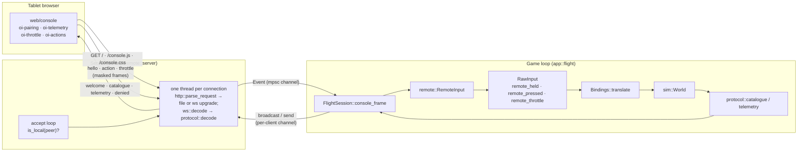
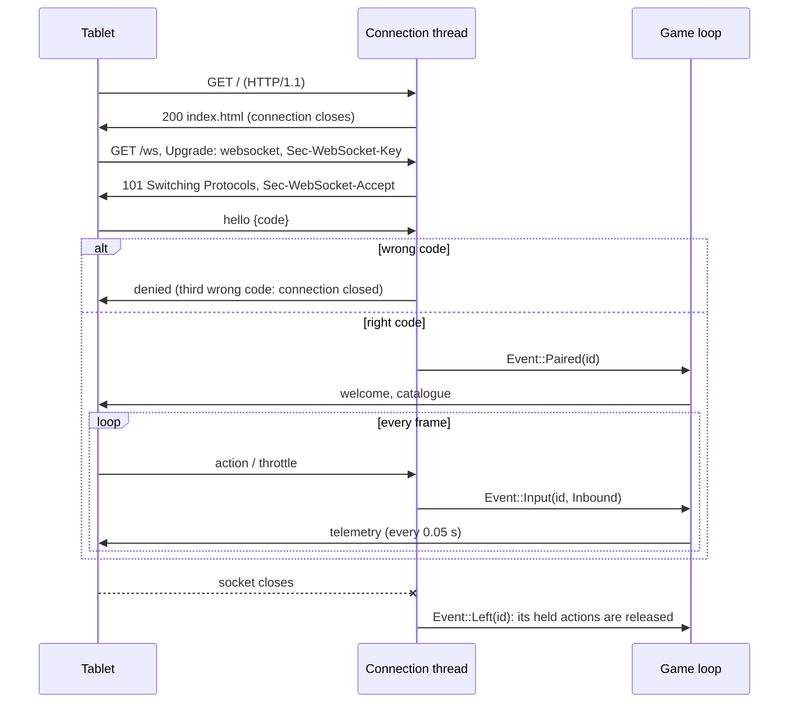

# Remote console

`src/remote/`: the **tablet control console** (interlude item C1, app 0.4.0, main `dfff71b`).
The game serves a web page and a WebSocket to a tablet on the local network; the tablet shows
the craft's condition live and sends the pilot's button presses back. Requirements
[R-CON-009 – R-CON-014](../../specification/requirements/control-console.md#r-con-009-console-server);
the wire format is the [Console protocol](../../specification/console-protocol.md); the
player's guide is [Tablet console](../../user-guide/console.md).

Everything — HTTP, the WebSocket handshake and frames, SHA-1, base64 and JSON — is written in
the crate: no dependency was added ([dependency policy](../../learning/best-practices/dependencies.md)).
The page in `web/console/` is plain HTML, CSS and custom elements, built into the binary with
`include_str!`.

`remote` sits in the application layer: it uses threads and sockets, and reads the world only
to describe it. `sim` knows nothing about it.

## Architecture Overview



The game loop must never wait on the network, so the server runs on its own threads and talks
to the game only through channels (`std::sync::mpsc`). The game calls `ConsoleServer::poll`
once a frame (it never blocks) and `broadcast` / `send` to queue outgoing frames; each
connection thread drains its own queue between reads. The only lock guards the short list of
connected clients.

### A connection's life



### Input path

A console button reaches the simulation the same way a key does:

1. The connection thread decodes `{"type":"action","name":"fire_beams","value":1}` into
   `Inbound::Action { action: Action::FireBeams, down: true }` (`protocol::decode`; a name
   outside `input::ACTIONS` is refused) and sends `Event::Input(id, …)` to the game.
2. `RemoteInput::apply` keeps **held** actions (`protocol::HELD`: turns, slides, afterburner,
   brake, fire beams, chase camera) in a set per console until the matching `value: 0`; any
   other action is a one-frame **tap**. A `throttle` message sets a one-frame throttle position.
3. `RemoteInput::merge_into(&mut raw)` adds them to this frame's `RawInput` (`remote_held`,
   `remote_pressed`, `remote_throttle`) and clears the taps.
4. `Bindings::translate` treats `remote_held` like a held key bound to the action and
   `remote_pressed` like a pressed one; `remote_throttle` sets `Controls::throttle_set`. From
   here on nothing knows the input came from a tablet.

`Event::Left` removes that console's held set, so a tablet that drops off the Wi-Fi in the
middle of a turn does not leave the craft turning. Each console has its own held set, so one
letting go does not release another's buttons.

### Safety (R-CON-009)

- **Off by default**: `--console`, `--console-port N` or `console: {enabled: true}`.
- **Local network only**: `accept_loop` checks every peer with `is_local`: IPv4 private
  (10/8, 172.16/12, 192.168/16), link-local (169.254/16) and loopback; IPv6 loopback,
  unique-local (fc00::/7) and link-local (fe80::/10); IPv4-mapped IPv6 by its IPv4 address.
  Anything else is dropped without an answer.
- **Pairing**: a 6-digit code from the clock at start-up (`pairing_code`, xorshift). Until a
  connection sends the right `hello`, its other messages are ignored; three wrong codes close
  it. The code only has to be unguessable to someone on the same network who cannot see the
  screen.
- **Limits**: a request head over 16 KB (`http::MAX_HEAD`) and a WebSocket frame over 64 KB (`ws::MAX_FRAME`) are
  protocol errors that end the connection; unmasked client frames and unknown opcodes too. Only
  the three embedded files are served; any other path is a 404.

## Key Symbols

| Symbol | What it is |
|---|---|
| `remote::server::ConsoleServer` | The running server as the game sees it: `port`, `code`, `url` (e.g. `http://192.168.1.20:8765`), the event receiver and the client list. Dropping it stops the accept loop. |
| `remote::server::Event` | What the server tells the game: `Paired(id)`, `Input(id, Inbound)`, `Left(id)`. |
| `remote::server::DEFAULT_PORT` | 8765. |
| `remote::RemoteInput` | The consoles' input state: held actions per console, this frame's taps and throttle. |
| `remote::protocol::Inbound` | A decoded console message: `Hello { code }`, `Action { action, down }`, `Throttle(f32)`. |
| `remote::protocol::HELD` | The actions that act while held; every other action is a tap. |
| `remote::protocol::VERSION` | The protocol version sent in `welcome` (1). |
| `remote::ws::Frame`, `ws::Opcode` | One WebSocket frame: `fin`, opcode (`Text`, `Binary`, `Close`, `Ping`, `Pong`, `Continuation`), unmasked payload. |
| `remote::http::Request` | A parsed request head: method, path (no query), lower-cased headers. |
| `remote::json::Json` | A parsed JSON value (`Null`, `Bool`, `Num`, `Str`, `Arr`, `Obj` with key order kept). |
| `remote::json::Obj` | A builder that writes a JSON object straight into a `String` (the 20 Hz telemetry costs one allocation). |
| `AppContext::console`, `AppContext::remote` | The server (when on) and the `RemoteInput`, owned by the app and passed to each screen. |
| `FlightSession::console_frame` | One frame of console work in flight: poll, apply, (re)send the catalogue, 20 Hz telemetry, merge input. |

## API Reference

- **Server** (`remote::server`):
  `ConsoleServer::start(port, seed) -> Result<ConsoleServer, String>` (binds `0.0.0.0:port`;
  the error names the port and the settings key); `poll(&self) -> Vec<Event>`;
  `broadcast(&self, text)` (every paired console; forgets clients whose thread has ended);
  `send(&self, id, text)`; `paired(&self) -> usize`. Helpers: `pairing_code(seed) -> String`,
  `is_local(IpAddr) -> bool`, `local_address() -> Option<IpAddr>` (asks the OS which interface
  would route to a documentation address; nothing is sent).
- **Protocol** (`remote::protocol`):
  `decode(text) -> Result<Inbound, String>`;
  `catalogue(&Ruleset, &World, ShipId) -> String`;
  `telemetry(&World, ShipId, time) -> String`;
  `available(&Ruleset, &World, ShipId, Action) -> bool` (cloak, ECM, tractor need the system
  fitted; VCT slides need `vct`; missiles need missiles aboard; beam actions need beams).
- **WebSocket** (`remote::ws`): `sha1(&[u8]) -> [u8; 20]`, `base64(&[u8]) -> String`,
  `accept_key(client_key) -> String`, `decode(&[u8]) -> Result<Option<(Frame, usize)>, String>`
  (`Ok(None)` = wait for more bytes), `encode(Opcode, payload) -> Vec<u8>` (unmasked, final).
- **HTTP** (`remote::http`): `parse_request(&[u8]) -> Result<Option<(Request, usize)>, String>`,
  `Request::header`, `Request::is_websocket`, `response(status, content_type, body)`,
  `upgrade_response(accept)`, `content_type(path)`.
- **JSON** (`remote::json`): `parse(text) -> Result<Json, String>` (recursive descent; nesting deeper
  than 32 levels is an error, so hostile input cannot overflow the stack), `Json::get`, `as_str`,
  `as_f64`; `Obj::new().str(k, v).num(k, v).bool(k, v).nums(k, &[..]).raw(k, json).end()`,
  `array(&[String])`.
- **Input** (`remote`): `RemoteInput::apply(&Event)`, `RemoteInput::merge_into(&mut RawInput)`.

## Debugging

- **Without a tablet**: `tools/console_client.py` (Python standard library only) pairs, prints
  the catalogue summary (including what is *not fitted*) and a few telemetry messages, and can
  send actions:

    ```sh
    target/release/openinterceptor --no-original --console --scenario rocket-vs-saucer --ship comet
    # in another terminal, with the code the game printed:
    tools/console_client.py 127.0.0.1:8765 123456 --tap next_target --hold fire_beams:1.5 --throttle 0.8
    ```

    `--telemetry N` sets how many telemetry lines to print (default 3). `denied: wrong pairing
    code` means the code is not the current run's.
- **The port is in use**: start-up prints `console: port 8765 is not available (…); set
  console.port in settings.yaml` and the game runs without the console. Find the other program
  with `lsof -i :8765` (macOS/Linux), or set `console.port` / `--console-port`.
- **Wrong code**: each wrong `hello` gets `{"type":"denied","reason":"wrong pairing code"}`;
  the third closes the connection (reload the page). The code changes every run; the terminal
  and the bottom-left hint show the current one.
- **Refused from outside the local network**: a peer that is not private, link-local or
  loopback is dropped silently, so the browser just reports that the connection closed. A
  phone on mobile data, a guest Wi-Fi with client isolation, or a VPN that gives the tablet a
  public-looking address (for example carrier-grade NAT, 100.64/10) are refused by design.
  Test from the same machine with `127.0.0.1`.
- **The URL shows `this-computer`**: `local_address` found no route; use the machine's address
  from the system's network settings.
- **The page loads but nothing pairs**: the WebSocket is opened on the page's own host and port
  (`ws://<host>/ws`). Check the browser console; a macOS firewall prompt may need answering.
- **Buttons do nothing in flight**: they act exactly like keys, so whatever stops a key (pause,
  menu, keys overlay, a dead craft) stops them too. An unavailable action (*not fitted*) does
  nothing by design.
- Tests: `remote::server::serves_the_page_pairs_and_relays_actions_over_a_real_socket` runs the
  whole path over a real localhost socket on a port derived from the process id.
