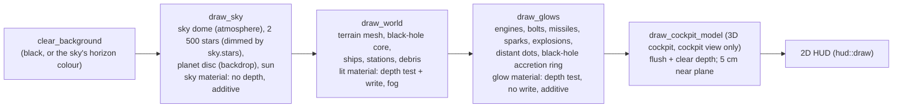
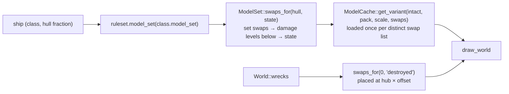

# Rendering

`src/render/`: draws one frame of the 3D scene with macroquad. It only *reads* the
simulation. Plan: Stage 1; Stage 2 added looks (model sets with texture swaps), debris sets,
effects with shock waves, station modules and their wrecks; app 0.3.1 lighting from the rules
(rim light), a brightness gamma, distant dots and viewer-relative bolt streaks; Stage 3 the black
hole (app 0.5.1) and the battle environment — terrain, sky dome, distance fog and a planet
backdrop (app 0.6.0).

## Architecture Overview

### Frame structure



### Looks: which model to draw



`Renderer::ship_look` picks the model a ship shows now: its model set's intact model with the
texture swaps for its hull fraction (`content::looks::ModelSet::swaps_for`). Swaps match the
model's textures by `looks::texture_key` (file name without folder or extension, lower-case).
`ModelCache::get_variant` keys the cache by model, scale and swap list, so each damage level is
built once and drawing it per frame costs nothing extra. Destroyed station modules with a
`destroyed` state are drawn from `World::wrecks` on their hubs. OBJ `slot_<name>` groups are not
part of the drawn mesh at all (the OBJ reader sets them aside as attachment points).

**Effects** (`render::effects`). On a `Destroyed` event, `Effects::on_events` starts an
`Explosion` with the model set's `destroyed_effect` (size × radius, duration, colour, and a
**shock wave** — a ring of glows racing outwards in the wreck's plane — when `shockwave` is set),
and throws the **debris set**: `pick` distinct pieces chosen with the effects' generator, each
starting at its place in the object's model space with the object's velocity plus a random
outward push and tumble, plus the generic `chunks`; wreckage darkens as it cools over its last
third and disappears after the set's `life`. Missile detonations draw the missile's `explosion` effect
(`SimEvent::MissileExploded { position, effect }`; size in metres), else a 25 m, 0.8 s fireball.
**Point-defence tracers** (`SimEvent::PointDefence`) are short streaks in the glow pass.

### The 3D cockpit pass

A cockpit definition may name a `model` (see [Cockpits](../../modding/cockpits.md)). It must always
appear in front of the world and may sit centimetres from the pilot's eye, which the normal
1 m near plane would clip. So `Renderer::draw_cockpit_model`:

1. flushes macroquad's batched draws (`InternalGlContext::flush`) so the world is on the GPU;
2. clears **only the depth buffer** (`quad_context.clear(None, Some(1.0), None)`) — the world's
   colour stays, but nothing in it can hide the cockpit;
3. draws the model with the lit material using `SpaceCamera::with_near(0.05)`, placed at the
   eye plus `ModelOffset` (in the eye's frame), always at LOD 0.

This and the model-matrix stack are the only uses of macroquad's internal GL state
(`unsafe_gl_context`, one documented `unsafe` block).

### Camera-relative rendering

`f32` loses precision far from the origin, and GPUs lose more. So no absolute world position
reaches the GPU: each object's model matrix is built from `position − camera.position`
(`SpaceCamera::model_matrix`), and the camera's view matrix is rotation-only
(`SpaceCamera::view_projection`). Near plane 1 m, far plane 200 km.

### Materials

| Material | Shader | GPU state | Used for |
|---|---|---|---|
| lit | vertex lighting: `ambient + sun × max(n·sun, 0) + rim × edge³` × vertex colour × texture, plus a `Tint` uniform (hit flash); gamma `1 / brightness` in the fragment shader; overlay depth bias | depth test ≤, depth write, **back faces culled** (counter-clockwise = front) | ships, stations, debris |
| sky | unlit | depth always, no write, additive | stars, sun |
| glow | unlit | depth test ≤, no write, `SrcAlpha + One` | engines, bolts, missiles, sparks, explosions |

Normals reach the shader through macroquad's spare `normal` vertex attribute. Per-object
transforms use macroquad's model-matrix stack (`push_model_matrix`), which breaks batches per
object and snapshots uniforms per draw call — so the hit `Tint` is per ship.

### One-sided faces (back-face culling)

Models are one-sided, as in the original game: the lit pipeline sets `cull_face: Back` with
counter-clockwise front faces. The original data winds every polygon counter-clockwise around
its outward plane normal, and models a surface seen from both sides as two polygons back to
back (shield rings, fins). Without culling both copies drew at the same depth and flickered
(z-fighting). `Model::from_xmsh` mirrors Z and reverses winding, so engine triangles stay
counter-clockwise seen from outside; mod OBJ models follow the same rule
([Models](../../modding/models.md)).

### Overlay layers and the depth bias

A decal lying exactly on another face (station panels, alien hull markings) has the same depth
values as the face under it, so the depth test picks a winner at random per pixel — flicker.
At load, `model::assign_overlay_layers` compares every pair of faces in a LOD: faces in the same
plane (normals within 0.999, plane offsets within 1e-4 × radius), facing the same way, that
overlap by the *separating-axis* test get stacked layers. Which is on top: faces flagged
`POLY_OVERLAY`, then `POLY_TRANSLUCENT`, then ordinary faces; among equals the later face in
the file (the original painted in that order). OBJ models use file order only. The pass takes
about 8 ms for all 297 CD meshes; 119 of 17,284 LOD-0 faces get a layer above 0.

The layer travels per vertex in the spare `w` of the `normal` attribute (`ModelVertex::layer`).
The lit vertex shader does

```glsl
gl_Position.z -= normal.w * LAYER_BIAS * gl_Position.w;
```

which moves the face towards the camera **in depth only** (the image does not shift).
`LAYER_DEPTH_BIAS` = 2⁻¹⁸ in normalised device coordinates, about 32 steps of a 24-bit depth
buffer — the same idea as `glPolygonOffset`, done per vertex because a model is one draw call.
Multiplying by `w` keeps the shift constant after the perspective divide. GLSL cannot read a
Rust constant, so `lit_vertex_source()` pastes the number into the shader text at start-up.

Overlay-flagged faces are kept in their own material groups (`MaterialGroup::overlay`,
`GpuLod::overlay`), so `Renderer::show_overlays = false` hides them (the model viewer's **O**).

### Texture addressing

Original texture coordinates run outside 0..1 to tile a texture across a big face. Model
textures are set to **repeat** (`render::set_repeat`, via `texture_set_wrap` on the internal GL
context) instead of macroquad's default clamp, which smeared edge pixels across such faces
(the "incomplete" Patton, the asteroids, many debris chunks). The UV varying is `mediump`, not
`lowp`, so tiled coordinates keep their precision on GL ES devices.

### Lighting, rim and brightness (app 0.3.1)

The lit shader's light comes from the `Light` uniform, a `mediump vec4` declared identically in
both stages (see [Debugging](#debugging)): x = ambient, y = sun,
z = rim, w = gamma. `Renderer::lighting` is the campaign's `flight: {lighting: …}`
(`content::rules::Lighting`, defaults 0.30 / 0.85 / 0 / 4 px, which reproduce the earlier fixed
lighting); the flight screen copies it in each frame. In the vertex shader the model matrix
already places the vertex relative to the camera, so its position is also the view ray;
`edge = 1 − |n·ray|` is 1 where a face is seen edge-on, and `rim × edge³` lights a thin
outline around a hull against black space. `Renderer::brightness` is the player's
`graphics.brightness` (1 = as authored, clamped 0.25–4 here, 0.5–2 by the settings reader),
read at start-up; the fragment shader raises the colour to the power `1 / brightness`, which
lifts dark tones more than bright ones.

### Distant dots

`push_distant_dots` (inside `draw_glows`) draws each ship that is on the player's radar
(`systems::on_radar`, so cloaked ships stay hidden) and smaller on screen than
`lighting.distant_dot` pixels as a glow billboard of that size in its radar colour (hostile,
friendly, neutral; the objective colour when protected). The on-screen size is
`2 × radius / (distance × metres per pixel)`, where one pixel covers
`2 tan(fov / 2) / screen height` metres at unit distance. The dot fades in as the ship shrinks,
so there is no pop at the threshold. `distant_dot: 0` turns it off.

### Bolt streaks

A bolt is drawn as a streak trailing behind its head. `Bolt::streak_length()` is
`min(muzzle_speed × 0.025 s, 80 m, muzzle_speed × age)`: never longer than the distance the bolt
has flown from the gun. Without the last term, a bolt fired this frame trailed up to 80 m back
past the muzzle, so in the chase view fire seemed to come from behind the ship.

The streak points along the bolt's velocity **relative to the viewer**,
`bolt.velocity − cam.velocity` (`SpaceCamera::velocity`, set from the player's ship with
`with_velocity`). That is what the eye sees: a bolt from a drifting ship shares the drift, so
relative to the pilot it streaks straight out of the guns, while a stationary observer would
see it slanted.

### Battle environments (app 0.6.0)

The flight screen sets `Renderer::env_sky` and `Renderer::planet` from the battle's environment
before drawing each frame, and clears them after, so the launcher, viewer and other screens still
draw plain space. With a sky, the background is cleared to the horizon colour instead of black.

- **Sky dome** (`draw_sky_dome`, drawn first in `draw_sky`): a dome of 8 rings × 24 segments around
  the camera, from 30° below the horizon to the zenith, coloured from `horizon` to `top` by
  `√max(sin(elevation), 0)` — the square root keeps the horizon band narrow. Stars are then drawn
  with their colour scaled by `sky.stars`.
- **Planet** (`draw_planet`): a disc facing the camera at 80 % of the sky distance, its radius set
  by the angular `size`. Each vertex is shaded as if it were on a sphere (the normal is rebuilt
  from the disc position), lit by the sun with a darker limb, so one flat mesh reads as a lit globe.
- **Terrain** (`render::terrain::terrain_model`): the heightfield becomes an ordinary `Model` —
  one vertex per grid point, two triangles per square, wound counter-clockwise seen from above so
  the fronts face up for back-face culling. Vertex colours run from `low` to `high` by height,
  blended to `slope` where the normal tips more than about 0.08 from vertical (full at 0.38), with
  a fixed ±8 % per-vertex variation. It is uploaded once per terrain id through
  `ModelCache::upload_model` and kept in `Renderer::terrain`, then drawn with `draw_model` like
  any ship: lit by the sun, depth-tested, fogged.
- **Ground to the horizon** (app 0.6.7, from the user's playtest). Past its square the ground
  continues as **mirror-image tiles** (`Heightfield::fold`): tile `(i, j)` is the field reflected
  across each odd index, so neighbours meet without seams and `height_at` — used by collision
  and the AI — answers everywhere. A tile reflected in X alone cannot be drawn by rotating the
  normal mesh, so two meshes are uploaded: the field and its X-mirror (`terrain_model(def,
  field, mirror_x)`, with the triangles' winding swapped so they still face up). A tile
  reflected in both X and Z is the normal mesh turned 180° about Y; one reflected in Z alone is
  the mirrored mesh turned 180° (`render::terrain::tile_placement`). Each frame the renderer
  draws the tiles within the fog distance × 1.1 (else three field sizes), at most 7 × 7 around
  the tile under the camera, skipping those whose nearest part is beyond reach. The test
  `tiles_match_the_folded_ground_heights` checks every vertex of every placed tile against the
  folded height.
- **Fog** in the lit shader: the vertex stage computes `fog = clamp(d / FogDistance.x, 0, 1)²` from
  the camera-relative position; the fragment stage mixes the colour towards `FogColor`.
  `FogDistance.x = 0` (space) turns it off. See the precision note under [Debugging](#debugging).

### Black hole

A black hole (`World::hazards.black_hole`, app 0.5.1) is drawn in two parts: in `draw_world` a
black sphere of the hole's `radius` that hides the stars and anything behind it, and in
`draw_glows` an accretion ring of 48 additive orange glows at 1.6 – 1.85 × the radius, turning
slowly with the battle time and bobbing a little out of plane, with fixed per-glow heat
variations.

LOD choice: `GpuModel::lod(distance)` picks the first LOD whose `switch_distance` exceeds the
camera distance (the original values: e.g. 75 / 150 / 450 m / ∞ for the Lightning II).
Objects entirely behind the camera are skipped.

## Key Symbols

| Symbol | What it is |
|---|---|
| `Renderer` | `lighting` (the campaign's `Lighting`) and `brightness` (the player's setting); owns the three materials, a generated radial `glow_texture`, `models: ModelCache`, the star list, and reusable vertex/index buffers. |
| `camera::SpaceCamera` | `position`, `rotation`, `fov_y`, `aspect`, `z_near`, `velocity` (the viewer's, for streaks); `new(...)`, `with_near(..)`, `with_velocity(..)`; implements macroquad's `Camera` trait; `project` (world → screen pixels) and `local_direction` for the HUD. |
| `effects::Effects` | `explosions`, `sparks`, `debris`, created by `on_events(&World)` (from effects and debris sets) and aged by `update(dt)`. |
| `effects::Explosion`, `Debris`, `Spark` | A fireball (with optional shock-wave plane), a tumbling piece with its life, a short spark. |
| `gpu::ModelCache::get_variant` | A model with texture swaps, cached per distinct swap list. |
| `Renderer::ship_look` | The model a ship shows now (model set + damage level). |
| `starfield::Star`, `starfield::generate(seed, count)` | Seeded, uniform-on-the-sphere star directions. |
| `push_billboard`, `push_streak` | Build camera-facing quads into the reusable buffers. |
| `LAYER_DEPTH_BIAS`, `lit_vertex_source()` | Depth shift per overlay layer and the shader text with it filled in. |
| `Renderer::show_overlays` | Draw overlay-flagged faces (default `true`; the viewer toggles it and restores it on exit). |
| `gpu::Chunk::overlay`, `GpuLod::overlay` | Per-mesh overlay flag, parallel to `GpuLod::meshes`. |
| `GpuModel::lod_index(distance)` | Index of the LOD to draw; shared between `GpuModel::lods` and `model.lods`. |
| `model::Face` | One original polygon: `first`, `count` (its corners are consecutive vertices), `group`, `flags`. |
| `model::assign_overlay_layers`, `model::face_plane` | The overlay pass; a face's plane by Newell's method. |
| `Renderer::env_sky`, `Renderer::planet` | The battle's `Sky` and `Planet` (set per frame by the flight screen, cleared after). |
| `Renderer::terrain` | The current terrain's GPU model, by terrain id (built once). |
| `terrain::terrain_model(&TerrainDef, &Heightfield) -> Model` | The terrain mesh, coloured by height and slope. |
| `ModelCache::upload_model(content, Model, pack)` | Uploads a model built in code rather than loaded from a pack. |
| `FogDistance`, `FogColor` | Lit-shader uniforms: vertex stage only, fragment stage only. |

## API Reference

- `Renderer::new() -> Result<Renderer, String>` (fails only if a shader is rejected).
- `draw_sky(&cam, seed, sun)`, `begin_solid(&cam, sun)`, `draw_model(&cam, &GpuModel, pos, rot, tint)`,
  `draw_model_lod(.., force_lod: Option<usize>)`, `draw_world(&Content, &World, &Effects, &cam, sun, hide)`,
  `draw_glows(&Content, &World, &Effects, &cam, hide, player)` (`player` for distant dots), `draw_cockpit_model(&cam, &GpuModel, offset, sun)`,
  `draw_axes`, `ship_model`, `ship_look(&Content, &World, &Ship)`.
- `ModelCache::get(content, reference, pack, scale)`, `get_variant(.., &Swaps)`.
- `effects::explosion_curve(t) -> (size, brightness)`; `effects::SPARK_LIFE`.

## Debugging

- Ships too dark or invisible: raise `rim` or `ambient` in the campaign's `flight.lighting`, or
  `graphics.brightness` in `settings.yaml`; dots missing for far ships: check `distant_dot` is
  not 0 and that the ship is on the radar (beyond `radar_range`, or cloaked, it is not).

- Reused buffers: `draw_glows` and `draw_sky` *move* their `Vec`s into a `Mesh` with
  `std::mem::take`, draw, then move them back — no allocation after the first frame.
- If a scene is black except the HUD, check the shader compile error returned by
  `Renderer::new` (shown on the start-up error screen).
- **"Shader error" at start-up, program fails to link** (fixed in app 0.4.1, main `42716d1`):
  in GLSL ES a uniform declared in both the vertex and the fragment shader must have the same
  type **and precision**, or the program does not link. The lit shader's `Light` uniform is
  used by both; the vertex shader's default float precision is `highp` and the fragment
  shader's `precision mediump float` makes it `mediump` there, so a bare `uniform vec4 Light;`
  in both had two different precisions. Both now declare `uniform mediump vec4 Light;`. Some
  desktop drivers accept the mismatch, so it can pass on one machine and fail on another. The
  test `render::tests::uniforms_shared_by_both_lit_shaders_match_exactly` compares every
  uniform the two lit shaders share and requires an explicit precision, so a new shared
  uniform cannot reintroduce the problem.
- **Fog distance is computed in the vertex shader** (app 0.6.0). Battle distances reach tens of
  kilometres, and the fragment shader's `precision mediump float` only guarantees about ±16 384
  with a 10-bit mantissa, so `d / FogDistance` computed there would be coarse or overflow on some
  GPUs. The vertex stage (highp by default) computes the fog factor, already in 0..1, and passes
  it down as a `mediump` varying. Each uniform is declared in **one** stage only (`FogDistance` in
  the vertex shader, `FogColor` in the fragment shader), which also sidesteps the
  shared-uniform precision rule above.
- An atmospheric battle with no visible ground: check the player starts above the terrain's
  `height` range, and that `fog_distance` is not so short that the ground is fogged out; the
  heightfield is cached per terrain id, so a changed terrain needs a new battle (not a new frame).
- Engine glows come from rear-facing model attachments, else the back of the bounding box;
  `GpuModel::engines` is computed once at load, so drawing glows allocates nothing per frame.
- A face that vanishes from one side is a back face: wind it the other way, or add a second
  face back to back if it must be seen from both sides. The viewer's wireframe (**W**) shows the
  missing face's outline.
- Flicker on a flat area means coplanar faces facing the same way that the overlay pass did not
  pair (they are not in the same plane within tolerance); select them with **[ ]** in the viewer
  and compare their `layer`.
- Stretched or single-colour faces on original models: check that the texture repeats (the
  face info line shows UVs beyond 0..1).
- A 3D cockpit that is invisible usually sits behind the eye: check `ModelOffset` and that the
  model's front faces −Z.
- A damage texture that never appears: the swap's key must be the model's texture *name*
  (no folder, no extension); open the class in the model viewer and press **D** to step through
  its looks, and `--check` reports swapped textures that fail to load.
- Debris that flies from the wrong place was modelled away from the object: pieces must be in
  the object's own model space. The viewer's debris look pulls them apart from where they sit.
