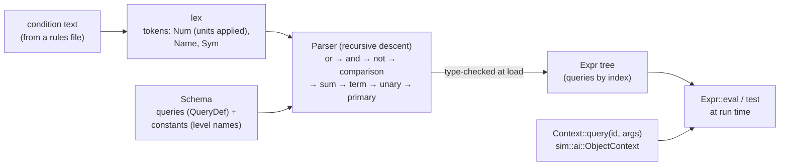
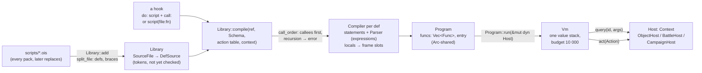

# Conditions and scripts (script)

`src/script/`: the condition language that behaviours (and, from Stage 3, missions and
events) use to decide things — `hull < 25% and not system_damaged(engines)`. A complete little
language implementation in four classic steps: lexing, recursive-descent parsing, type checking
against a schema, and evaluation. Plan: Stage 2 item 2.9 (object context); Stage 3 adds the
mission and event contexts and actions, and in app 0.18.0 (item 3.10) the **Tier 2 scripts**:
the same language grown into statements (`script::stmt`, [below](#scripts-tier-2-app-0180)). The
modder's view is on [Behaviours and conditions](../../modding/behaviours.md#the-condition-language)
and [Scripts (Tier 2)](../../modding/scripts.md).

## Architecture Overview

- **Lexing** (`lex`): whitespace-separated numbers, names and symbols. A unit written straight
  after a number is applied at once (`1.5km` → 1500, `25%` → 0.25; `m`, `km`, `s`, `min`, `h`,
  `day`, `%`). Names are lower-cased.
- **Parsing** (`Parser`): one method per precedence level, lowest first — `or`, `and`, `not`,
  comparison (`< <= > >= == !=`, not chained), `sum` (`+ -`), `term` (`* /`), `unary` (`-`),
  `primary` (number, `true`/`false`, constant, query with arguments, brackets). Each method
  returns the sub-tree **and its type** (`Num` or `Bool`).
- **Checking** happens while parsing, against the `Schema`: unknown names, wrong argument
  counts or kinds (`system_damaged(warp)`), and type errors (`hull and 3`, a comparison of
  booleans) are errors with a message; `parse_condition` also requires the whole expression to
  be true/false. Behaviours call it when the rules load, so a bad condition never reaches play.
- **Evaluation** (`Expr::eval`) walks the tree. `and`/`or` short-circuit; `==` and `!=` compare
  within 1e-6; division by zero gives 0. Queries are answered by a `Context`; arguments are
  evaluated first and passed as numbers (a name argument such as `engines` is resolved to its
  index while parsing).

A *condition* has no assignment, loop or user function, so evaluation cannot change the game
and always finishes (scripts add those, with the guarantees kept by other means — below). `random(p)` draws from the asking pilot's seeded generator, so runs are deterministic.

### The object context

`script::object` declares the queries a behaviour may use (`QUERIES`, with `doc` strings that
the docs table is made from) and `schema(levels)` adds the campaign's difficulty level ids as
numeric constants. `sim::ai::ObjectContext` implements `Context` for one ship: it holds
`&World`, the ship's id, the time in its current state and the pilot's random state in a
`Cell<u64>` — `Context::query` takes `&self`, but `random` must advance the generator, and a
`Cell` allows that for a `Copy` value without `&mut` (interior mutability).

### The campaign context (app 0.6.7)

`script::campaign` declares the strategy layer's 16 queries (`research`, `researching`, `has`,
`module_count`, `bases`, `money`, `day`, `month`, `difficulty`, `pilots`, `score`,
`month_score`, `random`, `flag`, `salvaged`, `craft`; ids in `campaign::id`).
`campaign::schema(names, levels)` makes **every id the campaign's data defines** a constant —
its index in `StrategyDef::names` — so a topic, item or module is passed as a bare word
(`research(heat_rays)` compiles to query 0 with that index) and a misspelt name is a load error.
Difficulty level ids are constants too, unless an id already has that name. The context is
answered by `campaign::Campaign` ([Campaign](campaign.md#expressions-the-campaign-as-a-scriptcontext)).
Time quantities accept `d` (days) since app 0.6.7, for `every: 30d`.

The story added five queries in app 0.10.0 (`arc`, `plan`, `relation`, `fired`, `battles_won`)
and logistics eight in app 0.16.3 (`deposit`, `feature`, `research_site`, `survey_known`,
`owned`, `lane_distance`, `facility_progress`, `construction_attacks`; ids 21 – 28, R-MOD-014)
and app 0.19.0 `base_distance` (id 29): **30** in all. A logistics query's arguments are names
like any other — the map's system ids and their feature tags, resource, component, facility-type
and research-site ids were added to `StrategyDef::names` for them — and its first argument is
always a system. `Arg::Num` carries the constant's index; the campaign looks the name up again
(`Campaign::logistics_query`), so a name that is not a system answers 0 instead of failing.
Since app 0.19.0 three **reserved names** are in every campaign's table
(`script::campaign::RESERVED`): `system` and `nearest_base`, which the campaign's `Cx` resolves
to the candidate system of a `placement:` condition and the base fewest lanes from it, and `any`
(any resource in `deposit`, any site in `research_site`)
([Campaign › Placement](campaign.md#placement-a-condition-about-a-candidate-system)).

### The condition console (app 0.16.5)

The testbed's backquote console evaluates typed text in the **battle** context:
`MissionRun::evaluate(&World, text, levels)` builds `battle::schema` from the mission's own role
names and the difficulty levels, parses, and evaluates against a `BattleCx` whose generator is a
`Cell` **copy** of the mission's (`Cell::new(self.rng)`), so `random(p)` reads the dice without
moving them — looking never changes the battle (unit-tested). The value comes back as text; a
parse error as the `Err` string the flight screen shows in orange.

## Scripts (Tier 2, app 0.18.0)

`src/script/stmt.rs` (main `040ca26`, decision (c) of the
[dependency evaluation](../../learning/best-practices/dependencies.md#tier-2-scripting-evaluated-stage-310)):
a small statement language on top of the condition parser. The guide is
[Scripts (Tier 2)](../../modding/scripts.md); the grammar is on
[Format: behaviours and scripting](../../specification/design/format-behaviour.md#the-language-as-built-app-0180).

**Loading.** `Content::load` reads every pack's `scripts/*.ois` into a `Library` before the rules
(`Library::add` replaces a file of the same pack-relative path, so mods override). `add` checks
only the file's **structure** (`split_file`: `def name(params) { … }` blocks, balanced braces,
no duplicate names) and keeps each body as tokens, because a body can only be type-checked
against a context, and only the **hook** knows its context.

**Compiling a hook.** `Library::compile(reference, schema, actions, context)` finds the file and
function, refuses an entry with parameters, orders the functions it reaches callees-first
(`call_order`, a depth-first walk whose stack *is* the call chain, so meeting a function already
on it is recursion — reported as `a → b → a`), and compiles each with a `Compiler`. Statements are
parsed by the compiler; expressions by the same `script::Parser` conditions use, now given the
function's **locals** (`LocalVar`: name, frame slot, type) and the **signatures** of the functions
already compiled (`FuncSig`), so it can produce `Expr::Local` and `Expr::Call`. Every check —
unknown names, argument kinds, types, `for each` without a collection (`Schema::each`), name
clashes, `script(...)` inside a script — is a load error with file and line. Three call sites:

| Hook | Where compiled | Context | Actions table |
|---|---|---|---|
| `do: script` state | `content::behaviour::BehaviourDef::parse` | object, plus the behaviour's `vars` as constants (slot numbers) | `action::OBJECT_ACTIONS` (`goto`, `set_var`, `message`); `goto`/`set_var` targets checked against the states and `vars` afterwards (`Program::action_words`) |
| `script(...)` in `outcomes` | `content::mission::MissionDef::parse_with` via `action::parse_with` | battle (with the mission's roles; `Schema::each = members`) | `action::MISSION_ACTIONS` |
| `script(...)` in events, choices, plan warnings / complete, evaluations | `content::story`, `content::strategy` via `action::parse_with` | campaign | `action::EVENT_ACTIONS` |

A compiled `Program` goes into an `Arc` (in `StateScript` or `Action::program`): action lists are
cloned when they run, and every ship flying a behaviour shares one program. After the rules
load, `content::mod` resolves `@text` keys inside programs with `Arc::make_mut` +
`Program::texts_mut` (no other `Arc` points at a program yet, so nothing is copied).

**Running.** `Program::run(&mut dyn Host)` creates a `Vm` with a budget of `BUDGET` = 10 000
operations and calls the entry. The tree walk (`Vm::block`, `Vm::eval`) mirrors `Expr::eval`
plus statements; every statement, expression node and loop round calls `tick()`, which
returns `Err(OutOfBudget)` at zero — an ordinary error value that `?` carries out of every
level, so the hook simply stops; actions already sent to the host stand. Loops run
`rounds(n)` = whole rounds, at most `MAX_LOOP` = 1 000. Locals live in **one value stack**: a
call's frame is the window `stack[base .. base + slots]`, arguments pushed by the caller become
its first slots, and the stack is truncated back on return. Query arguments are evaluated into a
fixed `[f32; MAX_QUERY_ARGS]` array (4; a test checks every context fits), so a query
allocates nothing.

**Hosts.** `trait Host: Context { fn act(&mut self, action: Action); }` — a host answers queries
like any condition context and receives actions:

- `sim::ai::ObjectHost` (behaviour scripts): queries through the pilot's `ObjectContext` (with
  `AiState::vars`, a fixed `[f32; 8]`); `goto` records the state (the last wins), `set_var` writes
  into the context at once, `message` becomes a `SimEvent::Radio`. `ai::step` runs the script on
  the state's first tick and every `every` seconds (`AiState::script_clock`) before flying the
  `fly` manoeuvre; out of budget raises `SimEvent::ScriptStopped` once per pilot
  (`AiState::script_warned`).
- `mission::BattleHost` (outcome scripts): run when the result is decided, against the battle as
  it ended; battle actions become message lines, campaign actions join the debrief's list.
- `campaign::story::CampaignHost` (campaign scripts): holds the one `&mut Campaign` and lends it
  out shared for each query; the roll generator sits in a `Cell<u64>` while the script runs and
  is handed back around each action, which is applied at once through `apply_actions`.

## Key Symbols

| Symbol | What it is |
|---|---|
| `Token` | `Num(f32)`, `Name(String)`, `Sym(&'static str)`. |
| `Expr` | `Num`, `Bool`, `Query(u16, Vec<Expr>)`, `Not`, `Neg`, `Binary(Op, …)`. |
| `Op` | `Or`, `And`, `Lt`, `Le`, `Gt`, `Ge`, `Eq`, `Ne`, `Add`, `Sub`, `Mul`, `Div`. |
| `Type`, `Value` | `Num` / `Bool` at check time; `Value::Num(f32)` / `Value::Bool(bool)` at run time. |
| `QueryDef`, `Arg` | A query: `name`, `args` (`Arg::Num` or `Arg::Name(&[..])`), `result` type, `doc`. |
| `Schema` | The queries and named constants available in one context. |
| `Context` | The trait a game context implements: `query(id, &[f32]) -> Value`. |
| `object::QUERIES`, `object::id`, `object::SYSTEM_NAMES`, `object::schema` | The object context (21 queries). |
| `campaign::QUERIES`, `campaign::id`, `campaign::schema` | The campaign context (16 queries in app 0.6.7; 29 since app 0.16.3). |
| `mission::MissionRun::evaluate` | The condition console's evaluation (app 0.16.5). |
| `stmt::Library` | The loaded script files (`add`, `compile`, `len`). |
| `stmt::Program` | A compiled hook: its functions and entry; `run`, `run_with`, `reference`, `action_words`, `texts_mut`. |
| `stmt::Host` | `trait Host: Context` — queries plus `act(Action)`. |
| `stmt::OutOfBudget` | The error a stopped hook returns. |
| `stmt::BUDGET`, `MAX_LOOP`, `MAX_QUERY_ARGS`, `EXTENSION` | 10 000, 1 000, 4, `"ois"`. |
| `Expr::Local`, `Expr::Call` | A local's frame slot; a call of a script function (only from the script compiler). |
| `Schema::each` | The query that sizes a `for each` collection (`battle::id::MEMBERS`), or none. |
| `action::OBJECT_ACTIONS`, `action::Hooks`, `action::parse_with` | The behaviour scripts' actions; what a `script(...)` list entry compiles against. |
| `object::MAX_VARS`, `object::id::VAR` | At most 8 object variables; the `var(name)` query. |
| `battle::id::MEMBERS` … `MEMBER_DISTANCE` | The battle context's member queries (ids 17 – 20). |
| `sim::ai::ObjectHost`, `mission::BattleHost`, `campaign::story::CampaignHost` | The three hosts. |
| `sim::ai::ObjectContext` | The simulation's answer to object queries. |

## API Reference

- `script::lex(&str) -> Result<Vec<Token>, String>`.
- `script::parse(&str, &Schema) -> Result<(Expr, Type), String>`;
  `script::parse_condition(&str, &Schema) -> Result<Expr, String>` (must be true/false).
- `expr.eval(&dyn Context) -> Value`, `expr.test(&dyn Context) -> bool`.
- `script::object::schema(&[String]) -> Schema`; `ruleset.object_schema()` builds it for the
  loaded campaign's levels.
- `stmt::Library::add(&mut self, path, origin, text) -> Result<(), String>`;
  `Library::compile(&self, "scripts/x.ois:fn", &Schema, &'static [ActionDef], context) -> Result<Program, String>`.
- `Program::run(&self, &mut dyn Host) -> Result<Option<Value>, OutOfBudget>`; `run_with(.., budget)`.
- `script::lex_lines(text, script: bool) -> Result<(Vec<Token>, Vec<u32>), String>` (tokens with
  their lines; `#` comments, `@keys`, quoted text, braces, line ends when `script`).

## Debugging

- Every parse error is reported at load with the behaviour and transition it came from
  (`--check` lists them); messages say what was expected: "unknown name 'hul'", "takes 1
  argument(s), given 0", "expected ',' or ')' in threats(...)", "missing ')'", "'hull' is a
  number, not a condition (compare it: 'hull > 0')".
- To test a condition, write it in a behaviour and run `--check`; to see it fire, use a
  transition into an obviously different manoeuvre (`do: circle`) in a testbed scenario.
- A **battle** condition can be typed live: start the mission and press `` ` `` (app 0.16.5) —
  [Getting started › The condition console](../../user-guide/getting-started.md#the-condition-console).
  A **campaign** condition can be watched in the strategy screen's Debug list (Ctrl+D, app
  0.16.13) by giving a test story event that `when` and `chance: 0%`.
- The language is pure, so new queries are unit-tested with a stub `Context` (see the tests in
  `script/mod.rs`) before the simulation answers them.
- **Scripts:** `--check` compiles every hook; an error names the hook
  (`behaviours.b.states.s.call: …`, `missions.m.outcomes.win: …`, `events.e.do: …`) and the
  file and line. A function no hook reaches is only structure-checked — call it from a test
  hook to check its body. In play, `message(...)` lines show what a behaviour script decided;
  `SCRIPT STOPPED: … used its whole operation budget` (message display or campaign log) means
  a runaway loop. `script::stmt::tests` has a `TestHost` that logs actions — the quickest way
  to try an interpreter change. The soak test
  `soak::tests::the_default_campaigns_scripted_ace_taunts_and_turns_furious` flies the default
  `saucer_ace` headless.
