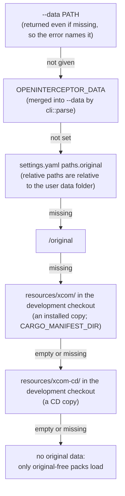

# Settings and data discovery

`src/settings.rs` and `src/cli.rs`: where the player's things live, and how the engine finds
the original Interceptor data without being told every time. Plan: Stage 1 (deployment
layout); the launcher grows a settings screen in Stage 5.

## Architecture Overview

An installed OpenInterceptor separates **what ships with the program** from **what belongs to
the player**:

```text
OpenInterceptor-<version>.app/Contents/      (the program — safe to share)
  MacOS/openinterceptor
  Resources/resources/default                (the default campaign: what the game ships)
  Resources/packs/interceptor                (bundled mods: no original content)

~/Library/Application Support/OpenInterceptor/      (macOS)
$XDG_DATA_HOME/openinterceptor/ or ~/.local/share/openinterceptor/   (Linux)
  settings.yaml    paths: original, mods; packs: disabled; game: campaign, difficulty, language;
                   graphics: brightness; console: enabled, port
  bindings.yaml    controls (created on first run)
  original/        optional copy of the original data, installed copy or CD
                   (tools/build_bundle.py --install-data)
  mods/            one folder per mod
```

A development checkout has the same split (app 0.4.2, spec [R-CMP-014](../../specification/requirements/compatibility.md#r-cmp-014-resources-folder)):

```text
OpenInterceptor/
  resources/default/   the default campaign, in editable formats (in Git)
  resources/xcom/      the developer's installed copy of Interceptor (git-ignored)
  resources/xcom-cd/   the developer's CD copy (git-ignored)
  packs/interceptor/   bundled mods (in Git)
```

Packs are loaded from `resources/` then `packs/` (`cli::content_dirs`), then the user's mods,
so a mod overrides resources. The original-data folders have no `pack.yaml` and are skipped as
packs. `--packs DIR` replaces only the second folder.

Finding the original data (`settings::resolve_original`) — the first candidate that exists
wins:



The mods folder is `--mods`, else `paths.mods`, else `<user data>/mods`. `packs.disabled`
lists pack ids to switch off (whole-pack activation, like XWVM's Game Content screen).
`game.campaign` and `game.difficulty` are the campaign and difficulty level to load; the
launcher's campaign switch (Tab) and difficulty switch (D) write them (`app::remember_campaign`),
and `--campaign` / `--difficulty` override them for one run. Empty means the default choice
(`interceptor` if its data is available, else `default`; the campaign's `default_difficulty`).

The two checkout folders count only once they hold files: they may exist empty in any
checkout, and an empty `resources/xcom/` must not hide a filled `resources/xcom-cd/`.

```yaml
# settings.yaml
paths:
  original: /Users/me/Games/XCOM Interceptor
  mods:
packs:
  disabled: [hd-cockpit-test]
game:
  campaign: default
  difficulty: ranger        # a level of game.campaign: ignored when another campaign loads
  language: en              # text/<language>/ folders (--language overrides)
graphics:
  brightness: 1.2           # 1 = as authored; 0.5 (darker) to 2 (brighter)
console:
  enabled: true             # serve the tablet control console (default false)
  port: 8765                # 1–65535; anything else is ignored
```

`console.enabled` accepts `true`, `yes` or `on`; `--console` and `--console-port N` turn it on
for one run ([Remote console](remote.md)).

`graphics.brightness` (app 0.3.1) is read once at start-up into `Renderer::brightness` and
applied as a gamma of 1 / brightness in the lit shader ([Rendering](rendering.md)); values
outside 0.5–2 are clamped, and an empty value means 1. The player's guide is
[Settings](../../user-guide/settings.md).

**Migration.** Builds before the YAML formats wrote `settings.ini` and `bindings.ini`. When
`settings.yaml` does not exist, `Settings::load` reads `settings.ini` instead
(`parse_legacy_ini`), and the next save writes `settings.yaml`. `bindings.ini` is read once and
saved straight away as `bindings.yaml` (`app::load_bindings`). The old files are left in place
and ignored from then on.

`tools/build_bundle.py` presets `paths.original` to the checkout's `resources/xcom/` (else
`resources/xcom-cd/`, or `--data`), so a freshly built app finds the original data at once.

## Key Symbols

| Symbol | What it is |
|---|---|
| `Settings` | `original: Option<PathBuf>`, `mods: Option<PathBuf>`, `disabled_packs: Vec<String>`, `campaign: Option<String>`, `difficulty: Option<String>`, `language: Option<String>`, `brightness: Option<f32>` (`graphics.brightness`, clamped 0.5–2), `console: bool` and `console_port: Option<u16>` (`console.enabled`, `console.port`). |
| `settings::Source` | Which rule found the data: `CommandLine`, `Environment`, `SettingsFile`, `UserDataFolder`, `DevelopmentTree` (`resources/xcom` or `resources/xcom-cd`). |
| `cli::user_data_dir()` | The per-user folder for this platform. |
| `cli::find_packs_dir(exe)`, `cli::find_resources_dir(exe)` | The `packs/` and `resources/` folders: in the working directory, next to the program, in `../Resources/` inside an app bundle, then the source tree (`find_dir`). |
| `cli::content_dirs(resources, packs)` | The pack folders in load order: `resources/` then `packs/`. |
| `content::checkout_dirs()` | The checkout's `resources/` and `packs/`, for tests and tools that load the real campaigns. |

## API Reference

- `Settings::parse(text)` (YAML; unknown keys ignored), `Settings::parse_legacy_ini(text)`,
  `Settings::load(dir)` (`settings.yaml`, else a legacy `settings.ini`, else defaults),
  `settings.to_yaml_text()`, `settings.save(dir)` (writes `settings.yaml`).
- `resolve_original(cli, env, &settings, user_dir, dev_tree) -> Option<(PathBuf, Source)>` —
  pure apart from `is_dir` and read-dir checks; tested with temporary folders
  (`original_data_is_found_in_order`).
- `cli::Options::content_config()` assembles a `ContentConfig` from all of the above
  (`campaign` = `--campaign`, else `game.campaign`; `difficulty` = `--difficulty`, else
  `game.difficulty` **only when the loaded campaign is `game.campaign`** — a remembered level
  belongs to its campaign, so `--check` checks every other campaign at its default level;
  `language` = `--language`, else `game.language`, else `en`).

## Debugging

- `openinterceptor --list` shows which packs loaded; if `interceptor` is missing, no data
  folder was found — check `settings.yaml`, pass `--data`, or put the data in
  `resources/xcom/` (installed copy) or `resources/xcom-cd/` (CD copy) in a checkout.
- A checkout that still has its data in the old `game/` folder is no longer searched: move it
  to `resources/xcom-cd/` (or `resources/xcom/` for an installed copy). `game/` stays
  git-ignored so it can never be committed.
- The default campaign is missing: `resources/` was not found next to the program. In an app
  bundle it is `Contents/Resources/resources/default`.
- The launcher always loads the last campaign chosen there; if a campaign seems "stuck", look
  at `game.campaign` (or pass `--campaign`); the same for `game.difficulty`. `--list` marks the loaded campaign with `*`.
- Unknown keys in `settings.yaml` are ignored, so a newer file still works with an older build.
