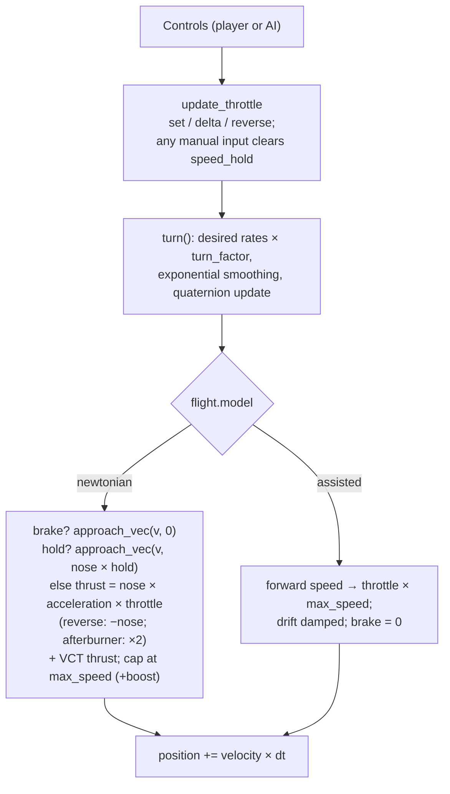
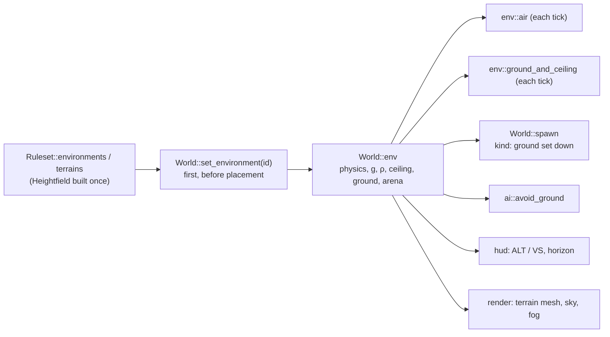
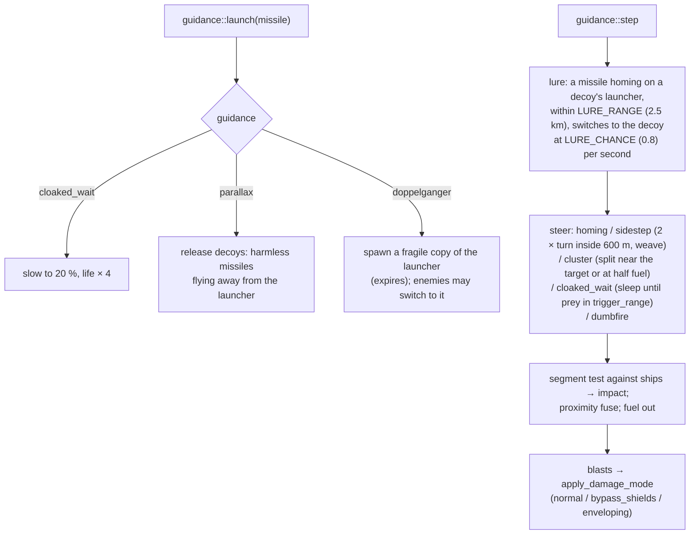
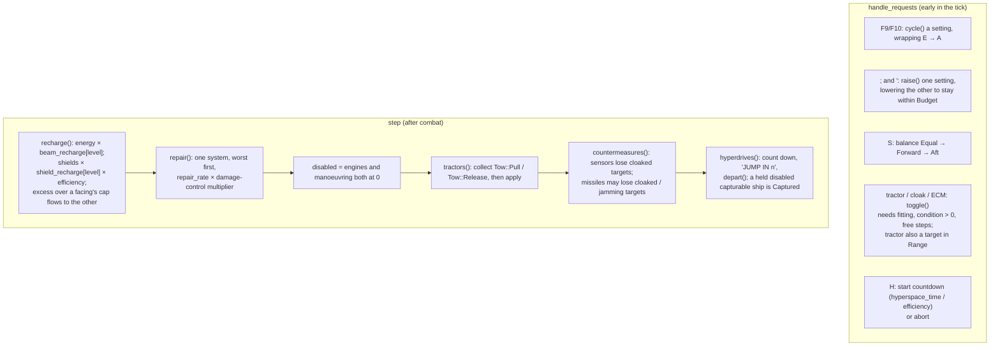
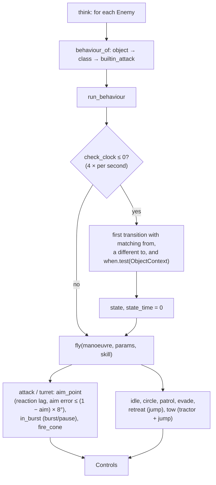

# Simulation

`src/sim/`: the battle as plain data, advanced by exactly `TICK` = 1/60 s per `World::step`.
No rendering, no input devices, no clock reads, no macroquad — only `glam` maths and the
`Ruleset`. That makes it deterministic and unit-testable (80+ tests). Plan: Stage 1 (flight,
weapons, basic AI); Stage 2 (in progress) adds ship systems, power, damage to systems, special
equipment, hyperspace and wingman orders (`sim::systems`), and will deepen the AI. Stage 3 adds
battle hazards (`sim::hazards`, app 0.5.1) and the battle environment — atmosphere, ground and
ceiling (`sim::env`, app 0.6.0; ground installations 0.6.1).

## Architecture Overview

### One tick: `World::step()`

```mermaid
flowchart TD
    A["events.clear()"] --> B["ai::think<br/>AI pilots write Controls (two-phase)"]
    B --> B2["systems::handle_requests<br/>power settings, shield balance,<br/>tractor / cloak / ECM switches, hyperdrive"]
    B2 --> C["match speed resolved<br/>(sets Ship::speed_hold to the target's speed)"]
    C --> AIR["env::air for every live ship<br/>drag, gravity, lift (atmosphere only)"]
    AIR --> D["flight::step for every live ship<br/>throttle, turn rates, rotation, thrust/velocity, position<br/>(scaled by engine / manoeuvring / VCT efficiency)"]
    D --> D2["flight::hold_in_arena<br/>halt ships at the arena radius ('ARENA BOUNDARY')<br/>(env.arena overrides flight.arena_radius)"]
    D2 --> GC["env::ground_and_ceiling<br/>landing / crash on the terrain, ceiling exit"]
    GC --> HZ["hazards::step<br/>black-hole pull, swallowed craft destroyed"]
    HZ --> E["combat::step<br/>lock → beams → missile controls → link mode<br/>→ point_defence → move_bolts → guidance::step"]
    E --> F["combat::ship_collisions"]
    F --> S["systems::step<br/>recharge → repair → disabled check<br/>→ tractors → countermeasures → hyperdrives"]
    S --> WR["destroyed modules with a destroyed look → wrecks"]
    WR --> MO["update_modules<br/>modules follow hubs, cascade, shield generators"]
    MO --> EX["expiring ships (doppelgangers) counted down"]
    EX --> G["clear one-shot controls and requests,<br/>since_hit += TICK, time += TICK"]
```

In short: **AI → requests → air → flight → ground and ceiling → hazards → combat (incl. missile
guidance) → collisions → systems → modules**. The atmosphere's forces act before `flight::step`
so the flight model integrates them with thrust in the same tick; the ground is checked after the
move, so a craft never ends a tick below it. Requests run before
flight so a switch pressed this tick (a cloak, a power change) already counts; systems run last
so that damage done this tick can knock a system out before repair and recharge look at it.

The player and the AI produce the **same** `Controls` struct and fly the same flight model.

### Flight model (`sim::flight`)

Two models, chosen per ruleset with `flight.model`:

**`newtonian` (default).** Space has no drag.

- **Throttle is thrust**: `acceleration × throttle` along the nose. At zero throttle the ship
  coasts at its current velocity — it does not slow down.
- **Reverse** (`Z`) points the thrust backwards along the nose.
- **Brake** (hold `B`, gamepad B) retro-thrusts *against the velocity* at full
  `acceleration` and stops exactly at zero (`approach_vec`).
- **Speed limit**: `max_speed`, or `max_speed + boost` while the afterburner burns (double
  thrust, `cost` energy per second). Thrust may not push past the cap; excess speed (after the
  burner stops) bleeds off at `acceleration` per second.
- **Turning** changes the nose, not the velocity: a hard turn at speed makes the ship slide.
  VCT hulls add sideways/vertical thrust at `0.5 × acceleration` (`VCT_THRUST_FRACTION`).
- **Flight computer (speed hold)**: `Controls::hold_speed` (set every tick by AI pilots) or
  `Ship::speed_hold` (set by match speed, `M`) drives the velocity towards
  `nose × hold` within the hull's acceleration — holding a forward speed *and* cancelling
  drift. Any manual throttle, reverse or brake input clears `speed_hold`. AI pilots therefore
  obey exactly the same thrust limits as the player.

**`assisted`** (the previous arcade model, kept for mods that want it): throttle sets a target
forward speed (`throttle × max_speed`, reverse −½), the ship accelerates or decelerates towards
it, sideways drift is damped, VCT slides at 25 % of `max_speed` (`VCT_SPEED_FRACTION`), brake
targets zero.

**Both models**: pitch and yaw rates scale with
`turn_factor(speed, lock_speed) = clamp(1 − |speed| / lock_speed, 0, 1)`; roll is not reduced.
Angular velocity approaches the desired value with `blend = 1 − exp(−dt / τ)`,
`τ = damping_time(angular_damp) = 0.05 + 0.06 × angular_damp`. Orientation is a quaternion
(`rotation × from_scaled_axis(ω·dt)`); body axes x = pitch (+ nose up), −y = yaw right,
−z = roll right. Static objects (`kind: station`, mines) never translate but may spin.
Recharge of energy and shields moved to `systems::recharge` in Stage 2 (it now depends on the
power settings).

**System efficiencies.** Thrust and the afterburner scale with `efficiency(Engines)` (no
afterburner at 0), turn rates with `efficiency(Manoeuvring)`, VCT slides with
`efficiency(Vct)`. A craft whose list lacks engines, manoeuvring or sensors is treated as
having working ones that are not modelled; any other missing system does not work.

**Arena edge.** After flight, `hold_in_arena(ship, arena_radius)` places any ship beyond the
radius back on the boundary sphere and removes its outward velocity (tangential motion is
kept), emitting `Message "ARENA BOUNDARY"` when it first arrives. `arena_radius: 0` means no
limit. Default 60 000 m.

### Combat (`sim::combat`)

- **Lock**: the target inside the cone `flight.lock_angle` and within
  `missile speed × duration` for the selected missile's `lock_time` seconds → `locked`,
  `SimEvent::LockAcquired`. Leaving the cone resets it. Lock builds at
  `efficiency(Sensors)` speed, halved again while the target's ECM is on.
- **Tractor and cloak**: while the tractor beam is on, beams do not fire ("BEAMS OFF-LINE:
  TRACTOR BEAM ON"); firing beams or a missile drops an active cloak ("CLOAK DROPPED").
- **Beams**: `LinkMode::Linked` fires mounts in pairs, `Full` all at once, `Unlinked` one at a
  time; each mount has a cooldown of `1 / rate_of_fire`; energy is checked for the whole group
  (`NoEnergy` event and a 0.5 s hold if short). Life = range / speed.
- **Bolt launch (app 0.3.1, R-CMB-021).** A bolt starts at its muzzle, `pos + r` with
  `r = rotation × mount_offset`, and leaves with exactly the muzzle's velocity plus its own
  muzzle speed along the gun: `velocity = ship.velocity + ω × r + dir × beam.speed`. `ω` is the
  ship's turn rate in world axes; `Ship::angular_velocity` is kept in body axes, so
  `ω = rotation × angular_velocity`. A gun on the right wing of a ship yawing left is swinging
  forwards, and its shot keeps that speed. After launch the bolt flies straight, whatever the
  ship does (`flight.bolt_frame: world`, the default).
- **`bolt_frame: ship`** (the arcade option): the bolt also stores its offset and velocity in
  the owner's body axes (`local_offset`, `local_velocity`, made with `rotation.conjugate()`)
  and a `carry` time from `flight.bolt_carry`. While `carry > 0` and the owner lives,
  `move_bolts` places it from the owner each tick (`owner.position + owner.rotation ×
  local_offset`), so it turns with the nose; its `velocity` is set to the move it makes, so the
  hit test sweeps the real path. When the carry runs out it keeps that last velocity and flies
  straight.
- **Body velocity.** `Ship::body_velocity()` is the velocity in the ship's own axes,
  `rotation.conjugate() × velocity`, with z negated so forward reads positive: `x` sideways
  drift (+ right), `y` vertical drift (+ up), `z` forward speed. The HUD's drift readout shows
  it ([Cockpit and HUD](hud.md)).
- **Bolts and missiles** test the *segment* travelled this tick against every other ship's
  `collision::Shape` (sphere broad phase, triangle mesh for stations) so fast shots cannot
  tunnel.
- **Missiles** are launched and flown by `sim::guidance` (below); impact damage on a hit; the
  proximity fuse detonates on a near *miss* (inside `proximity_radius` and moving away);
  expired missiles pop harmlessly.
- **Damage** (`apply_damage`): fore or aft shield (by which side was hit) → armour → hull;
  hull ≤ 0 → `alive = false`, `Destroyed`, and every ship targeting or towing it lets go
  (`forget_ship`). Damage that gets past the armour without destroying the ship also strikes a
  system (`systems::damage_system`). A shield facing reaching zero says "FORE/AFT SHIELD DOWN".
- **Collisions**: fighter–fighter spheres (60 % of radius) push apart and swap half their
  velocities; a fighter sweeping into a station mesh is backed out and bounced. Damage =
  relative speed × 0.1.

### Point defence (Stage 2)

`combat::point_defence` runs before the missiles move: each ship with a `PointDefence`
(`range`, `rate`, `chance`, `energy`) whose gun is cooled down and that has the energy fires at
the **nearest hostile missile** within `range` (decoys included); `chance` is rolled on the
world's seeded generator; a hit removes the missile. Each shot costs `energy`, sets
`Ship::pd_cooldown = 1 / rate` and emits `SimEvent::PointDefence { ship, from, to, hit }` (tracer and
sound).

### Probes and radar (Stage 2)

`systems::on_radar(world, observer, other)` decides what a radar shows: `detectable` (a cloak
hides a ship of another faction beyond its range), then within `flight.radar_range` — **halved
while `systems::jammed(observer)`**, i.e. inside the `jamming` radius of a live hostile probe —
or within the `sensors` range of any live probe of the observer's faction. Objects that never
move always show. Missile lock also builds at half speed while jammed. Probes are ordinary
objects with a `ProbeDef { sensors, jamming }`.

Since app 0.5.1 an **ion storm** multiplies the radar range by its `sensors` factor (after the
jamming halving) and halves missile-lock speed again. **Scenery** (`Ship::scenery`, set on
asteroids placed by a hazard) is the exception to "objects that never move always show": it shows
only within range, so an asteroid field does not flood the scopes.

### Hazards (`sim::hazards`, app 0.5.1)

The definitions come from a mission's or scenario's `hazards:` (`content::hazards::Hazards`:
`Scatter` for asteroids and mines, `BlackHole`, the ion storm's factor; [modder's
guide](../../modding/missions.md#hazards)). `World::apply_hazards` runs **last** when a battle is
built — after every scenario object or mission role — and does two things:

- **Asteroid fields and minefields are ordinary objects**, spawned once by `World::scatter`, so
  collisions, shots, damage and destruction need no new code. Points are uniform in the ball: a
  random direction times `radius × u^(1/3)` (volume grows with r³, so a plain `u` would crowd the
  centre). A point within `CLEARANCE` = 300 m of a live craft is rejected; at most 20 × `count` tries
  are made, so a crowded sphere places fewer rather than looping. Each gets a random orientation
  and an angular velocity up to `spin` °/s. Everything uses the world's seeded `random()`, so a
  battle is the same every time.
- **Field hazards** (the black hole and the ion storm) are stored as `ActiveHazards` on
  `World::hazards` and act every tick. `hazards::step` adds `black_hole_accel` to every live,
  non-static craft and to every missile, then destroys any craft inside the hole's `radius`
  (shields and armour zeroed, then `combat::apply_damage` with an overwhelming amount, so the
  usual `Destroyed` event, explosion and mission bookkeeping follow). The ion storm acts through
  `systems::on_radar` and the lock code (above).

`black_hole_accel(b, p)` = `pull × (1000 / d)²` towards the hole, capped at `PULL_CAP` = 20 ×
`pull` — without the cap the 1/d² term would fling a craft very near the centre across the map
in one tick. The flight screen announces an ion storm as the battle starts (`ION STORM: SENSORS
AT n%`), and the renderer draws the hole ([Rendering](rendering.md#black-hole)).

### The battle environment (`sim::env`, app 0.6.0)

`World::env: Env` holds the environment the battle runs in: `id`, `physics` (`Space` or
`Atmosphere`), `gravity`, `air_density`, `ceiling`, `ground` (an `Arc<Heightfield>`, shared with
the rules rather than copied per battle) and `arena`. `World::set_environment(id)` copies it from
`Ruleset::environments` and finds the terrain's heightfield; it runs **first**, right after
`World::new` in `World::from_scenario` and before the roles in `MissionRun::start`, so that ground
installations placed afterwards can be set on the ground. Without an `environment:` the default
`Env` is open space and nothing below applies.

| Step | Function | Rule |
|---|---|---|
| Drag | `env::air` | `v −= v · min(k·ρ·|v|·dt, 1)`, `k = acceleration / atmosphere_max_speed²`: full thrust balances drag at `atmosphere_max_speed` when ρ = 1. The `min` keeps one tick from reversing the velocity. |
| Gravity | `env::air` | `v.y −= g·dt`, unless the class has `hover`. |
| Lift | `env::air` | `v += up · min(g·ρ·(forward/lift)², 2g) · dt` for classes with `lift` > 0; `forward` is the velocity along the nose (never negative). |
| Ground | `env::ground_and_ceiling` | Below `ground_height + clearance` (the shape radius × `BODY_RADIUS_FRACTION`) the craft is put back on the ground. Speed into the ground (along the terrain's normal) ≤ `LANDING_SPEED` = 25 m/s with `up · n > 0.7` lands (the into-ground motion removed, ×0.97 slide friction); otherwise a crash: a bounce (`+n × into × 1.3`, then ×0.5), a `Collision` event and `apply_damage(into² × 0.5)`. |
| Ceiling | `env::ground_and_ceiling` | Above `ceiling`: `alive = false`, `departed = true`, `Departed` and the message `LEFT THE ATMOSPHERE` — the same path as a hyperspace jump, so missions count it as leaving. |

Static classes (`max_speed` 0) feel none of it. A craft in Simple physics feels the forces, but
`flight::step` then sets its velocity along the nose as usual. **Ground installations**
(`ShipKind::Ground`, app 0.6.1) are static (`is_static`); `World::spawn` replaces the y of such an
object with `ground_height + 0.25 × shape radius` when the battle has a ground.

### Missile guidance (`sim::guidance`, Stage 2)

`combat` fires a missile through `guidance::launch`, which applies the class's launch-time
behaviour; `guidance::step` (called by `combat::step` every tick) steers, moves and detonates
every missile, collecting blasts first and applying them after the loop (the same two-phase
pattern as the AI).

`area_blast(world, at, radius, damage, except)` damages every ship in `radius`, falling off
linearly, `enveloping`; mines use it (`systems::handle_requests` on a `detonate` request:
radius = 4 × the warhead's `proximity_radius`, at least 100 m). The modder's view:
[Missiles and mines](../../modding/weapons.md).

### Station modules (Stage 2)

`World::spawn_modules(hub, depth)` (called by `from_scenario` for every placed object) spawns
each `modules` entry of the hub's class at its attachment point — an OBJ `slot_<name>` or an
original manipulator index, looked up in the class's `collision::Shape::mounts` — turned so the
module's −Z follows the slot's facing, with the hub's faction and `Ship::mount = (hub, offset,
rotation)`; modules with a behaviour fly it (`turret`), the rest are idle; up to five levels.
`update_modules` (every tick, after systems) puts each module back on its hub, destroys the
modules of a destroyed hub, removes wrecks whose hub is gone, and zeroes a station's shields
while none of its `shield_generator` modules survives ("STATION SHIELDS DOWN"). A destroyed
module whose model set has a `destroyed` state becomes a `Wreck { class, hub, offset, rotation }`
in `World::wrecks`, drawn by the renderer on its hub. Modder's view:
[Stations and modules](../../modding/stations.md).

### Systems (`sim::systems`, Stage 2)

Everything a pilot manages *inside* the ship. Data comes from the `systems`, `power` and
`damage` sections ([Rulesets](../../modding/rulesets.md)); each ship has `power: Power`,
`systems: Vec<SystemState>` (one per fitted system), `repairing`, `towing`, `hyperspace`,
`disabled` and `departed`.

**Conditions.** `SystemState::condition()` is `Ok` above half its hit points (efficiency 1),
`Damaged` at half or below (0.5), `Inoperative` once its hit points reach 0 (0) and
`Destroyed` below `−destroy_below × max` (0, for the battle). `SystemState::set_hp` keeps an
`offline` flag: a knocked-out system stays `Inoperative` until repaired back to
`ONLINE_AT` = 25 % of its hit points, so the first moments of repair do not bring a wreck
straight back. A knocked-out switchable system switches off; a knocked-out hyperdrive aborts a
countdown.

**Damage.** `damage_system` strikes one random non-destroyed system with the damage that got
past the armour × `system_share`, and emits `SystemChanged` when the condition changes.

**Repair.** `repair` keeps working on the current job; otherwise it takes the worst-off system
(first in fitting order on a tie). Speed = class `repair_rate` × (1 + (`repair_rate` of the damage
control computer − 1) × its efficiency); the computer does not speed up its own repair.

**Power.** `raise` and `cycle` work on a plain `Power` value and the `PowerRules`, not on the
world, so they are tested exhaustively. `shield_caps(shields, balance, shift)` gives the fore
and aft capacities `shields × (1 ± shift)`.

**Tractor.** The beam holds its target on its current bearing at a distance between 1.2 × the
two radii and 0.6 × `range`, steering the target's velocity towards the captor's by at most
`strength × efficiency` m/s². The hold is lost beyond 1.5 × `range`, if the target goes, or if
the tractor is knocked out ("TRACTOR BEAM RELEASED"). Because a pull changes *another* ship,
decisions are collected as `Tow` values first and applied afterwards (the two-phase pattern of
`ai::think`).

**Cloak and ECM.** `detectable(world, observer, other)` hides a cloaked ship of another faction
beyond its cloak's `range`; targeting (`targeting::cycle`, nearest enemy) only offers detectable
ships and a sensor that loses its target says "TARGET LOST". Each second, a missile homing on a
ship loses its target with chance `strength / 100 × efficiency` per active cloak, plus per active
ECM within `range` of the missile.

**Hyperspace.** The countdown announces the last five seconds; at zero `depart` removes the
ship (`alive = false`, `departed = true`, `Departed` event). If its tractor holds a disabled,
`capturable` ship, that ship departs too and `Captured { captor, prize }` is emitted.

### AI (`sim::ai`)

`think` reads the whole world into a list of decisions, then writes them (two-phase update).
Each AI ship has a **role** from its scenario (`ai::Behaviour`): `Idle`, `Target` (slow circle,
never fires), `Wingman` (formation and orders, below) or `Enemy`. A **disabled** AI ship does
nothing but drift.

Enemies fly a **behaviour** from the rules (`content::behaviour`, [modder's
guide](../../modding/behaviours.md)): the scenario object's `behaviour`, else the class's, else the
engine's `builtin_attack`.

- **Aim.** Every `skill.reaction` seconds (`aim_point`) the pilot takes a fresh look at its
  target (position and velocity) and draws a new aim error, uniform over a disc of radius
  `(1 − aim) × MAX_AIM_ERROR` (8°). Between looks it assumes the target flies straight on from
  the last sighting. The lead point uses the target's velocity relative to the shooter
  (bolts carry the shooter's velocity).
- **Fire discipline.** `in_burst` alternates `burst` seconds of firing with `pause` seconds of
  holding; guns fire only inside `fire_cone` and inside `range` (and 95 % of the first beam's
  reach). Missiles every `missiles` seconds when locked (0 = never).
- **Systems use.** At each transition check, `systems:` conditions of the behaviour are evaluated
  (`ObjectContext`) and turned into ordinary `Requests`: `cloak` / `ecm` switched to match their
  condition, `power_to_shields` while `shields_first` holds and shields are below the top level,
  else `power_to_beams` while `beams_first` holds. The requests go through
  `systems::handle_requests` like the player's keys, and reach the ship once (they are cleared
  after the tick).
- **Missiles (Stage 3).** An attacker launches only within 2.5 × its `attack` range (at least
  2 km); its first launch comes 3 s plus a random part of one interval into the attack, and each
  interval varies by ±25 %. Every AI pilot's random sequence is seeded per ship in `World::spawn`
  (from its slot and the world's generator), so pilots that start together do not fire together.
- **Target choice.** `attack` and `turret` keep the current target while it lives and stays
  visible; otherwise they pick `targeting::preferred_hostile` with the behaviour's `prefer`
  weights (a matching hostile counts as `distance / weight`; several matches multiply), within
  8 km (`attack`) or `range` (`turret`).
- **Mines.** The `mine` manoeuvre sets `Requests::detonate` when a hostile is within `range`.
- **Turrets.** `Controls::aim` (a world direction) lets a ship with `turret_arc > 0` fire its
  beams along the aim instead of the nose, if the aim is within the arc (`combat::fire_beams`);
  the `turret` manoeuvre stays put and sets it.
- **Tow.** The `tow` manoeuvre finds the nearest disabled, capturable hostile
  (`nearest_prize`), closes in, requests the tractor within 90 % of its range and then the
  hyperdrive.
- Each pilot has its own seeded random stream (`AiState::rng`), so `random(p)` and aim errors
  are deterministic.
- **Escapes (Stage 3).** Whatever its behaviour wants, every AI pilot except `Idle` objects first
  checks two overrides, in this order: `escape_black_hole` — inside 4 × the hole's radius, or
  inside 10 × while its velocity points towards the hole, it steers directly away, holds its top
  speed and burns the afterburner while energy is above 20 %; then `avoid_ground` — below 150 m
  above the terrain, or when `altitude + 3 s × vertical speed` is below 100 m, it steers for a
  point 800 m ahead and 600 m up and holds `1.4 × lift` (clamped between half and all of its top
  speed), a speed its wings can climb at. Either returns `None` when clear, and the behaviour's
  own controls are used. Since the black-hole escape, no AI craft falls in during the soaks.
- **Collision avoidance (app 0.6.7, from the user's playtest).** Third in the override chain,
  `avoid_collision(world, id)` runs for **every moving AI pilot** (static objects and turrets
  never avoid; they cannot move out of the way and must keep aiming). For each other object it
  takes the relative position `r` and velocity `v` and finds the time of **closest approach**
  `t* = −(r·v)/|v|²`; objects that cannot reach it within the horizon are skipped early. The
  horizon is `AVOID_HORIZON` = 2.5 s, but **1 s** for static objects and for the pilot's own
  target — those are attacked head-on, and a firing pass must not be broken off early. Danger is
  a miss `|r + v·t*|` under 1.5 × the combined radii + 10 m (static objects: the combined radii
  + 30 m, so attack runs on a station still get close), or something already inside twice the
  combined radii and closing. Against the soonest danger the pilot steers away from where the
  other will be at closest approach (a dead-on course breaks to its own upper right), mostly
  sideways, and eases off to the other's speed if it is ahead. A **leader ignores its own
  wingmen** (they keep clear of it; swerving from them as they form up, it would never fly
  straight). The fire buttons are kept, so avoiding does not stop a pilot shooting. Before, only
  wingmen avoided, and only when something was already inside twice the combined radii; the user
  saw wingmen and enemies ram. Test: `collision_avoidance_predicts_the_closest_approach`.
- **Formations (MD1, app 0.6.6).** A wingman's `AiState::offset` is its slot in the leader's
  frame. `MissionRun` gives wingmen successive slots of their role's formation
  (`Ruleset::formation(role.formation)`, else `flight.formation`; `FormationDef::slot(k)`),
  counting the wingmen of every role already spawned. `ai::next_formation(world, leader)` (the
  Shift+O order) takes the formation after `World::wing_formation` in `rules.formations`
  (wrapping), gives each of the leader's living wingmen the next slot in ship order and orders
  them to form up; it returns the formation's id, or `None` with no formations or no wingmen.
  Slots are still pushed out to `flight.formation_gap` by `formation_slot`.

Wingmen follow `WingOrder`s from their leader (`order_wingmen`); they fend for themselves if
the leader dies. When they engage they fly `attack` with the parameters and skill of their
class's behaviour (its first `attack` state):

| Order | Behaviour |
|---|---|
| `Formation` (default; "ignore my target") | Hold the formation slot. |
| `AttackMyTarget` | Attack the leader's current target if it is hostile. |
| `FireAtWill` | Engage the nearest hostile near the leader. |
| `Evasive` | Break formation and weave near the leader for `EVASIVE_TIME` = 10 s, then form up. |
| `Retreat` | Run from the nearest hostile at full speed (afterburner while energy lasts) and start the hyperdrive. |

`wing_status(world, leader)` returns one line per wingman: name, hull and shield percentages,
current order, and `DISABLED` if so.

## Key Symbols

| Symbol | What it is |
|---|---|
| `World` | `rules: Arc<Ruleset>`, `shapes: Arc<Vec<Shape>>`, `ships`, `bolts`, `missiles`, `events`, `time`, deterministic xorshift `random()`. |
| `ShipId` | `{ index, generation }` — a generational handle. A destroyed ship's slot can be reused; the generation changes, so old ids resolve to `None`. |
| `Ship` | Class, faction, name, position, rotation (`Quat`), velocity, angular velocity, throttle, reverse, afterburning, `braking`, `speed_hold`, hull/armor/shields/energy, `controls`, `pilot`, `target`, link mode, beam cooldowns, missile racks, `lock`, `since_hit`, `alive`; Stage 2: `power`, `systems`, `repairing`, `towing`, `hyperspace`, `disabled`, `departed`. Helpers `system(kind)`, `efficiency(kind)`, `is_on(kind)`, `cloaked()`. |
| `Controls` | Pilot input for one tick: axes, slide, throttle set/delta, reverse toggle, match speed, afterburner, `brake` (held), `hold_speed` (flight computer target, m/s), `aim` (turret direction), fire, link/missile cycling, `requests`. `carry_unconsumed` keeps unconsumed one-shot presses across frames that run no tick. |
| `Requests` | Edge-triggered power and equipment presses: `beam_charge`, `shield_charge`, `power_to_shields`, `power_to_beams`, `shield_balance`, `tractor`, `cloak`, `ecm`, `hyperspace`, `detonate` (mines); `merge`. |
| `Wreck`, `World::wrecks` | A destroyed module left on its hub. |
| `Ship::mount`, `Ship::expires` | A module's hub and place on it; seconds left for a short-lived ship (a doppelganger). |
| `guidance::LURE_RANGE`, `LURE_CHANCE` | 2 500 m, 0.8 per second. |
| `content::rules::Guidance`, `DamageMode` | The missile's steering kind and warhead mode. |
| `Power`, `ShieldBalance` | Beam and shield level indices (0 = A) and `Equal` / `Forward` / `Aft`. |
| `SystemState`, `Condition` | One fitted system: `id`, `kind`, `hp`, `max`, `destroyed`, `offline`, `on`; `set_hp`, `condition()`, `ONLINE_AT`. `Condition::{Ok, Damaged, Inoperative, Destroyed}` with `efficiency()` 1 / 0.5 / 0 / 0. |
| `systems::Setting`, `systems::Tow` | Beam or shield (for `raise` / `cycle`); a tractor decision (`Pull(target, velocity, max accel)` or `Release(captor)`). |
| `ai::WingOrder`, `ai::EVASIVE_TIME` | Wingman orders (above). |
| `ai::AiState` | Per-ship AI memory: role (`behaviour`), behaviour override `def`, leader, offset, order and order time; behaviour `state`, `state_time`, `check_clock`; `break_timer`, `missile_timer`, `burst_clock`; `reaction_clock`, `seen` (last sighting), `aim_error`; `home`; `rng`. |
| `ai::ObjectContext` | Answers condition queries about one ship ([Conditions](script.md)). |
| `ai::CHECKS_PER_SECOND`, `MAX_AIM_ERROR`, `ENGAGE_RADIUS`, `HUNT_RADIUS` | 4, 8°, 3 km (wingmen engage near the leader), 8 km (enemies look for targets). |
| `FlightModel` | `Newtonian` or `Assisted` (`flight.model`), in `FlightRules` with `arena_radius`. |
| `Pilot` | `External` (the player) or `Ai(AiState)`. |
| `SimEvent` | `BeamFired`, `MissileLaunched`, `Hit`, `Destroyed`, `MissileExploded { position, effect }`, `LockAcquired`, `Collision`, `Message`, `NoEnergy`; Stage 2: `SystemChanged { ship, system, condition, repaired }`, `Disabled { ship }`, `Departed { ship, position }`, `Captured { captor, prize }`, `Switched { ship, kind, on }`, `PointDefence { ship, from, to, hit }`. |
| `Bolt`, `Missile`, `Lock`, `LinkMode` | Projectiles and weapon state. `Bolt::carry`, `local_offset`, `local_velocity`: the `bolt_frame: ship` carry (above). |
| `content::rules::BoltFrame`, `FlightRules::bolt_carry` | `World` (default) or `Ship`; the carry time (0.3 s). |
| `collision::Shape`, `TriMesh` | Bounding radius plus optional triangle mesh. |
| `TICK` | `1.0 / 60.0`. |
| `hazards::ActiveHazards`, `World::hazards` | The field hazards acting every tick: `black_hole: Option<BlackHole>`, `ion_storm: Option<f32>` (the radar factor). |
| `hazards::PULL_CAP`, `CLEARANCE` | 20 (× `pull`), 300 m. |
| `Ship::scenery` | Shown on radar only within range although it never moves (hazard asteroids). |
| `env::Env`, `World::env` | The battle environment: `id`, `physics`, `gravity`, `air_density`, `ceiling`, `ground: Option<Arc<Heightfield>>`, `arena`. |
| `env::LANDING_SPEED` | 25 m/s: the hardest touchdown that is a landing. |
| `content::environment::Heightfield` | `n`, `size`, row-major `heights`; `height_at` (bilinear), `normal_at`, `coord`, `generate`, `from_image`, `scaled`. |
| `content::rules::ShipKind::Ground` | A ground installation: static, set down on the terrain. |

## API Reference

- `World::new(rules, shapes, seed)`, `World::from_scenario(&Scenario, rules, shapes, player_class) -> Result<(World, ShipId), String>`.
- `world.spawn(class, faction, name, position, rotation, pilot) -> ShipId`, `get`, `get_mut`,
  `id_of(index)`, `live_ids()`, `step()`.
- `flight::step(&mut Ship, &ShipClass, &FlightRules, dt)`, `turn_factor`, `damping_time`,
  `approach`, `approach_vec(v, target, max_step)`, `update_throttle`,
  `hold_in_arena(&mut Ship, radius) -> bool`; constants `VCT_THRUST_FRACTION`,
  `VCT_SPEED_FRACTION`.
- `combat::step(&mut World, dt)`, `apply_damage(world, id, amount, at)`, `ship_collisions`,
  `rotate_towards`, `mount_offset`.
- `combat::forget_ship(world, id)` — every ship targeting or towing `id` lets go.
- `guidance::launch(&mut World, Missile)`, `guidance::step(&mut World, dt, &Ruleset)`,
  `guidance::area_blast(world, at, radius, damage, except)`.
- `world.spawn_placement(&Placement, player) -> Result<ShipId, String>` (one scenario object or
  mission role member: class, faction, pilot, modules, starting damage and speed);
  `world.same_slot(id)`.
- `world.spawn_modules(hub, depth) -> Result<(), String>` (an unknown slot is an error).
- `targeting::preferred_hostile(world, me, &[(Selector, f32)]) -> Option<(ShipId, distance)>` —
  the nearest hostile with distances divided by matching preference weights.
- `systems::handle_requests(&mut World)`, `systems::step(&mut World, dt)`,
  `raise(&mut Power, Setting, &PowerRules, switched) -> bool`, `cycle(...) -> bool`,
  `shield_caps(shields, balance, shift) -> (f32, f32)`, `power_message(&Power, &PowerRules)`,
  `switched_power(&Ship, &Ruleset)`, `power_used(&Ship, &Ruleset)`,
  `recharge(&mut Ship, &ShipClass, &PowerRules, dt)`,
  `repair(&mut Ship, &ShipClass, &Ruleset, dt) -> Option<(index, before, after)>`,
  `damage_system(world, id, amount)`, `detectable(world, observer, other) -> bool`,
  `on_radar(world, observer, other) -> bool`, `jammed(world, ship) -> bool`.
- `ai::think`, `ai::order_wingmen(world, leader, WingOrder) -> usize`,
  `ai::wing_status(world, leader) -> Vec<String>`, `steer_towards`, `lead_point`,
  `ai::nearest_prize(world, me, within) -> Option<ShipId>`.
- `targeting::cycle`, `nearest_hostile`, `in_sights(world, me, max_angle_deg)`, `off_nose_angle`.
- `collision::segment_sphere`, `segment_triangle` (Möller–Trumbore), `segment_shape`.
- `ship.body_velocity() -> Vec3` — velocity in body axes (x right, y up, z forward).
- `sim::euler(Vec3 degrees)` — yaw/pitch/roll to a quaternion (positive yaw turns left).
- `world.apply_hazards(&Hazards) -> Result<(), String>` (an unknown class or faction is an error),
  `hazards::black_hole_accel(&BlackHole, p) -> Vec3`, `hazards::step(&mut World, dt)`.
- `world.set_environment(id) -> Result<(), String>`, `world.ground_height(x, z) -> Option<f32>`,
  `env::air(&mut Ship, &ShipClass, &Env, dt)`, `env::ground_and_ceiling(&mut World)`.
- `ai::escape_black_hole(world, &Ship) -> Option<Controls>`, `ai::avoid_ground(world, &Ship) -> Option<Controls>`, `ai::avoid_collision(world, ShipId) -> Option<Controls>` (app 0.6.7), `ai::AVOID_HORIZON`.
- `ai::next_formation(&mut World, leader) -> Option<String>`; `World::wing_formation` (app 0.6.6).

## Debugging

- To compare the two flight models, set `flight: {model: assisted}` in a mod's rules (or a
  small addon to the `default` campaign) and fly the same scenario; the HUD status line shows `BRAKE` while braking and
  `HOLD n` while a speed hold is active.

- Because `step` is deterministic, a bug can be reproduced as a unit test: build a world with
  `sim::test_support::world()` (a tiny in-memory ruleset), place ships, set `controls`, call
  `step` in a loop, assert. Most tests in `sim/` are written exactly this way.
- `--view chase` or `--view chase-manual` shows the player's own ship to check orientation and
  engine glow; the MFD Status page shows shields, armour, hull and energy live, and the
  Systems page each system's condition.
- The `systems-trial` scenario (both campaigns) exercises power, tractor tow and capture,
  cloak and hyperspace. Scenario objects with `destroyed_systems = engines, manoeuvring` start
  disabled, and `hull = 0.3` starts them damaged, so a system state can be set up without
  fighting for it.
- Every power or equipment refusal is a pilot message ("INSUFFICIENT POWER FOR …",
  "NO TARGET IN TRACTOR RANGE", "… INOPERATIVE"); the message line and `L` (repeat) show why a
  switch did nothing.
- An enemy that "does nothing": check its role (`ai: enemy` in the scenario) and that its
  behaviour's states can act (an `attack` state with a `range` its beams reach). `--check`
  reports behaviours whose conditions do not parse.
- Balance by numbers: `--soak <scenario> --ship <id> --difficulty <level> [--soak-pilot ai|idle]`
  plays the battle without a window and reports how long the player lasted, hits taken and
  enemies destroyed; the default campaign's balance promise is held by a unit test of the
  same runner (`soak`).
- Hazards and environments: the testbed scenarios `hazard-asteroids`, `hazard-black-hole`,
  `hazard-minefield`, `env-orbit`, `env-pocket`, `surface-moon`, `surface-hills`,
  `surface-colony` and `surface-strike` (default) set each up on its own; `--soak <scenario>
  --soak-pilot ai` shows whether craft survive them. A craft "vanishing" in an atmosphere has
  usually climbed through the `ceiling` (the message log says LEFT THE ATMOSPHERE). Physics
  questions make good unit tests: `sim::env`'s tests build an `Env` with a flat ground by hand.
- Missions sit **above** the simulation: `mission::MissionRun::update` runs after each
  `World::step` and spawns through `World::spawn_placement` ([Missions](mission.md)); `sim`
  itself knows nothing about them.
