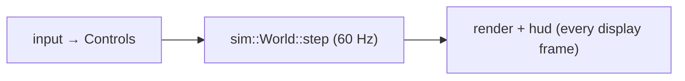

# Architectural design

## Layering

```text
formats → model → content → sim → input/platform → render/hud/audio → app   (+ check, cli)
```

The order is written at the top of `src/lib.rs`.

Each layer depends only on layers to its left. Consequences:

- `formats` is pure functions on bytes: testable with hand-made inputs, reusable by tools.
- `sim` knows nothing about drawing or windows: testable, deterministic, and usable headless
  (for AI duels, replays, a future server).
- Presentation reads the simulation; it never changes it except through `Controls`.

## Data-driven design

The engine contains **no game content**. Ships, weapons, stations, cockpits and scenarios come
from packs. A quick test for a change: *could a modder do this with a pack?* If the answer
requires editing Rust, ask whether a rule key should exist instead. This is what makes the
Interceptor content "just one pack" and a custom campaign possible.

## Separate simulation from rendering



The simulation is the single source of truth. Rendering is a view of it. The player and the AI
both drive ships through the same `Controls`, so the AI obeys the same flight model, and the
simulation reports what happened as `SimEvent`s that effects, sound and the message line
consume — none of which can change the battle.

## Fixed timestep

The simulation advances in constant 1/60 s steps, run as many times as needed per display frame
(see [the loop](../rust/async-loop.md)). Physics and AI then behave the same on a 60 Hz
laptop and a 144 Hz monitor, and a recorded input sequence replays identically.

## One owner per resource

Each long-lived resource has one owner: the `AppContext` owns the `Content` (packs, original
data, rules, scenarios), the `Renderer` (shaders, model and texture caches), the `SoundBank`
and the `Bindings`; a `FlightSession` owns its `World`. Everything else borrows. Shared,
read-only data uses reference counting where several owners really exist: the `World` shares
the `Ruleset` and collision shapes through `Arc`, ships of one class share a `GpuModel` through
`Rc`.

## Errors are values, diagnostics are collected

Loading returns `Result`s and collects warnings; nothing in the content path panics on bad data.
