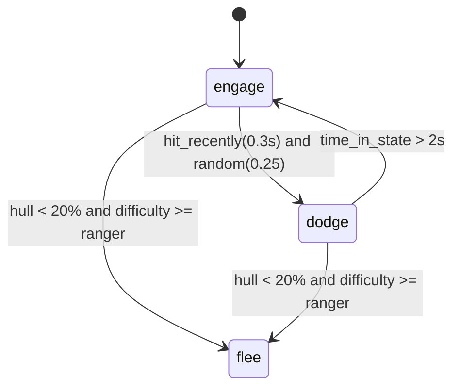

# Behaviours and conditions

How AI ships fly and fight is data: a **behaviour** in a pack's `behaviours:` section, named by
a ship class (`behaviour: saucer_scout`) or by one scenario object (`behaviour: …` on the object).
This is the Tier 1 design of [Format: behaviours and scripting](../design/format-behaviour.md),
implemented in Stage 2 (`src/content/behaviour.rs`, `src/script/`, `src/sim/ai.rs`).

## A behaviour

A behaviour is a small **state machine**. Each state runs one built-in **manoeuvre** with
parameters; **transitions** move between states when a **condition** becomes true; **skill**
sets how well the pilot aims and how fast it reacts.

```yaml
behaviours:
  saucer_raider:
    start: engage
    states:
      engage:
        do: attack
        range: 1.8km
        fire_cone: 3
        burst: {per_level: [0.8s, 1s, 1.2s, 1.5s]}
        pause: {per_level: [1.8s, 1.4s, 1.1s, 0.8s]}
        missiles: {per_level: [0, 14s, 11s, 8s]}      # 0 = no missiles at cadet
      dodge: {do: evade, duration: 2s}
      flee: {do: retreat, jump: true}
    transitions:
      - {from: engage, to: dodge, when: "hit_recently(0.3s) and random(0.25)"}
      - {from: dodge, to: engage, when: "time_in_state > 2s"}
      - {from: "*", to: flee, when: "hull < 20% and difficulty >= ranger"}
    skill:
      aim: {per_level: [0.2, 0.35, 0.5, 0.65]}
      reaction: {per_level: [1.2s, 0.9s, 0.7s, 0.5s]}

ships:
  raider_saucer:
    behaviour: saucer_raider
```



- The ship starts in `start` (default: the first state listed).
- Transitions are checked **4 times a second** (`ai::CHECKS_PER_SECOND`), tried in order; the
  first whose `from` matches the current state (`"*"` matches any) and whose condition holds
  wins. A transition to the state the ship is already in is skipped. `time_in_state` restarts
  at 0 on every change.
- Every condition is parsed and type-checked **when the rules load**: a misspelt query, a
  wrong argument or `hull and 3` is a load error naming the behaviour, not a surprise in
  flight.

All keys with types and defaults: [Mod file reference › behaviours](reference.md#behaviours).

## Manoeuvres

| `do:` | What it does | Parameters it reads |
|---|---|---|
| `idle` | Nothing (parked ships, unarmed stations). | — |
| `circle` | A slow circle at 35 % of top speed; never shoots (practice targets). | — |
| `patrol` | Circles its spawn point. | `range` (radius), `speed` |
| `attack` | Pursues the target (its current one, else the nearest visible hostile within 8 km) with lead and aim error; fires in bursts inside `fire_cone` and `range` (and 95 % of its first beam's reach); launches a missile every `missiles` seconds when locked; breaks off for 2 s when about to ram; VCT hulls strafe when the target faces them. Without a target it cruises at half speed. | `range`, `fire_cone`, `burst`, `pause`, `missiles`, `speed` |
| `evade` | Weaves unpredictably at top speed (VCT hulls also slide). Leave it with a transition on `time_in_state`. | `duration` |
| `retreat` | Runs from the nearest hostile at top speed, afterburning while energy lasts. | `jump: true` also starts the hyperdrive |
| `turret` | Stays put; beams that can swivel (`turret_arc` on the ship class) track hostiles within `range` (and 95 % of the first beam's reach) and fire in bursts. | `range`, `burst`, `pause` |
| `mine` | Waits; when a hostile is within `range`, detonates its first missile rack as an area blast and is gone ([Missiles and mines](weapons.md#mines)). | `range` (trigger distance) |
| `tow` | Finds the nearest disabled, capturable hostile ship, closes in, tractors it and jumps out with it (tugs; needs a tractor beam fitted). | `range` (search radius, at least 5 km) |

## Using the ship's systems

`systems:` tells the pilot when to use its ship's equipment and power. Each entry is a
condition, checked with the transitions (4 times a second):

```yaml
behaviours:
  saucer_raider:
    systems:
      cloak: target_distance > 2km          # stay cloaked until 2 km from the target
      ecm: missiles_incoming(3km) > 0       # jam when missiles are coming
      shields_first: hull < 50%             # hurt: favour shields
```

| Key | While the condition holds | Otherwise |
|---|---|---|
| `cloak` | The cloak is switched on (if fitted, working and powered). | Switched off. |
| `ecm` | ECM on. | ECM off. |
| `shields_first` | Power moves one step at a time towards shields (`;`), up to the top level. | — |
| `beams_first` | Power moves towards beams (`'`), unless `shields_first` also holds. | — |

The requests are exactly the player's keys, so the same power budget and fitting rules apply
(a ship without a cloak cannot cloak), and firing still drops a cloak. Both campaigns' pilots run
ECM against incoming missiles and favour shields when hurt; the raider saucer and the Shade stay
cloaked until 2 km from their target.

## Target preferences

By default an attacker picks the **nearest** visible hostile (within 8 km for `attack`, `range`
for `turret`). `prefer:` weights that choice: a hostile matching a selector counts as if it were
`weight` times nearer, so `{player: 1.5}` chases the player over a wingman up to 1.5 times
closer. When several selectors match one ship their weights multiply.

```yaml
behaviours:
  saucer_raider:
    prefer: {player: 1.5}          # go for the player
  station_turret:
    prefer: {fighter: 1.5}         # shoot fighters before freighters and stations
  wraith:
    prefer: {freighter: 3, class:lightning: 1.2}
```

| Selector | Matches |
|---|---|
| `player` | The ship the player flies. |
| a ship kind | `fighter`, `freighter`, `capital`, `drone`, `station`, `probe`, `mine`, `debris`. |
| `class:<id>` | Ships of that class. |
| `faction:<id>` | Ships of that faction. |

Weights must be above 0 (below 1 makes a match *less* attractive). Preferences only apply when
the AI picks a new target: it keeps attacking its current one while that stays alive and
visible. An unknown selector is a load error ("prefer: 'x' is not player, a ship kind,
class:<id> or faction:<id>").

**Wingmen** keep the role and orders of [Simulation › AI](../architecture/sim.md#ai-simai); when
they engage they fly `attack` with the parameters and skill of their class's behaviour (its
first `attack` state).

**Fallback.** An enemy whose class names no behaviour flies the engine's `builtin_attack`:
`engage` (attack with default parameters) and `evade` for 2.5 s, entered on
`hit_recently(0.3s) and random(0.2)` and left on `time_in_state > 2.5s`, with skill aim 0.5,
reaction 0.7 s. A pack may define its own `builtin_attack` to change it.

## Skill and fire discipline

| Setting | Effect |
|---|---|
| `skill.aim` (0 … 1) | Every `reaction` seconds the pilot picks a fresh aim error of up to **(1 − aim) × 8°** (`ai::MAX_AIM_ERROR`). At 0.2 the error is up to 6.4°, enough to miss a fighter at a kilometre; at 1 the pilot leads perfectly. |
| `skill.reaction` | Seconds between the pilot's looks at its target: between looks the pilot assumes the target flies straight on from its last sighting, so a slow pilot leads where the target *was* going. Lead uses the target's velocity relative to the shooter (bolts carry the shooter's velocity). |
| `burst`, `pause` | Fire for `burst` seconds, then hold for `pause`: pilots do not hose a target continuously. |
| `fire_cone` | Only fire when the aim point is within this angle of the nose. |

Together with per-level values these make difficulty. Both campaigns ship behaviours for
every enemy type in `rules/behaviours.yaml` — the default campaign's saucers, robots, gun
platforms, tugs, hot-rods and Guard pilots; the `interceptor` Wraith, Spectre, Phantasm, Shade,
Harbinger (tow), drones, pirate and corporate pilots and X-COM wingmen (derived from the strategy
guide's descriptions; the original's AI is hard-coded). In the default campaign a cadet-level
saucer aims within about 6–7°, looks every 1.2–1.4 s and fires short bursts with long pauses; at
space ace it aims within about 3°, looks every 0.5 s and fires long bursts.

## The condition language

Transitions use **conditions** — small expressions that are true or false:

```text
hull < 25% and not system_damaged(engines)
target_distance < 1.5km or hit_recently(2s)
difficulty >= captain and random(0.3)
```

| Element | Written as |
|---|---|
| Numbers | `3`, `0.25`, `.5`; with a unit straight after: `1.5km`, `350m`, `2s`, `2min`, `1h`, `1day`, `25%` (= 0.25) |
| Logic | `and`, `or`, `not`, brackets `( … )`; `and` and `or` stop early (`has_target and target_distance < 1km` never asks for a distance without a target) |
| Comparisons | `<`, `<=`, `>`, `>=`, `==`, `!=` — between numbers, giving true/false |
| Arithmetic | `+`, `-`, `*`, `/`, unary `-` |
| Constants | `true`, `false`; the campaign's **difficulty level ids** stand for their index (`captain` = 2 in the default campaign) |
| Queries | names from the context below, some with arguments: `hit_recently(2s)` |

Precedence, lowest first: `or`, `and`, `not`, comparisons, `+ -`, `* /`, then numbers, names
and brackets. Names are case-insensitive. Types are checked when the rules load: `and`, `or`,
`not` and the whole condition need true/false; comparisons and arithmetic need numbers. There
is no assignment, loop or user function, so a condition cannot change the game and always
finishes; `random` draws from the pilot's seeded generator, so a battle replays exactly.

### Object context: what a behaviour can ask

The queries a behaviour's transitions may use, about the ship flying it (`src/script/object.rs`).
Fractions are 0..1 (write `25%` or `0.25`), distances metres, times seconds.

| Query | Type | Meaning |
|---|---|---|
| `hull` | number | Hull as a fraction of its maximum. |
| `shields` | number | Fore + aft shields as a fraction of full. |
| `energy` | number | Beam capacitor as a fraction of full. |
| `speed` | number | Speed, m/s. |
| `has_target` | true/false | The ship has a target. |
| `target_distance` | number | Distance to the target, m (very large without one). |
| `target_hull` | number | The target's hull fraction (1 without one). |
| `target_disabled` | true/false | The target is disabled. |
| `target_is_player` | true/false | The target is flown by the player. |
| `time_in_state` | number | Seconds since the behaviour entered its state. |
| `hit_recently(t)` | true/false | Hit within the last `t` seconds: `hit_recently(2s)`. |
| `random(p)` | true/false | True with probability `p` per check (seeded): `random(0.3)`. |
| `system_damaged(kind)` | true/false | The system is damaged, knocked out or destroyed: `system_damaged(engines)`. `kind` is one of `engines`, `manoeuvring`, `sensors`, `shields`, `hyperdrive`, `vct`, `tractor`, `cloak`, `ecm`, `damage_control`. |
| `threats(d)` | number | Hostile ships within distance `d`: `threats(2km)`. |
| `allies(d)` | number | Friendly ships within distance `d`. |
| `missiles` | number | Missiles left in all racks. |
| `difficulty` | number | The difficulty level's index; compare with level ids: `difficulty >= captain`. |
| `disabled` | true/false | This ship is disabled. |
| `towing` | true/false | This ship's tractor beam holds something. |
| `missiles_incoming(d)` | number | Hostile missiles homing on this ship within distance `d`: `missiles_incoming(3km)`. |
| `prize_near(d)` | true/false | A disabled, capturable hostile ship is within distance `d`. |

Missions and events (Stage 3) will add their own contexts with the same language.

## Difficulty

Any number in a behaviour may be `{per_level: […]}`, a behaviour may have `variants` per level,
and conditions can test `difficulty` — see [Rulesets › Difficulty levels](rulesets.md#difficulty-levels).
Cloak lock-break chance by difficulty (Stage 2 item 2.7) is still a fixed `strength` per system.

## Errors you may see

| Message (in `--check` or on the launcher) | Cause |
|---|---|
| `states.x: say what it does (do: attack, …)` | A state without `do:`. |
| `states.x: unknown manoeuvre 'y'` | `do:` is not one of the nine manoeuvres. |
| `start: no state 'b'` / `transitions[2]: no state 'b'` | A name that is not a state. |
| `unknown name 'hul'` … | A query or constant that the object context does not have. |
| `'hull' is a number, not a condition (compare it: 'hull > 0')` | The condition is not true/false. |
| `variants: unknown difficulty level 'x'` | A level id the campaign does not define. |
