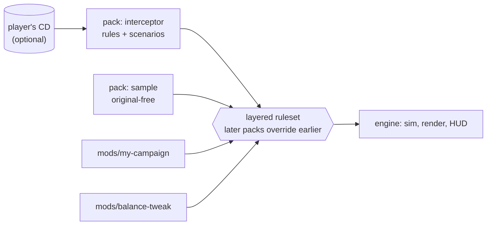

# Modding

**Modding is the main objective of OpenInterceptor.** The engine is a general space-combat
simulator toolkit; *X-COM: Interceptor* is one content pack for it. Everything a game is made of
— ships, weapons, stations, cockpits, scenarios, missions, later the tech tree and the campaign —
is data in a **pack**, and packs layer on top of each other.

The most likely use is a **custom campaign that uses none of the original assets**: your own
models, textures, sounds, rules and missions. Such a pack runs with `--no-original` and can be
shared freely, because it contains nothing of MicroProse's.

## What a mod can do

| Stage | You can change |
|---|---|
| 1 (now) | Ships (model, cockpit, flight model, mounts, hit points), beam weapons, missiles, stations and objects, factions, scenarios with any mix of objects, replacement or additional models (OBJ) and textures (PNG/TGA) |
| 2 | AI behaviours per class, shields/armour, special systems, mines and probes, effects, sounds |
| 3 | Missions with objectives and triggers, wingman chatter, **scripts** |
| 4 | Star map, bases and modules, research tree, manufacturing, economy, enemy strategy |
| 5 | Menus, videos, music |

## Pages

- [Packs](packs.md): folder layout and `pack.ini`.
- [Rulesets and layering](rulesets.md): the rule format and how mods override.
- [Models and textures](models.md): bringing your own art.
- [Scenarios and missions](scenarios.md): placing ships and stations.
- [Scripting](scripting.md) and [Tech tree and campaign](campaign.md): planned.
- [Validating a mod](validating.md): `--check`.
