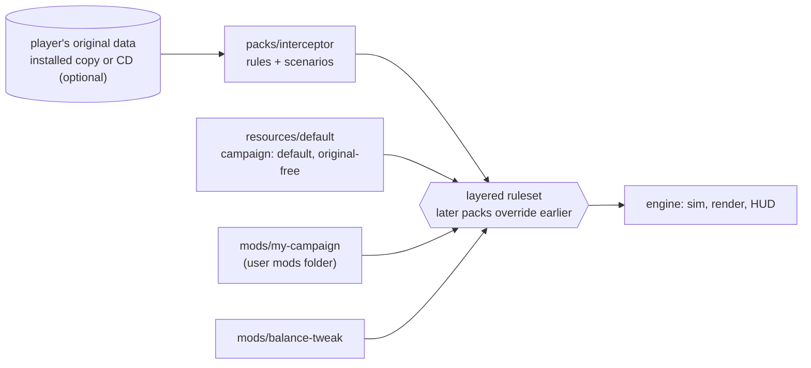

# Modding

**Modding is the main objective of OpenInterceptor.** The engine is a general space-combat
simulator toolkit; *X-COM: Interceptor* is one content pack for it. Everything a game is made of
— ships, weapons, stations, cockpits, scenarios, missions, later the tech tree and the campaign —
is data in a **pack**, and packs layer on top of each other.

The most likely use is a **custom campaign that uses none of the original assets**: your own
models, textures, sounds, rules and missions. Such a pack runs with `--no-original` and can be
shared freely, because it contains nothing of MicroProse's.

## What a mod can do

| Stage | You can change |
|---|---|
| 1 | Ships (model, cockpit, flight values, mounts, hull/armour/shields, energy), the flight model itself (`newtonian` or `assisted`) and arena size, beam weapons, missiles, stations and objects, factions, cockpits (2D art at any resolution, own design space, 3D cockpit models), instrument layout, event sounds, scenarios with any mix of objects and nav points, additional models (OBJ) and textures (PNG/TGA), **per-asset replacement of any original model, texture, image or sound** |
| 2 (in progress) | **Done:** mod kinds (`campaign`, `addon`, `library`) with `parent`, `targets`, `format`; **YAML mod files with schemas** (format 2: units, did-you-mean errors, editor completion); ship systems and special equipment (`systems`, `systems+`), power sharing (`power`), damage to systems and repair (`damage`), capture (`capturable`), hyperspace time, crippled scenario objects (`destroyed_systems`, `hull`), the `power` and `systems` instruments; **AI behaviours** as state machines with the condition language; **difficulty levels** with per-level values and variants; 3D cockpit instruments anchored in perspective and the F12 layout editor; **looks** (model sets with damage textures and states, debris sets, effects); **missile guidance** kinds, damage modes and mines; **station modules** at attachment points; AI target preferences and systems use (cloak, ECM, power); the sound cue table; point defence; sensor and jamming probes; **text keys and translations**. **To come:** XSPT explosions, model-set extras |
| 3 (in progress) | **Done:** missions as data — roles with class lists, counts and arrivals, waves, objectives, optional objectives, timers, outcomes (actions), radio chatter, debriefs; the tablet console's look per campaign and cockpit (`console`, [Console themes](console-themes.md)). **hazards** (asteroid fields, minefields, black holes, ion storms; [Missions › Hazards](missions.md#hazards)); **environments** — orbit, pockets and atmospheric battles over generated or heightmap **terrain** with sky, fog and ground installations ([Environments and terrain](environments.md)); **radio voices** — pilot voice sets, spoken chatter and the computer voice ([Radio voices](voices.md)). **To come:** terrain detail textures and scattered objects, the campaign context, Tier 2 **scripts** |
| 4 (in progress) | **Done (app 0.6.6 – 0.9.2):** [formations](reference.md#formations) for wingmen; the [strategy layer](strategy.md) as data — the start, fixed and generated star maps with lane travel, research with prerequisites and unlocks, items, hulls and fitting, base types and modules with limits and effects, incomes and expenses as expressions, raids that become battles, pilots, scores, saves; the `interceptor` strategy layer from the player's data through [`tech_ids`](strategy.md#tech_ids) (0.8.0); [logistics](strategy.md#logistics) — resources, recipes, facilities, surveys, demand-driven supply convoys, research stations (0.9.0); flown convoy ambushes with cargo containers, tugs and escorts (`ambush_mission`, `cargo:`, `escort:`, waves `every:`, `towable`, `cargo`, the `escort` and `travel` manoeuvres) and the nebula backdrop (0.9.1 – 0.9.2). **To come:** fighter pools, construction strikes, depots, evaluations, designs |
| 5 (in progress) | **Done (app 0.10.0 – 0.10.3):** the [story layer](story.md) — events with choices and mission offers, arcs, rival plans built from interceptable shipments, dynamic relations that stop raids and decide who fights whom in battle, the strategist's aggression, endings and victory/defeat conditions, the encyclopaedia; both campaigns' stories. **To come:** rival logistics and depots, third-party convoys, allied factions in battle, relation effects on prices, the `Think.ini` strategist, the event debugger |
| 6 (in progress) | **Done (app 0.11.0 – 0.13.1):** interactive [music](music.md) sets with states, segments and stingers; [skins](skins.md) — colours, a nine-slice panel and a font — for the menu and strategy screens; chapter **title cards** (`card`); the original's Smacker films (`video`, `campaign.intro_video`, an ending's `video`); engine [cutscenes](cutscenes.md) with keyframed craft, timed fire, cameras, cuts and captions (`campaign.intro`, `play_cutscene`); the cockpit comms panel with speakers' names and faces ([voices](voices.md#faces-on-the-comms-panel) `name`, `face`, chatter `speaker`; app 0.13.1). **To come:** screen layouts and a main menu, X-COM talking heads mapped to speakers, the X-COM wrapper screens, video files other than Smacker, the rest of the cutscene format |

## Two ways to change the game

1. **Rules and scenarios** — YAML files in a pack. Add new ships, weapons and arenas, or change
   any value of an existing one by overriding just that key ([Rulesets](rulesets.md)).
2. **Assets** — drop a file at an original asset's *override path* in a pack and it replaces
   that asset everywhere ([Overrides and extraction](overrides.md)). `openinterceptor
   --extract <folder>` writes every original asset, already converted to OBJ/PNG/WAV, at
   exactly those paths: extract, edit, copy the edited file into your mod.

The simplest useful mod is one file: a repainted cockpit at modern resolution
([walkthrough](overrides.md#walkthrough-repaint-the-cockpit-in-hd)). Replacing the 2D cockpit
with a 3D one is a few lines of rules plus a model ([Cockpits](cockpits.md)).

## Comparison with XWVM

[XWVM](https://www.gamingonlinux.com/2025/06/xwvm-is-a-modern-unity-engine-to-play-star-wars-x-wing-first-alpha-out-now)
plays the original *X-Wing* from the player's own data, and faces the same problem: 1990s
assets by default, modern content when the player wants it. Public sources (a GamingOnLinux
article, a Steam discussion, changelog quotes on Mudspike, and the `scotsdez/xwvm-sidecars-xwing`
repository; ModDB refused automated access) describe its approach:

| | XWVM | OpenInterceptor |
|---|---|---|
| Original assets | Read from the player's install; none shipped | Same |
| Modern content | A separate HD Asset Pack download (new ship models, 3D cockpits, re-recorded music) | Any pack or mod |
| Switching | Whole packs activated in the launcher's *Game Content* screen | Whole packs switched off in `settings.yaml` (`packs: {disabled: […]}`) |
| Granularity | Per pack; no documented per-asset override scheme | **Per asset**: a file at the override path replaces one original asset; everything else still comes from the original data |
| Cockpits | Legacy VGA cockpit or a 3D cockpit with instruments on in-cockpit screens | Original 2D cockpit, HD/widescreen 2D art with its own design space, or a 3D cockpit model with instruments anchored in perspective on its dashboard, placed with the in-game layout editor |
| Missions | "Sidecar" XML beside the unmodified original mission | Scenario YAML files; rules `inherit` from original INI sections without editing them |
| Tools | No public extractor; community format tools | Built-in `--extract` to OBJ/PNG/WAV at override paths |

Both keep original files untouched and never redistribute them. XWVM's lesson on pack
activation (toggling a pack had no effect until a restart path was taken) is why our pack list
is read once, deterministically, at start-up.

## Pages

- [Make your first mod](first-mod.md): a walkthrough starting from the `default` campaign.
- [Packs](packs.md): folder layout, `pack.yaml`, asset references, re-skinning.
- [Rulesets and layering](rulesets.md): the YAML rule format, units, difficulty and how mods override.
- [Behaviours and conditions](behaviours.md): AI state machines and the condition language.
- [Looks: model sets, debris and effects](looks.md): damage textures, wreck states, debris, explosions.
- [Missiles and mines](weapons.md): guidance kinds, damage modes, decoys, cluster, mines.
- [Stations, modules and probes](stations.md): attachment points, turrets, shield generators, sensor and jamming probes.
- [Text and translation](text.md): `@key` text, `text/<language>/`, the original's text by reference.
- [Missions](missions.md): roles, arrivals, waves, objectives, outcomes, chatter, debriefs, hazards; five example missions for environments, hazards and ground installations.
- [Radio voices](voices.md): pilots' voice sets, spoken chatter, the computer voice.
- [Music](music.md): interactive music sets — states, segments, stingers — for battles and the strategy screen.
- [Skins](skins.md): the menu and strategy screens' colours, nine-slice panels and font.
- [Cutscenes](cutscenes.md): engine-played films — keyframed craft, timed fire, cameras and cuts, captions; videos.
- [Environments and terrain](environments.md): orbit, pockets, atmospheric flight, terrains, sky and fog, ground installations.
- [Mod file reference](reference.md): every key of every file type.
- [Models and textures](models.md): bringing your own art.
- [Overrides and extraction](overrides.md): replacing original assets; `--extract`; the HD cockpit walkthrough.
- [Cockpits (HD and 3D)](cockpits.md): cockpit rules, design spaces, 3D cockpits.
- [Console themes](console-themes.md): the tablet console's colours, font and corners, per campaign and per cockpit.
- [Scenarios and missions](scenarios.md): placing ships and stations.
- [Scripting](scripting.md) and [Tech tree and campaign](campaign.md): planned.
- [Validating a mod](validating.md): `--check`.
